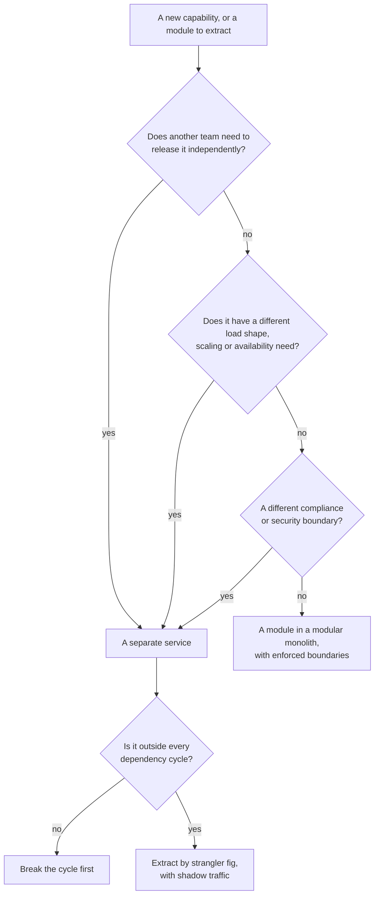
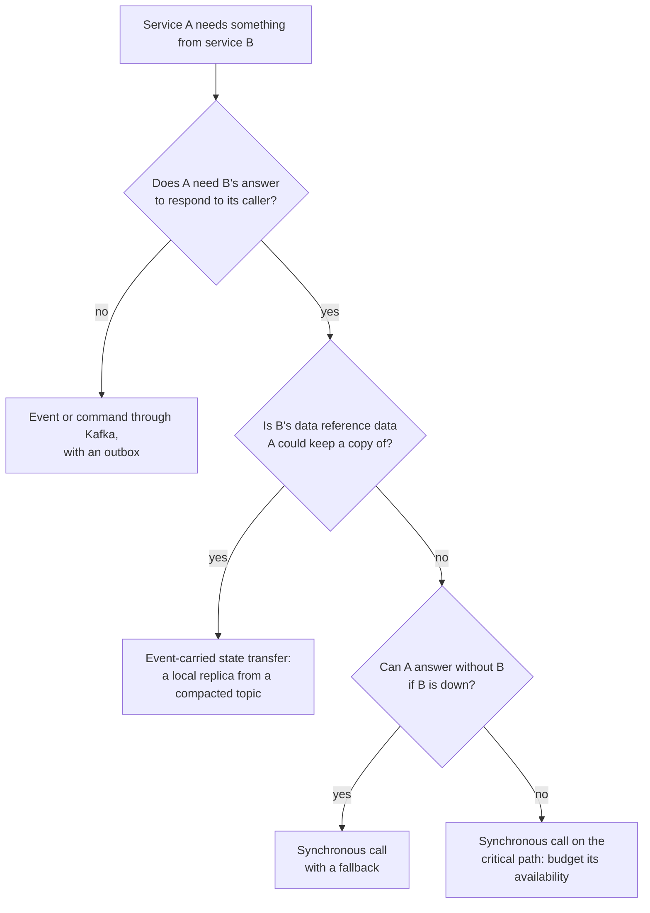
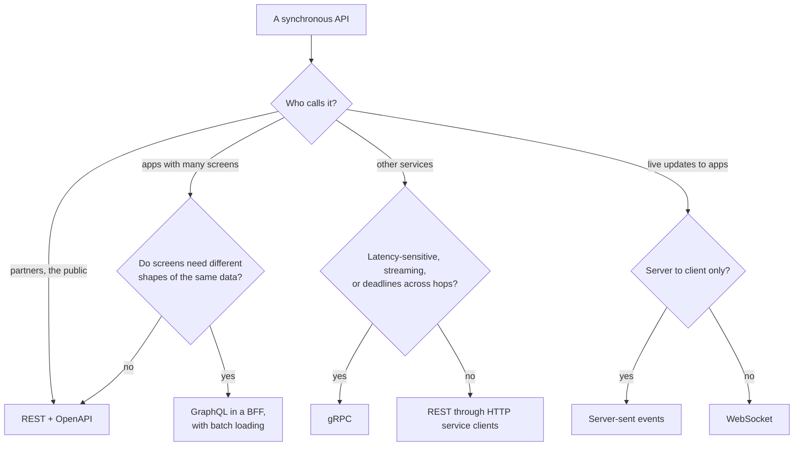
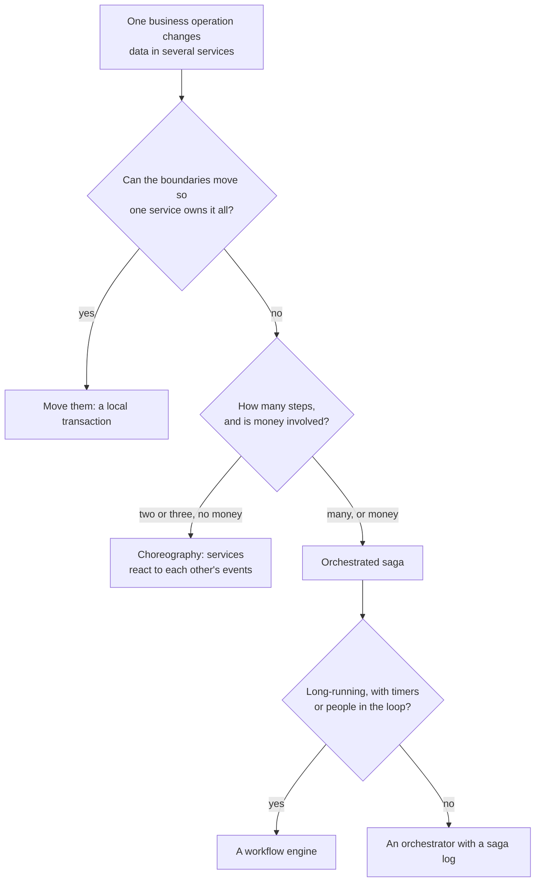
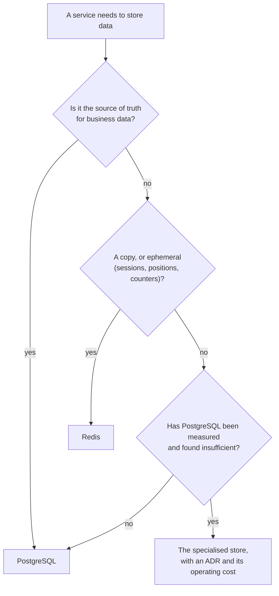
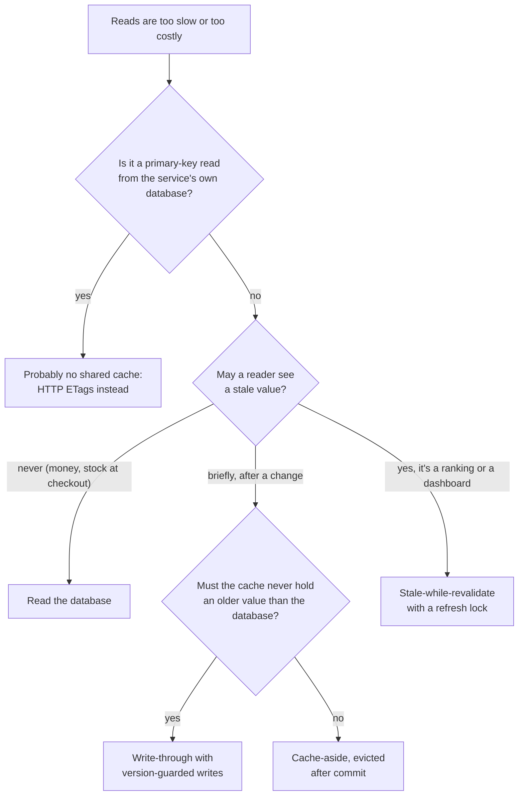
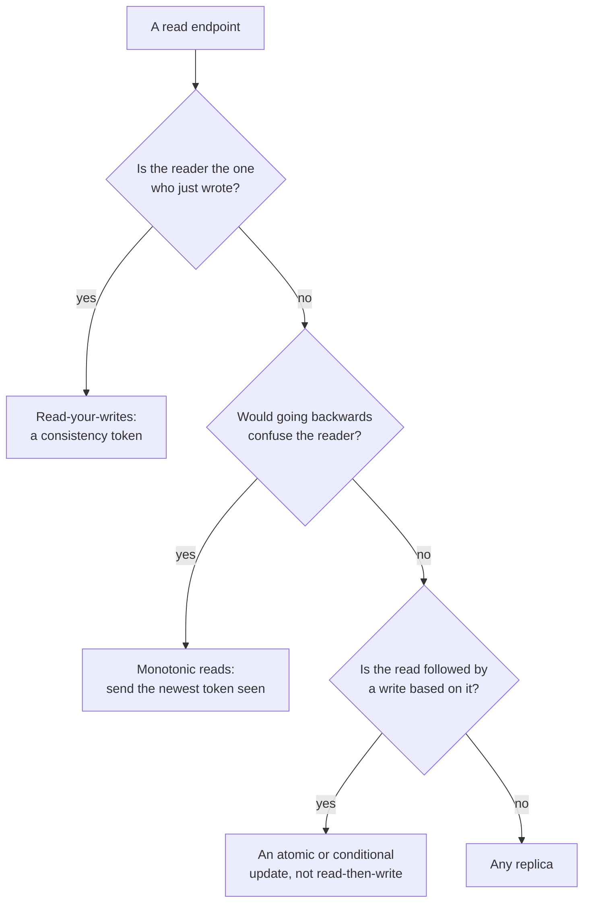
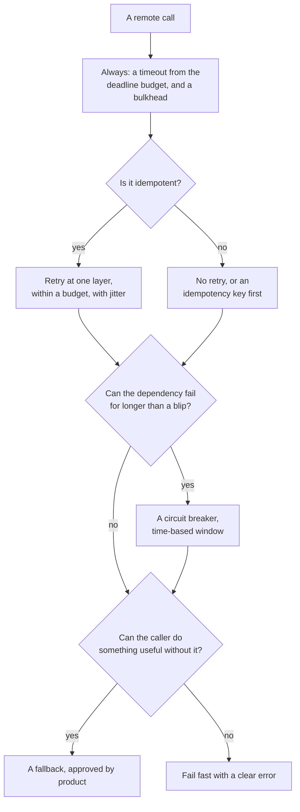
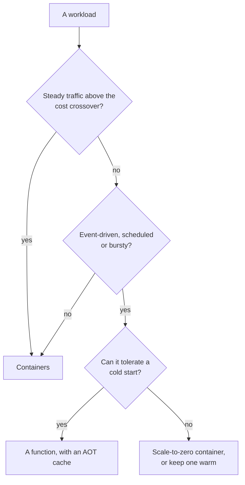
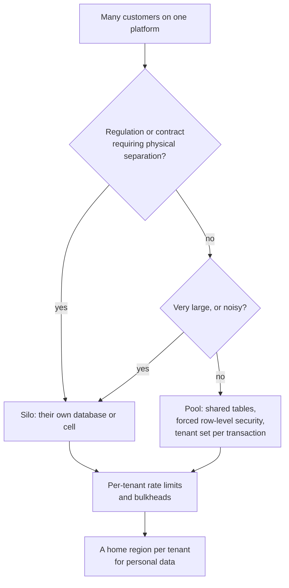

# Pattern Selection Decision Trees

L2 · PractitionerL3 · Senior/LeadL4 · Architect

Each tree turns one chapter's "Choosing" section into questions. They're starting points: the chapter has the measurements and the cases where the obvious branch is wrong.

## 1. Should this be a separate service?

From [chapters 1](../foundations/ch01-architecture-styles.md), [6](../foundations/ch06-service-decomposition.md), [16](../architecture-patterns/ch16-strangler-fig-migration.md) and [74](../governance-org/ch74-maturity-migration-roadmap.md). The close call is extraction order: in chapter 74's real monolith, choosing by independent changes per new remote dependency freed 32% of changes for 340 remote dependencies; choosing the most-changed module first, 33% for 1,083.

## 2. Synchronous or asynchronous?

From [chapters 3](../foundations/ch03-distributed-systems-fundamentals.md), [19](../architecture-patterns/ch19-event-driven-architecture.md) and [25](../communication/ch25-asynchronous-messaging.md). In chapter 19, synchronous calls failed 100% of orders during a catalog outage; state transfer, none. Every required call multiplies availability: four at 99.9% give 99.6%.

## 3. Which protocol for a synchronous call?

From [Part 3](../communication/index.md). GraphQL only with batching: without it, one screen made 19 backend calls instead of REST's 3 ([ch. 24](../communication/ch24-graphql.md)).

## 4. A change that spans services

From [chapters 14](../architecture-patterns/ch14-saga-pattern.md) and [30](../data/ch30-distributed-transactions.md). Never two-phase commit across services: one in-doubt transaction cut a hot dish to 2–6 orders a second. Whatever you choose, participants must be idempotent: 165 double charges in 10,000 sagas without it.

## 5. Which store?

From [chapter 29](../data/ch29-polyglot-persistence.md). PostgreSQL covered menus (JSONB, 14× cheaper than joins), dish search (29 of 29 misspellings found) and history; Redis took positions at 3.8–5.6× PostgreSQL's write rate.

## 6. Which caching strategy?

From [chapter 32](../data/ch32-caching-strategies.md). For menu cards, Redis (2.1–2.2 ms p50) was slower than PostgreSQL's primary-key read (1.7–1.8 ms).

## 7. What consistency does this read need?

From [chapter 31](../data/ch31-data-consistency.md): 15% stale re-reads, 19% backwards polls and 15.5% lost points without these; 0 with them, at 2.9% of reads on the primary.

## 8. Which resilience patterns does this call need?

From [chapters 18](../architecture-patterns/ch18-resilience-patterns.md), [42](../resilience/ch42-failure-modes.md) and [43](../resilience/ch43-resilience4j-deep-dive.md). Retries at three layers sent 27 calls per request to a dead dependency; one layer within a 10% budget, 1.4.

## 9. Function or container?

From [chapter 76](../governance-org/ch76-serverless-microservices.md): functions were cheaper below about 30 thumbnails or 100 fee quotes a second, sustained; the AOT cache cut the JVM part of a cold start from 246–329 ms to 113–196 ms.

## 10. How to isolate tenants?

From [chapter 75](../governance-org/ch75-multi-tenancy-multi-region-compliance.md): a per-session tenant leaked into 177 of 193 forgotten requests, a per-transaction one into none; bulkheads kept other tenants' p99 at 8–11 ms instead of 25–38 ms.
