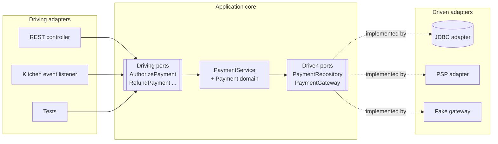
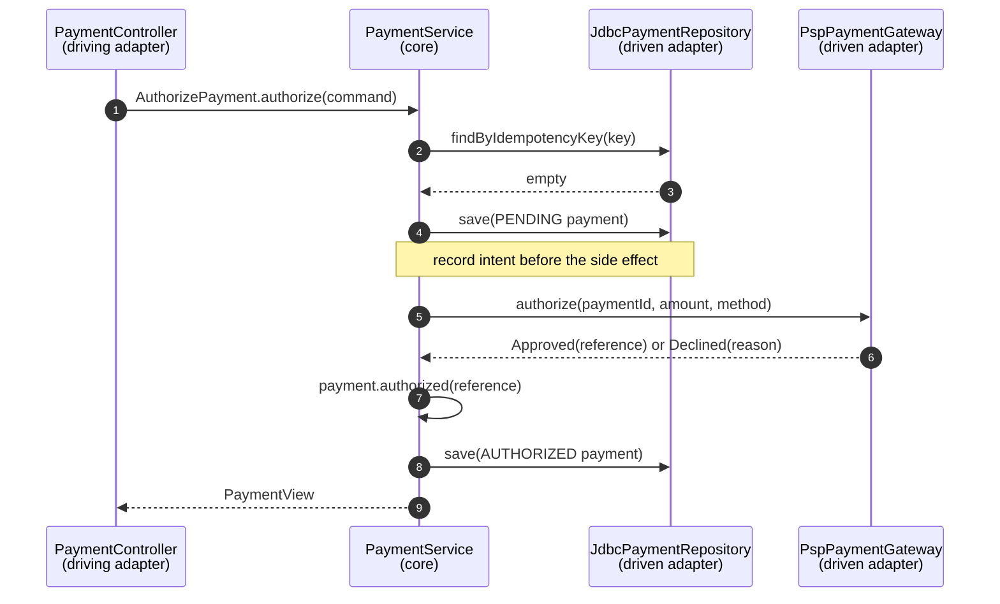

# 9. Hexagonal, Clean & Onion Architecture

<div class="badges" markdown><span class="badge badge-l2">L2 · Practitioner</span><span class="badge badge-l3">L3 · Senior/Lead</span><span class="badge badge-meta">Ports &amp; adapters · JdbcClient · HTTP service clients · ArchUnit onion rule</span></div>

<div class="grid two" markdown>

!!! info "Prerequisites"
    - [Chapter 5](../foundations/ch05-domain-driven-design.md): aggregates, value objects, anti-corruption layer
    - [Chapter 8](../foundations/ch08-spring-boot-4-essentials.md): HTTP service clients, Problem Details
    - Java interfaces and dependency injection

!!! abstract "What you'll learn"
    - What **ports** and **adapters** are, and the difference between **driving** and **driven** sides
    - How hexagonal, onion and clean architecture relate (mostly: the same idea, three drawings)
    - The **dependency rule** and the **composition root**
    - Package structures that make the architecture visible
    - Where transactions and mapping belong, and where they don't
    - Testing a service at four speeds, with **contract tests** that keep fakes honest
    - Enforcing it with **ArchUnit's `onionArchitecture()`**

</div>

---

## 1 · Introduction & Context

### The payment-provider migration

In 2025 FoodFleet moved from one payment provider to another: better UPI success rates, lower fees. The commercial decision took two weeks. The engineering estimate was four months.

The old payment code used the provider's SDK types everywhere. `ProviderPaymentResponse` was returned by the controller, stored in a JPA entity, checked in the refund rules (`if (resp.getStatus().equals("captured"))`) and logged by the reconciliation job. Changing provider meant changing about 140 files, and every one of them was a place where a mistake could charge a customer twice.

After the rewrite this chapter describes, the provider lives behind one interface, `PaymentGateway`, with one adapter per provider. Adding the second provider was **one new adapter class, one translator, one configuration property**. The payment rules didn't change, and their tests didn't change.

That is the promise of hexagonal architecture: **the business logic doesn't depend on the technology around it**, so you can change the technology without touching the logic, and test the logic without the technology.

### Where it comes from

<ul class="mh-timeline">
<li><span class="when">1992 · Ivar Jacobson</span><span class="what">Boundary–Control–Entity objects in <em>Object-Oriented Software Engineering</em>: separate the interface to the outside world from the logic.</span></li>
<li><span class="when">2003 · Eric Evans</span><span class="what">Layered architecture in <em>Domain-Driven Design</em>: an isolated domain layer.</span></li>
<li><span class="when">2005 · Alistair Cockburn</span><span class="what"><strong>Hexagonal architecture</strong>, a.k.a. <strong>ports and adapters</strong>: "allow an application to equally be driven by users, programs, automated test or batch scripts, and to be developed and tested in isolation from its eventual run-time devices and databases."</span></li>
<li><span class="when">2008 · Jeffrey Palermo</span><span class="what"><strong>Onion architecture</strong>: concentric layers, dependencies point inward, infrastructure at the edge.</span></li>
<li><span class="when">2012 · Robert C. Martin</span><span class="what"><strong>Clean architecture</strong> (blog post; book in 2017): entities, use cases, interface adapters, frameworks; the <em>dependency rule</em>.</span></li>
<li><span class="when">2018 · Jimmy Bogard</span><span class="what"><strong>Vertical slice architecture</strong>: organise by feature, not by layer; the main counterpoint.</span></li>
</ul>

---

## 2 · Core Concepts & Terminology

### The hexagon



Port
:   An interface that belongs to the application core and is written in the core's language. **Driving** (primary, inbound) ports are what the outside world can ask the application to do: use cases such as `AuthorizePayment`. **Driven** (secondary, outbound) ports are what the application needs from the outside world: `PaymentRepository`, `PaymentGateway`.

Adapter
:   Code that connects a port to a technology. **Driving adapters** call a driving port (a REST controller, a Kafka listener, a CLI, a test). **Driven adapters** implement a driven port (JDBC repository, payment-provider client, fake).

Application core
:   The domain model plus the application services that implement the driving ports. No framework, no SQL, no HTTP.

Dependency rule
:   Source-code dependencies point **inward**. Adapters depend on the core; the core depends on nothing outside itself. The driven side achieves this through **dependency inversion**: the core defines the interface, the adapter implements it.

Composition root
:   The single place that decides which adapter implements which port (here, Spring `@Configuration` classes). Everything else only knows interfaces.

### Three names, one idea

| | Hexagonal (Cockburn) | Onion (Palermo) | Clean (Martin) |
|---|---|---|---|
| Picture | A hexagon with ports on its edges | Concentric rings | Concentric circles |
| Centre | Application | Domain model | Entities |
| Next ring | (inside the hexagon) | Domain services, then application services | Use cases |
| Edge | Adapters | Infrastructure, UI, tests | Interface adapters, then frameworks and drivers |
| Emphasis | **Symmetry** of driving and driven sides; testability | **Layers** inside the core | **The dependency rule**; use cases as first-class objects |
| Shared rule | Dependencies point inward; the core owns its interfaces | ← same | ← same |

In practice, teams take the **ports and adapters** vocabulary from hexagonal, the **layers inside the core** from onion and clean, and the **dependency rule** from all three. ArchUnit's rule for it is called `onionArchitecture()`.

### Compared with the classic layered architecture

| | Layered (controller → service → repository) | Hexagonal |
|---|---|---|
| Who owns the repository interface | Persistence layer (often a Spring Data interface) | **Core** (a port, in domain terms) |
| Direction of the core → database dependency | Core depends on persistence | Persistence depends on core |
| Can the core run without the database? | Usually not | **Yes**, with a fake adapter |
| Multiple entry points (HTTP, events, batch) | Often duplicated logic | Same driving port, several adapters |
| Cost | Fewer types | More interfaces and mapping |

---

## 3 · How It Works Internally

### One use case, through the ports



The controller only knows `AuthorizePayment`. `PaymentService` only knows `PaymentRepository` and `PaymentGateway`. The JDBC and provider classes are chosen in `config/`. At runtime the calls go outward; at compile time every arrow points inward.

### Package structure

Make the architecture visible in the package names, so a new team member (and ArchUnit) can see it:

```text
payment/
├── domain/                       ← depends on nothing
├── application/
│   ├── port/in/                  ← driving ports: one interface per use case
│   ├── port/out/                 ← driven ports
│   └── service/                  ← implements port/in, uses port/out
├── adapter/
│   ├── in/web/  in/events/       ← call port/in
│   └── out/persistence/  out/gateway/   ← implement port/out
└── config/                       ← composition root
```

Two common variations:

- **Package by feature first** (`payment/`, `refund/`, each with its own `domain`, `application`, `adapter`) once a service has several distinct capabilities. Combine with Spring Modulith ([chapter 1](../foundations/ch01-architecture-styles.md)).
- **Fewer port interfaces**: one `PaymentUseCases` interface instead of one per use case. Fine for small services; per-use-case ports pay off when different adapters need different subsets.

### Where transactions go

The core is plain Java, so it can't carry `@Transactional`. That turns out to be a feature, because it forces a decision:

| Option | When |
|---|---|
| **Each repository call is its own transaction** (the adapter uses `TransactionTemplate`) | The use case calls a remote system between writes (payment-service). Never hold a DB transaction open across a 5-second provider call. |
| A transactional **decorator** around the application service, defined in the composition root | Use cases that only touch the database |
| `@Transactional` on the driving adapter | Simple services; keeps Spring at the edge |

payment-service uses the first: save PENDING, call the provider, save the outcome. A crash between the steps leaves a PENDING record that reconciliation resolves against the provider ([chapter 14](ch14-saga-pattern.md) and [chapter 15](ch15-outbox-inbox-cdc.md) generalise this).

### Mapping between the domain and the outside world

| Boundary | Mapping | In the code |
|---|---|---|
| HTTP ↔ core | Request DTO → command; core result → view | `AuthorizeRequest` → `AuthorizePayment.Command`; `PaymentView` |
| Core ↔ database | Aggregate ↔ rows, by hand | `JdbcPaymentRepository` with `Payment.restore(...)` |
| Core ↔ provider | Port types ↔ provider DTOs, through a translator | `PspTranslator` (an anti-corruption layer, chapter 5) |

Hand-written mapping costs some code. It buys a domain model with no JPA annotations, no Jackson annotations and no provider types, which is what makes the provider migration a one-adapter change.

---

## 4 · Design Considerations & Trade-offs

### When it pays off, and when it doesn't

<div class="mh-axes" markdown>
<div class="mh-axes__y">Business rules in the service →</div>
<div class="mh-axes__cell ok"><strong>Rich rules, one technology</strong>Hexagonal core worth it; keep adapters minimal. Example: pricing rules behind a single REST API.</div>
<div class="mh-axes__cell good"><strong>Rich rules, many integrations</strong>Full ports and adapters. Example: payments (providers, database, events, batch reconciliation).<br><span class="pin">payment-service</span></div>
<div class="mh-axes__cell good"><strong>Thin CRUD</strong>Simple layered code or Spring Data REST. Ports would be ceremony.<br><span class="pin">restaurant-profile</span></div>
<div class="mh-axes__cell ok"><strong>Thin rules, many integrations</strong>An integration service: adapters and translators matter more than the core. Example: notification fan-out.</div>
<div class="mh-axes__x">Number of external technologies and entry points →</div>
</div>

Rule of thumb from [chapter 5](../foundations/ch05-domain-driven-design.md): spend this structure on **core** and **complicated** subdomains; supporting CRUD services can stay simple.

### Testing at four speeds

| Level | Example | Needs | Speed | Catches |
|---|---|---|---|---|
| Domain | `PaymentTest` | Nothing | Microseconds | Rule bugs |
| Use case | `PaymentServiceTest` with in-memory repository and recording gateway | Fakes | Milliseconds | Orchestration bugs, idempotency, side-effect order |
| Adapter | `JdbcPaymentRepositoryTest`, `PspTranslatorTest`, `PaymentControllerTest` | A database, a slice | Sub-second to seconds | Mapping, SQL, HTTP contract |
| Assembled service | `PaymentServiceApplicationTest` | Spring context | Seconds | Wiring |

The trap in the second row is a fake that behaves differently from the real adapter. The fix is a **contract test**: one abstract test class that every implementation of the port must pass. If the in-memory repository passes the same tests as the JDBC one, tests that use it are trustworthy.

### Common objections, honestly

| Objection | Fair? | Response |
|---|---|---|
| "Too many interfaces" | Sometimes | One interface per *port*, not per class. Domain classes and adapters don't need interfaces. |
| "Mapping boilerplate" | Yes | Records and small mappers keep it cheap; it's the price of keeping JPA and provider types out of the core. |
| "We'll never change the database" | Often true | The main benefit is **testability and clarity**, not swapping databases. Payment providers, though, do change. |
| "Spring already gives us DI" | Partly | DI wires objects; the dependency rule decides **which way** the dependencies point. |
| "Vertical slices are simpler" | For many services | Slices and hexagons combine well: slice by feature, apply ports where a slice talks to the outside world. |

---

## 5 · Hands-on Implementation

Code: `code/chapters/ch09-hexagonal-architecture/`, FoodFleet **payment-service** (port 8089).

```bash
cd code
mvn -B -pl chapters/ch09-hexagonal-architecture -am verify
```

### 🔵 Level 2: the core and its ports

<div class="badges" markdown><span class="badge badge-l2">L2 · Practitioner</span></div>

The aggregate enforces the money rules: partial refunds never exceed the captured amount, and state changes follow the lifecycle.

```java title="domain/Payment.java (excerpt)"
--8<-- "code/chapters/ch09-hexagonal-architecture/src/main/java/dev/foodfleet/ch09/payment/domain/Payment.java:42:99"
```

A driving port is a use case; a driven port is a need, in the core's words:

```java title="application/port/in/AuthorizePayment.java"
--8<-- "code/chapters/ch09-hexagonal-architecture/src/main/java/dev/foodfleet/ch09/payment/application/port/in/AuthorizePayment.java"
```

```java title="application/port/out/PaymentGateway.java"
--8<-- "code/chapters/ch09-hexagonal-architecture/src/main/java/dev/foodfleet/ch09/payment/application/port/out/PaymentGateway.java"
```

The application service implements the driving ports by orchestrating the domain and the driven ports:

```java title="application/service/PaymentService.java"
--8<-- "code/chapters/ch09-hexagonal-architecture/src/main/java/dev/foodfleet/ch09/payment/application/service/PaymentService.java"
```

### 🔵 Level 2: driving adapters

<div class="badges" markdown><span class="badge badge-l2">L2 · Practitioner</span></div>

The REST controller depends on four port interfaces, nothing else from the core:

```java title="adapter/in/web/PaymentController.java"
--8<-- "code/chapters/ch09-hexagonal-architecture/src/main/java/dev/foodfleet/ch09/payment/adapter/in/web/PaymentController.java"
```

A second driving adapter on the same port. In production it's a Kafka consumer; the core can't tell the difference:

```java title="adapter/in/events/KitchenRejectionListener.java"
--8<-- "code/chapters/ch09-hexagonal-architecture/src/main/java/dev/foodfleet/ch09/payment/adapter/in/events/KitchenRejectionListener.java"
```

### 🟣 Level 3: driven adapters and the composition root

<div class="badges" markdown><span class="badge badge-l3">L3 · Senior/Lead</span></div>

The JDBC adapter maps the aggregate by hand, with optimistic locking:

```java title="adapter/out/persistence/JdbcPaymentRepository.java (save)"
--8<-- "code/chapters/ch09-hexagonal-architecture/src/main/java/dev/foodfleet/ch09/payment/adapter/out/persistence/JdbcPaymentRepository.java:33:96"
```

The provider adapter: an HTTP service client in the provider's vocabulary, and a translator into ours. An unknown status is never treated as approved:

```java title="adapter/out/gateway/PspTranslator.java"
--8<-- "code/chapters/ch09-hexagonal-architecture/src/main/java/dev/foodfleet/ch09/payment/adapter/out/gateway/PspTranslator.java"
```

Which adapter plugs into which port is configuration:

```java title="config/PaymentConfiguration.java"
--8<-- "code/chapters/ch09-hexagonal-architecture/src/main/java/dev/foodfleet/ch09/payment/config/PaymentConfiguration.java"
```

```java title="config/GatewayConfiguration.java"
--8<-- "code/chapters/ch09-hexagonal-architecture/src/main/java/dev/foodfleet/ch09/payment/config/GatewayConfiguration.java"
```

### 🟣 Level 3: tests at every level, and honest fakes

<div class="badges" markdown><span class="badge badge-l3">L3 · Senior/Lead</span></div>

The whole hexagon in-process, with no Spring and no mocks:

```java title="PaymentServiceTest.java"
--8<-- "code/chapters/ch09-hexagonal-architecture/src/test/java/dev/foodfleet/ch09/payment/application/PaymentServiceTest.java"
```

The repository contract, written once and run against both implementations:

```java title="PaymentRepositoryContract.java"
--8<-- "code/chapters/ch09-hexagonal-architecture/src/test/java/dev/foodfleet/ch09/payment/adapter/out/persistence/PaymentRepositoryContract.java"
```

```java title="JdbcPaymentRepositoryTest.java"
--8<-- "code/chapters/ch09-hexagonal-architecture/src/test/java/dev/foodfleet/ch09/payment/adapter/out/persistence/JdbcPaymentRepositoryTest.java"
```

### 🔴 Level 4: enforce the shape

<div class="badges" markdown><span class="badge badge-l4">L4 · Architect</span></div>

```java title="ArchitectureTest.java"
--8<-- "code/chapters/ch09-hexagonal-architecture/src/test/java/dev/foodfleet/ch09/payment/ArchitectureTest.java"
```

`onionArchitecture()` builds the layer rules from the package lists: domain models depend on nothing else, application services only on the domain, and adapters on both but **never on each other** (the web adapter can't reach into the JDBC adapter). The composition root is exempt because wiring everything is its job.

### Run and verify

```bash
mvn -pl chapters/ch09-hexagonal-architecture spring-boot:run      # H2 + fake gateway

# authorize (send it twice: same payment, one charge)
curl -s -X POST localhost:8089/api/payments -H 'Idempotency-Key: k-1' -H 'Content-Type: application/json' \
  -d '{"orderId":"o-1","amountPaise":87185,"method":{"type":"UPI","reference":"ravi@okaxis"}}' | jq
# { "paymentId": "pay_…", "orderId": "o-1", "amountPaise": 87185, "status": "AUTHORIZED", "refundedPaise": 0 }

# capture, then a partial refund
curl -s -X POST localhost:8089/api/payments/pay_…/capture | jq .status            # "CAPTURED"
curl -s -X POST localhost:8089/api/payments/pay_…/refunds -H 'Content-Type: application/json' \
  -d '{"amountPaise":8625,"reason":"Raita missing"}' | jq '{status, refundedPaise}'   # PARTIALLY_REFUNDED, 8625

# the fake gateway declines fail@upi; a refund above the captured amount is 422
# same Idempotency-Key with a different amount → 409

# switch the driven adapter to the real provider: configuration only
PAYMENT_GATEWAY=psp PSP_URL=https://sandbox.paykaro.example mvn -pl chapters/ch09-hexagonal-architecture spring-boot:run
```

!!! question "Try it"
    1. Add `import org.springframework.stereotype.Service;` and `@Service` to `PaymentService`. Run `ArchitectureTest`. Which rule fails, and why is the composition root the better place?
    2. Make `PaymentController` inject `PaymentRepository` "just to look something up". Which rule catches it?
    3. Add a `findAll()` to `PaymentRepository`. Which classes must change? Now add the method to the contract test first, and watch both implementations fail until they comply.
    4. Write a `CliReconciliationAdapter` (a `CommandLineRunner`) that finds PENDING payments and asks the gateway what happened. Which new port method do you need, and on which side?

---

## 6 · Production Readiness

- [x] **Core is framework-free** and ArchUnit-enforced; Spring, JDBC and HTTP types live only in adapters and the composition root
- [x] **Each driven port has a contract test**; every fake used in tests passes it
- [x] **Translators** for every external system; unknown values fail safe (never "approved", never "delivered")
- [x] **No DB transaction spans a remote call**; intent is recorded before side effects, and a reconciliation job resolves PENDING records
- [x] **Idempotency** at the driving port (Idempotency-Key) and towards the provider (our payment id as the provider's idempotency key)
- [x] **Optimistic locking** in the persistence adapter; conflicts map to 409
- [x] **Error mapping in one place per driving adapter** (Problem Details for HTTP, dead-letter handling for messages, [chapter 25](../communication/ch25-asynchronous-messaging.md))
- [x] **Adapter selection by configuration** is visible at startup (log which `PaymentGateway` implementation is active) and guarded in production (the fake can't be enabled with a production profile)
- [x] **Migrations** (Flyway) own the schema in production; `schema.sql` is for the embedded database only ([chapter 12](ch12-database-per-service.md))

---

## 7 · Anti-patterns & Pitfalls

!!! pitfall "Incident 1: the provider SDK everywhere"
    **Context.** Before 2025, payment code passed the provider SDK's response objects through every layer.
    **Symptoms.** A provider SDK upgrade renamed a status from `captured` to `CAPTURED`. Refund eligibility checks silently returned false, and about 300 customers were told their refunds were "not possible" over a weekend.
    **Root cause.** No boundary: provider vocabulary had reached the business rules.
    **Fix.** The `PaymentGateway` port in FoodFleet's vocabulary, a translator with tests per provider status, and an ArchUnit rule that provider types stay in `adapter.out.gateway`.

!!! pitfall "Incident 2: a transaction around a phone call"
    **Context.** An earlier version put `@Transactional` on the whole authorize use case.
    **Symptoms.** During a provider slowdown (5 s per authorization), the database connection pool (20 connections) was exhausted within seconds; even `GET /payments/{id}` timed out.
    **Root cause.** Each request held a DB connection and transaction open while waiting for the provider.
    **Fix.** Short transactions per repository call; record PENDING first, call the provider, record the outcome; reconciliation for the gap.

!!! pitfall "Incident 3: the port that mirrored the database"
    **Context.** A team's repository port grew methods like `findByStatusAndCreatedAtBetweenOrderByAmountDesc` and `executeNativeQuery(String sql)`.
    **Symptoms.** The in-memory fake couldn't keep up; tests switched to mocks; mocks drifted from the real behaviour; a production bug passed all tests.
    **Root cause.** The port described the *adapter's* capabilities, not the *core's* needs.
    **Fix.** Ports in use-case language (`findActiveByOrderId`), queries for reporting moved to a separate read model ([chapter 13](ch13-cqrs-event-sourcing.md)), and contract tests for every port.

| Anti-pattern | Symptom | Fix |
|---|---|---|
| JPA entities as the domain model | Lazy-loading exceptions in business rules; setters everywhere | Separate persistence model, or Spring Data JDBC aggregates; mapping in the adapter |
| Interface for every class | "Impl" suffixes, navigation pain | Interfaces only for ports |
| Driving adapter calls driven adapter | Controller uses the repository directly | Go through a use case; ArchUnit rule |
| Business rules in adapters | `if` statements in controllers and listeners | Move to domain or application service |
| Mocks instead of fakes for driven ports | Tests pass, production fails | Fakes plus contract tests |
| Shared "common" core across services | Lock-step releases | One hexagon per service; share libraries only for technical code |
| Ports in the adapter's package | Core imports adapter packages to see its own interfaces | Ports live in `application.port` |

---

## 8 · Enterprise Case Study

### FoodFleet: two providers, one core

!!! decision "ADR-009: payment-service uses ports and adapters; provider integrations are adapters"
    **Status:** Accepted · **Date:** 2025-06-02

    **Context.** Payments are a complicated subsystem (chapter 7) with many integrations: two providers (with a third under evaluation), PostgreSQL, events from kitchen and ordering, and nightly reconciliation. Provider vocabulary leaking into business rules caused a refund incident.

    **Decision.** Hexagonal structure with `application.port.in`/`out` packages, one adapter per provider behind `PaymentGateway`, hand-written mapping, translators with fail-safe defaults, contract tests for every driven port, and ArchUnit's onion rule in CI. Provider selection per payment method is a configuration and routing concern in the gateway adapter layer.

    **Consequences.** ✅ Adding the second provider took one sprint, with no change to payment rules. ✅ The core's tests run in under a second. ⚠️ More types and explicit mapping; new joiners need a short guide (this chapter). ⚠️ Reporting queries go to a separate read model instead of the repository port.

### Fintech analogue: the core ledger behind ports 🔴

Banks and payment companies often run several rails (UPI, IMPS, NEFT/RTGS, card networks) and several providers per rail, each with its own message formats (ISO 8583, ISO 20022, proprietary JSON). Teams that keep the **ledger and payment rules** in a core with ports (`PaymentRail`, `LedgerPostings`, `FraudCheck`), and put each rail behind an adapter with a translator, can add a rail or switch a provider without re-certifying the core logic. Regulators and auditors benefit too: the rules are in one place, readable without reading HTTP or SQL code.

### E-commerce analogue: one checkout, many channels

A large marketplace's checkout is driven by many adapters: web, Android and iOS apps (through BFFs), partner APIs, voice assistants, and back-office tools for customer support. With checkout as a hexagon, each channel is a driving adapter on the same `PlaceOrder` port, so business rules (pricing, limits, fraud checks) can't diverge between channels. The same pattern works on the driven side for warehouses and logistics partners.

---

## 9 · Interview Q&A + Summary

#### Q1. Explain hexagonal architecture. · <span class="badge badge-l2">L2</span> · Cognizant · TCS · SAP

**Short answer:** The application core (domain and use cases) is isolated from technology. It talks to the outside world through **ports**, interfaces it owns; **adapters** connect ports to technologies. Driving adapters (REST, messaging, tests) call driving ports; driven adapters (database, external APIs) implement driven ports. Dependencies point inward, so the core can be tested and changed without its infrastructure.

#### Q2. What's the difference between driving and driven ports? · <span class="badge badge-l2">L2</span> · Infosys · Accenture

**Short answer:** Driving (primary) ports are what the application offers: use cases, called by adapters such as controllers. Driven (secondary) ports are what the application needs: repositories, gateways, publishers, implemented by adapters. Both are defined by the core.

#### Q3. Hexagonal vs onion vs clean architecture? · <span class="badge badge-l3">L3</span> · SAP · Goldman Sachs

**Short answer:** Same core idea (inward-pointing dependencies, framework-free core) drawn differently. Hexagonal emphasises the symmetry of inbound and outbound adapters; onion emphasises concentric layers inside the core; clean architecture adds use cases as explicit objects and names the dependency rule. Most teams mix the vocabulary.

#### Q4. How does this differ from controller–service–repository layering? · <span class="badge badge-l2">L2</span><span class="badge badge-l3">L3</span> · Flipkart · Amazon

**Short answer:** In layering, the service depends on the persistence layer. In hexagonal, the core defines the repository interface and persistence depends on the core (dependency inversion). That lets the core run with a fake, keeps persistence types out of business rules, and supports several entry points on the same use cases.

#### Q5. Where do you put `@Transactional` in a hexagonal service? · <span class="badge badge-l3">L3</span> · JP Morgan · Goldman Sachs

**Short answer:** Not on domain code. Options: a transactional decorator around the application service in the composition root, `@Transactional` on the driving adapter, or short transactions inside repository adapters. If the use case calls a remote system, never hold a DB transaction across the call: record intent, call, record outcome, reconcile the gap.

**Red flags:** "One `@Transactional` around everything, including the payment-provider call."

#### Q6. How do you test a hexagonal service? · <span class="badge badge-l3">L3</span> · Amazon · Flipkart

**Short answer:** Domain unit tests; use-case tests through driving ports with fake driven adapters (in-memory repository, recording gateway); adapter tests against real infrastructure (embedded DB or Testcontainers, `@WebMvcTest`, translator tests); a few assembled-service tests. Keep fakes honest with **contract tests** that both the fake and the real adapter must pass.

#### Q7. Should JPA entities be your domain model? · <span class="badge badge-l3">L3</span> · Goldman Sachs · SAP

**Short answer:** For core domains, usually not: JPA requires no-arg constructors, mutable fields and proxies, and lazy loading leaks persistence concerns into rules. Map between a clean domain model and persistence in the adapter, or use Spring Data JDBC, which respects aggregate boundaries. For simple CRUD services, JPA entities as the model are fine.

#### Q8. What's an anti-corruption layer in a hexagonal service? · <span class="badge badge-l3">L3</span> · JP Morgan · SAP

**Short answer:** The translator inside a driven adapter that converts an external model (a payment provider's statuses and error codes) into the core's model. It's where interpretation decisions live, with fail-safe defaults for unknown values.

#### Q9. Isn't this over-engineering for microservices, which are small anyway? · <span class="badge badge-l3">L3</span><span class="badge badge-l4">L4</span> · Flipkart · Amazon

**Short answer:** For thin CRUD services, yes. For services with real rules and several integrations (payments, pricing, dispatch), the core is where the value is, and keeping it independent pays back in testability and change safety. Decide per service based on rule complexity and number of integrations, not as a company-wide mandate.

#### Q10. How do you enforce the architecture over time? · <span class="badge badge-l3">L3</span> · any Spring shop

**Short answer:** Package structure that names the parts, ArchUnit rules in the build (`onionArchitecture()`, framework-free core, driving adapters use ports only), code review checklists, and templates for new services. Rules in CI catch violations on day one rather than in a review six months later.

#### Q11. How would you add a new payment provider? · <span class="badge badge-l3">L3</span><span class="badge badge-l4">L4</span> · Goldman Sachs · Flipkart

**Short answer:** A new driven adapter implementing `PaymentGateway`: an HTTP client in the provider's vocabulary, a translator with tests for every status and error code (unknown means "not approved"), idempotency keys per call, error mapping to the port's exceptions. Run it against the gateway contract test and the provider's sandbox, then route a small percentage of traffic to it by configuration.

#### Q12. Hexagonal or vertical slice architecture? · <span class="badge badge-l3">L3</span> · startups · consulting firms

**Short answer:** They answer different questions. Vertical slices organise code by feature, minimising coupling between features; hexagonal organises the boundary between logic and technology. Many teams slice by feature and use ports where a slice touches infrastructure.

### Key takeaways

- **The core owns its interfaces.** Driving ports are use cases, driven ports are needs, written in the core's language.
- **Dependencies point inward**; a **composition root** chooses adapters.
- Keep transactions short and **never across a remote call**; record intent before side effects.
- Test at four speeds, and keep fakes honest with **contract tests**.
- Use it where rules and integrations justify it, and **enforce** it with ArchUnit.

### Further reading

- Alistair Cockburn, [Hexagonal architecture](https://alistair.cockburn.us/hexagonal-architecture/) (2005), and *Hexagonal Architecture Explained* (with Juan Manuel Garrido de Paz, 2024)
- Jeffrey Palermo, [The Onion Architecture](https://jeffreypalermo.com/2008/07/the-onion-architecture-part-1/) (2008)
- Robert C. Martin, [The Clean Architecture](https://blog.cleancoder.com/uncle-bob/2012/08/13/the-clean-architecture.html) (2012) and *Clean Architecture* (2017)
- Tom Hombergs, *Get Your Hands Dirty on Clean Architecture*, 2nd ed. (Packt, 2023)
- Jimmy Bogard, [Vertical Slice Architecture](https://www.jimmybogard.com/vertical-slice-architecture/) (2018)
- ArchUnit user guide, [Architectures: onion architecture](https://www.archunit.org/userguide/html/000_Index.html#_onion_architecture)

---

**Previous:** [← 8. Spring Boot 4 Essentials](../foundations/ch08-spring-boot-4-essentials.md) · **Next:** [10. API Gateway & Backend for Frontend →](ch10-api-gateway-bff.md)
