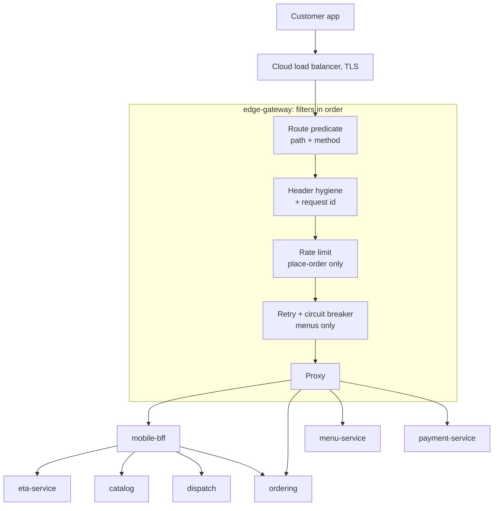

# 10. API Gateway & Backend for Frontend

<div class="badges" markdown><span class="badge badge-l2">L2 · Practitioner</span><span class="badge badge-l3">L3 · Senior/Lead</span><span class="badge badge-meta">Spring Cloud Gateway Server Web MVC · Resilience4j · HTTP service clients · virtual threads</span></div>

<div class="grid two" markdown>

!!! info "Prerequisites"
    - [Chapter 2](../foundations/ch02-characteristics-principles.md) (API evolution) and [Chapter 3](../foundations/ch03-distributed-systems-fundamentals.md) (latency, retries, idempotency)
    - [Chapter 8](../foundations/ch08-spring-boot-4-essentials.md): HTTP service clients, virtual-thread fan-out, API versioning
    - [Chapter 9](ch09-hexagonal-clean-architecture.md): why payments must not be retried blindly

!!! abstract "What you'll learn"
    - What belongs at the edge (**routing**, **offloading**, **protection**) and what never does (business logic)
    - Gateway vs BFF vs ingress vs service mesh vs load balancer
    - Building an edge with **Spring Cloud Gateway Server Web MVC**: routes as code, custom filters, retry, circuit breaker, fallback
    - **Rate limiting** with a token bucket, and what "per instance" really means
    - The **Backend for Frontend** pattern: one endpoint per screen, owned by the client team, aggregated in parallel with graceful degradation
    - Testing an edge against stub backends

</div>

---

## 1 · Introduction & Context

### Fourteen front doors

In 2023 the FoodFleet app talked to services directly. `menu.foodfleet.in`, `orders.foodfleet.in`, `payments.foodfleet.in` and eleven others each had a public DNS name, a TLS certificate, CORS settings and their own copy of token validation. Three things went wrong:

- **Security drifted.** One service forgot to validate tokens on a new endpoint. Another trusted an `X-Customer-Id` header sent by the client.
- **The app became a distributed system.** The order-tracking screen made four sequential calls (order, ETA, restaurant, rider) over a mobile network. On a typical 4G connection that was most of a second before anything appeared, and when one call failed the screen showed an error even though the other three had answered.
- **Services couldn't change.** Splitting `orders` into two services meant an app release, and old app versions stay installed for months.

The fix has two parts. An **API gateway** gives the system one front door that routes, protects and observes every request. A **Backend for Frontend** (BFF) gives each client one endpoint per screen, so the app makes one call and the joining happens in the data centre, close to the services.

### A short history of the edge

<ul class="mh-timeline">
<li><span class="when">2000s · Hardware load balancers and ESBs</span><span class="what">F5-style appliances route traffic; enterprise service buses do routing <em>and</em> transformation <em>and</em> business rules, which becomes the cautionary tale.</span></li>
<li><span class="when">2013 · Netflix Zuul</span><span class="what">An edge service with dynamic routing and filters for many device types; Netflix also runs a device-specific API adaptation layer.</span></li>
<li><span class="when">2015 · BFF</span><span class="what">Phil Calçado describes SoundCloud's <strong>Backends for Frontends</strong>; Sam Newman's write-up popularises the name.</span></li>
<li><span class="when">2015–2017 · Kong, Envoy, Spring Cloud Gateway</span><span class="what">Programmable gateways and proxies; Spring Cloud Gateway (WebFlux) replaces Zuul 1 in the Spring ecosystem.</span></li>
<li><span class="when">2023 · Gateway API, Gateway Server MVC</span><span class="what">Kubernetes <strong>Gateway API</strong> v1.0 (the successor of Ingress); Spring Cloud Gateway adds a <strong>Server Web MVC</strong> variant that runs on servlet stacks and virtual threads.</span></li>
</ul>

---

## 2 · Core Concepts & Terminology

### What the edge does

The classic catalogue (from Microsoft's cloud design patterns) groups gateway jobs into three patterns:

Gateway routing
:   One public host and path space; the gateway forwards each request to the right service. Services can move, split and merge behind it without clients noticing.

Gateway offloading
:   Cross-cutting work done once at the edge instead of in every service: TLS termination, authentication (validating tokens), rate limiting, request ids, request size limits, CORS, compression, header hygiene.

Gateway aggregation
:   One client request becomes several backend calls whose results are combined. Useful, but it is the start of a slippery slope: aggregation is better done in a BFF, where it belongs to the client team.

### The four things often called "the gateway"

| Component | Layer | Typical jobs | Owned by | FoodFleet |
|---|---|---|---|---|
| **Load balancer / Ingress / Gateway API** | L4/L7, cluster edge | TLS, host and path routing to Kubernetes services | Platform | Cloud load balancer + Gateway API |
| **API gateway** | L7, application edge | Public API surface, auth, rate limits, request ids, retries, circuit breakers | Platform | `edge-gateway` (this chapter) |
| **BFF** | Application | Screen-shaped endpoints, aggregation, formatting for one client | **Client team** | `mobile-bff`, `partner-bff` |
| **Service mesh** | L7, east–west | mTLS, retries and telemetry between services | Platform | [Chapter 38](../security/ch38-service-to-service-security.md) and [chapter 17](ch17-sidecar-ambassador-adapter.md) |

The rule of thumb: **north–south traffic** (clients to the system) goes through the gateway; **east–west traffic** (service to service) does not, so the gateway never becomes a bottleneck or a hidden dependency between services.

### BFF in one paragraph

A **Backend for Frontend** is a small service built for one kind of client (the customer app, the partner portal, the rider app) and **owned by the team that builds that client**. It exposes endpoints shaped like screens ("everything the tracking screen needs"), calls the domain services in parallel, tolerates partial failure, and formats data for display. It holds no domain rules: those stay in the services (chapter 6). Because each channel has its own BFF, the web team can change their API without a meeting with the app team.

---

## 3 · How It Works Internally

### A request through the edge



Spring Cloud Gateway Server Web MVC builds on Spring's functional web framework (WebMvc.fn):

- A **route** is a `RouterFunction`: an id, a predicate (`GET /api/menus/**`), a handler (`http()`, which proxies) and filters.
- **Before filters** are `Function<ServerRequest, ServerRequest>`: they rewrite the request (set the backend URI, remove headers, add a request id).
- **Filters** are `HandlerFilterFunction`s that wrap the call: they can short-circuit (rate limit returns 429 without calling the backend), retry, or catch failures (circuit breaker forwards to a fallback).
- Routes combined with `.and(...)` are tried **in order**, so specific routes (`/api/orders/{id}/eta`) come before general ones (`/api/orders/**`).
- It runs on the servlet stack, so with `spring.threads.virtual.enabled=true` each proxied request waits on a virtual thread (chapter 8).

### Token bucket rate limiting

Each client key (IP address now, token subject once authentication is added in [chapter 36](../security/ch36-oauth2-oidc-jwt.md)) has a bucket:

- The bucket holds at most **capacity** tokens (FoodFleet: 5) and refills continuously (10 per minute).
- A request takes one token; with none left, the answer is **429 Too Many Requests** with `Retry-After` set to when the next token arrives.
- Bursts up to the capacity are allowed, which suits humans (tap, tap, tap) and stops scripts.

| Algorithm | Behaviour | Trade-off |
|---|---|---|
| Fixed window | N per minute, counter resets on the minute | Allows 2N across a window boundary |
| Sliding window | N in any 60-second span | More state per client |
| **Token bucket** | Burst up to capacity, steady refill rate | Two parameters to tune; the common choice for APIs |
| Leaky bucket | Smooths output to a constant rate | Adds queueing delay |

!!! warning "Per instance is not global"
    The chapter's limiter keeps buckets in memory, so with 4 gateway replicas a client can get up to 4× the limit (depending on how the load balancer spreads requests). That's fine for abuse protection. For contractual quotas (partner APIs, paid tiers) use a shared store: Redis, or Bucket4j's distributed proxy managers, which Spring Cloud Gateway MVC's `RateLimiter` filter supports.

### Why the BFF is faster: latency arithmetic

Assume a mobile round trip of about 100 ms and backend calls of 30–60 ms inside the data centre (illustrative numbers):

| | Calls over the mobile network | Approximate time to render |
|---|---|---|
| App calls 4 services in sequence | 4 | 4 × (100 + ~45) ≈ **580 ms** |
| App calls 4 services in parallel | 4 (concurrent) | 100 + 60 ≈ 160 ms, but 4× the radio use, 4 TLS sessions, 4 failure points in the app |
| **App calls the BFF once** | 1 | 100 + order (40) + max(eta, restaurant, rider) (60) ≈ **200 ms**, one failure point, partial results |

The BFF's other gains don't show up in the timing: smaller payloads (it binds 5 of the order's 30 fields), one place to fix a display bug for all app versions, and partial failure handled once.

---

## 4 · Design Considerations & Trade-offs

### What belongs where

| Concern | Gateway | BFF | Domain service |
|---|:---:|:---:|:---:|
| TLS, routing, request ids | ✅ | | |
| Token validation, rate limits, request size limits | ✅ | | |
| Coarse authorization ("must be logged in") | ✅ | ✅ | |
| Fine authorization ("this order is yours") | | | ✅ |
| Aggregating several services for one screen | | ✅ | |
| Formatting for display (times, currency, labels) | | ✅ | |
| Business rules (prices, refunds, availability) | | | ✅ |
| Retries | Idempotent reads only | Per call, with budgets | Per call, with budgets |

!!! pitfall "The gateway is not an ESB"
    The moment a gateway validates coupons, computes prices or maps one service's response into another's request, it has become a shared monolith that every team must change and nobody owns. Keep it **generic**: routing, protection, observability. Put client-specific shaping in BFFs and business rules in services.

### Spring Cloud Gateway: MVC or WebFlux?

| | Gateway Server Web MVC | Gateway Server WebFlux |
|---|---|---|
| Stack | Servlet (Tomcat/Jetty), virtual threads | Reactor Netty, non-blocking |
| Custom filters | Plain functions, blocking calls allowed | Reactive types (`Mono`) |
| Streaming, WebSockets, very high connection counts | Adequate for most | Strongest |
| Fit with FoodFleet's MVC golden path (chapter 8) | ✅ | Different programming model |

FoodFleet uses **Web MVC** for the API edge and keeps WebFlux for the live-tracking stream ([chapter 26](../communication/ch26-websockets-sse.md)).

### Build or buy the gateway?

| Option | Strengths | Watch out for |
|---|---|---|
| **Spring Cloud Gateway** | Routes and filters in Java, same tooling as the services, easy custom logic | You operate it; custom logic tempts business rules |
| Envoy-based (Envoy Gateway, Istio ingress, Contour) | High performance, Kubernetes Gateway API native | Extensions in Lua/Wasm or external services |
| Kong, Apigee, Tyk | Developer portal, API keys, monetisation, analytics | Licence cost; configuration outside your codebase |
| Cloud API gateways (AWS, Azure, GCP) | Managed, integrated with cloud auth | Per-request pricing; vendor-specific config |

Many organisations run two layers: a managed or Envoy-based **ingress** for TLS and coarse routing, and an application gateway for API-specific policies. Avoid more layers than that; each one adds latency and a place for configuration to drift.

### One BFF per channel, or one shared API?

| | One BFF per client type | One general-purpose API (or GraphQL) |
|---|---|---|
| Ownership | Client team owns its BFF | Platform or API team owns it |
| Change speed | Fast; no cross-team negotiation | Every client's needs compete |
| Duplication | Some (two BFFs call the same services) | Little |
| Best when | Clients differ a lot (mobile app vs partner portal vs rider app) | Clients are similar, or GraphQL lets each query what it needs |

FoodFleet runs three BFFs (customer app, partner portal, rider app). A web BFF was merged into the app BFF when the web and app screens converged: a BFF should follow **client experiences**, not technologies.

---

## 5 · Hands-on Implementation

Code: `code/chapters/ch10-api-gateway-bff/`, two deployables: **edge-gateway** (8080) and **mobile-bff** (8090).

```bash
cd code
mvn -B -pl chapters/ch10-api-gateway-bff/gateway,chapters/ch10-api-gateway-bff/mobile-bff -am verify
```

### 🔵 Level 2: routes as code

<div class="badges" markdown><span class="badge badge-l2">L2 · Practitioner</span></div>

The whole public API surface in one router, most specific routes first. Note what each route *doesn't* do: payments get no gateway retries, because a retried POST is only safe with an `Idempotency-Key` (chapter 9):

```java title="gateway/EdgeRoutes.java"
--8<-- "code/chapters/ch10-api-gateway-bff/gateway/src/main/java/dev/foodfleet/ch10/gateway/EdgeRoutes.java:32:78"
```

```yaml title="gateway/application.yml"
--8<-- "code/chapters/ch10-api-gateway-bff/gateway/src/main/resources/application.yml"
```

### 🔵 Level 2: offloading with filter functions

<div class="badges" markdown><span class="badge badge-l2">L2 · Practitioner</span></div>

Two custom filters: hygiene (remove headers only the platform may set, guarantee a request id) and rate limiting (short-circuit with a 429 Problem Details response):

```java title="gateway/EdgeFilters.java"
--8<-- "code/chapters/ch10-api-gateway-bff/gateway/src/main/java/dev/foodfleet/ch10/gateway/EdgeFilters.java"
```

```java title="gateway/TokenBucketRateLimiter.java"
--8<-- "code/chapters/ch10-api-gateway-bff/gateway/src/main/java/dev/foodfleet/ch10/gateway/TokenBucketRateLimiter.java"
```

### 🟣 Level 3: the mobile BFF

<div class="badges" markdown><span class="badge badge-l3">L3 · Senior/Lead</span></div>

Four downstream services as HTTP service clients. eta-service is always asked for API version 2.0 through configuration (`spring.http.serviceclient.eta.apiversion.*`, see `application.yml` below):

```java title="mobile-bff/client/Downstream.java"
--8<-- "code/chapters/ch10-api-gateway-bff/mobile-bff/src/main/java/dev/foodfleet/ch10/bff/client/Downstream.java"
```

Two-phase aggregation: the order is required; ETA, restaurant and rider load in parallel on virtual threads within a 600 ms budget, and each may fail on its own:

```java title="mobile-bff/tracking/TrackingScreenService.java"
--8<-- "code/chapters/ch10-api-gateway-bff/mobile-bff/src/main/java/dev/foodfleet/ch10/bff/tracking/TrackingScreenService.java:51:92"
```

The screen logic, pure and unit-tested: titles per status (tolerant of statuses that don't exist yet), IST time windows, rupees with Indian digit grouping, and which buttons to show:

```java title="mobile-bff/tracking/TrackingCardAssembler.java"
--8<-- "code/chapters/ch10-api-gateway-bff/mobile-bff/src/main/java/dev/foodfleet/ch10/bff/tracking/TrackingCardAssembler.java:25:104"
```

```yaml title="mobile-bff/application.yml"
--8<-- "code/chapters/ch10-api-gateway-bff/mobile-bff/src/main/resources/application.yml"
```

### 🟣 Level 3: testing the edge

<div class="badges" markdown><span class="badge badge-l3">L3 · Senior/Lead</span></div>

The real gateway on a random port in front of stub backends that echo what they received:

```java title="gateway/EdgeGatewayIntegrationTest.java (tests)"
--8<-- "code/chapters/ch10-api-gateway-bff/gateway/src/test/java/dev/foodfleet/ch10/gateway/EdgeGatewayIntegrationTest.java:62:107"
```

The BFF's fan-out against a scripted stub, including a slow ETA that degrades only the ETA:

```java title="mobile-bff/TrackingScreenIntegrationTest.java (tests)"
--8<-- "code/chapters/ch10-api-gateway-bff/mobile-bff/src/test/java/dev/foodfleet/ch10/bff/tracking/TrackingScreenIntegrationTest.java:64:102"
```

### Run and verify

```bash
mvn -pl chapters/ch10-api-gateway-bff/gateway spring-boot:run
mvn -pl chapters/ch10-api-gateway-bff/mobile-bff spring-boot:run

curl -s localhost:8080/bff/mobile/v1/orders/o-1/tracking | jq
# {
#   "orderId": "o-1",
#   "title": "On the way",
#   "subtitle": "from Biryani House, Koramangala",
#   "etaText": "Arriving 8:24–8:30 pm",
#   "etaApproximate": false,
#   "rider": { "name": "Ravi", "vehicle": "Scooter KA-01-AB-1234" },
#   "total": "₹871.85",
#   "actions": ["CALL_RIDER", "HELP"],
#   "degraded": []
# }

# spoofed headers never reach services; every request gets an X-Request-Id
curl -s localhost:8080/api/orders/o-1 -H 'X-Customer-Id: someone-else'

# the sixth order within a few seconds from one client:
# HTTP/1.1 429  Retry-After: 6  {"title":"Slow down", ...}
```

!!! question "Try it"
    1. Move the `orders` route above the `eta` route. Which request now goes to the wrong service, and which test catches it?
    2. Add `.filter(retry(...))` to the `payments` route with `POST` in the methods. Describe the failure that makes this dangerous, then remove it.
    3. Run two gateway instances on different ports and send 8 orders alternating between them. How many get through? Why?
    4. Add a `partner-bff` route for `/bff/partner/**`. What would its tracking endpoint return that the app's doesn't?

---

## 6 · Production Readiness

- [x] **One public entry point**; services have no public DNS names or ingress of their own
- [x] **TLS terminated at the edge**, and mTLS or a mesh between gateway and services ([chapter 38](../security/ch38-service-to-service-security.md))
- [x] **Tokens validated at the gateway** and again (cheaply) in services; fine-grained authorization stays in services
- [x] **Spoofable headers stripped**: anything the platform sets (`X-Customer-Id`, internal flags) is removed from client requests
- [x] **Request id on every request**, propagated to traces and logs ([chapter 49](../observability/ch49-distributed-tracing-otel.md))
- [x] **Rate limits** on expensive or abusable endpoints, with `Retry-After`; global quotas use a shared store
- [x] **Retries only for idempotent requests**; circuit breakers with fast fallbacks for non-critical reads
- [x] **Request size and header size limits**, timeouts per route shorter than the client's timeout
- [x] **Gateway is horizontally scaled and stateless**, with at least 3 replicas across zones and a PodDisruptionBudget
- [x] **Routes are code**, reviewed and tested like code; a route change is a deployment, not a console click
- [x] **BFFs owned by client teams**, with per-screen endpoints, partial-failure handling and versioned paths matching app releases
- [x] **Edge dashboards**: request rate, error rate and latency per route; 429 and fallback counts

---

## 7 · Anti-patterns & Pitfalls

!!! pitfall "Incident 1: duplicate orders from a helpful retry"
    **Context.** A gateway-wide retry policy (3 attempts on 5xx and timeouts) was applied to all routes.
    **Symptoms.** During a database failover, ordering-service was slow; the gateway retried `POST /api/orders` after timeouts. About 200 customers were charged for two or three identical orders.
    **Root cause.** The first attempt had succeeded slowly; the retries created new orders. POST is not idempotent without a key.
    **Fix.** Retries only on `GET` and only where safe; `Idempotency-Key` required on order and payment creation; services deduplicate (chapter 3).

!!! pitfall "Incident 2: the gateway that knew about coupons"
    **Context.** To launch a campaign quickly, coupon validation was added as a gateway filter ("it sees every order anyway").
    **Symptoms.** Six months later the gateway had 40 business filters, a release train every two weeks, and every team needed the platform team's approval to ship.
    **Root cause.** Business logic in shared infrastructure.
    **Fix.** Coupon logic moved back to promotions-service; the gateway's filter list is reviewed quarterly against a rule: "no filter may know a domain concept".

!!! pitfall "Incident 3: one BFF for everyone"
    **Context.** The "mobile BFF" also served the partner portal and the rider app.
    **Symptoms.** Endpoints accumulated flags (`?client=partner&compact=true`); the three app teams queued for one backlog; a change for riders broke the partner portal.
    **Root cause.** A BFF shared by several clients is a general-purpose API with extra steps.
    **Fix.** One BFF per client experience, each owned by its client team.

| Anti-pattern | Symptom | Fix |
|---|---|---|
| Services exposed directly to clients | Security drift, clients coupled to service layout | One gateway; services private |
| Business logic in the gateway | Platform team becomes everyone's bottleneck | Gateway is generic; logic in services |
| Gateway for east–west calls | Extra hop, gateway outage stops internal traffic | Services call services directly (or via mesh) |
| Retrying non-idempotent requests | Duplicate side effects | Retry only idempotent operations, with idempotency keys |
| BFF with domain rules | Rules diverge between channels | BFF formats and aggregates; services decide |
| Aggregation without budgets | One slow service makes every screen slow | Per-part deadlines and partial results |
| Trusting client headers | Impersonation | Strip and re-derive identity at the edge |
| Many gateway layers | Latency and config drift | At most ingress + one API gateway |

---

## 8 · Enterprise Case Study

### FoodFleet: one edge, three BFFs

!!! decision "ADR-010: one API gateway for routing and protection; one BFF per client experience"
    **Status:** Accepted · **Date:** 2024-05-20

    **Context.** Fourteen publicly exposed services, inconsistent auth and CORS, a tracking screen that made four sequential calls, and app releases required for backend restructuring.

    **Decision.** A single `edge-gateway` (Spring Cloud Gateway Server Web MVC, owned by Platform) is the only public entry point: routing, token validation, header hygiene, request ids, rate limits, size limits, retries for idempotent reads and circuit breakers with fallbacks. No business logic and no aggregation in the gateway. Three BFFs (customer app, partner portal, rider app), each owned by its client team, expose per-screen endpoints with partial-failure handling. Services lose their public DNS names.

    **Consequences.** ✅ One place for edge security and observability; services can split and merge behind stable public paths. ✅ The tracking screen makes one call and still renders when one part fails. ⚠️ The gateway is critical infrastructure: three replicas across zones, strict change review. ⚠️ Some duplication between BFFs is accepted.

### Fintech analogue: partner APIs and open banking 🔴

Banks exposing APIs to partners (payment initiation, account information, lending marketplaces) put an API management layer at the edge for **mutual TLS with partner certificates**, **OAuth scopes tied to customer consent**, **per-partner quotas** enforced globally (contractual, so never per instance), request signing, and audit logs of every call. Internal systems sit behind it unchanged. The same separation holds as in FoodFleet: the gateway knows partners, scopes and quotas; it never decides whether a payment is allowed.

### E-commerce analogue: the BFF's origin

The BFF pattern came from exactly this problem at SoundCloud: a single general-purpose API serving web, iOS and Android grew slow to change because every client needed different shapes. Large retailers and streaming companies converge on the same structure: an edge for protection, client-specific adaptation layers for each device family, and domain services that know nothing about screens. Sale-day traffic adds one more lesson: put **rate limits and caching** at the edge so that bots and refresh storms are absorbed before they reach inventory and checkout.

---

## 9 · Interview Q&A + Summary

#### Q1. What does an API gateway do? · <span class="badge badge-l2">L2</span> · TCS · Infosys · Cognizant

**Short answer:** It's the single entry point for clients: routes requests to services, and offloads cross-cutting concerns such as TLS, authentication, rate limiting, request ids, CORS, size limits and observability. It lets services change behind a stable public API.

#### Q2. API gateway vs load balancer vs service mesh? · <span class="badge badge-l2">L2</span><span class="badge badge-l3">L3</span> · Amazon · Flipkart

**Short answer:** A load balancer distributes connections (L4/L7) across instances. An API gateway is an application-level edge for **north–south** traffic with API policies (auth, quotas, routing by path and version). A service mesh handles **east–west** traffic between services (mTLS, retries, telemetry) through sidecars or ambient proxies. They are complementary.

#### Q3. What is the BFF pattern and when would you use it? · <span class="badge badge-l2">L2</span><span class="badge badge-l3">L3</span> · Flipkart · Swiggy-/Zomato-style product companies

**Short answer:** A backend built for one client experience and owned by that client's team, exposing screen-shaped endpoints that aggregate and format data from domain services. Use it when clients differ significantly or when chatty client-to-service calls hurt latency and coupling. It must not hold domain rules.

#### Q4. Should the gateway aggregate responses? · <span class="badge badge-l3">L3</span> · Amazon · SAP

**Short answer:** Usually not. Aggregation is client-specific, so it belongs in a BFF owned by the client team. A shared gateway that aggregates becomes a monolith that every team must change. Keep the gateway generic.

#### Q5. How do you implement rate limiting, and what are the pitfalls? · <span class="badge badge-l3">L3</span> · Amazon · Goldman Sachs · Flipkart

**Short answer:** Token bucket per key (user, API key or IP): capacity for bursts, steady refill, 429 with `Retry-After` when empty. Pitfalls: in-memory limits are per instance (use Redis or a distributed bucket for exact quotas); keying by IP punishes users behind carrier NAT; unbounded per-key state is a memory attack; limits must exist before you need them.

**Follow-ups:** "Fixed vs sliding window?" Fixed windows allow double bursts at boundaries; sliding windows or token buckets avoid that.

#### Q6. Should the gateway retry failed requests? · <span class="badge badge-l3">L3</span> · JP Morgan · Amazon

**Short answer:** Only idempotent ones (GET, or POST with an idempotency key the backend honours), with backoff and a small retry count, and never on top of client and service retries without a budget, or retries multiply. Pair with circuit breakers and fast fallbacks for non-critical reads.

**Red flags:** "Retry everything three times at the gateway."

#### Q7. How does the gateway handle authentication? · <span class="badge badge-l3">L3</span> · Goldman Sachs · SAP

**Short answer:** It validates tokens (signature, expiry, audience) and rejects unauthenticated calls early, then forwards the token (token relay) or a derived identity to services. Services still check authorization on their own resources. Client-supplied identity headers are stripped. [Chapter 36](../security/ch36-oauth2-oidc-jwt.md) covers the flows.

#### Q8. What happens when the gateway goes down? · <span class="badge badge-l3">L3</span><span class="badge badge-l4">L4</span> · Amazon · Flipkart

**Short answer:** Everything public goes down, which is why it must be stateless, horizontally scaled across zones, protected by disruption budgets, deployed with canaries, and kept simple (no business logic, few dependencies). Internal traffic must not route through it, so services keep working with each other during an edge incident.

#### Q9. Spring Cloud Gateway MVC or WebFlux? · <span class="badge badge-l3">L3</span> · any Spring shop

**Short answer:** Web MVC fits teams on the servlet stack and virtual threads, with simple blocking custom filters. WebFlux suits streaming, WebSockets and very high connection counts, at the cost of reactive programming. Both offer the same core routing and filter concepts.

#### Q10. How do you version APIs at the edge? · <span class="badge badge-l2">L2</span><span class="badge badge-l3">L3</span> · SAP · Cognizant

**Short answer:** Public paths are stable; versions are carried in a header or path segment and routed by the gateway or handled by the service's own API versioning (chapter 8). BFF endpoints are often versioned by path to match app releases, because old app versions live for months.

#### Q11. GraphQL instead of BFFs? · <span class="badge badge-l3">L3</span><span class="badge badge-l4">L4</span> · Flipkart · startups

**Short answer:** GraphQL lets each client ask for exactly the fields it needs from one schema, which removes much of the shaping work BFFs do. It still needs per-field authorization, query cost limits and careful resolver fan-out. Many organisations combine them: a GraphQL layer per client experience, owned by that client team.

#### Q12. Design the edge for a food delivery platform. · <span class="badge badge-l4">L4</span> · Swiggy-/Zomato-style system design rounds · Amazon

**Short answer:** CDN for static assets and cacheable menus; cloud load balancer with TLS; a stateless API gateway (token validation, header hygiene, request ids, per-user rate limits on order placement, size limits, retries only for reads, circuit breakers with fallbacks); BFFs for the customer app, partner portal and rider app; WebSocket or SSE endpoint for live tracking; services private. Mention capacity (gateway replicas per zone), observability per route, and that internal calls bypass the gateway.

### Key takeaways

- The **gateway** routes, protects and observes; it holds **no business logic** and handles **north–south** traffic only.
- **BFFs** give each client experience screen-shaped endpoints, owned by the client team, with parallel aggregation and partial results.
- **Rate limit** abusable endpoints with token buckets; know whether your limits are per instance or global.
- **Retry only idempotent requests**; use circuit breakers and fast fallbacks for non-critical reads.
- Treat routes as **code**: reviewed, tested against stub backends, deployed like any service.

### Further reading

- Spring Cloud Gateway reference, [Server Web MVC](https://docs.spring.io/spring-cloud-gateway/reference/spring-cloud-gateway-server-webmvc.html): routes, filters, circuit breaker, retry, rate limiter
- Sam Newman, [Backends For Frontends](https://samnewman.io/patterns/architectural/bff/) (2015) and *Building Microservices*, 2nd ed., chapter on user interfaces
- Phil Calçado, [The Back-end for Front-end Pattern (BFF)](https://philcalcado.com/2015/09/18/the_back_end_for_front_end_pattern_bff.html) (2015)
- Microsoft Azure Architecture Center: [Gateway Routing](https://learn.microsoft.com/azure/architecture/patterns/gateway-routing), [Gateway Offloading](https://learn.microsoft.com/azure/architecture/patterns/gateway-offloading), [Gateway Aggregation](https://learn.microsoft.com/azure/architecture/patterns/gateway-aggregation)
- Kubernetes, [Gateway API](https://gateway-api.sigs.k8s.io/)
- Chris Richardson, *Microservices Patterns*, chapter 8 (external API patterns)

---

**Previous:** [← 9. Hexagonal, Clean & Onion Architecture](ch09-hexagonal-clean-architecture.md) · **Next:** [11. Service Discovery Patterns →](ch11-service-discovery-patterns.md)
