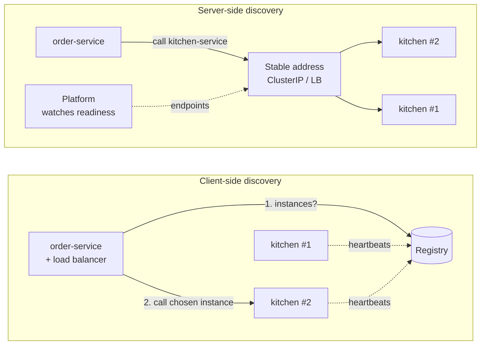

# 11. Service Discovery Patterns

<div class="badges" markdown><span class="badge badge-l2">L2 · Practitioner</span><span class="badge badge-l3">L3 · Senior/Lead</span><span class="badge badge-meta">Spring Cloud LoadBalancer · Kubernetes Services · failover simulation</span></div>

<div class="grid two" markdown>

!!! info "Prerequisites"
    - [Chapter 3](../foundations/ch03-distributed-systems-fundamentals.md): partial failure, timeouts, retries
    - [Chapter 4](../foundations/ch04-twelve-factor.md): disposability, health probes, Kubernetes basics
    - [Chapter 10](ch10-api-gateway-bff.md): the gateway's backends are found through discovery

!!! abstract "What you'll learn"
    - Why hard-coded addresses fail, and what a **service registry** stores
    - **Client-side vs server-side** discovery; **self-registration vs third-party registration**
    - How Eureka, Consul, DNS and **Kubernetes Services** work, and how stale each can be
    - Measured: how long traffic keeps reaching a **dead instance**, and how retries change the outcome
    - **Spring Cloud LoadBalancer** behind an HTTP service client, called by service name
    - Long-lived HTTP/2 and gRPC connections, headless Services, and graceful shutdown

</div>

---

## 1 · Introduction & Context

### "Which IP is kitchen-service today?"

In a monolith, a function call has no address. In a microservice system every call needs one, and the answer keeps changing:

- Instances **scale** up at 7 pm and down at midnight.
- Deployments **replace** every instance with new ones on new addresses.
- Instances **die**: a node fails, a JVM runs out of memory, a pod is evicted.
- Zones and regions fail over.

FoodFleet's first services used a properties file with IP addresses, updated by a deploy script. It worked until the first autoscaling event, when new kitchen instances received no traffic for twenty minutes and old addresses kept receiving requests after their instances were gone.

**Service discovery** is the mechanism that keeps "kitchen-service" pointing at the instances that exist and are healthy *right now*. Every approach answers three questions: who **registers** instances, who **stores** the list, and who **chooses** an instance for each request. The answers decide how stale the list can get, and staleness, as section 4 shows, is measured in failed requests.

### A short history

<ul class="mh-timeline">
<li><span class="when">1983 and 2000 · DNS and SRV records</span><span class="what">Names to addresses (DNS); RFC 2782 adds SRV records with ports, priorities and weights.</span></li>
<li><span class="when">2008–2010 · ZooKeeper</span><span class="what">Yahoo's coordination service; ephemeral nodes become a way to register live instances.</span></li>
<li><span class="when">2012 · Netflix Eureka</span><span class="what">An AP registry with heartbeats and client-side caching, paired with client-side load balancing; becomes Spring Cloud Netflix.</span></li>
<li><span class="when">2014 · Consul</span><span class="what">HashiCorp's registry with health checks, a DNS interface and a key-value store.</span></li>
<li><span class="when">2015 · Kubernetes 1.0</span><span class="what">Discovery becomes a <strong>platform feature</strong>: Services, cluster DNS, readiness probes; EndpointSlices follow (GA in 1.21).</span></li>
<li><span class="when">2016 onwards · Envoy and xDS</span><span class="what">Proxies receive endpoints from a control plane; service meshes make discovery and balancing invisible to the application.</span></li>
</ul>

---

## 2 · Core Concepts & Terminology

### The parts

Service registry
:   A database of service instances: name, address, port, metadata (zone, version), and health. Eureka, Consul, ZooKeeper, and in Kubernetes the API server's EndpointSlices.

Registration
:   **Self-registration**: the instance registers itself and sends heartbeats (Eureka clients). **Third-party registration**: something else watches the instances and registers them (Kubernetes from pod readiness, Consul agents with health checks, a cloud load balancer's target groups).

Discovery
:   **Client-side**: the caller asks the registry (usually through a local cache) and picks an instance itself (Eureka + Spring Cloud LoadBalancer, gRPC with a headless Service). **Server-side**: the caller sends to a stable address and something in between picks the instance (Kubernetes ClusterIP via kube-proxy, a cloud load balancer, a mesh sidecar).

Health
:   Whether an instance should receive traffic. Liveness (should it be restarted?) is different from **readiness** (should it get requests now?). Discovery must follow readiness.

### Client-side vs server-side discovery



| | Client-side | Server-side |
|---|---|---|
| Who picks the instance | The caller's library | A proxy, kube-proxy rules or a load balancer |
| Language support | A library per language | Nothing in the application |
| Load-balancing smarts | Rich: zone preference, weights, sticky, per-request | Usually per connection; richer with a mesh |
| Extra hop | No | Sometimes (cloud LB); not with kube-proxy |
| Staleness | Registry + every client cache | Platform propagation only |
| Typical | Eureka + Spring Cloud LoadBalancer; gRPC + headless Service | Kubernetes Service, cloud load balancers, service mesh |

### The main options

| | Eureka | Consul | DNS (plain or SRV) | Kubernetes Service |
|---|---|---|---|---|
| Registration | Self (heartbeats) | Agent, with health checks | Operator or tooling | Third-party (pod readiness) |
| Consistency | AP: availability over consistency | CP catalog (Raft) | Eventually consistent caches | API server (etcd), watched by every node |
| Health | Heartbeats; optional health propagation | Rich checks (HTTP, TCP, script) | External health checks | Readiness probes |
| Clients | Java library | HTTP API, DNS, mesh | Every language | Every language (DNS + virtual IP) |
| Best for | JVM fleets outside Kubernetes | Mixed estates, VMs + containers | Simple, cross-platform | Anything running on Kubernetes |

---

## 3 · How It Works Internally

### Eureka: why it can be minutes stale

A Eureka client renews its lease every **30 s**; the lease lasts **90 s**; the server evicts expired leases in a sweep every **60 s**; the server serves registry reads from a response cache refreshed every **30 s**; clients fetch the registry every **30 s**; and Spring Cloud LoadBalancer caches instance lists for **35 s**. A crashed instance has to fall out of every one of those layers. Eureka's lease bookkeeping also counts the lease duration twice (a long-standing quirk noted in its source and kept for compatibility), so expiry takes up to 180 s.

Two more Eureka behaviours matter in production:

- **Self-preservation.** If more than 15% of expected renewals go missing (by default, renewal threshold 0.85), the server assumes a network problem on *its* side and stops evicting anyone. That protects against mass eviction during a partition, and also keeps genuinely dead instances listed.
- **Hung instances look healthy.** Heartbeats come from a background thread. An application that is alive but deadlocked or out of database connections keeps renewing its lease, unless health propagation (`eureka.client.healthcheck.enabled=true`) reports its actuator health to the registry.

### Kubernetes: discovery as a side effect of readiness

1. A pod becomes **Ready** when its containers' readiness probes pass.
2. The EndpointSlice controller adds the pod's IP to the Service's **EndpointSlices**; when the pod stops being ready (or is deleted), it removes it.
3. **kube-proxy** on every node watches EndpointSlices and programs iptables, IPVS or nftables rules so that connections to the Service's virtual IP go to a ready pod.
4. **CoreDNS** answers `kitchen-service.foodfleet.svc.cluster.local` with the virtual IP (ClusterIP), or with all ready pod IPs for a **headless** Service (`clusterIP: None`).

The crucial distinction is how the failure is noticed:

| Failure | How Kubernetes notices | Typical time out of rotation |
|---|---|---|
| Process exits (crash, OOM kill) | The kubelet sees the container exit | Seconds |
| Pod deleted (deploy, scale-in, eviction) | Pod marked terminating immediately | Seconds, but in-flight requests need a graceful shutdown |
| Process hung (deadlock, pool exhausted) | Only the **readiness probe** | `periodSeconds × failureThreshold` (defaults 10 s × 3) |
| Node lost | Node controller after its grace period | Can be a minute or more |

### Long-lived connections defeat connection-level balancing

kube-proxy balances **connections**, not requests. HTTP/1.1 clients open several pooled connections, which spread reasonably well. **HTTP/2 and gRPC** multiplex all requests over one long-lived connection, so a client pod may send everything to a single server pod while new pods sit idle after a scale-out. The fixes are:

- client-side balancing over a **headless Service** (gRPC's `round_robin` policy with the `dns:///` resolver), with periodic re-resolution;
- a **service mesh** or proxy that balances per request ([chapter 17](ch17-sidecar-ambassador-adapter.md));
- server-side `max connection age` so clients reconnect and spread out.

### Spring Cloud LoadBalancer with HTTP service clients

Since Spring Cloud Commons 5.0 (Spring Cloud 2025.1), an HTTP service client group with **no `base-url`**, or a `base-url` with the `lb://` scheme, is load-balanced automatically, with the **group name used as the service id**. Each request asks the `DiscoveryClient` (Eureka, Consul, Kubernetes, or the static `SimpleDiscoveryClient`) for instances, through a cache whose default TTL is 35 s, and picks one round-robin. Configurations such as `zone-preference`, `health-check`, `weighted` and `same-instance-preference` change the choice.

---

## 4 · Design Considerations & Trade-offs

### Measured: how long traffic keeps reaching a dead instance

The chapter's simulation models each mechanism as a chain of timers whose phase at the moment of failure is random, and runs 200,000 trials. Scenario: 4 instances, 100 requests per second spread evenly, one instance dies (verified output):

| Mechanism | Mean window | p99 window | Failed requests | Slowed requests |
|---|---:|---:|---:|---:|
| Eureka, defaults | **242.5 s** | 298.1 s | **6,062** | 0 |
| Eureka, tuned (5 s heartbeat, 15 s lease, no response cache, 5 s fetches) | 35.0 s | 41.5 s | 875 | 0 |
| DNS + health checks (10 s × 3 checks, 30 s TTL, 30 s JVM cache) | 55.0 s | 81.9 s | 1,375 | 0 |
| Kubernetes Service, **crash** | **3.0 s** | 3.0 s | 75 | 0 |
| Kubernetes Service, **hang** (readiness 10 s × 3) | 27.0 s | 31.9 s | 675 | 0 |
| Kubernetes Service, hang **+ retry on another instance** | 27.0 s | 31.9 s | **0** | 675 |

What the numbers say:

- **Every** mechanism is stale for a while; the question is how long, and what callers do meanwhile.
- Eureka's defaults favour availability and low registry load over fast detection. Tuning helps, at the cost of more heartbeat traffic on the registry.
- Kubernetes reacts to **crashes** in seconds, but a **hung** process is only removed by its readiness probe. A good readiness probe (one that fails when the instance can't serve, for example when its database pool is exhausted) matters more than the discovery technology.
- A **retry on another instance** turns failures into slower successes, for idempotent requests. It's the cheapest protection against staleness, and it works with any discovery mechanism.

Kubernetes propagation delays and health-check intervals in the model are stated assumptions; Eureka, Spring Cloud LoadBalancer, JDK DNS-cache and probe values are the documented defaults. Change them in `Mechanisms.java` and rerun.

### Which discovery should you use?

<div class="mh-axes" markdown>
<div class="mh-axes__y">Everything runs on Kubernetes →</div>
<div class="mh-axes__cell good"><strong>Platform discovery</strong>Kubernetes Services and DNS; no registry, no client library. Headless Services or a mesh for gRPC.<br><span class="pin">FoodFleet today</span></div>
<div class="mh-axes__cell ok"><strong>Platform + mesh</strong>Service mesh for per-request balancing, mTLS and multi-cluster discovery.</div>
<div class="mh-axes__cell ok"><strong>Registry for VMs</strong>Eureka (JVM only) or Consul. Tune timers; use health propagation.<br><span class="pin">FoodFleet 2022</span></div>
<div class="mh-axes__cell ok"><strong>Mixed estate</strong>Consul or a mesh spanning VMs and clusters; one catalog for both worlds.</div>
<div class="mh-axes__x">Mix of platforms, languages and data centres →</div>
</div>

FoodFleet's rule: **on Kubernetes, use Kubernetes.** Spring Cloud LoadBalancer stays useful in two places: tests and local development (with `SimpleDiscoveryClient`), and the few services that need request-level policies such as zone preference.

### Client-side balancing policies

| Policy | Use when | Watch out for |
|---|---|---|
| Round robin (default) | Instances are similar | Slow instances get the same share |
| Random | Very many clients | Uneven at low volume |
| Zone preference | Cross-zone traffic costs money or latency | Overloading one zone's instances |
| Weighted | Mixed instance sizes, canaries | Weights must be maintained |
| Health-check filtered | Registry health is coarse | Extra probe traffic from every client |
| Least outstanding requests | Uneven request costs | Needs per-instance in-flight counts |

---

## 5 · Hands-on Implementation

Code: `code/chapters/ch11-service-discovery/`.

```bash
cd code
mvn -B -pl chapters/ch11-service-discovery -am verify
java -cp chapters/ch11-service-discovery/target/classes dev.foodfleet.ch11.simulation.FailoverReport
```

### 🔵 Level 2: calling a service by name

<div class="badges" markdown><span class="badge badge-l2">L2 · Practitioner</span></div>

The client knows a name, not an address:

```java title="kitchen/KitchenClient.java"
--8<-- "code/chapters/ch11-service-discovery/src/main/java/dev/foodfleet/ch11/kitchen/KitchenClient.java"
```

```java title="kitchen/KitchenClientConfiguration.java"
--8<-- "code/chapters/ch11-service-discovery/src/main/java/dev/foodfleet/ch11/kitchen/KitchenClientConfiguration.java"
```

Locally, a static registry; on Kubernetes, the Service's DNS name and no client-side balancing:

```yaml title="application.yml"
--8<-- "code/chapters/ch11-service-discovery/src/main/resources/application.yml"
```

```yaml title="application-kubernetes.yml"
--8<-- "code/chapters/ch11-service-discovery/src/main/resources/application-kubernetes.yml"
```

```java title="RoundRobinDiscoveryTest.java"
--8<-- "code/chapters/ch11-service-discovery/src/test/java/dev/foodfleet/ch11/kitchen/RoundRobinDiscoveryTest.java"
```

### 🟣 Level 3: surviving a stale registry

<div class="badges" markdown><span class="badge badge-l3">L3 · Senior/Lead</span></div>

The registry still lists an instance that has crashed. Without a retry, half the calls fail; with one retry that goes back through the load balancer, none do:

```java title="kitchen/KitchenCapacityLookup.java"
--8<-- "code/chapters/ch11-service-discovery/src/main/java/dev/foodfleet/ch11/kitchen/KitchenCapacityLookup.java"
```

```java title="StaleRegistryTest.java"
--8<-- "code/chapters/ch11-service-discovery/src/test/java/dev/foodfleet/ch11/kitchen/StaleRegistryTest.java"
```

### 🟣 Level 3: modelling staleness

<div class="badges" markdown><span class="badge badge-l3">L3 · Senior/Lead</span></div>

Each mechanism is a chain of stages; periodic stages wait a uniformly random part of their interval:

```java title="simulation/Stage.java"
--8<-- "code/chapters/ch11-service-discovery/src/main/java/dev/foodfleet/ch11/simulation/Stage.java"
```

```java title="simulation/Mechanisms.java"
--8<-- "code/chapters/ch11-service-discovery/src/main/java/dev/foodfleet/ch11/simulation/Mechanisms.java"
```

### 🔴 Level 4: platform discovery done properly

<div class="badges" markdown><span class="badge badge-l4">L4 · Architect</span></div>

A ClusterIP Service for HTTP, a headless twin for gRPC, a readiness probe that defines "in rotation", and a `preStop` pause so in-flight requests finish while the endpoint removal propagates:

```yaml title="k8s/kitchen-service.yaml"
--8<-- "code/chapters/ch11-service-discovery/k8s/kitchen-service.yaml"
```

!!! tip "Graceful shutdown is part of discovery"
    When a pod is deleted, Kubernetes removes it from EndpointSlices and sends SIGTERM **at the same time**. Nodes that haven't processed the update yet keep sending it connections for a moment. The `preStop` pause covers that gap; Spring Boot's `server.shutdown=graceful` then lets in-flight requests finish. Without both, every deployment produces a burst of errors.

### Run and verify

```bash
java -cp chapters/ch11-service-discovery/target/classes dev.foodfleet.ch11.simulation.FailoverReport
# One of 4 instances dies; 100 req/s spread evenly (25 req/s to the dead one)
# Mechanism                                    mean s    p50 s    p99 s     failed     slowed
# Eureka, defaults                              242.5    242.5    298.1       6062          0
# Eureka, tuned                                  35.0     35.0     41.5        875          0
# DNS + health checks                            55.0     55.0     81.9       1375          0
# Kubernetes Service, crash                       3.0      3.0      3.0         75          0
# Kubernetes Service, hang                       27.0     27.0     31.9        675          0
# Kubernetes Service, hang + retry elsewhere     27.0     27.0     31.9          0        675

# on a cluster
kubectl -n foodfleet get endpointslices -l kubernetes.io/service-name=kitchen-service -o wide
kubectl -n foodfleet run dns-test --rm -it --image=busybox:1.36 --restart=Never -- \
  nslookup kitchen-service-headless.foodfleet.svc.cluster.local      # one A record per ready pod
```

!!! question "Try it"
    1. In `Mechanisms.kubernetesHang()`, change the readiness probe to 5 s × 2. How many failed requests remain? What could go wrong with a probe that sensitive?
    2. Add a stage for Spring Cloud LoadBalancer's 35 s cache to the Kubernetes rows, as if you used Spring Cloud Kubernetes discovery. What did you gain over plain Services?
    3. In `StaleRegistryTest`, set `maxRetries = 0`. Which assertion fails?
    4. Why would retrying a `POST /orders` on another instance be dangerous here, and what would make it safe (chapter 3)?

---

## 6 · Production Readiness

- [x] **Readiness probes reflect the ability to serve**: dependencies the instance cannot work without, connection pools, warm-up; liveness probes do not check dependencies
- [x] **Graceful shutdown**: `server.shutdown=graceful`, a `preStop` pause, and `terminationGracePeriodSeconds` longer than both
- [x] **Retries on another instance** for idempotent calls, with timeouts and a retry budget
- [x] **Timeouts shorter than the staleness window** you've measured, so callers move on quickly
- [x] **Long-lived connections** (HTTP/2, gRPC) balanced per request: headless Service + client-side balancing, a mesh, or max connection age
- [x] **Registry-based discovery tuned and monitored**: heartbeat and lease settings documented; self-preservation state alerted on; health propagation enabled
- [x] **No IP addresses in configuration**; services addressed by name, environments by namespace
- [x] **Cross-zone traffic understood**: topology-aware routing or zone preference where cross-zone traffic is expensive
- [x] **Discovery dashboards**: ready endpoints per Service, endpoint churn, DNS errors, 5xx rates per upstream instance

---

## 7 · Anti-patterns & Pitfalls

!!! pitfall "Incident 1: four minutes of errors after every crash"
    **Context.** In 2022, FoodFleet's services on VMs used Eureka with default settings.
    **Symptoms.** Every instance crash produced about four minutes of 5xx errors for its callers; on-call engineers learned to restart callers to "refresh" them.
    **Root cause.** The stacked caches of section 3: lease (up to 180 s), eviction sweep, server response cache, client fetch and load-balancer cache.
    **Fix.** Tuned timers, health propagation, timeouts of 1 s and a retry on another instance for reads. The move to Kubernetes later made most of this unnecessary.

!!! pitfall "Incident 2: one pod doing all the gRPC work"
    **Context.** dispatch-service called the dispatch optimizer over gRPC through a ClusterIP Service and scaled the optimizer from 3 to 12 pods for a cricket-final evening.
    **Symptoms.** Latency didn't improve; three pods ran at 100% CPU while nine were idle.
    **Root cause.** HTTP/2 connections are long-lived; kube-proxy balanced the initial connections and nothing else.
    **Fix.** A headless Service with gRPC client-side round robin and periodic re-resolution; later a mesh.

!!! pitfall "Incident 3: the readiness probe that checked everything"
    **Context.** order-service's readiness probe called payment-service, kitchen-service and the database.
    **Symptoms.** A short payment-service outage made **every** order-service pod unready; Kubernetes removed them all from the Service, and the app showed "service unavailable" for browsing orders, which didn't need payments at all.
    **Root cause.** Readiness depended on non-essential downstream services, so one failure cascaded into total removal.
    **Fix.** Readiness checks only what the instance needs for most of its traffic (its own database pool); downstream failures are handled per request with timeouts and fallbacks.

| Anti-pattern | Symptom | Fix |
|---|---|---|
| IPs in config files | Traffic to dead or recycled addresses | Names resolved by discovery |
| Liveness probe checks dependencies | Restart storms during a downstream outage | Liveness checks the process only |
| Readiness checks every dependency | Whole service removed for a partial outage | Readiness checks essentials only |
| Client cache longer than timeouts tolerate | Minutes of errors after failures | Measure staleness; tune or retry elsewhere |
| ClusterIP for gRPC/HTTP/2 | Uneven load, no benefit from scale-out | Headless + client-side balancing, or a mesh |
| No graceful shutdown | Errors on every deployment | preStop pause + graceful shutdown |
| Registry as a single point of failure | Nothing can start when the registry is down | Replicated registry; clients cache the last known list |
| Two discovery systems at once | Different clients see different worlds | One source of truth per environment |

---

## 8 · Enterprise Case Study

### FoodFleet: from Eureka to Kubernetes Services

!!! decision "ADR-011: Kubernetes Services are FoodFleet's discovery mechanism"
    **Status:** Accepted · **Date:** 2024-02-12

    **Context.** Services moved from VMs with Eureka to Kubernetes. Eureka's default staleness caused minutes of errors after crashes; running Eureka on Kubernetes would duplicate what the platform already does.

    **Decision.** Services call each other by Kubernetes Service DNS name (ClusterIP) with no client-side discovery library. gRPC traffic uses headless Services with client-side round robin. Every service has a readiness probe that checks only essential dependencies, `server.shutdown=graceful`, and a 5 s `preStop` pause. Idempotent calls retry once on another instance. Spring Cloud LoadBalancer with `SimpleDiscoveryClient` remains for local development and tests. Eureka is decommissioned after the last VM service moves.

    **Consequences.** ✅ Crashed instances leave rotation in seconds; no registry to run. ✅ Works the same for Java, Python and Go services. ⚠️ Hung instances depend on good readiness probes. ⚠️ Request-level policies (zone preference, weights) need a mesh or Gateway API features rather than a library.

### Fintech analogue: discovery across data centres 🔴

Banks often run active-active data centres plus a cloud region, with mainframe and VM workloads alongside containers. Discovery then needs a **catalog that spans environments** (Consul federation, or a mesh with multi-cluster discovery), **locality preference** so that calls stay within a data centre unless it fails, and strict control over which services are visible where, because discovery data reveals the system's shape. Failover drills measure exactly the windows in this chapter's simulation.

### E-commerce analogue: scale-out during a sale

During a sale, product and cart services may scale several times over in minutes. Discovery has to make **new** instances useful quickly (readiness after warm-up, then fast propagation) and must not send full traffic to cold instances; slow-start and weighted policies help. The gRPC pitfall is common here: scaling out a service whose callers hold long-lived HTTP/2 connections does nothing until those connections are rebalanced.

---

## 9 · Interview Q&A + Summary

#### Q1. What is service discovery and why do microservices need it? · <span class="badge badge-l2">L2</span> · TCS · Infosys · Cognizant

**Short answer:** Instances come and go (scaling, deployments, failures), so callers can't use fixed addresses. Discovery keeps a current list of healthy instances per service name, through a registry, DNS or the platform, and the caller or a proxy picks one per request or connection.

#### Q2. Client-side vs server-side discovery? · <span class="badge badge-l2">L2</span><span class="badge badge-l3">L3</span> · Amazon · Flipkart

**Short answer:** Client-side: the caller queries the registry and chooses an instance itself (Eureka + Spring Cloud LoadBalancer, gRPC over a headless Service): rich policies, a library per language, client caches. Server-side: the caller uses a stable address and the platform or a proxy chooses (Kubernetes ClusterIP, cloud load balancers, meshes): language-neutral, simpler clients.

#### Q3. Self-registration vs third-party registration? · <span class="badge badge-l2">L2</span> · SAP · Cognizant

**Short answer:** Self-registration: the instance registers itself and heartbeats (Eureka). Third-party: an external component registers instances based on observed state (Kubernetes from pod readiness, Consul agents). Third-party registration removes discovery code from services and reflects real readiness.

#### Q4. How does service discovery work in Kubernetes? · <span class="badge badge-l2">L2</span><span class="badge badge-l3">L3</span> · Amazon · Flipkart · JP Morgan

**Short answer:** A Service selects pods by label; ready pods' IPs go into EndpointSlices; kube-proxy on each node routes connections to the Service's ClusterIP to a ready pod; CoreDNS resolves the Service name to the ClusterIP (or to all pod IPs for a headless Service). Readiness probes decide membership.

#### Q5. Do you need Eureka on Kubernetes? · <span class="badge badge-l3">L3</span> · any Spring shop

**Short answer:** Usually not. Kubernetes already provides registration, health-based membership and DNS. Adding Eureka adds another stale cache and another system to run. Use Spring Cloud Kubernetes or a mesh only if you need client-side policies.

#### Q6. An instance crashes. How long until callers stop sending it requests? · <span class="badge badge-l3">L3</span> · Amazon · Goldman Sachs

**Short answer:** It depends on every cache between the failure and the caller. Eureka defaults can take several minutes (lease, eviction, server cache, client fetch, load-balancer cache); Kubernetes removes a crashed pod in seconds but a hung one only after readiness probes fail (30 s with defaults). Mitigate with short timeouts and a retry on another instance for idempotent calls.

**Red flags:** "Immediately."

#### Q7. Why does gRPC load-balance badly behind a Kubernetes Service? · <span class="badge badge-l3">L3</span> · Flipkart · Amazon

**Short answer:** kube-proxy balances connections, and gRPC multiplexes all requests over one long-lived HTTP/2 connection, so each client sticks to one pod. Use a headless Service with client-side round robin, a mesh that balances per request, or limit connection age.

#### Q8. What's Eureka's self-preservation mode? · <span class="badge badge-l3">L3</span> · JP Morgan · SAP

**Short answer:** When renewals drop below a threshold (85% of expected by default), the Eureka server assumes a network problem and stops evicting instances, protecting against mass eviction during partitions. The trade-off: dead instances remain listed until renewals recover, so clients need timeouts and retries.

#### Q9. Liveness vs readiness probes? · <span class="badge badge-l2">L2</span> · Cognizant · Infosys · Amazon

**Short answer:** Liveness answers "should this container be restarted?" and must only check the process itself. Readiness answers "should it receive traffic now?" and controls Service membership. Checking dependencies in liveness causes restart storms; checking every dependency in readiness removes whole services during partial outages.

#### Q10. How do you avoid errors during rolling deployments? · <span class="badge badge-l3">L3</span> · Flipkart · Goldman Sachs

**Short answer:** Readiness gates new pods until warm; on termination, a `preStop` pause lets endpoint removal propagate while the pod still serves, then graceful shutdown finishes in-flight requests; `maxUnavailable` and PodDisruptionBudgets keep enough capacity; callers retry idempotent requests elsewhere.

#### Q11. What does Spring Cloud LoadBalancer do with HTTP service clients? · <span class="badge badge-l3">L3</span> · any Spring shop

**Short answer:** Since Spring Cloud 2025.1, an HTTP service group without a base URL (or with an `lb://` URL) is load-balanced automatically, using the group name as the service id. Instances come from the `DiscoveryClient`, cached (35 s by default), and are chosen round-robin unless another configuration is set.

#### Q12. Design discovery for a platform with VMs, two Kubernetes clusters and a mainframe. · <span class="badge badge-l4">L4</span> · JP Morgan · Goldman Sachs

**Short answer:** One catalog spanning environments (Consul federation or a mesh with multi-cluster support), locality-aware routing, mainframe endpoints registered by a third party behind an ACL or adapter, health checks per environment, and failover rules tested with drills. Keep Kubernetes-native discovery inside clusters and use gateways or mesh gateways between them.

### Key takeaways

- Discovery answers **who registers, who stores, who chooses**; each answer adds a cache and a staleness window.
- On Kubernetes, use **Services and readiness probes**; registries add staleness without adding much.
- **Measure** the window between failure and removal; defaults can mean minutes.
- **Retry idempotent calls on another instance** and keep timeouts short: that hides staleness from users.
- Mind **long-lived connections**, **readiness probe design** and **graceful shutdown**; most discovery incidents come from those.

### Further reading

- Spring Cloud Commons reference, [Spring Cloud LoadBalancer](https://docs.spring.io/spring-cloud-commons/reference/spring-cloud-commons/loadbalancer.html) and [common abstractions](https://docs.spring.io/spring-cloud-commons/reference/spring-cloud-commons/common-abstractions.html)
- Kubernetes documentation: [Service](https://kubernetes.io/docs/concepts/services-networking/service/), [EndpointSlices](https://kubernetes.io/docs/concepts/services-networking/endpoint-slices/), [Configure liveness, readiness and startup probes](https://kubernetes.io/docs/tasks/configure-pod-container/configure-liveness-readiness-startup-probes/)
- Chris Richardson, [microservices.io](https://microservices.io/patterns/client-side-discovery.html): client-side discovery, server-side discovery, self-registration, third-party registration
- Netflix, [Eureka wiki](https://github.com/Netflix/eureka/wiki) and the Spring Cloud Netflix reference
- gRPC, [Load balancing](https://grpc.io/blog/grpc-load-balancing/)

---

**Previous:** [← 10. API Gateway & Backend for Frontend](ch10-api-gateway-bff.md) · **Next:** [12. Database per Service & API Composition →](ch12-database-per-service.md)
