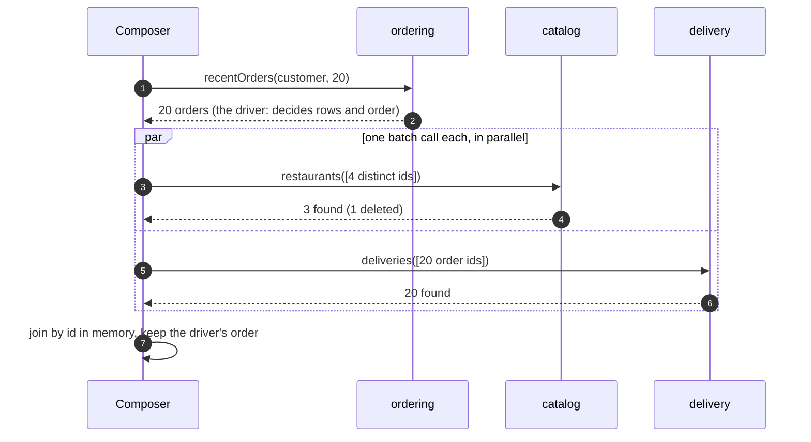

# 12. Database per Service & API Composition

<div class="badges" markdown><span class="badge badge-l2">L2 · Practitioner</span><span class="badge badge-l3">L3 · Senior/Lead</span><span class="badge badge-meta">SQL ownership audit · API composition · virtual threads</span></div>

<div class="grid two" markdown>

!!! info "Prerequisites"
    - [Chapter 5](../foundations/ch05-domain-driven-design.md) (aggregates, bounded contexts) and [Chapter 6](../foundations/ch06-service-decomposition.md) (the capability services)
    - [Chapter 8](../foundations/ch08-spring-boot-4-essentials.md): HTTP service clients and virtual-thread fan-out
    - Comfortable with SQL joins and transactions

!!! abstract "What you'll learn"
    - Why a **shared database** couples services more tightly than any API
    - The three levels of isolation: **private tables, schema per service, database per service**
    - How to **find** cross-service data access in a real database, and split it **step by step**
    - What you lose (joins, foreign keys, ACID across services) and what replaces each
    - **API composition** done properly: driver query, batch lookups, parallel calls, budgets, partial results
    - When composition stops being enough, and CQRS takes over (chapter 13)

</div>

---

## 1 · Introduction & Context

### Five services, one database

By 2023 FoodFleet had split its code into services, but every service still connected to one PostgreSQL database with one schema. It looked like microservices on the architecture diagram. In practice:

- kitchen-service read `orders` and `order_line` directly, and **wrote** `orders.status`.
- payment-service and delivery-service wrote `orders.status` too.
- ordering-service read `menu_item`, `restaurant`, `coupon` and `address`, and wrote `coupon_redemption`.
- A reporting job joined everything to everything.

When ordering-service renamed `orders.total` to `orders.total_paise`, four services broke in production, because the column was part of their contract without anybody having agreed to that. When a reporting query took a lock on `orders` during dinner, checkout stalled for every customer. And nobody could answer "who changes order status?" without reading every service's code.

This is the **shared database anti-pattern**: services that are separate in code but coupled through tables. A database schema is the widest possible API: every column, type, index and lock is exposed, there is no versioning, and changes break consumers silently. This chapter is about giving each service its own data and still building screens that need data from several.

### A short history

<ul class="mh-timeline">
<li><span class="when">1990s–2000s · Integration databases</span><span class="what">Enterprise applications integrate by sharing one database. Martin Fowler later names it the <strong>IntegrationDatabase</strong>, contrasted with an <strong>ApplicationDatabase</strong> owned by one application.</span></li>
<li><span class="when">2002 · Amazon's API mandate</span><span class="what">As retold by Steve Yegge: teams must expose data only through service interfaces; no direct reads of another team's data store.</span></li>
<li><span class="when">2014–2018 · Microservices patterns</span><span class="what">Newman and Richardson catalogue <strong>Database per Service</strong>, <strong>Shared Database</strong>, <strong>API Composition</strong> and <strong>CQRS</strong>.</span></li>
<li><span class="when">2019 · Monolith to Microservices</span><span class="what">Sam Newman's step-by-step database decomposition patterns: split the schema before or after the code, database view, change data ownership, and more.</span></li>
</ul>

---

## 2 · Core Concepts & Terminology

### Ownership, not storage

The rule is about **ownership**, not about how many database servers you run:

> Each service owns its data. Only the owner reads and writes its tables. Everyone else uses the owner's API or its events.

Three ways to implement it, from least to most isolated:

| Level | What it means | Isolation | Cost | Typical use |
|---|---|---|---|---|
| **Private tables** | Same database and schema; tables are "owned" by convention | Weak: nothing stops another service | Lowest | First step out of a shared database |
| **Schema per service** | Same database server, one schema and one DB user per service; grants enforce ownership | Logical: no cross-schema access without a grant | Low; shared CPU, memory and connections | Many services, modest load |
| **Database per service** | Separate database instances (or clusters) | Full: separate failure, scaling, upgrades, technology | Highest: more instances to run, back up and patch | Critical or heavy services; different technology needs |

FoodFleet uses **schema per service** for most services on a shared PostgreSQL cluster, and **database per service** for payment-service (compliance and failure isolation) and for services that need other technologies (Redis for zones, Elasticsearch for search: *polyglot persistence*).

### What you give up, and what replaces it

| In one database you had | Across services you use |
|---|---|
| `JOIN` across domains | **API composition** (this chapter) or a **read model** built from events (chapter 13) |
| Foreign keys across domains | Ids as plain values; validation at write time through the owner's API; **eventual** cleanup through events |
| One ACID transaction across domains | A **saga** with compensations ([chapter 14](ch14-saga-pattern.md)) and reliable events ([chapter 15](ch15-outbox-inbox-cdc.md)) |
| `UPDATE orders SET status` from anywhere | A command to the owner (`POST /orders/{id}/status`) or an event the owner reacts to |
| Reporting `SELECT` over everything | A reporting store fed by events or CDC ([chapter 34](../data/ch34-reporting-analytics.md)) |
| One backup and restore | Per-service backups; restore consistency across services is a design topic of its own |

### API composition

A **composer** (a BFF, a gateway route or a dedicated query service) answers a query that needs several services' data by calling each owner and joining the results in memory. It is the simplest replacement for a cross-service `JOIN` and needs no new infrastructure. Its limits are latency, availability (every source on the path) and queries that filter or sort on data from more than one service.

---

## 3 · How It Works Internally

### Finding the coupling in a real database

You can't split what you can't see. PostgreSQL's `pg_stat_statements` extension records every distinct statement with the user that ran it. With one database user per service (good practice anyway), it becomes a map of who touches what. The chapter's audit tool parses those statements, extracts the tables each one reads and writes, and compares them with an ownership map.

Run on a sample of FoodFleet's 2023 statements (verified output):

```text
23 statements, 14 touch another service's tables

== Cross-service access (reader -> owner) ==
delivery -> customer (read)                1
delivery -> delivery-zones (read)          1
delivery -> ordering (read)                1
delivery -> ordering (write)               1
kitchen -> ordering (read)                 2
kitchen -> ordering (write)                1
ordering -> catalog (read)                 2
ordering -> customer (read)                2
ordering -> delivery (read)                1
ordering -> promotions (read)              1
ordering -> promotions (write)             1
payment -> ordering (write)                1
reporting -> catalog (read)                1
reporting -> ordering (read)               1
reporting -> payment (read)                2
```

The **writes** are the urgent ones: three services change `orders.status`, so no single service can enforce the order lifecycle (chapter 5's aggregate rules). Reads are coupling too, but can be replaced gradually.

### Splitting a shared database, step by step

<ul class="mh-timeline">
<li><span class="when">Step 1 · Map ownership</span><span class="what">Table → owning service, in a file in the repository; audit real statements against it.</span></li>
<li><span class="when">Step 2 · One database user per service</span><span class="what">Grants match ownership; temporary cross-grants are read-only and listed.</span></li>
<li><span class="when">Step 3 · Stop foreign writes</span><span class="what">Commands or events to the owner instead of <code>UPDATE</code> on its tables.</span></li>
<li><span class="when">Step 4 · Replace foreign reads</span><span class="what">Owner APIs with batch endpoints, API composition, or local copies kept from events.</span></li>
<li><span class="when">Step 5 · Remove cross-domain foreign keys and joins</span><span class="what">Ids become plain values; integrity moves to validation, events and reconciliation.</span></li>
<li><span class="when">Step 6 · Schema per service</span><span class="what">Move each service's tables into its schema; nothing crosses the boundary any more.</span></li>
<li><span class="when">Step 7 · Optional: separate instances</span><span class="what">For technology, isolation, compliance or scaling reasons (section 4).</span></li>
</ul>

Each step is small and reversible, and the audit tool tells you when a step is finished (its list for that pair is empty). Steps 3 and 4 are where the real work is; the patterns for them are in section 4. Step 6 is mostly mechanical once nothing crosses the boundary. The strangler-fig migration of [chapter 16](ch16-strangler-fig-migration.md) applies the same idea to code.

### API composition, inside



The five rules in that diagram:

1. **One driver.** The service that owns the list (ordering) decides which rows exist, how they are sorted and paged. Never sort or filter on another service's fields in the composer: that would need *all* rows from every source.
2. **Batch lookups.** One call per enriching service with all ids, deduplicated. That needs batch endpoints (`GET /restaurants?ids=…`) on the owners; ask for them.
3. **Parallel.** The enriching calls don't depend on each other.
4. **Budget and partial results.** Enrichment that is slow or fails is left empty and reported; the page still renders.
5. **Missing is not failed.** A restaurant deleted from the catalog is a normal case, not an error.

---

## 4 · Design Considerations & Trade-offs

### Composition, measured

The naive composer loops over orders and calls each enriching service per row: **1 + 2N** calls in sequence. The careful one makes **3** calls, two of them in parallel. With 40 ms for the order list, 30 ms per lookup call and 0.5 ms per id (illustrative), for a page of 20 orders:

| | Calls | Approximate latency | If catalog fails |
|---|---:|---:|---|
| Naive loop | 41 | 40 + 20 × 2 × 30.5 ≈ **1,260 ms** | Whole page fails |
| Batched + parallel | 3 | 40 + 30 + 20 × 0.5 ≈ **80 ms** | Page renders without restaurant names |

### Replacing each kind of cross-service access

| Access found by the audit | Replace with | FoodFleet example |
|---|---|---|
| Foreign **write** of the owner's state | Command to the owner, or an event the owner handles | kitchen publishes `TicketAccepted`; ordering updates its own `orders.status` |
| Foreign **read** at request time, small and fresh | Owner's API (batch endpoint) | ordering asks catalog for prices when placing an order |
| Foreign **read** of reference data, read often | **Local copy** maintained from the owner's events | delivery keeps a `delivery_address` copy taken when the order is placed |
| Read for **display** across several owners | API composition | order history (this chapter) |
| Query that **filters or sorts across owners**, or is heavy | **CQRS read model** | "orders from restaurants in Koramangala over ₹500, last 7 days" ([chapter 13](ch13-cqrs-event-sourcing.md)) |
| Reporting and analytics | Event or CDC pipeline into a warehouse | daily GMV by restaurant ([chapter 34](../data/ch34-reporting-analytics.md)) |

!!! tip "Copies are fine; shared writable state is not"
    Keeping a local copy of another service's data (a restaurant's name in an order, the delivery address in a delivery) is normal and often **correct**: the order should show the restaurant name *as it was* when ordered. What breaks a system is two services **writing** the same data. Copy data with intent: take a snapshot at the right moment, or subscribe to changes.

### When composition stops being enough

<div class="mh-axes" markdown>
<div class="mh-axes__y">Query needs filtering or sorting across owners →</div>
<div class="mh-axes__cell ok"><strong>Composition with care</strong>Small result sets that still filter across owners: possible with two queries, but fragile.</div>
<div class="mh-axes__cell bad"><strong>CQRS read model</strong>Large or frequent cross-owner queries: build a dedicated view from events.<br><span class="pin">restaurant dashboards</span></div>
<div class="mh-axes__cell good"><strong>API composition</strong>Driver owns the list; others enrich a page by id.<br><span class="pin">order history</span></div>
<div class="mh-axes__cell ok"><strong>Composition + caching</strong>High traffic, stable enrichment data: cache restaurant info in the composer for minutes.</div>
<div class="mh-axes__x">Traffic and result-set size →</div>
</div>

### Schema per service or database per service?

| Choose separate databases when | Schema per service is enough when |
|---|---|
| The service needs a different technology (search, cache, time series) | All services use the same database engine |
| Failure isolation matters: a runaway query must not affect others | Load is modest and well understood |
| Compliance needs separation (payments, PII) | No special compliance scope |
| The service's load needs independent scaling or tuning | Shared tuning works for everyone |
| Upgrade schedules must differ | One upgrade cadence is fine |

Either way, **one database user per service**, with grants on its own schema only, turns the convention into an enforced rule.

---

## 5 · Hands-on Implementation

Code: `code/chapters/ch12-database-per-service/`.

```bash
cd code
mvn -B -pl chapters/ch12-database-per-service -am verify
java -cp chapters/ch12-database-per-service/target/classes dev.foodfleet.ch12.ownership.OwnershipAuditReport
```

### 🔵 Level 2: who touches whose tables?

<div class="badges" markdown><span class="badge badge-l2">L2 · Practitioner</span></div>

The ownership map and the statements are plain text, so they can live in the repository and be reviewed:

```text title="sql/table-owners.txt"
--8<-- "code/chapters/ch12-database-per-service/src/main/resources/sql/table-owners.txt"
```

```java title="ownership/TableReferences.java"
--8<-- "code/chapters/ch12-database-per-service/src/main/java/dev/foodfleet/ch12/ownership/TableReferences.java"
```

```java title="ownership/OwnershipAudit.java"
--8<-- "code/chapters/ch12-database-per-service/src/main/java/dev/foodfleet/ch12/ownership/OwnershipAudit.java"
```

To audit your own database, export statements with the service as the database user:

```sql
SELECT usename || '|' || regexp_replace(query, '\s+', ' ', 'g')
FROM pg_stat_statements JOIN pg_user ON userid = usesysid;
```

Then enforce ownership with grants, one user and schema per service:

```sql title="ownership by grants (PostgreSQL)"
CREATE SCHEMA ordering AUTHORIZATION ordering_svc;
CREATE SCHEMA kitchen  AUTHORIZATION kitchen_svc;
REVOKE ALL ON SCHEMA ordering FROM PUBLIC;
-- during migration only, and visible in review: kitchen may still read two ordering tables
GRANT USAGE ON SCHEMA ordering TO kitchen_svc;
GRANT SELECT ON ordering.orders, ordering.order_line TO kitchen_svc;
```

### 🟣 Level 3: API composition

<div class="badges" markdown><span class="badge badge-l3">L3 · Senior/Lead</span></div>

The ports, including the batch methods composition needs:

```java title="composition/Ports.java"
--8<-- "code/chapters/ch12-database-per-service/src/main/java/dev/foodfleet/ch12/composition/Ports.java"
```

The composer:

```java title="composition/OrderHistoryComposer.java"
--8<-- "code/chapters/ch12-database-per-service/src/main/java/dev/foodfleet/ch12/composition/OrderHistoryComposer.java:46:94"
```

!!! warning "Cancelling a blocked call"
    `future.cancel(true)` interrupts the virtual thread, and the try-with-resources block waits for both tasks before returning. A sleeping thread stops at once, but a thread blocked on a socket read may keep waiting until its read timeout. So the HTTP clients' `read-timeout` must not be longer than the composition budget, or the budget is only a suggestion.

The tests compare it with the naive loop and check every rule:

```java title="OrderHistoryComposerTest.java"
--8<-- "code/chapters/ch12-database-per-service/src/test/java/dev/foodfleet/ch12/composition/OrderHistoryComposerTest.java"
```

### 🟣 Level 3: behind HTTP

<div class="badges" markdown><span class="badge badge-l3">L3 · Senior/Lead</span></div>

The owners' APIs as HTTP service clients, adapted to the ports:

```java title="client/HttpClients.java"
--8<-- "code/chapters/ch12-database-per-service/src/main/java/dev/foodfleet/ch12/client/HttpClients.java"
```

```java title="client/CompositionConfiguration.java"
--8<-- "code/chapters/ch12-database-per-service/src/main/java/dev/foodfleet/ch12/client/CompositionConfiguration.java"
```

### Run and verify

```bash
java -cp chapters/ch12-database-per-service/target/classes dev.foodfleet.ch12.ownership.OwnershipAuditReport
# 23 statements, 14 touch another service's tables  (full table in section 3)

mvn -pl chapters/ch12-database-per-service spring-boot:run      # needs ordering, catalog and delivery
curl -s localhost:8094/api/customers/c-42/order-history?limit=20 | jq '.entries | length, .degraded'
```

!!! question "Try it"
    1. Add `kitchen|SELECT * FROM orders o JOIN payment p ON p.order_id = o.id` to the statements file. What does the audit report, and which pattern from section 4 would you use to remove it?
    2. Make the composer sort entries by restaurant name. Why is that a bad idea once the history has 2,000 orders?
    3. Change the catalog stub to throw for one id only. What should the batch endpoint do in that case?
    4. Write the grants that would make kitchen's `UPDATE orders` fail. What breaks first in a real migration, and how would you find it before production?

---

## 6 · Production Readiness

- [x] **Every table has exactly one owning service**, recorded in the repository and checked in CI
- [x] **One database user per service**, granted only its own schema; temporary cross-grants are listed with an end date
- [x] **No foreign writes**: state changes go through the owner's API or events
- [x] **Migrations owned by the service** (Flyway in the service's repository), never applied by another team
- [x] **Owners offer batch endpoints** for ids, with a maximum batch size
- [x] **Composers** use a driver query, batch lookups, parallel calls, a time budget, partial results, and HTTP read timeouts within the budget
- [x] **Copies of other services' data** are deliberate: a snapshot at a business moment, or kept current from events, with a documented staleness
- [x] **Cross-service integrity**: references validated at write time; orphan handling through events; periodic reconciliation for critical relationships
- [x] **Reporting** reads a separate store fed by events or CDC, never the services' operational databases
- [x] **Connection limits per service** so one service can't exhaust a shared cluster; per-database monitoring and alerting

---

## 7 · Anti-patterns & Pitfalls

!!! pitfall "Incident 1: the column rename that broke four services"
    **Context.** ordering-service renamed `orders.total` to `orders.total_paise` in a routine migration.
    **Symptoms.** kitchen, delivery, payment and the reporting job failed at once in production; three of them had no test against the real schema.
    **Root cause.** The table was a shared, unversioned contract that its owner didn't know it had.
    **Fix.** The ownership audit, one database user per service, and an end to foreign reads of `orders` within two quarters.

!!! pitfall "Incident 2: the report that locked checkout"
    **Context.** A weekly finance report ran a large aggregation over `orders`, `payment` and `refund` on the primary database at 7:30 pm.
    **Symptoms.** Checkout p99 latency rose from 300 ms to 12 s for 20 minutes; connection pools were exhausted.
    **Root cause.** Analytical load on the operational database, during peak, with locks and I/O contention.
    **Fix.** CDC into a warehouse; reporting users have no access to operational databases ([chapter 34](../data/ch34-reporting-analytics.md)).

!!! pitfall "Incident 3: the N+1 composer"
    **Context.** The first order-history endpoint looped over orders and called catalog and delivery per row.
    **Symptoms.** Customers with long histories saw 3–4 s load times; catalog-service's request rate tripled during dinner; one slow catalog instance made the whole page fail.
    **Root cause.** 1 + 2N sequential calls with no budget and no partial results.
    **Fix.** Batch endpoints on catalog and delivery, parallel calls, a 500 ms budget, partial results (this chapter's composer).

| Anti-pattern | Symptom | Fix |
|---|---|---|
| Shared database | Schema changes break other services; nobody owns the data | One owner per table; APIs and events |
| Shared DB user | Can't tell who runs which query; can't restrict access | One user per service |
| Foreign writes | Rules bypassed; status changed from three places | Commands or events to the owner |
| Distributed transactions (XA/2PC) across services | Locks across services; coupling of availability | Sagas and outbox (chapters 14, 15) |
| N+1 composition | Slow pages, load multiplied | Batch endpoints, parallel calls |
| Sorting or filtering in the composer across owners | Must fetch everything | Let the driver sort; CQRS for cross-owner queries |
| Reporting on operational databases | Peak-time slowdowns | Separate analytical store |
| "Database per service" with a shared replica everyone reads | Shared database again, read-only | Owner APIs, events, or a purpose-built read model |

---

## 8 · Enterprise Case Study

### FoodFleet: out of the shared database

!!! decision "ADR-012: one owner per table; schema per service by default; composition for display joins"
    **Status:** Accepted · **Date:** 2024-01-22

    **Context.** Five services and a reporting job shared one PostgreSQL schema; the audit found 14 of 23 sampled statements touching other services' tables, including three services writing `orders.status`.

    **Decision.** Every table has one owner (recorded in `table-owners.txt` and checked in CI with the audit). Each service gets its own database user and schema on the shared cluster; payment-service gets its own database instance. Foreign writes are removed first (events to the owner), then foreign reads (owner APIs with batch endpoints, local copies from events, or composition). Order history is served by API composition; cross-owner analytical queries move to the warehouse; restaurant dashboards use a CQRS read model (chapter 13).

    **Consequences.** ✅ Schema changes are local; ordering alone enforces the order lifecycle; reporting can't slow checkout. ⚠️ Joins became API calls and events; batch endpoints had to be added to catalog and delivery. ⚠️ Eventual consistency between services is now explicit and must be designed for (chapters 14–15).

### Fintech analogue: the core ledger as the only writer 🔴

In banking, the ledger is the classic single owner: every balance change is a posting written by the ledger service, and nothing else updates balances directly. Payments, cards and loans **ask** the ledger to post, and read balances through its API or through a read model fed by its postings. Regulators expect exactly this: a single, auditable writer for money, with every other system holding copies that are reconciled against it daily.

### E-commerce analogue: product data at scale

A marketplace's product page combines catalog (description, images), pricing, inventory, seller ratings and delivery promises, each owned by a different team and service. Composition at request time is common for the core of the page, with aggressive caching of slow-changing parts. Search and category listings, which filter and sort across all of those owners, are served from a search index built from events: the CQRS step that composition can't replace.

---

## 9 · Interview Q&A + Summary

#### Q1. What is the database-per-service pattern? · <span class="badge badge-l2">L2</span> · TCS · Infosys · Cognizant

**Short answer:** Each service owns its data, and only that service reads and writes it; others go through its API or events. It can be implemented as private tables, a schema per service, or separate database instances. It's what makes services independently changeable and deployable.

#### Q2. Why is a shared database an anti-pattern? · <span class="badge badge-l2">L2</span><span class="badge badge-l3">L3</span> · Amazon · Flipkart

**Short answer:** The schema becomes an unversioned contract for every service that touches it: renames break others, locks and heavy queries interfere, nobody owns the rules for the data, and services can't be deployed or scaled independently. It's the tightest coupling a system can have.

#### Q3. How do you join data across services? · <span class="badge badge-l2">L2</span><span class="badge badge-l3">L3</span> · Flipkart · SAP

**Short answer:** API composition for display queries: the owner of the list is queried first, then other owners are called in batch, in parallel, and joined in memory. For queries that filter or sort across owners or are heavy, build a CQRS read model from events. For analytics, a warehouse fed by events or CDC.

#### Q4. What replaces foreign keys between services? · <span class="badge badge-l3">L3</span> · Goldman Sachs · Amazon

**Short answer:** Ids stored as values; validation through the owner's API when the reference is created; events to react when the referenced entity changes or is deleted; and reconciliation jobs for critical relationships. Often you also store a snapshot of the referenced data at the business moment.

#### Q5. How do you keep data consistent across services without distributed transactions? · <span class="badge badge-l3">L3</span> · JP Morgan · Amazon

**Short answer:** Sagas: a sequence of local transactions with compensating actions, driven by events or an orchestrator, with reliable publishing through an outbox. Accept eventual consistency and design the user experience around it (chapters 14 and 15).

#### Q6. How would you split a shared database in a running system? · <span class="badge badge-l3">L3</span><span class="badge badge-l4">L4</span> · Goldman Sachs · SAP · Flipkart

**Short answer:** Map table ownership; audit real statements per service (one DB user each); remove foreign writes first, then foreign reads (APIs, local copies, composition); drop cross-domain foreign keys; move tables into per-service schemas with grants; separate instances where needed. Each step is small and measurable.

#### Q7. What are the problems with API composition? · <span class="badge badge-l3">L3</span> · Amazon · Flipkart

**Short answer:** Latency and availability (every source is on the path), N+1 calls without batch endpoints, no efficient filtering or sorting across sources, and inconsistent snapshots between sources. Mitigate with batching, parallel calls, budgets, partial results and caching; switch to CQRS when queries cross owners.

#### Q8. Schema per service or database per service? · <span class="badge badge-l3">L3</span> · JP Morgan · SAP

**Short answer:** Schema per service with one user each gives enforced ownership at low cost. Separate databases when a service needs different technology, failure isolation, compliance separation, independent scaling or its own upgrade schedule.

#### Q9. Is it OK for a service to keep a copy of another service's data? · <span class="badge badge-l3">L3</span> · Flipkart · Goldman Sachs

**Short answer:** Yes, if the copy is read-only and its freshness is deliberate: a snapshot at a business moment (the price when ordered) or a replica kept current from the owner's events. Two services writing the same data is the problem, not copies.

#### Q10. How do you handle reporting across microservices? · <span class="badge badge-l2">L2</span><span class="badge badge-l3">L3</span> · Cognizant · Accenture · Amazon

**Short answer:** Not on operational databases. Stream changes through events or CDC into a warehouse or lakehouse, model the data there, and give analysts access only to that store.

#### Q11. A product page needs data from six services. Design it. · <span class="badge badge-l4">L4</span> · Flipkart · Amazon

**Short answer:** A BFF composes the page: the catalog item as driver, then pricing, inventory, ratings and delivery promises in parallel with per-source budgets and fallbacks (hide ratings rather than fail the page), plus caching for slow-changing parts. Listings and search come from an index built from events. Name the latency budget and which parts are critical.

#### Q12. How do you stop teams from sneaking back to cross-service queries? · <span class="badge badge-l3">L3</span> · any company mid-migration

**Short answer:** Database users per service with grants limited to their schema; an ownership file checked in CI; the statement audit run regularly against production statistics; and platform templates that provision one schema and user per service by default.

### Key takeaways

- **Ownership** is the rule: one owner per table, everyone else uses its API or events.
- A shared database is the **widest, least visible API** you can have; find its use with real statement data.
- Split **writes first, then reads**, in small steps, and enforce ownership with **grants**.
- **API composition** works for display joins when done with a driver query, batch lookups, parallel calls, budgets and partial results.
- When queries filter or sort across owners, move to **CQRS read models**; for analytics, to a **warehouse**.

### Further reading

- Chris Richardson, [Database per service](https://microservices.io/patterns/data/database-per-service.html), [Shared database](https://microservices.io/patterns/data/shared-database.html), [API Composition](https://microservices.io/patterns/data/api-composition.html), and *Microservices Patterns*, chapters 2 and 7
- Sam Newman, *Monolith to Microservices* (O'Reilly, 2019), chapter 4: decomposing the database
- Martin Fowler, [IntegrationDatabase](https://martinfowler.com/bliki/IntegrationDatabase.html) and [ApplicationDatabase](https://martinfowler.com/bliki/ApplicationDatabase.html)
- PostgreSQL documentation, [pg_stat_statements](https://www.postgresql.org/docs/current/pgstatstatements.html) and [privileges](https://www.postgresql.org/docs/current/ddl-priv.html)
- Pramod Sadalage and Scott Ambler, *Refactoring Databases* (Addison-Wesley, 2006)

---

**Previous:** [← 11. Service Discovery Patterns](ch11-service-discovery-patterns.md) · **Next:** [13. CQRS & Event Sourcing →](ch13-cqrs-event-sourcing.md)
