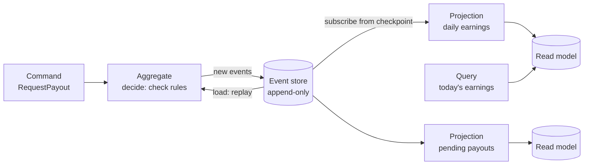
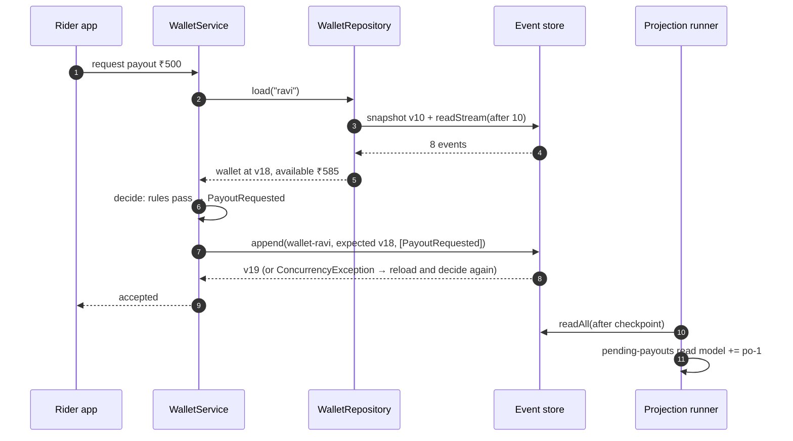

# 13. CQRS & Event Sourcing

<div class="badges" markdown><span class="badge badge-l3">L3 · Senior/Lead</span><span class="badge badge-l4">L4 · Architect</span><span class="badge badge-meta">Event store · decide/evolve aggregate · projections · upcasting</span></div>

<div class="grid two" markdown>

!!! info "Prerequisites"
    - [Chapter 5](../foundations/ch05-domain-driven-design.md): aggregates, invariants, domain events
    - [Chapter 12](ch12-database-per-service.md): why cross-owner queries outgrow API composition
    - [Chapter 3](../foundations/ch03-distributed-systems-fundamentals.md): eventual consistency

!!! abstract "What you'll learn"
    - **CQRS**: separate models for changing data and for reading it, and why they are independent of event sourcing
    - **Event sourcing**: state as a fold over immutable events; what you gain (history, audit, time travel, new read models) and pay
    - An **event store** with optimistic concurrency and a global order
    - Aggregates as **decide / evolve**; **snapshots**; **temporal queries**
    - **Projections** with checkpoints, lag and rebuilds
    - **Schema evolution** with upcasters, and the pitfalls (GDPR, gaps, event design)

</div>

---

## 1 · Introduction & Context

### The rider who asked "why?"

Every FoodFleet rider has an earnings wallet: delivery fees and tips come in, penalties and corrections are applied, payouts go to their bank account. In 2023 the wallet was a row with a `balance` column, updated in place.

Then a rider in Pune disputed his balance: ₹412 less than he expected after a week of deliveries. Support could see the current balance and nothing else. Engineers reconstructed the week from application logs, payment-provider reports and a half-finished audit table. It took two days to find a double-applied penalty, and the same bug had affected 1,800 riders. Nobody could say by how much each, because the past states were gone.

A wallet is a **ledger**, and ledgers have always been recorded as entries, not as balances: the balance is derived from the entries. **Event sourcing** applies that idea to software: store every change as an immutable event; current state is what the events add up to. **CQRS** adds a second idea: the model that enforces rules on writes doesn't have to be the model that answers questions; reads get their own models, shaped for each question.

### A short history

<ul class="mh-timeline">
<li><span class="when">Centuries · Double-entry bookkeeping</span><span class="what">Accounts as append-only journals; balances derived; corrections as new entries, never erasures.</span></li>
<li><span class="when">1988 · Bertrand Meyer</span><span class="what"><strong>Command–Query Separation</strong> (CQS): a method either changes state or returns data, not both.</span></li>
<li><span class="when">2005 · Martin Fowler</span><span class="what">Names <strong>Event Sourcing</strong> on his website.</span></li>
<li><span class="when">2010 · Greg Young</span><span class="what"><strong>CQRS</strong>: CQS applied at the architecture level; popularises event sourcing with it.</span></li>
<li><span class="when">2012 onwards · Event Store, Axon, Kafka</span><span class="what">Dedicated event stores (EventStoreDB, Axon Server) and log-based platforms make the patterns practical.</span></li>
<li><span class="when">2020s · Decider pattern</span><span class="what">Jérémie Chassaing's <strong>decide / evolve</strong> formulation: aggregates as pure functions over events.</span></li>
</ul>

---

## 2 · Core Concepts & Terminology

### CQRS and event sourcing are two different things

| | CQRS | Event sourcing |
|---|---|---|
| Idea | Separate write model and read model(s) | Store state changes as events; derive state |
| Can be used alone | Yes: write to tables, update a read model in the same transaction or via events | Yes, but reads by replaying are limited, so it almost always comes with CQRS |
| Main benefit | Each side shaped for its job; reads scale independently | Complete history, audit, temporal queries, new read models from old data |
| Main cost | Two models, eventual consistency between them | Event design and schema evolution forever; unfamiliar to most teams |



### The vocabulary

Event
:   An immutable fact in the past tense, in domain language: `EarningCredited`, `PayoutRequested`. Not `BalanceUpdated`: that's a state change, not a business fact.

Stream
:   The ordered events of one aggregate instance (`wallet-ravi`). Its length is the aggregate's **version**.

Event store
:   Append-only storage with two guarantees: events in a stream are ordered, and an append succeeds only if the stream is at the **expected version** (optimistic concurrency). A **global position** orders all events for subscribers.

Decide / evolve
:   `decide(state, command) → events` checks rules and produces events without changing anything; `evolve(state, event) → state` applies one event and never fails, because the event already happened.

Projection
:   A function from events to a read model, run continuously from a **checkpoint**. Disposable: throw the read model away and replay to rebuild it.

Snapshot
:   A cached state at some version, so loading reads only the events after it. An optimisation, never the source of truth.

Upcaster
:   A function that converts an old version of an event into the current one when it's read; stored events are never rewritten.

---

## 3 · How It Works Internally

### A command, end to end



Two properties make this safe:

- **Optimistic concurrency.** The append names the version the decision was based on. If the rider's phone and the web app request payouts at the same moment, both load v18, both pass the rules, but only one append succeeds; the other gets a conflict, reloads v19 and decides again, and this time the "payout already in progress" rule rejects it. No locks are held while deciding.
- **Read models are behind, by design.** The projection sees the event after the append. Between the two, the "pending payouts" screen is stale. That gap is the **lag**; it is usually milliseconds and must be measured and shown when it matters ("payout requested, processing").

### Loading: replay, snapshots, and time travel

| Load strategy | Events read for a wallet with 18 events (snapshot every 10) | When |
|---|---:|---|
| Replay all | 18 | Short streams |
| Snapshot + tail | 8 | Long-lived streams |
| As of a time | Events up to that time | Disputes, audits, debugging |

Snapshots are taken after appends that cross a multiple of N. If snapshot code has a bug, delete all snapshots: state is rebuilt from events and nothing is lost.

### Projections: checkpoints, lag, rebuild

The runner reads the global log from the projection's checkpoint, applies each event, and advances the checkpoint. In production the read-model update and the checkpoint are stored **in one transaction**, so a crash neither skips nor repeats an event; otherwise handlers must be idempotent. Adding a new read model, or fixing a buggy one, is the same operation: reset it and replay from position 0.

### Schema evolution

Events are stored forever, so their schema is a long-lived contract. In 2023 FoodFleet stored `EarningCredited` with `amountRupees: "38.50"`; since 2024 the payload has integer `paise`. Rather than rewriting history, a **v1 → v2 upcaster** converts old events when they're read:

| Change | Approach |
|---|---|
| Add an optional field | New readers default it; no version change needed |
| Rename or change a field's type or unit | New schema version + upcaster |
| Split one event into two, or merge | Upcaster that returns the new shape; sometimes a new event type |
| Fix wrong historical data | A **compensating event** (`AdjustmentApplied`), never an edit |
| Huge accumulated complexity | "Copy-and-transform" migration into a new store, as a last resort |

---

## 4 · Design Considerations & Trade-offs

### Where it pays off

<div class="mh-axes" markdown>
<div class="mh-axes__y">Value of history and audit →</div>
<div class="mh-axes__cell ok"><strong>Audit log + CRUD</strong>History matters but rules are simple: keep state tables and append an audit table in the same transaction.</div>
<div class="mh-axes__cell good"><strong>Event sourcing + CQRS</strong>Ledgers, wallets, bookings, workflows with disputes and many read views.<br><span class="pin">rider wallet</span></div>
<div class="mh-axes__cell good"><strong>Plain CRUD</strong>Restaurant profiles, settings, catalog data.<br><span class="pin">most services</span></div>
<div class="mh-axes__cell ok"><strong>CQRS without event sourcing</strong>Read-heavy, many query shapes, simple writes: state tables plus read models fed by events or CDC.<br><span class="pin">restaurant dashboards</span></div>
<div class="mh-axes__x">Number and variety of read views →</div>
</div>

### Benefits and costs, honestly

| Benefit | Cost |
|---|---|
| Complete, immutable history; audit by construction | Event design is hard to change; bad events live forever |
| Temporal queries ("balance on 3 March") | Every read model is eventually consistent |
| New read models from all past data | Projections to build, run, monitor and rebuild |
| Debugging by replay | Unfamiliar to most developers; onboarding cost |
| Natural integration events | Domain events ≠ integration events: leaking internal events couples other services to your internals |
| Optimistic concurrency without locks | Long streams need snapshots; hot aggregates conflict often |
| Corrections are explicit events | GDPR "right to erasure" needs crypto-shredding or separate PII storage |

### Event design rules

- **Business facts, past tense, in the ubiquitous language**: `PayoutRequested`, not `WalletUpdated` or `SetBalance`.
- **Enough data to be meaningful alone**, not a full state dump: `EarningCredited(orderId, paise, occurredAt)`.
- **No derived values that rules may change** (store the earning, not "the new balance").
- **Money in minor units**, times as instants, ids as values.
- **Personal data outside events**, or encrypted with a per-person key that can be deleted (crypto-shredding).
- **Internal events stay internal**; publish separate, versioned integration events ([chapter 15](ch15-outbox-inbox-cdc.md), [chapter 19](ch19-event-driven-architecture.md)).

### Choosing an event store

| Option | Fit |
|---|---|
| Relational table (this chapter's JDBC store) | Small to medium volume; team knows SQL; watch the position-gap caveat below |
| EventStoreDB (Kurrent) | Purpose-built: streams, subscriptions, projections, correct global ordering |
| Axon Server + Axon Framework | JVM, with aggregates, sagas and projections built in |
| Kafka | A great event **log** for integration, not an event store: no per-key optimistic concurrency, retention limits, slow per-aggregate reads |

!!! warning "The position-gap problem"
    With a database identity or sequence as the global position, transaction A can take position 11, transaction B position 12, and B can commit first. A projection reading "after 10" sees 12, moves its checkpoint to 12, and never sees 11. Fixes: serialise appends, use a commit-ordered log, or let projections wait briefly for gaps to close. Purpose-built stores solve this for you.

---

## 5 · Hands-on Implementation

Code: `code/chapters/ch13-cqrs-event-sourcing/`, the **rider wallet**. Mostly plain Java; Spring JDBC only for the database-backed store.

```bash
cd code
mvn -B -pl chapters/ch13-cqrs-event-sourcing -am verify
java -cp chapters/ch13-cqrs-event-sourcing/target/classes dev.foodfleet.ch13.WalletDemo
```

### 🟣 Level 3: the events and the aggregate

<div class="badges" markdown><span class="badge badge-l3">L3 · Senior/Lead</span></div>

```java title="wallet/WalletEvent.java"
--8<-- "code/chapters/ch13-cqrs-event-sourcing/src/main/java/dev/foodfleet/ch13/wallet/WalletEvent.java"
```

Decide (rules, no changes) and evolve (apply, never fails):

```java title="wallet/RiderWallet.java (decide and evolve)"
--8<-- "code/chapters/ch13-cqrs-event-sourcing/src/main/java/dev/foodfleet/ch13/wallet/RiderWallet.java:76:131"
```

Tests read as *given events, when command, then events*:

```java title="RiderWalletTest.java"
--8<-- "code/chapters/ch13-cqrs-event-sourcing/src/test/java/dev/foodfleet/ch13/wallet/RiderWalletTest.java"
```

### 🟣 Level 3: the event store and concurrency

<div class="badges" markdown><span class="badge badge-l3">L3 · Senior/Lead</span></div>

```java title="eventstore/EventStore.java"
--8<-- "code/chapters/ch13-cqrs-event-sourcing/src/main/java/dev/foodfleet/ch13/eventstore/EventStore.java"
```

```sql title="event-store.sql"
--8<-- "code/chapters/ch13-cqrs-event-sourcing/src/main/resources/event-store.sql"
```

Load from snapshot + tail, append with the expected version, and the retry loop that re-checks rules after a conflict:

```java title="wallet/WalletRepository.java (load, save, asOf)"
--8<-- "code/chapters/ch13-cqrs-event-sourcing/src/main/java/dev/foodfleet/ch13/wallet/WalletRepository.java:30:64"
```

```java title="wallet/WalletService.java"
--8<-- "code/chapters/ch13-cqrs-event-sourcing/src/main/java/dev/foodfleet/ch13/wallet/WalletService.java"
```

```java title="WalletRepositoryTest.java"
--8<-- "code/chapters/ch13-cqrs-event-sourcing/src/test/java/dev/foodfleet/ch13/wallet/WalletRepositoryTest.java"
```

### 🔴 Level 4: projections and schema evolution

<div class="badges" markdown><span class="badge badge-l4">L4 · Architect</span></div>

```java title="projection/ProjectionRunner.java"
--8<-- "code/chapters/ch13-cqrs-event-sourcing/src/main/java/dev/foodfleet/ch13/projection/ProjectionRunner.java"
```

```java title="projection/DailyEarningsProjection.java"
--8<-- "code/chapters/ch13-cqrs-event-sourcing/src/main/java/dev/foodfleet/ch13/projection/DailyEarningsProjection.java"
```

The 2023 → 2024 upcaster:

```java title="wallet/WalletEventCodec.java (upcaster)"
--8<-- "code/chapters/ch13-cqrs-event-sourcing/src/main/java/dev/foodfleet/ch13/wallet/WalletEventCodec.java:89:105"
```

### Run and verify

```text
$ java -cp chapters/ch13-cqrs-event-sourcing/target/classes dev.foodfleet.ch13.WalletDemo
Events in stream: 18
Balance ₹585.00, available ₹85.00, payout pending po-1
Load with snapshots every 10 events reads 8 events, not 18
As of 9:00 pm IST the balance was ₹400.00
Meena's 2023 balance, from a v1 event in rupees: ₹38.50
Projection daily-earnings handled 20 events: 12 deliveries, earnings ₹540.00, tips ₹60.00
Projection pending-payouts: 1 pending
After payout completes: read model still says 1 pending (lag 1), after catch-up 0
Rebuilt daily-earnings from scratch: 21 events, same totals: true
```

The evening: 12 deliveries at ₹45 and 3 tips of ₹20 (₹600), a ₹15 late-delivery penalty, a ₹500 payout requested. A duplicate delivery event for `o-3` was ignored (idempotent credit), so 18 events, not 19.

!!! question "Try it"
    1. Answer the Pune rider's question: write a method that lists every event between two dates with the running balance after each.
    2. Add a `WeeklyIncentiveProjection` ("₹500 bonus at 60 deliveries a week") and build it from all past events. What would that take without event sourcing?
    3. Introduce a bug in `RiderWallet.snapshot()` (drop `creditedOrders`). Which test catches it, and how would you recover in production?
    4. Rename `TipCredited.paise` to `amountPaise`. Write the upcaster and the test that proves old events still load.

---

## 6 · Production Readiness

- [x] **Event store guarantees**: per-stream ordering, optimistic concurrency, atomic multi-event appends, a gap-free global order for subscribers
- [x] **Events reviewed like APIs**: names, fields, units; schema versions and upcasters with tests for every old version
- [x] **No personal data in events**, or crypto-shredding with per-person keys
- [x] **Snapshots versioned** with the aggregate's code; safe to delete and rebuild
- [x] **Projection checkpoints transactional** with read models; handlers idempotent where that's impossible
- [x] **Lag monitored** per projection, with alerts; UI shows "processing" states where lag is visible
- [x] **Rebuilds rehearsed**: time to rebuild each read model is known; blue/green read models for long rebuilds
- [x] **Integration events separate** from domain events, published through an outbox
- [x] **Backups and retention**: the event store is the system of record; backups tested; no retention-based deletion
- [x] **Hot aggregates identified** (high conflict rates) and redesigned (smaller aggregates, commutative events)

---

## 7 · Anti-patterns & Pitfalls

!!! pitfall "Incident 1: CRUD events"
    **Context.** A team's first event-sourced service emitted `WalletUpdated { balance: 58500 }` on every change.
    **Symptoms.** The history said *that* the balance changed, never *why*; the dispute problem was unsolved, and projections had to diff states to guess what happened.
    **Root cause.** State changes recorded as events, instead of business facts.
    **Fix.** Events named after what happened (`EarningCredited`, `AdjustmentApplied`), with the reason inside.

!!! pitfall "Incident 2: the missing event"
    **Context.** The first wallet store used a database sequence for global positions, with concurrent writers.
    **Symptoms.** A few riders' daily-earnings cards permanently missed one delivery; a full rebuild fixed them.
    **Root cause.** The position-gap problem: a projection advanced past a position whose transaction committed later.
    **Fix.** Appends serialised per partition, and projections wait for gaps up to a short timeout before skipping.

!!! pitfall "Incident 3: event sourcing everything"
    **Context.** After the wallet's success, a team event-sourced restaurant profiles (name, address, opening hours).
    **Symptoms.** Twice the code for the same behaviour, projections for every screen, and confused new joiners; no one ever asked for profile history.
    **Root cause.** A pattern applied where its benefits weren't needed.
    **Fix.** Back to a state table with an audit table; event sourcing kept for ledgers and workflows.

| Anti-pattern | Symptom | Fix |
|---|---|---|
| Event sourcing everywhere | Complexity without benefit | Use it where history, audit and many read views matter |
| Events as state snapshots | History without meaning | Business facts with intent |
| Querying the event store for screens | Slow, complex reads | Projections into read models |
| Publishing internal events to other services | Other teams coupled to your aggregate's internals | Separate integration events |
| Editing or deleting stored events | Lost trust, broken projections | Compensating events; upcasters for schema |
| Reading your own writes from a lagging read model | "My payout disappeared" | Return the command result; read from the write model for the user's own latest change |
| Ignoring snapshot versioning | Wrong state after deploy | Version snapshots; discard incompatible ones |
| One huge aggregate (e.g. per restaurant) | Constant concurrency conflicts | Smaller aggregates, chapter 5 |

---

## 8 · Enterprise Case Study

### FoodFleet: the rider wallet

!!! decision "ADR-013: Rider wallets are event-sourced; read models via projections"
    **Status:** Accepted · **Date:** 2024-03-04

    **Context.** Wallet disputes took days to investigate; a penalty bug affected 1,800 riders with no way to reconstruct past balances. Riders, support, finance and ops need different views of the same data.

    **Decision.** The wallet is an event-sourced aggregate (decide/evolve) in a relational event store with per-stream optimistic concurrency and serialised appends per partition. Read models (today's earnings, payout queue, weekly incentives, finance export) are projections with transactional checkpoints. Snapshots every 50 events. Integration events (`PayoutCompleted` for notifications and finance) are published separately through the outbox. Restaurant, catalog and customer data stay CRUD.

    **Consequences.** ✅ Any balance at any time is explainable event by event; disputes are resolved in minutes. ✅ New incentive programmes were built from two years of history in a day. ⚠️ Event schemas are long-lived contracts with upcasters. ⚠️ Read models lag; the app shows "processing" for payouts until the projection confirms.

### Fintech analogue: the ledger was always event-sourced 🔴

Core banking ledgers, card transaction processing and trading systems have worked this way for decades: immutable journal entries, balances derived, corrections as reversing entries, end-of-day projections for statements and regulatory reports. Modern implementations add per-account streams with optimistic concurrency, real-time projections for apps, and temporal queries for audits. The lesson for software teams: where a domain already keeps journals on paper, event sourcing usually fits it naturally.

### E-commerce analogue: order and inventory read models

Large marketplaces commonly apply CQRS without full event sourcing: orders and inventory are written to transactional stores, changes flow out through CDC or events, and many read models (customer order history, seller dashboards, search facets, fraud features) are built from that stream. Event sourcing is reserved for a few places where history is the product, such as payments, loyalty points and returns.

---

## 9 · Interview Q&A + Summary

#### Q1. What is CQRS? · <span class="badge badge-l2">L2</span><span class="badge badge-l3">L3</span> · Cognizant · SAP · Flipkart

**Short answer:** Separating the model that handles commands (enforcing rules on writes) from the model(s) that answer queries. Read models are shaped per query and can live in different stores, kept up to date from the write side, usually through events and therefore eventually consistent.

#### Q2. What is event sourcing? · <span class="badge badge-l3">L3</span> · Goldman Sachs · JP Morgan · Amazon

**Short answer:** Persisting every state change as an immutable event in an append-only store; current state is derived by replaying an aggregate's events (or a snapshot plus later events). It gives full history, auditability, temporal queries and the ability to build new read models from past data.

#### Q3. Are CQRS and event sourcing the same thing? · <span class="badge badge-l3">L3</span> · any

**Short answer:** No. CQRS separates read and write models and works with ordinary tables. Event sourcing is a storage approach; it almost always needs CQRS because querying by replaying events is impractical, but CQRS doesn't need event sourcing.

#### Q4. How do you handle concurrent commands on the same aggregate? · <span class="badge badge-l3">L3</span> · Amazon · Goldman Sachs

**Short answer:** Optimistic concurrency: append with the expected stream version; if another writer appended first, the store rejects it. Reload, decide again (rules re-checked against the newer state), and retry a bounded number of times.

#### Q5. How do read models stay up to date, and what about consistency? · <span class="badge badge-l3">L3</span> · Flipkart · JP Morgan

**Short answer:** Projections subscribe to the event log from a checkpoint and update read models; checkpoint and read model are updated atomically, or handlers are idempotent. Read models are eventually consistent; measure lag, and for the user's own latest change return the command result or read from the write side.

#### Q6. What are snapshots and when do you need them? · <span class="badge badge-l3">L3</span> · Amazon · SAP

**Short answer:** Cached aggregate state at a version, so loading replays only later events. Needed for long streams; they're an optimisation that can be deleted and rebuilt, and must be versioned with the code that reads them.

#### Q7. How do you change the schema of events already stored? · <span class="badge badge-l4">L4</span> · Goldman Sachs · JP Morgan

**Short answer:** Never rewrite history. Additive changes are tolerated by readers; breaking changes get a new schema version and an upcaster that converts old events on read; wrong data is corrected with compensating events. As a last resort, copy-and-transform into a new store.

#### Q8. How does event sourcing work with GDPR's right to erasure? · <span class="badge badge-l4">L4</span> · SAP · banks with EU operations

**Short answer:** Keep personal data out of events (reference ids, store PII separately), or encrypt it with a per-person key and delete the key (crypto-shredding). Design this before the first event is stored.

#### Q9. When would you not use event sourcing? · <span class="badge badge-l3">L3</span><span class="badge badge-l4">L4</span> · Flipkart · Amazon

**Short answer:** For CRUD-like data where nobody needs history, for teams without experience and without a clear benefit, and where simple audit tables suffice. It's a tool for ledgers, workflows and domains with disputes and many read views.

#### Q10. Can Kafka be your event store? · <span class="badge badge-l4">L4</span> · Flipkart · Amazon

**Short answer:** It's an excellent event log for integration and stream processing, but lacks per-aggregate optimistic concurrency, efficient per-stream reads and unlimited retention guarantees by default. Most systems use a proper event store (or a database table) for aggregates and Kafka for publishing integration events.

#### Q11. How do you rebuild or add a read model? · <span class="badge badge-l3">L3</span> · Goldman Sachs · Flipkart

**Short answer:** Reset the read model and its checkpoint, replay the log from the start. For large logs, build the new version alongside the old one (blue/green), switch reads when it has caught up, then drop the old one.

#### Q12. Design a wallet for delivery partners. · <span class="badge badge-l4">L4</span> · Swiggy-/Zomato-style system design rounds

**Short answer:** Event-sourced wallet per partner (earnings, tips, adjustments, payout requested/completed/failed), rules in decide (minimum payout, available balance, one payout in flight), optimistic concurrency, idempotent credits per order, projections for the app, ops queue and finance, payouts through a saga with the bank, integration events through an outbox, PII outside events.

### Key takeaways

- **CQRS** separates write and read models; **event sourcing** stores facts instead of state. They are often combined but independent.
- Aggregates as **decide / evolve**, with **optimistic concurrency** on append and a retry that re-checks rules.
- **Projections** are disposable read models with checkpoints; measure **lag**, rehearse **rebuilds**.
- Events are **long-lived contracts**: design them as business facts; evolve with **upcasters**; correct with **compensating events**.
- Use it where **history and audit** are worth it; keep everything else simple.

### Further reading

- Martin Fowler, [Event Sourcing](https://martinfowler.com/eaaDev/EventSourcing.html) (2005) and [CQRS](https://martinfowler.com/bliki/CQRS.html) (2011)
- Greg Young, *Versioning in an Event Sourced System* (Leanpub)
- Jérémie Chassaing, [Functional Event Sourcing Decider](https://thinkbeforecoding.com/post/2021/12/17/functional-event-sourcing-decider) (2021)
- Microsoft Azure Architecture Center, [Event Sourcing pattern](https://learn.microsoft.com/azure/architecture/patterns/event-sourcing) and [CQRS pattern](https://learn.microsoft.com/azure/architecture/patterns/cqrs)
- Chris Richardson, *Microservices Patterns*, chapters 6 and 7
- Axon Framework and EventStoreDB (Kurrent) documentation

---

**Previous:** [← 12. Database per Service & API Composition](ch12-database-per-service.md) · **Next:** [14. Saga Pattern →](ch14-saga-pattern.md)
