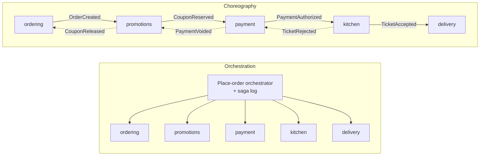
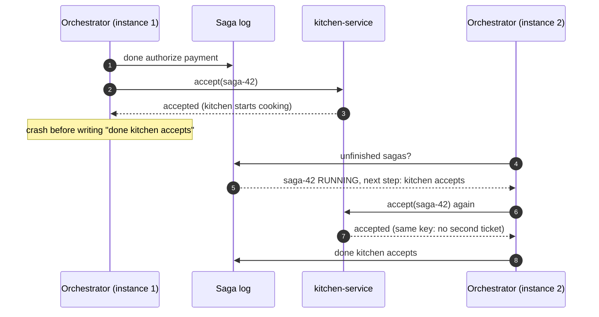

# 14. Saga Pattern

<div class="badges" markdown><span class="badge badge-l3">L3 · Senior/Lead</span><span class="badge badge-l4">L4 · Architect</span><span class="badge badge-meta">Orchestrator with saga log · choreography · failure simulation</span></div>

<div class="grid two" markdown>

!!! info "Prerequisites"
    - [Chapter 3](../foundations/ch03-distributed-systems-fundamentals.md): partial failure, retries, idempotency keys
    - [Chapter 9](ch09-hexagonal-clean-architecture.md) (payment-service) and [Chapter 12](ch12-database-per-service.md) (database per service)
    - [Chapter 13](ch13-cqrs-event-sourcing.md): events and eventual consistency

!!! abstract "What you'll learn"
    - Why two-phase commit doesn't fit microservices, and what a **saga** gives up instead
    - **Compensating actions**, and the three step kinds: **compensatable, pivot, retriable**
    - **Orchestration vs choreography**, with the same flow built both ways
    - Crash recovery with a **saga log**, and why every participant must be **idempotent**
    - **Missing isolation** and its countermeasures: semantic locks, commutative updates, re-reading values, ordering
    - Measured: 10,000 sagas with failures and crashes, with and without idempotent payments

</div>

---

## 1 · Introduction & Context

### Placing an order touches five services

When a FoodFleet customer taps **Place order**, five services must each do their part:

1. **ordering** creates the order;
2. **promotions** reserves the coupon (limited uses);
3. **payment** authorizes ₹500 on the customer's UPI or card;
4. **kitchen** accepts the order and starts cooking;
5. **payment** captures the money, **delivery** finds a rider, **ordering** marks the order approved.

In a monolith this was one database transaction: all or nothing. With database per service (chapter 12) each step is a **local** transaction in a different database. If the kitchen rejects the order after the payment was authorized, nothing rolls the payment back automatically. FoodFleet's first version didn't handle this at all, and in its first busy weekend about 0.4% of orders ended with money held for food that was never cooked.

A **saga** is the answer: a sequence of local transactions where each step has a **compensating action** that semantically undoes it. If a step fails, the saga runs the compensations of the completed steps in reverse order. The system becomes **eventually consistent** instead of atomic, and the design work is in making that safe.

### Why not a distributed transaction?

Two-phase commit (XA) coordinates several databases so they all commit or all abort. It's rarely right for microservices:

- **Availability**: every participant and the coordinator must be up for any transaction to finish; locks are held while waiting.
- **Coupling**: services must share a transaction manager and use XA-capable resources; message brokers and HTTP APIs don't take part.
- **Latency**: locks are held across network round trips to every participant, under load.
- **Reality**: a payment provider, a restaurant's tablet and a rider app will never join your transaction.

### Where sagas come from

<ul class="mh-timeline">
<li><span class="when">1987 · Garcia-Molina & Salem</span><span class="what"><em>Sagas</em>: long-lived transactions split into a sequence of sub-transactions with compensations, so locks aren't held for hours.</span></li>
<li><span class="when">2000s · Workflow engines and BPM</span><span class="what">Compensation handlers in BPEL and process engines.</span></li>
<li><span class="when">2017–2018 · Chris Richardson</span><span class="what"><em>Microservices Patterns</em>: orchestration vs choreography, compensatable/pivot/retriable transactions, countermeasures for lack of isolation; the Eventuate Tram Sagas framework.</span></li>
<li><span class="when">2019 onwards · Durable execution</span><span class="what">Temporal (from Uber's Cadence), AWS Step Functions, Camunda and others run saga orchestrations as durable workflows.</span></li>
</ul>

---

## 2 · Core Concepts & Terminology

### Step kinds

| Kind | Meaning | Place-order steps |
|---|---|---|
| **Compensatable** | Can be undone by a compensating action if a later step fails | create order (→ reject), reserve coupon (→ release), authorize payment (→ void) |
| **Pivot** | The point of no return: once it succeeds, the saga will complete | kitchen accepts (food is being cooked) |
| **Retriable** | After the pivot: guaranteed to succeed eventually, so it is retried, never compensated | capture payment, request rider, approve order |

The order is fixed: compensatable steps, then at most one pivot, then retriable steps. Designing a saga is largely choosing the pivot and putting likely-to-fail, cheap checks first.

### Orchestration vs choreography



| | Orchestration | Choreography |
|---|---|---|
| Where the flow lives | One orchestrator (code or workflow definition) | Spread across services' event handlers |
| Understanding the flow | Read one place | Trace events across services |
| Coupling | Orchestrator knows participants' APIs | Services know each other's events |
| Compensation | Central, in reverse order | Each service reacts to failure events |
| Monitoring "where is order X?" | The saga log answers | Needs tracing and correlation across topics |
| Best for | Many steps, money, branching, timeouts | Few steps, simple reactions, notifications |

### Words used in this chapter

Saga log
:   The orchestrator's durable record of each saga's progress, written before moving on, so another instance can resume after a crash.

Idempotent participant
:   Repeating a request with the same key (saga id + step) has no extra effect and returns the original outcome.

Semantic lock
:   An application-level marker (`PENDING` order) that tells other operations a saga is in progress on that record.

Lack of isolation
:   Other transactions can see a saga's intermediate states (coupon reserved, order not yet approved). The **ACD** without the I: sagas are atomic (eventually), consistent and durable, but not isolated.

---

## 3 · How It Works Internally

### The orchestrator's loop

1. Write `started` to the saga log.
2. For each step: call the participant; on success, write `done <step>` and continue.
3. On a **transient** failure (timeout, 503), retry with the same idempotency key, a bounded number of times.
4. On a **business rejection** before or at the pivot (card declined, kitchen closed): write `failed <step>` and run compensations of completed compensatable steps **in reverse order**, writing each one.
5. If retries are exhausted **before** the pivot: the outcome is unknown (the reply may have been lost), so also compensate the failing step. Compensations must be safe when there is nothing to undo.
6. After the pivot there is no going back: a retriable step that keeps failing marks the saga **STUCK** for a later retry or a human, never compensated.

The same applies if the **pivot's own** outcome is unknown: the kitchen may already be cooking, so going back would be a guess. The saga stops and retries the pivot later.

### Crash recovery: at-least-once calls



Because the orchestrator writes the log *after* the call returns, a crash in between means the call is made **again** on resume. Every action and compensation must therefore be idempotent per (saga id, step). In production the log write and the message that calls the next participant are written in one transaction through an outbox ([chapter 15](ch15-outbox-inbox-cdc.md)), and participants deduplicate with an inbox.

### The subtle bug: a retry that gets "rejected"

An idempotent participant must answer a repeated request with the **original** outcome. Consider:

1. payment-service authorizes ₹500, but the reply is lost (timeout);
2. the orchestrator retries; this time a fraud rule (or a now-insufficient balance) says **declined**;
3. the orchestrator sees a rejection, assumes the authorization never happened, and compensates only the earlier steps.

The customer's ₹500 stays held. The fix is in the participant: for a repeated key, return the stored result of the first attempt, never re-evaluate. The chapter's simulation found exactly this bug in a first version of its own participants: 7 double charges in 10,000 sagas until it was fixed.

### Missing isolation and its countermeasures

Between steps, other requests see intermediate states. Richardson's countermeasures, applied to FoodFleet:

| Anomaly | Example | Countermeasure |
|---|---|---|
| **Dirty read** | Support sees an order with a reserved coupon that will be released | **Semantic lock**: order is `PENDING`; screens and other flows treat it as "in progress" |
| **Lost update** | A customer cancels while the saga is approving | Semantic lock + **reject or queue** commands on `PENDING` orders |
| **Fuzzy read** | Delivery fee computed from a zone price that changes mid-saga | **Re-read value** at the step that uses it, or **pessimistic view**: copy the value into the saga at the start |
| Coupon over-redemption | Two sagas race for the last coupon use | **Commutative update** with a bound (decrement-if-positive) in the coupon owner |
| Refund before capture | Compensation overtakes the forward step | **By value / ordering**: per-order message ordering; compensations tolerant of missing originals |

---

## 4 · Design Considerations & Trade-offs

### Measured: 10,000 sagas with failures and crashes

The simulation runs the place-order saga against participants with injected business rejections (declined cards 8%, kitchen rejections 5%, exhausted coupons 2%), transient failures (kitchen tablets 10%, no rider free 15%), lost replies, and an orchestrator crash after 0.5% of calls. Then the participants recover and stuck sagas are retried. Verified output:

| | Idempotent participants | payment-service **not** idempotent |
|---|---:|---:|
| Completed / compensated / stuck (first pass) | 8,638 / 1,321 / 41 | 8,540 / 1,417 / 43 |
| After retrying stuck sagas | 8,679 / 1,321 / 0 | 8,583 / 1,417 / 0 |
| Orchestrator crashes resumed from the log | 351 | 348 |
| Authorizations voided by compensation | 475 | 518 |
| Money held beyond completed orders | **₹0** | **₹82,500 (165 double charges)** |
| Coupons leaked / approved without kitchen | 0 / 0 | 0 / 0 |

What it shows:

- With **retries, a saga log and idempotent participants**, money and coupons add up exactly, despite hundreds of crashes and lost replies.
- Remove idempotency from **one** participant and retries and crash recovery turn into double charges, about 1.7% of orders, invisibly, until customers complain.
- **STUCK** is a normal state, not a bug: 41 sagas waited for a kitchen or rider outage to pass and then completed. They need a dashboard, a retry job and an alert on age.

Failure rates are illustrative; change them in `SagaSimulation.foodFleetOdds()`.

### Choosing orchestration or choreography

<div class="mh-axes" markdown>
<div class="mh-axes__y">Steps, branches and money involved →</div>
<div class="mh-axes__cell ok"><strong>Orchestrate anyway</strong>Few services but money or strict ordering: one place to audit and monitor.</div>
<div class="mh-axes__cell good"><strong>Orchestration</strong>Many steps, compensations, timeouts, human tasks; often a workflow engine.<br><span class="pin">place order, refunds</span></div>
<div class="mh-axes__cell good"><strong>Choreography</strong>Two or three services reacting to a fact, no compensation chain.<br><span class="pin">order delivered → rating request, loyalty points</span></div>
<div class="mh-axes__cell bad"><strong>Event spaghetti</strong>Many services, long implicit flows, compensations spread everywhere; nobody can answer "where is order X?"</div>
<div class="mh-axes__x">Number of services involved →</div>
</div>

### Build or use a workflow engine?

| Option | Strengths | Watch out for |
|---|---|---|
| Hand-written orchestrator + saga log (this chapter) | Small, transparent, no new infrastructure | You own retries, timers, versioning, visibility |
| Temporal / Cadence | Durable execution: workflow code as plain functions, automatic state, timers, retries | New platform to run (or buy); deterministic-code rules |
| Camunda / Zeebe, Flowable | BPMN models, human tasks, business visibility | Modelling discipline; engine operations |
| AWS Step Functions, Azure Durable Functions | Managed, integrated with cloud services | Vendor lock-in; pricing per transition |
| Axon, Eventuate Tram | Saga support in event-driven Java frameworks | Framework commitment |

FoodFleet runs a hand-written orchestrator for place-order (one flow, latency-sensitive) and uses a workflow engine for long-running flows with timers and humans: refunds with manual review and restaurant onboarding.

### Designing compensations

- A compensation is a **new business action**, not a rollback: "void authorization", "release coupon", "reject order", "send apology with voucher".
- Some actions **can't be compensated** (an SMS was sent, food was cooked): put them after the pivot, or compensate with a different action (a voucher).
- Compensations must **never fail for business reasons**; if they fail technically, retry them until they succeed, and alert.
- Compensations must be **safe if the original never happened** or was already undone.

---

## 5 · Hands-on Implementation

Code: `code/chapters/ch14-saga/`. Plain Java (JUnit only for tests), so every rule can be tested and the simulation runs in seconds.

```bash
cd code
mvn -B -pl chapters/ch14-saga -am verify
java -cp chapters/ch14-saga/target/classes dev.foodfleet.ch14.simulation.SagaSimulation
```

### 🟣 Level 3: the saga definition

<div class="badges" markdown><span class="badge badge-l3">L3 · Senior/Lead</span></div>

```java title="placeorder/PlaceOrderSaga.java"
--8<-- "code/chapters/ch14-saga/src/main/java/dev/foodfleet/ch14/placeorder/PlaceOrderSaga.java"
```

The definition is validated: compensatable steps, at most one pivot, then retriable steps.

```java title="saga/SagaDefinition.java"
--8<-- "code/chapters/ch14-saga/src/main/java/dev/foodfleet/ch14/saga/SagaDefinition.java"
```

### 🟣 Level 3: the orchestrator

<div class="badges" markdown><span class="badge badge-l3">L3 · Senior/Lead</span></div>

Forward with retries; backward in reverse order; STUCK after the pivot or when a compensation keeps failing:

```java title="saga/SagaOrchestrator.java (forward and backward)"
--8<-- "code/chapters/ch14-saga/src/main/java/dev/foodfleet/ch14/saga/SagaOrchestrator.java:84:124"
```

Every scenario as a test:

```java title="PlaceOrderSagaTest.java"
--8<-- "code/chapters/ch14-saga/src/test/java/dev/foodfleet/ch14/placeorder/PlaceOrderSagaTest.java"
```

### 🔴 Level 4: idempotent participants

<div class="badges" markdown><span class="badge badge-l4">L4 · Architect</span></div>

The two promises every participant keeps: a repeated request returns the original outcome, and compensating something that never happened does nothing:

```java title="placeorder/Participant.java"
--8<-- "code/chapters/ch14-saga/src/main/java/dev/foodfleet/ch14/placeorder/Participant.java:31:63"
```

### 🔴 Level 4: the same flow, choreographed

<div class="badges" markdown><span class="badge badge-l4">L4 · Architect</span></div>

No orchestrator: each service subscribes to the previous one's events. Compare how much you must read to know what happens when the kitchen says no:

```java title="choreography/ChoreographedPlaceOrder.java"
--8<-- "code/chapters/ch14-saga/src/main/java/dev/foodfleet/ch14/choreography/ChoreographedPlaceOrder.java"
```

```java title="ChoreographyTest.java"
--8<-- "code/chapters/ch14-saga/src/test/java/dev/foodfleet/ch14/choreography/ChoreographyTest.java"
```

The last test shows choreography's characteristic failure: delivery's handler dead-letters after three redeliveries, yet the order is approved, because **nobody owns the whole flow**. In the orchestrated version the same failure leaves the saga STUCK, visible and retried.

### Run and verify

```text
$ java -cp chapters/ch14-saga/target/classes dev.foodfleet.ch14.simulation.SagaSimulation
== idempotent participants ==
10000 sagas, 351 orchestrator crashes (resumed from the log)
first pass:  {COMPLETED=8638, COMPENSATED=1321, STUCK=41}
after retry: {COMPLETED=8679, COMPENSATED=1321}
authorizations voided: 475
money held: ₹4,339,500, expected ₹4,339,500, extra ₹0 (0 double charges)
coupons leaked: 0, approved orders without a kitchen ticket: 0

== payment-service NOT idempotent ==
10000 sagas, 348 orchestrator crashes (resumed from the log)
first pass:  {COMPLETED=8540, COMPENSATED=1417, STUCK=43}
after retry: {COMPLETED=8583, COMPENSATED=1417}
authorizations voided: 518
money held: ₹4,374,000, expected ₹4,291,500, extra ₹82,500 (165 double charges)
coupons leaked: 0, approved orders without a kitchen ticket: 0
```

!!! question "Try it"
    1. Move "authorize payment" after "kitchen accepts" in `PlaceOrderSaga`. Which validation fails, and what would that order mean for a restaurant whose customer's card is declined?
    2. Set the kitchen's reject rate to 30% in the simulation. How many authorizations are voided? What does that cost in payment-provider fees, and how could the step order reduce it?
    3. Remove the `repeatOfSuccess` check in `Participant` and rerun. Where do the double charges come from now?
    4. Add a "send confirmation SMS" step. Where must it go, and why?

---

## 6 · Production Readiness

- [x] **Every action and compensation idempotent** per (saga id, step); repeated requests return the original outcome
- [x] **Saga log written transactionally** with the outgoing message (outbox); participants deduplicate (inbox)
- [x] **Explicit step kinds**: the pivot is named in the design; nothing compensatable after it
- [x] **Transient vs business failures** distinguished in participants' APIs; retries bounded with backoff
- [x] **Semantic locks** on records in flight (`PENDING`), honoured by every other flow and screen
- [x] **Timeouts per saga**: a saga that hasn't progressed in N minutes is retried or escalated
- [x] **STUCK sagas** on a dashboard, with a retry job and an alert on count and age
- [x] **Compensations never fail for business reasons**; technical failures retried until they succeed
- [x] **Correlation id = saga id** in logs, traces and messages; "where is order X?" answerable in one query
- [x] **Saga definitions versioned**: in-flight sagas finish on the version they started with
- [x] **Reconciliation jobs** against external systems (payment provider) for anything still uncertain

---

## 7 · Anti-patterns & Pitfalls

!!! pitfall "Incident 1: money held for food never cooked"
    **Context.** The first place-order flow called payment, then kitchen, with no compensation.
    **Symptoms.** About 0.4% of orders over a weekend: customers charged, no food, no refund; support spent two days voiding authorizations by hand.
    **Root cause.** No saga: a failure after a successful step left the earlier step in place.
    **Fix.** The orchestrated saga with compensations and a reconciliation job against the provider.

!!! pitfall "Incident 2: the retry that was declined"
    **Context.** payment-service re-ran its fraud rules on every request, including retries with the same idempotency key.
    **Symptoms.** A handful of customers per day had ₹500 held after their order was "cancelled".
    **Root cause.** The first authorization succeeded but its reply was lost; the retry was declined, so the saga compensated only earlier steps and never voided the first authorization.
    **Fix.** Idempotency means returning the **stored** result for a repeated key; the simulation's check now guards against regressions.

!!! pitfall "Incident 3: the implicit flow nobody owned"
    **Context.** Refunds were choreographed across ordering, payment, wallet, notification and loyalty services.
    **Symptoms.** When loyalty-service dead-lettered events for a day, customers got refunds but kept loyalty points for cancelled orders; nobody noticed for a week.
    **Root cause.** No component knew the whole flow or its completion state.
    **Fix.** Refunds moved to an orchestrated workflow with explicit completion and a dashboard of incomplete refunds.

| Anti-pattern | Symptom | Fix |
|---|---|---|
| Distributed transactions (2PC) across services | Locks across services; one outage blocks all | Sagas |
| Non-idempotent participants | Double charges after retries and crashes | Idempotency keys; stored outcomes |
| Compensating after the pivot | Refunding food that is already cooked | Name the pivot; retriable steps after it |
| Compensations that can fail for business reasons | Sagas half-undone | Compensations must always be possible |
| Ignoring isolation | Users see and act on intermediate states | Semantic locks and other countermeasures |
| Long choreographies | Nobody can answer "where is order X?" | Orchestrate flows with many steps |
| No STUCK handling | Silent half-finished sagas | Dashboards, retry jobs, alerts |
| Orchestrator with business rules | Orchestrator becomes a god service | Rules in participants; orchestrator sequences |

---

## 8 · Enterprise Case Study

### FoodFleet: the place-order saga

!!! decision "ADR-014: Place-order is an orchestrated saga with the kitchen as pivot"
    **Status:** Accepted · **Date:** 2024-04-08

    **Context.** Placing an order spans ordering, promotions, payment, kitchen and delivery, each with its own database (ADR-012). Failures after payment left money held; choreography made the flow hard to monitor.

    **Decision.** An orchestrator inside ordering-service runs the saga: create order (PENDING, a semantic lock) → reserve coupon → authorize payment → **kitchen accepts (pivot)** → capture → request rider → approve. Steps before the pivot have compensations; steps after it are retried until they succeed, with STUCK sagas on a dashboard. The saga log and outgoing commands are written through an outbox; every participant is idempotent per (saga id, step) and returns stored outcomes for repeats. Long-running flows with humans (refund review, onboarding) use a workflow engine.

    **Consequences.** ✅ No money held for uncooked food; every order's progress is visible by saga id. ✅ Hundreds of orchestrator restarts per day are harmless. ⚠️ Customers see "confirming with restaurant" while the saga runs. ⚠️ Every participant team owns idempotency and compensation correctness, enforced with contract tests.

### Fintech analogue: payments that span banks 🔴

A UPI or card payment is itself a saga across the customer's bank, the network and the merchant's bank: debit, credit and, on failure, a **reversal**, a compensating transaction, not a rollback. Banks add exactly the elements this chapter recommends: unique transaction references (idempotency), status-check APIs for unknown outcomes, timeouts that trigger reversals, and daily **reconciliation** files to settle anything still uncertain. "Pending" payments in banking apps are semantic locks made visible.

### E-commerce analogue: checkout with inventory

Marketplace checkout reserves inventory (compensatable: release), authorizes payment (compensatable: void), and confirms the order with the seller or warehouse (pivot), then ships (retriable). Reservations with **expiry** are a common extra countermeasure: if a saga stalls, the stock returns to sale automatically after N minutes, so a stuck saga can't hold popular items during a sale.

---

## 9 · Interview Q&A + Summary

#### Q1. What is a saga? · <span class="badge badge-l2">L2</span><span class="badge badge-l3">L3</span> · Cognizant · SAP · Flipkart

**Short answer:** A sequence of local transactions across services, where each step has a compensating action. If a step fails, the compensations of completed steps run in reverse order. It provides eventual atomicity without distributed locks.

#### Q2. Why not use two-phase commit across microservices? · <span class="badge badge-l3">L3</span> · Goldman Sachs · Amazon

**Short answer:** It needs every participant and the coordinator available to finish, holds locks across network calls, requires XA-capable resources (brokers and HTTP APIs aren't), and couples services to a shared transaction manager. External systems like payment providers never participate.

#### Q3. Orchestration vs choreography? · <span class="badge badge-l3">L3</span> · Amazon · Flipkart · SAP

**Short answer:** Orchestration: a central coordinator tells participants what to do and tracks state; easier to understand, monitor and change. Choreography: services react to each other's events; looser coupling, but the flow is implicit and compensation is spread out. Orchestrate flows with many steps or money; choreograph simple reactions.

#### Q4. What are compensatable, pivot and retriable transactions? · <span class="badge badge-l4">L4</span> · Goldman Sachs · JP Morgan

**Short answer:** Compensatable steps can be undone; the pivot is the point of no return (if it succeeds, the saga completes); retriable steps follow the pivot and must eventually succeed, so they are retried, not compensated. The order is compensatable*, pivot, retriable*.

#### Q5. Why must saga participants be idempotent? · <span class="badge badge-l3">L3</span> · Amazon · JP Morgan

**Short answer:** Retries after timeouts and orchestrator recovery after crashes deliver the same request more than once; replies can be lost after the work was done. Without idempotency, retries double-charge or double-book. And a repeated request must return the original outcome, not be re-evaluated.

#### Q6. Sagas lack isolation. What problems does that cause and how do you handle them? · <span class="badge badge-l4">L4</span> · Goldman Sachs · SAP

**Short answer:** Dirty reads, lost updates and fuzzy reads of intermediate state. Countermeasures: semantic locks (PENDING states), commutative updates, re-reading values, pessimistic views (copying values into the saga), ordering by value, and reservations with expiry.

#### Q7. What happens if the orchestrator crashes mid-saga? · <span class="badge badge-l3">L3</span> · Amazon · Flipkart

**Short answer:** Its progress is in a durable saga log; another instance finds unfinished sagas and resumes from the last recorded step, re-sending the in-flight request (at-least-once). Idempotent participants make the repeat harmless. The log write and outgoing message use an outbox so they can't diverge.

#### Q8. What if a compensation fails? · <span class="badge badge-l3">L3</span><span class="badge badge-l4">L4</span> · JP Morgan · Goldman Sachs

**Short answer:** Compensations are designed never to fail for business reasons; technical failures are retried until they succeed (they're idempotent). If they keep failing, the saga is marked stuck and escalated, with alerting and a manual procedure, plus reconciliation against the external system.

#### Q9. Design the order placement for a food delivery app. · <span class="badge badge-l4">L4</span> · Swiggy-/Zomato-style system design rounds

**Short answer:** An orchestrated saga: create order (PENDING) → reserve coupon → authorize payment → restaurant accepts (pivot) → capture, assign rider, confirm. Compensations: release coupon, void authorization, reject order. Idempotency keys per step, outbox and inbox, timeouts (restaurant doesn't respond in 3 minutes → reject and compensate), STUCK dashboard, customer-visible "confirming with restaurant" state.

#### Q10. Would you use a workflow engine like Temporal? · <span class="badge badge-l3">L3</span><span class="badge badge-l4">L4</span> · Flipkart · startups

**Short answer:** Yes for long-running flows with timers, human steps and many branches: durable execution removes most hand-written state handling. For a short, latency-sensitive saga a small orchestrator with a saga log may be simpler. Either way participants must still be idempotent.

#### Q11. How do you test sagas? · <span class="badge badge-l3">L3</span> · any

**Short answer:** Unit-test the orchestrator against fake participants with scripted faults (rejections, timeouts, lost replies, crashes at every step), check invariants (money and stock add up) over randomized simulations, contract-test each participant's idempotency and compensations, and run chaos experiments in staging.

#### Q12. How do you show a saga's progress to users? · <span class="badge badge-l2">L2</span><span class="badge badge-l3">L3</span> · product companies

**Short answer:** Expose the semantic lock as a state ("confirming with restaurant"), push updates as the saga progresses (WebSocket/SSE), and design copy for compensation outcomes ("restaurant couldn't accept; your payment was released").

### Key takeaways

- A saga replaces one atomic transaction with **local transactions plus compensations**; it is eventually atomic and **not isolated**.
- Name the **pivot**: compensatable steps before it, retriable steps after it.
- **Orchestrate** flows with many steps or money; **choreograph** simple reactions.
- **Idempotency** (returning original outcomes) and a **saga log** make retries and crashes harmless; the simulation shows what happens without them.
- Handle **STUCK** sagas and **isolation** anomalies explicitly; they are normal, not exceptional.

### Further reading

- Hector Garcia-Molina and Kenneth Salem, *Sagas*, ACM SIGMOD 1987
- Chris Richardson, *Microservices Patterns* (Manning, 2018), chapter 4, and [microservices.io: Saga](https://microservices.io/patterns/data/saga.html)
- Caitie McCaffrey, *Distributed Sagas: A Protocol for Coordinating Microservices* (talk, 2017)
- Microsoft Azure Architecture Center, [Saga distributed transactions pattern](https://learn.microsoft.com/azure/architecture/reference-architectures/saga/saga) and [Compensating Transaction pattern](https://learn.microsoft.com/azure/architecture/patterns/compensating-transaction)
- [Temporal documentation](https://docs.temporal.io/): durable execution and saga examples

---

**Previous:** [← 13. CQRS & Event Sourcing](ch13-cqrs-event-sourcing.md) · **Next:** [15. Transactional Outbox, Inbox & CDC →](ch15-outbox-inbox-cdc.md)
