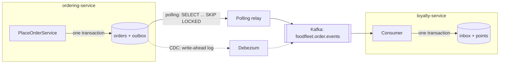

# 15. Transactional Outbox, Inbox & CDC

<div class="badges" markdown><span class="badge badge-l3">L3 · Senior/Lead</span><span class="badge badge-l4">L4 · Architect</span><span class="badge badge-meta">Spring Boot 4 · PostgreSQL · Debezium · failure simulation</span></div>

<div class="grid two" markdown>

!!! info "Prerequisites"
    - [Chapter 3](../foundations/ch03-distributed-systems-fundamentals.md): partial failure, at-least-once delivery, idempotency
    - [Chapter 12](ch12-database-per-service.md): each service owns its database
    - [Chapter 14](ch14-saga-pattern.md): sagas, which depend on this chapter to send their commands reliably

!!! abstract "What you'll learn"
    - The **dual-write problem**, and why neither order of "save, then publish" is safe
    - The **transactional outbox**: the event is written in the same transaction as the change
    - Two relays: a **polling publisher** (`FOR UPDATE SKIP LOCKED`) and **log tailing / CDC** with Debezium
    - The **inbox**: deduplication in the consumer's own transaction
    - Measured: 10,000 orders through five designs with the same failures
    - Ordering, outbox table growth, relay lag and the other things to run in production

</div>

---

## 1 · Introduction & Context

### A loyalty bug that wasn't in the loyalty service

FoodFleet gives one loyalty point per ₹10 spent. ordering-service saves the order, then publishes `OrderPlaced`; loyalty-service adds the points. Simple code:

```java
orders.save(order);                         // 1. commit to PostgreSQL
kafka.send("order-events", orderPlaced);    // 2. publish
```

Every week a few customers wrote in: points missing after an order. A few others had points for orders that didn't exist. The loyalty code was fine. The problem was the two lines above: a **dual write**, two writes to two systems with no transaction spanning both.

- If the pod is killed between line 1 and line 2 (a deploy, an out-of-memory kill), or Kafka is unreachable, the order is committed and **nobody is told**: a lost event.
- Swap the lines and a failed commit (deadlock, constraint, failover) means everyone **was told about an order that doesn't exist**: a phantom event.

There is no order of the two writes that's safe, and wrapping them in a "transaction" in code doesn't help: Kafka doesn't take part in the database's transaction.

### The pattern in one sentence

Write the event **into your own database, in the same transaction as the change** (the *outbox* table), and let a separate process (the *relay*) publish it, retrying until the broker acknowledges. Consumers record which messages they've processed in **their** transaction (the *inbox*), because the relay will sometimes publish twice.

### Where it comes from

<ul class="mh-timeline">
<li><span class="when">1990s–2000s · Enterprise integration</span><span class="what">"Guaranteed delivery" with a message store; distributed transactions (XA) across database and queue.</span></li>
<li><span class="when">2000s · Pat Helland, Gregor Hohpe</span><span class="what">Idempotent receivers; "Life beyond distributed transactions" (2007) argues for at-least-once messaging plus deduplication.</span></li>
<li><span class="when">2016–2018 · Debezium, Chris Richardson</span><span class="what">Debezium turns database logs into event streams; <em>Microservices Patterns</em> names the transactional outbox, polling publisher and transaction log tailing.</span></li>
<li><span class="when">2019 onwards · Mainstream</span><span class="what">Debezium's Outbox Event Router; outbox support in Axon, Eventuate, MassTransit, NServiceBus; Spring Modulith's event publication registry (an outbox for in-process events, used in chapter 1).</span></li>
</ul>

---

## 2 · Core Concepts & Terminology



Dual write
:   Updating two systems (database and broker, or two databases) without a transaction that covers both.

Transactional outbox
:   A table in the service's own database. The business change and the event row commit together, or neither does.

Relay (message relay)
:   The component that moves outbox rows to the broker: a **polling publisher** (queries the table) or **log tailing / CDC** (reads the database's write-ahead log).

Change data capture (CDC)
:   Reading committed changes from the database log as a stream. Debezium does this for PostgreSQL (logical replication), MySQL (binlog), SQL Server, Oracle, MongoDB and others.

Inbox (idempotent consumer)
:   A table in the consumer's database recording processed message ids, written in the same transaction as the consumer's effect.

Delivery guarantee
:   Outbox plus relay gives **at-least-once**: never lost, sometimes duplicated. **Effectively once** processing comes from at-least-once delivery plus an idempotent consumer.

---

## 3 · How It Works Internally

### Producer side: one local transaction

```sql
begin;
insert into orders (id, customer_id, total_paise, status) values ('o-1', 'c-1', 45000, 'PLACED');
insert into outbox (id, aggregate_type, aggregate_id, type, payload)
       values ('1111…', 'order', 'o-1', 'OrderPlaced', '{"orderId":"o-1","points":45}');
commit;   -- both rows, or neither
```

The order and the fact that an event must be published are now one atomic fact. Publishing becomes a separate, retryable job.

### Relay 1: polling publisher

Every few hundred milliseconds:

1. `SELECT … FROM outbox WHERE published_at IS NULL ORDER BY position LIMIT 100 FOR UPDATE SKIP LOCKED`
2. Publish each row, waiting for the broker's acknowledgement. On the first failure, **stop**, so later events never overtake earlier ones.
3. `UPDATE outbox SET published_at = now() WHERE id IN (…)`, commit.

If the relay dies after step 2 but before step 3, or the broker stored a message but its acknowledgement was lost, the rows are published **again** next time. That is why consumers need an inbox.

`SKIP LOCKED` lets several relay instances run without waiting on each other: rows locked by one instance are skipped by the others. Verified on PostgreSQL 16 with a second session holding a lock on `o-1`'s row:

```text
select ... from outbox where published_at is null order by position limit 100 for update skip locked;
 position | aggregate_id |    type     | payload
----------+--------------+-------------+-----------------------------------------------
        2 | o-2          | OrderPlaced | {"points": 30, "orderId": "o-2", ...}
(1 row)
Time: 1.234 ms
```

o-2 was published immediately while o-1 waited for the other instance, which also shows the cost: **across instances, global order is not preserved**. Per-aggregate order is what matters; section 4 covers how to keep it.

### Relay 2: log tailing (CDC)

The database already writes every committed change, in commit order, to its write-ahead log (WAL). Debezium reads it through a logical replication slot, picks out INSERTs into `outbox`, and publishes them. With the **Outbox Event Router** transform, `aggregate_type` chooses the topic, `aggregate_id` becomes the Kafka key and `payload` the value.

Because the log has the INSERT, the row doesn't need to stay in the table. Inserting and deleting it in the same transaction keeps the table empty. Verified with PostgreSQL's `test_decoding` plugin:

```text
ordering=# begin; insert into orders ...; insert into outbox ...; delete from outbox where id = '9999…'; commit;
ordering=# select count(*) from outbox where aggregate_id = 'o-9';     -- 0
ordering=# select data from pg_logical_slot_get_changes('ordering_outbox', null, null);
 BEGIN 745
 table public.orders: INSERT: id[character varying]:'o-9' customer_id[character varying]:'c-9' ...
 table public.outbox: INSERT: "position"[bigint]:4 id[uuid]:'9999…' aggregate_type[character varying]:'order'
                      aggregate_id[character varying]:'o-9' type[character varying]:'OrderPlaced'
                      payload[jsonb]:'{"points": 52, "orderId": "o-9"}' ...
 table public.outbox: DELETE: "position"[bigint]:4
 COMMIT 745
```

Notice `position` 4: a rolled-back transaction had used 3. Sequences aren't transactional, so **gaps are normal**; never use "no gap" as a signal that the relay has caught up.

Debezium stores its position (the LSN) as a connector offset, flushed periodically. After a crash it resumes from the last flushed offset and republishes what came after: at-least-once again.

### Consumer side: the inbox

```sql
begin;
insert into inbox (consumer, message_id) values ('loyalty-service', '1111…') on conflict do nothing;
-- 1 row inserted: first time, apply the effect. 0 rows: duplicate, skip.
insert into loyalty_points (customer_id, points) values ('c-1', 45)
  on conflict (customer_id) do update set points = loyalty_points.points + excluded.points;
commit;
-- then commit the Kafka offset
```

The inbox record and the effect commit together. If the consumer crashes before committing the broker offset, the message comes back, the inbox insert finds the id, and the effect is skipped. The primary key makes this safe even when two consumer instances receive the same message at once.

---

## 4 · Design Considerations & Trade-offs

### Measured: five designs, 10,000 orders, the same failures

The simulation places 10,000 orders (10% then cancelled) and injects the same seeded faults into every design: a pod killed after a commit (0.5%), failed commits (1%), an unavailable broker (1%), lost broker acknowledgements (0.5%), relay crashes (0.3% per message) and consumer crashes before the offset commit (0.5%). Then faults stop, everything drains, and we count. Verified output:

| Design | Lost events | Phantom events | Duplicate messages | Skipped by inbox | Loyalty points off by |
|---|---:|---:|---:|---:|---:|
| Dual write: commit, then publish | **169** | 0 | 0 | 67 | **−10,959** |
| Dual write: publish, then commit | 0 | **164** | 0 | 56 | **+11,393** |
| Outbox + polling, consumer **without** inbox | 0 | 0 | 96 | 0 | **+12,519** |
| Outbox + polling + inbox | 0 | 0 | 96 | 159 | **0** |
| Outbox + CDC + inbox | 0 | 0 | 178 | 230 | **0** |

What it shows:

- **Dual writes fail in both directions**: about 1.6% of events lost or invented. Each is a support ticket: missing points, or points for a phantom order.
- **The outbox alone fixes the producer**: nothing lost, nothing invented. But duplicates still happen (relay crashes, lost acks) and so do redeliveries (consumer crashes). Without an inbox they overcount, by more than either dual write.
- **Outbox plus inbox** is exact, with either relay. The inbox skipped more than the broker duplicates because consumer redeliveries are duplicates too.
- **CDC produced more duplicates** here (178 vs 96) because its offset is flushed every 20 log entries, so a crash replays more. That's a tuning choice, not a flaw; the inbox absorbs it.

Fault rates are illustrative; change them in `OutboxSimulation.foodFleetFaults()`.

### Polling publisher or CDC?

| | Polling publisher | Log tailing (Debezium) |
|---|---|---|
| Moving parts | Code in your service, a scheduler | Kafka Connect cluster, connector, replication slot |
| Latency | Poll interval (100 ms–1 s) | Usually tens of milliseconds |
| Load on the database | A query every interval per instance; index on unpublished rows | Reads the WAL; no queries on the table |
| Ordering | Single active relay: commit order of `position`; several instances: per-row locks only | Commit order from the log |
| Outbox table | Rows marked, deleted later by a job | Can be deleted in the same transaction |
| Failure modes | Relay down → backlog grows (visible as a count) | Slot not consumed → **WAL retained, disk fills**; schema changes; connector restarts |
| Works with | Any database you can query | Databases with a supported log (PostgreSQL, MySQL, SQL Server, Oracle, MongoDB…) |
| Good default for | One team, moderate volume, no Kafka Connect yet | Platform with Kafka Connect, high volume, many services |

FoodFleet started with the polling publisher in every service, then moved its five busiest services to Debezium when the platform team ran Kafka Connect for other reasons.

### Ordering

Consumers usually need events **for the same aggregate** in order (OrderPlaced before OrderCancelled), not a global order.

- Use the **aggregate id as the message key**, so all events of one order land in one partition.
- Run **one active polling relay** per service (leader election, or a lock such as ShedLock), or partition the outbox by aggregate id hash across instances. `SKIP LOCKED` alone with several instances can publish o-1's second event before its first.
- A relay that hits an error must **stop**, not skip ahead.
- Positions from a sequence are allocated at insert, not commit. A long transaction can commit position 41 after 42 was published. Per aggregate this can't happen (the order row lock serializes its transactions); across aggregates it doesn't matter.

### What goes in the event?

| Choice | Example | Trade-off |
|---|---|---|
| Event notification (id only) | `{"orderId":"o-1"}` | Small; consumers call back for data (coupling, load) |
| Event-carried state transfer | `{"orderId":"o-1","customerId":"c-1","points":45,...}` | Consumers are autonomous; payload is a contract to version |

FoodFleet carries the state the known consumers need and versions it like an API ([chapter 19](ch19-event-driven-architecture.md), [chapter 27](../communication/ch27-api-contracts.md)).

### Alternatives and where they fit

- **Listen to yourself**: publish only, and update your own database from the event too. Works when the service can tolerate seeing its own change late; awkward for request/response flows.
- **Event sourcing** ([chapter 13](ch13-cqrs-event-sourcing.md)): the event store *is* the database, so there is nothing to keep in sync; projections and publishing read the store.
- **Kafka transactions** give exactly-once *within Kafka* (consume, produce, commit offsets); they don't include your database.
- **Spring Modulith's event publication registry**: an outbox for application events inside one service, with externalization to a broker. A good start in a modular monolith (chapter 1).

---

## 5 · Hands-on Implementation

Code: `code/chapters/ch15-outbox-inbox-cdc/`. The simulation is plain Java; `app/` is the same design on Spring Boot 4 and PostgreSQL.

```bash
cd code
mvn -B -pl chapters/ch15-outbox-inbox-cdc -am verify      # container tests need Docker; skipped without it
java -cp chapters/ch15-outbox-inbox-cdc/target/classes dev.foodfleet.ch15.simulation.OutboxSimulation
```

### 🟣 Level 3: the bug, then the fix

<div class="badges" markdown><span class="badge badge-l3">L3 · Senior/Lead</span></div>

The dual write, in both orders:

```java title="dualwrite/DualWriteOrderService.java"
--8<-- "code/chapters/ch15-outbox-inbox-cdc/src/main/java/dev/foodfleet/ch15/dualwrite/DualWriteOrderService.java:57:73"
```

The outbox: the event row is part of the order's transaction.

```java title="outbox/OutboxOrderService.java"
--8<-- "code/chapters/ch15-outbox-inbox-cdc/src/main/java/dev/foodfleet/ch15/outbox/OutboxOrderService.java:28:38"
```

The polling publisher stops at the first failure, and is at-least-once by construction:

```java title="outbox/PollingPublisher.java"
--8<-- "code/chapters/ch15-outbox-inbox-cdc/src/main/java/dev/foodfleet/ch15/outbox/PollingPublisher.java:29:54"
```

The log-tailing relay reads committed changes and resumes from its flushed offset:

```java title="outbox/LogTailingRelay.java"
--8<-- "code/chapters/ch15-outbox-inbox-cdc/src/main/java/dev/foodfleet/ch15/outbox/LogTailingRelay.java:34:57"
```

The consumer, with and without an inbox:

```java title="inbox/LoyaltyConsumer.java"
--8<-- "code/chapters/ch15-outbox-inbox-cdc/src/main/java/dev/foodfleet/ch15/inbox/LoyaltyConsumer.java:40:70"
```

Each failure mode as a test:

```java title="PollingPublisherTest.java"
--8<-- "code/chapters/ch15-outbox-inbox-cdc/src/test/java/dev/foodfleet/ch15/outbox/PollingPublisherTest.java"
```

### 🔴 Level 4: Spring Boot 4 and PostgreSQL

<div class="badges" markdown><span class="badge badge-l4">L4 · Architect</span></div>

The schema: business table, outbox with a partial index on unpublished rows, inbox keyed by (consumer, message id):

```sql title="db/migration/V1__orders_outbox_inbox.sql"
--8<-- "code/chapters/ch15-outbox-inbox-cdc/src/main/resources/db/migration/V1__orders_outbox_inbox.sql"
```

The service writes the order and appends to the outbox; `Outbox.append` requires a surrounding transaction (`MANDATORY`), so calling it on its own fails instead of silently becoming a dual write again:

```java title="app/order/PlaceOrderService.java"
--8<-- "code/chapters/ch15-outbox-inbox-cdc/src/main/java/dev/foodfleet/ch15/app/order/PlaceOrderService.java:8:33"
```

```java title="app/outbox/Outbox.java"
--8<-- "code/chapters/ch15-outbox-inbox-cdc/src/main/java/dev/foodfleet/ch15/app/outbox/Outbox.java:10:40"
```

The relay: `FOR UPDATE SKIP LOCKED`, stop on first failure, mark only what was acknowledged, delete old rows nightly:

```java title="app/outbox/OutboxRelay.java"
--8<-- "code/chapters/ch15-outbox-inbox-cdc/src/main/java/dev/foodfleet/ch15/app/outbox/OutboxRelay.java:13:90"
```

The inbox and a handler that uses it:

```java title="app/inbox/Inbox.java"
--8<-- "code/chapters/ch15-outbox-inbox-cdc/src/main/java/dev/foodfleet/ch15/app/inbox/Inbox.java:9:33"
```

```java title="app/inbox/LoyaltyPointsHandler.java"
--8<-- "code/chapters/ch15-outbox-inbox-cdc/src/main/java/dev/foodfleet/ch15/app/inbox/LoyaltyPointsHandler.java:10:43"
```

Tests on real PostgreSQL (Testcontainers): rollback removes the event too, `MANDATORY` refuses a lone append, ordering, `SKIP LOCKED`, inbox:

```java title="OutboxContainerTest.java"
--8<-- "code/chapters/ch15-outbox-inbox-cdc/src/test/java/dev/foodfleet/ch15/app/OutboxContainerTest.java:32:140"
```

### 🔴 Level 4: the CDC relay with Debezium

<div class="badges" markdown><span class="badge badge-l4">L4 · Architect</span></div>

Replace `OutboxRelay` with a Kafka Connect connector. The Outbox Event Router maps columns to topic, key, value and headers:

```json title="debezium/ordering-outbox-connector.json"
--8<-- "code/chapters/ch15-outbox-inbox-cdc/debezium/ordering-outbox-connector.json"
```

PostgreSQL needs `wal_level = logical`, a replication user, and a heartbeat so the slot keeps advancing when the outbox is quiet (see `debezium/README.md`).

### Run and verify

```text
$ java -cp chapters/ch15-outbox-inbox-cdc/target/classes dev.foodfleet.ch15.simulation.OutboxSimulation
10,000 orders per design (10% cancelled), same seeded faults

design                                              events  on bus  lost phantom  dup msgs   dedup'd points off
dual write: commit, then publish                     11042   10873   169       0         0        67     -10959
dual write: publish, then commit                     10738   10902     0     164         0        56     +11393
outbox + polling publisher, consumer without inbox   10923   11019     0       0        96         0     +12519
outbox + polling publisher + inbox                   10923   11019     0       0        96       159         +0
outbox + log tailing (CDC) + inbox                   10918   11096     0       0       178       230         +0
```

!!! question "Try it"
    1. In `PollingPublisher.poll()`, replace `return published` on failure with `continue`. Write a test that shows OrderCancelled arriving before OrderPlaced.
    2. Set the CDC relay's `flushEvery` to 1 and to 500. How do duplicates change, and what does flushing every record cost a real connector?
    3. Make the loyalty consumer naturally idempotent instead (store points per order, sum on read). Does it still need an inbox if the same order can be cancelled and re-placed?
    4. Remove `propagation = MANDATORY` from `Outbox.append` and call it outside a transaction. What does the container test now let through?

---

## 6 · Production Readiness

- [x] **No dual writes**: a fitness test or code review rule rejects broker clients in transactional service code
- [x] **Outbox append requires a transaction** (`MANDATORY`); event and change commit together
- [x] **Message id** generated once per event and carried as a header; consumers deduplicate on it
- [x] **Aggregate id as message key**; one active relay per service, or partitioned relays
- [x] **Relay stops on first failure**; retries with backoff; alerts when the oldest unpublished row is older than N seconds
- [x] **Outbox cleanup**: published rows deleted after a retention period, in batches; or deleted immediately with CDC
- [x] **CDC**: replication slot lag monitored (`pg_replication_slots`), heartbeat configured, alert before the disk fills
- [x] **Inbox in the consumer's transaction**, with retention (keep ids longer than the broker can redeliver)
- [x] **Broker settings**: producer `acks=all`, idempotent producer; consumer commits offsets **after** the transaction
- [x] **Event schemas versioned**; payloads carry what consumers need (and no secrets or unneeded personal data)
- [x] **Dashboards**: outbox backlog, relay publish rate and errors, end-to-end latency (created_at → consumed), inbox duplicates
- [x] **Runbook**: replaying from the outbox, re-snapshotting a CDC connector, poisoned messages to a dead-letter topic

---

## 7 · Anti-patterns & Pitfalls

!!! pitfall "Incident 1: missing loyalty points"
    **Context.** ordering-service committed the order, then called `kafkaTemplate.send()`.
    **Symptoms.** Around 40 customers a week had no points for an order; no errors in loyalty-service.
    **Root cause.** Pods killed during deploys between commit and send, and short Kafka outages, lost events. Nobody had a list of what was lost.
    **Fix.** Transactional outbox with a polling relay; a one-off reconciliation job compared orders with the loyalty ledger.

!!! pitfall "Incident 2: double points after the fix"
    **Context.** The outbox shipped, and the team assumed "the outbox gives exactly once".
    **Symptoms.** Some customers had double points, clustered around relay restarts and a Kafka broker failover.
    **Root cause.** At-least-once delivery: the relay republished rows whose acks were lost, and consumers re-processed messages after crashes. loyalty-service had no deduplication.
    **Fix.** Inbox table in loyalty-service, written in the same transaction as the points update; a contract test that sends every message twice.

!!! pitfall "Incident 3: the disk that filled on a quiet Sunday"
    **Context.** ordering-service moved to Debezium. On Sundays the outbox was quiet but other tables in the same database were busy.
    **Symptoms.** The database disk filled; writes failed for 25 minutes.
    **Root cause.** The replication slot only advanced when Debezium received changes it was subscribed to, so PostgreSQL retained WAL for the busy tables. No alert on slot lag.
    **Fix.** Debezium heartbeat with an action query, `max_slot_wal_keep_size` as a safety limit, and an alert on retained WAL size.

| Anti-pattern | Symptom | Fix |
|---|---|---|
| Dual write (DB then broker, or broker then DB) | Lost or phantom events | Transactional outbox |
| Publishing inside the transaction before commit | Phantom events on rollback; long transactions | Publish from the relay after commit |
| "The outbox is exactly once" | Duplicates applied twice | Inbox / idempotent consumers |
| Inbox written outside the effect's transaction | Effect lost or applied twice after a crash | Same transaction |
| Relay skips failed rows | Events reordered | Stop on failure; retry |
| Several pollers without coordination | Same aggregate's events out of order | One active relay, or partition by aggregate |
| Outbox never cleaned | Table and index bloat, slower polling | Retention job, or delete with CDC |
| Unmonitored replication slot | WAL retained, disk full | Heartbeats, slot lag alerts, size limits |
| Raw table CDC as the public contract | Every column rename breaks consumers | Outbox with explicit event payloads |

---

## 8 · Enterprise Case Study

### FoodFleet: reliable events from every service

!!! decision "ADR-015: Every service publishes through a transactional outbox; every consumer uses an inbox"
    **Status:** Accepted · **Date:** 2024-04-22

    **Context.** Dual writes lost or invented about 1–2% of events under failure (missing loyalty points, phantom orders in analytics). The saga orchestrator (ADR-014) needs its commands sent reliably with its log writes.

    **Decision.** Services never call the broker from transactional code. They append events to an `outbox` table in the same transaction as the change; the platform library provides `Outbox.append` (requires a transaction) and a polling relay (`SKIP LOCKED`, single active instance, stop on failure). High-volume services use Debezium with the Outbox Event Router instead. Message id and aggregate key are mandatory. Every consumer records processed message ids in an `inbox` table in the same transaction as its effect.

    **Consequences.** ✅ No lost or phantom events; duplicates are absorbed. ✅ The saga log and its outgoing commands commit together. ⚠️ Events are delayed by the relay (p99 ~600 ms polling, ~80 ms CDC). ⚠️ Two more tables per service and their cleanup; Kafka Connect to operate for CDC services.

### Fintech analogue: ledgers and payment notifications 🔴

A payments platform posts a ledger entry and must notify the merchant (webhook), the risk system and the statement service. Banks have used the same shape for decades: the ledger posting and a "pending notification" record commit together; a dispatcher sends notifications and retries for days; receivers deduplicate on the transaction reference. CDC from the core ledger database feeds risk and reporting systems without adding load to the transactional path. Auditors like the outbox for another reason: it's a durable record of every event the system claimed to send.

### E-commerce analogue: order events to search, warehouse and email

An online store's order service feeds the warehouse (pick and pack), the email service and the search index. The warehouse needs every event exactly once in effect (inbox keyed by event id), email tolerates rare duplicates but not losses, and search needs only the latest state (an upsert by product id is naturally idempotent). One outbox serves all three; each consumer chooses how it deduplicates.

---

## 9 · Interview Q&A + Summary

#### Q1. What is the dual-write problem? · <span class="badge badge-l2">L2</span><span class="badge badge-l3">L3</span> · Flipkart · Cognizant · SAP

**Short answer:** Writing to two systems (a database and a broker) without a transaction covering both. A failure between the writes leaves them inconsistent: commit-then-publish loses events, publish-then-commit invents them.

#### Q2. How does the transactional outbox work? · <span class="badge badge-l3">L3</span> · Amazon · Flipkart · Goldman Sachs

**Short answer:** The event is inserted into an outbox table in the same local transaction as the business change. A relay reads the outbox (by polling or from the transaction log) and publishes to the broker, retrying until acknowledged, then marks or deletes the row.

#### Q3. Does the outbox give exactly-once delivery? · <span class="badge badge-l3">L3</span> · Amazon · JP Morgan

**Short answer:** No. It gives at-least-once: the relay can crash after publishing and before marking, or lose the broker's ack, and republish. Exactly-once *processing* needs an idempotent consumer, usually an inbox table keyed by message id.

#### Q4. Polling publisher vs CDC? · <span class="badge badge-l3">L3</span><span class="badge badge-l4">L4</span> · Flipkart · SAP · Goldman Sachs

**Short answer:** Polling is simple, in your code, works with any database, adds query load and latency of the poll interval. CDC (Debezium) reads the WAL: low latency, commit order, no table queries, but needs Kafka Connect, replication slots, monitoring of WAL retention and schema-change handling.

#### Q5. How do you preserve event order? · <span class="badge badge-l4">L4</span> · Amazon · Goldman Sachs

**Short answer:** Per aggregate: key messages by aggregate id (same partition), publish outbox rows in position order, stop on failure rather than skipping, and run one active relay per service (or partition relays by aggregate). Global order is rarely needed and expensive.

#### Q6. Why `FOR UPDATE SKIP LOCKED`? · <span class="badge badge-l3">L3</span> · JP Morgan · startups

**Short answer:** Several relay instances can poll the same table without blocking on each other or publishing the same row concurrently: each locks a batch and the others skip locked rows. It improves throughput but can reorder events across instances, so combine it with partitioning or a single active relay.

#### Q7. What is an inbox and why must it be in the same transaction? · <span class="badge badge-l3">L3</span> · Amazon · Flipkart

**Short answer:** A table of processed message ids in the consumer's database. Insert the id and apply the effect in one transaction: a duplicate fails the unique key and is skipped. If they were separate, a crash between them would lose the effect or apply it twice.

#### Q8. How would you make a consumer idempotent without an inbox? · <span class="badge badge-l3">L3</span> · any

**Short answer:** Design the effect to be idempotent: upserts by natural key, "set state to X" instead of "add N", version checks (apply only if event version > stored version). Inboxes are the general solution when effects aren't naturally idempotent, such as incrementing a balance.

#### Q9. What can go wrong with Debezium in production? · <span class="badge badge-l4">L4</span> · Flipkart · Goldman Sachs

**Short answer:** Replication slots retaining WAL when not consumed (disk full), quiet tables not advancing the slot (needs heartbeats), schema changes, connector restarts replaying events, snapshots on first start, failover to a replica without the slot. Monitor slot lag and connector status.

#### Q10. Why not just use Kafka transactions? · <span class="badge badge-l4">L4</span> · JP Morgan · Amazon

**Short answer:** Kafka transactions make consume-process-produce atomic within Kafka. Your PostgreSQL commit isn't part of them, so database plus Kafka is still a dual write. Use the outbox for the database-to-Kafka step; Kafka transactions can help in pure stream processing.

#### Q11. How do sagas use the outbox? · <span class="badge badge-l4">L4</span> · SAP · Goldman Sachs

**Short answer:** The orchestrator writes its saga-log update and the command for the next participant to the outbox in one transaction, so it can never record "sent" without sending, or send without recording. Participants use an inbox to deduplicate commands and write their replies through their own outbox.

#### Q12. What would you monitor? · <span class="badge badge-l3">L3</span> · any

**Short answer:** Outbox backlog and age of the oldest unpublished row, relay errors and publish rate, end-to-end latency from created_at to consumption, replication slot lag (CDC), inbox duplicate rate, dead-letter topic volume.

### Key takeaways

- A dual write is never safe; the **outbox** makes "change + event" one local transaction.
- Every relay is **at-least-once**; consumers need an **inbox** or naturally idempotent effects.
- **Polling** is the simple default; **CDC** is faster and lighter on the database but adds Kafka Connect and WAL-retention risk.
- Order matters **per aggregate**: key by aggregate id, stop on failure, one active relay or partitioned relays.
- Measured: dual writes lost or invented ~1.6% of events; outbox without inbox overcounted; outbox plus inbox was exact.

### Further reading

- Chris Richardson, *Microservices Patterns* (Manning, 2018), chapter 3, and [microservices.io: Transactional outbox](https://microservices.io/patterns/data/transactional-outbox.html)
- [Debezium documentation: Outbox Event Router](https://debezium.io/documentation/reference/stable/transformations/outbox-event-router.html) and Gunnar Morling, *Reliable Microservices Data Exchange With the Outbox Pattern* (Debezium blog, 2019)
- Pat Helland, *Life beyond Distributed Transactions: an Apostate's Opinion* (CIDR 2007)
- PostgreSQL documentation: [Logical Decoding](https://www.postgresql.org/docs/current/logicaldecoding.html) and [`SELECT … FOR UPDATE SKIP LOCKED`](https://www.postgresql.org/docs/current/sql-select.html#SQL-FOR-UPDATE-SHARE)
- [Spring Modulith: Event Publication Registry](https://docs.spring.io/spring-modulith/reference/events.html)

---

**Previous:** [← 14. Saga Pattern](ch14-saga-pattern.md) · **Next:** [16. Strangler Fig, ACL & Monolith Migration →](ch16-strangler-fig-migration.md)
