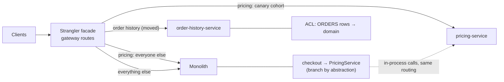

# 16. Strangler Fig, ACL & Monolith Migration

<div class="badges" markdown><span class="badge badge-l3">L3 · Senior/Lead</span><span class="badge badge-l4">L4 · Architect</span><span class="badge badge-meta">Shadow traffic · canary cohorts · Spring Cloud Gateway MVC · ArchUnit</span></div>

<div class="grid two" markdown>

!!! info "Prerequisites"
    - [Chapter 1](../foundations/ch01-architecture-styles.md): modular monolith first, and extraction seams
    - [Chapter 5](../foundations/ch05-domain-driven-design.md): bounded contexts and the anti-corruption layer as a context-map relationship
    - [Chapter 10](ch10-api-gateway-bff.md): the gateway, where most strangler routing lives

!!! abstract "What you'll learn"
    - Why big-bang rewrites fail, and what the **strangler fig** does instead
    - The **facade**: legacy, shadow, canary and new routing, changed by config
    - **Anti-corruption layers** in both directions, and **quarantine** instead of guessing
    - **Branch by abstraction** for calls that never pass the gateway
    - Measured: **shadow traffic** finds three bugs and one undocumented legacy behaviour; **canary** with a guard limits an incident to 8 customers
    - A **migration playbook**: what to move first, data, and when to delete the old code

</div>

---

## 1 · Introduction & Context

### The rewrite that never shipped

In 2023 FoodFleet started "Pricing 2.0": a new service, written from scratch, to replace pricing inside the monolith in one cut-over weekend. Eight months in, it still didn't match the monolith's prices. Each fix exposed another rule nobody had written down: gold members' free delivery, silver's ₹499 threshold, the late-night surcharge's hours *in IST*. Meanwhile the monolith's pricing kept changing for the business, so the target kept moving. The cut-over was postponed twice and then cancelled.

This is the classic big-bang rewrite: all the risk on one day, months of work with no feedback from production, and a frozen old system that can't actually be frozen.

### The strangler fig

Martin Fowler named the alternative after the strangler fig, a plant that grows around a host tree until it can stand on its own. Applied to software:

1. Put a **facade** in front of the monolith; everything still goes to the monolith.
2. Build one capability in a new service.
3. Route that capability's traffic to the new service, **gradually and reversibly**.
4. When it has taken all the traffic for long enough, **delete** the old code.
5. Repeat until the monolith is gone, or small enough that it no longer matters.

The second attempt, in 2024, moved pricing this way in seven weeks, and no customer saw a wrong price.

### Where it comes from

<ul class="mh-timeline">
<li><span class="when">2004 · Martin Fowler</span><span class="what"><em>StranglerApplication</em> (later <em>StranglerFigApplication</em>): grow the new system around the edges of the old.</span></li>
<li><span class="when">2003 · Eric Evans</span><span class="what"><em>Domain-Driven Design</em>: the anti-corruption layer, so a new model isn't bent by a legacy one.</span></li>
<li><span class="when">2007 · Paul Hammant</span><span class="what"><em>Branch by abstraction</em>: large changes on trunk, behind an interface, in small releasable steps.</span></li>
<li><span class="when">2015–2019 · Sam Newman, GitHub</span><span class="what"><em>Monolith to Microservices</em> catalogues the migration patterns; GitHub's Scientist library popularises comparing old and new code paths in production.</span></li>
<li><span class="when">2020s · Progressive delivery</span><span class="what">Feature-flag platforms, Argo Rollouts and service-mesh traffic splitting make cohorts, mirroring and automated rollback standard tooling.</span></li>
</ul>

---

## 2 · Core Concepts & Terminology



Strangler facade
:   The single place that decides, per request, whether the old or new system answers. Usually the gateway for external calls, plus an in-process switch for internal ones.

Anti-corruption layer (ACL)
:   A translation layer that keeps the legacy model (codes, encodings, quirks) out of the new model, in both directions.

Branch by abstraction
:   Put an interface in front of the code to replace, move every caller onto it, then swap the implementation behind it with a toggle, all on trunk.

Shadow traffic (dark launch, mirroring)
:   The old system answers; the new one is called too and its answer compared and discarded.

Canary cohort
:   A percentage of *customers* (not requests) routed to the new system, stable across requests, so a customer never flips between old and new.

Guard
:   An automated check on the new path's error rate (or latency, or business metrics) that rolls back without waiting for a human.

| Routing mode | Who answers | Customer risk | What you learn |
|---|---|---|---|
| `LEGACY` | Monolith | None | Nothing |
| `SHADOW` | Monolith; new is compared | None (if reads, async, with timeout) | Correctness differences, new-service failures, latency |
| `CANARY n%` | New for n% of customers | n% of customers | Real behaviour under real load |
| `NEW` | New service | Everyone | The monolith code can go |

---

## 3 · How It Works Internally

### The facade decides per request

```java title="strangler/StranglerFacade.java"
--8<-- "code/chapters/ch16-strangler-fig/src/main/java/dev/foodfleet/ch16/strangler/StranglerFacade.java:38:72"
```

Routing is read on **every request** from a supplier (a flag service, config, an `AtomicReference` in tests), so moving forward and rolling back are config changes that take effect in seconds, not deployments.

### Sticky cohorts

Canary percentages are applied to a stable hash of the customer id:

```java title="strangler/Cohorts.java"
--8<-- "code/chapters/ch16-strangler-fig/src/main/java/dev/foodfleet/ch16/strangler/Cohorts.java:5:29"
```

Three properties matter, and each has a test: a customer is always in the same bucket; buckets are uniform (850–1,150 of every 100,000 customers per bucket); and raising 5% to 25% keeps the first 5% in, so nobody bounces between prices during a rollout.

### Shadow comparison

The comparator checks the new answer field by field, counts outcomes, and keeps a few examples of each kind of difference for the team to debug:

```java title="strangler/ShadowComparator.java"
--8<-- "code/chapters/ch16-strangler-fig/src/main/java/dev/foodfleet/ch16/strangler/ShadowComparator.java:32:56"
```

Rules for shadowing safely:

- Shadow **reads and pure calculations** only. A shadowed write ("place order") would do it twice. For writes, compare the *decision* (what would be written) rather than performing it.
- Call the new service **asynchronously with a timeout**, so its latency can't slow the customer down.
- **Sample** if the new service can't take full production load yet.
- Compare **meaningfully**: field by field, with explicit, documented tolerances.

### The anti-corruption layer

The monolith's ORDERS table has a decade of history: one-letter statuses (some lower-case), rupees as `double`, pipe-delimited addresses with and without pincodes, IST timestamps as strings. The new order-history service reads these rows through an ACL that translates every quirk once, with a test, and **quarantines** anything it can't translate rather than guessing:

```java title="acl/LegacyOrderTranslator.java"
--8<-- "code/chapters/ch16-strangler-fig/src/main/java/dev/foodfleet/ch16/acl/LegacyOrderTranslator.java:29:55"
```

Note `paise()`: converting `0.1 + 0.2` rupees by multiplying by 100 gives `30.000000000000004`; going through `BigDecimal.valueOf` (the double's shortest decimal string) gives exactly 30 paise.

The legacy adapter behind `PricingService` is an ACL in the other direction: new model in (paise, metres, `Instant`, an enum), legacy call (rupees, km, IST string, "G"), new model out.

---

## 4 · Design Considerations & Trade-offs

### Measured A: shadow traffic for each release

50,000 FoodFleet-shaped requests (20,000 customers, 10% gold, 30% silver, 1–4 items, 0.5–9 km, any hour of a week), in `SHADOW` mode, for each release of pricing-service. Customers always got the monolith's price. Verified output:

| Release | Match | Within 1 paisa | Mismatch | What differed |
|---|---:|---:|---:|---|
| V1 | 29,812 | 0 | **20,188** | surcharge 15,129 · delivery fee 3,381 · both 1,678 |
| V2 | 46,501 | 3,499 | 0 | (surcharge rounded down: always within 1 paisa) |
| V3 | 49,389 | 611 | 0 | (monolith's float rounding) |

- **V1 was wrong for 40% of baskets.** It judged the late-night hours in UTC, so the 15% surcharge applied at 03:30–07:30 IST instead of 22:00–02:00, and it forgot gold members' free delivery. A big-bang cut-over would have shipped both.
- **V2** fixed both; the remaining differences were the surcharge being rounded down.
- **V3** rounds half-up, which the team believed the monolith did, and *still* differs by one paisa on 1.2% of baskets. The monolith computes `224.5 * 0.15 * 100`, which in binary floating point is `3367.4999999999995`, and rounds that down. Nobody had ever specified this; customers had been seeing it for six years.

That last finding is typical: the legacy system's behaviour *is* the specification, including what nobody intended. The team had three options: reproduce it bug for bug (compute in `double` the same way), fix it and accept a 1-paisa change for 1.2% of orders, or keep the monolith for that path. They chose to accept it explicitly, with a tolerance in the comparator and a line in the ADR. Shadowing made that a decision instead of a surprise.

### Measured B: rolling out during an incident

V3 is rolled out while a zone-data migration has just dropped Whitefield (3% of traffic), so pricing-service fails those requests. 1,000 requests a minute for an hour; all automated strategies use the same guard: *at least 200 new-path requests in the last 5 minutes and more than 1% failed → route everything back to the monolith*.

| Strategy | Rolled back | New-path requests | Errors customers saw | Customers affected |
|---|---:|---:|---:|---:|
| Big bang, no guard (on-call rolls back at 20 min) | minute 20 | 20,000 | **592** | **583** |
| Big bang with the guard | minute 1 | 1,000 | 21 | 21 |
| Canary 1→5→25→50→100%, 10 min per step | minute 14 | 309 | **8** | **8** |
| Canary + fall back to the monolith on error | minute 14 | 309 | **0** | 0 (8 fallbacks) |

What it shows:

- **Automated rollback is most of the win**: 592 → 21 errors, before canaries even enter the picture.
- **Canaries shrink the blast radius further**: 8 customers instead of 21, because only the cohort was exposed while the guard gathered evidence.
- **The 1% step proved nothing**: at 10 requests a minute it never reached the guard's 200-request minimum. Size the first step so the guard can actually decide, or use a longer window.
- **Fallback** hid the incident from customers entirely, while the guard still saw the failures and rolled back. It's only possible where the old path is still there and the operation is safe to repeat (reads, calculations).

### Choosing what to strangle first

| Good first candidates | Poor first candidates |
|---|---|
| Clear boundary, few callers (pricing, notifications, search) | The core everything touches (orders) |
| Mostly reads or calculations: shadowable | Writes with side effects you can't compare |
| Changes often: the new service pays back quickly | Stable code nobody needs to change |
| Data it owns can be separated | Tables joined by half the monolith |
| A team that will own it | "Whoever is free" |

### Data: the hardest part

Code moves in weeks; data takes longer. The usual sequence:

1. **New service reads legacy data through an ACL** (a read replica, a view, or an API on the monolith). No data moved yet.
2. **Copy and sync**: backfill, then keep in sync with CDC from the monolith's tables ([chapter 15](ch15-outbox-inbox-cdc.md)), translating through the same ACL. Quarantine what can't be translated.
3. **Reconcile** continuously: counts and checksums per day, differences reported.
4. **Switch writes** to the new service; the monolith now reads from it (or from a replicated copy flowing the other way).
5. **Retire** the legacy tables once nothing reads them (prove it: database audit logs, the ownership audit from [chapter 12](ch12-database-per-service.md)).

Avoid a period where **both** systems accept writes to the same data without a single owner; that's a dual write ([chapter 15](ch15-outbox-inbox-cdc.md)) on a larger scale.

### Where the routing lives

| Place | Good for | Limits |
|---|---|---|
| Gateway (Spring Cloud Gateway, NGINX, Envoy) | External HTTP calls, per-path and per-cohort routing | Doesn't see in-process calls |
| In the monolith (branch by abstraction + flags) | Internal calls, shadow comparison, fallback | Needs code changes in the monolith |
| Service mesh (Istio, Linkerd) | Weighted routing and mirroring between services ([chapter 57](../deployment/ch57-service-mesh.md)) | Per-request weights, not per customer, unless headers are used |
| Feature-flag platform ([OpenFeature, Unleash](../components-tools/feature-flags.md)) | Cohort targeting, kill switches, audit | Another dependency; flags need cleanup |

FoodFleet uses all of the first two: the gateway for the public API, the in-monolith facade for checkout's in-process calls, both reading the same percentage.

---

## 5 · Hands-on Implementation

Code: `code/chapters/ch16-strangler-fig/`. Everything except `gateway/` is plain Java.

```bash
cd code
mvn -B -pl chapters/ch16-strangler-fig -am verify
java -cp chapters/ch16-strangler-fig/target/classes dev.foodfleet.ch16.rollout.RolloutSimulation
```

### 🟣 Level 3: the seam and the new implementation

<div class="badges" markdown><span class="badge badge-l3">L3 · Senior/Lead</span></div>

The monolith's pricing, as it is:

```java title="legacy/LegacyPricing.java"
--8<-- "code/chapters/ch16-strangler-fig/src/main/java/dev/foodfleet/ch16/legacy/LegacyPricing.java"
```

pricing-service, with each release's bugs marked:

```java title="pricing/NewPricing.java"
--8<-- "code/chapters/ch16-strangler-fig/src/main/java/dev/foodfleet/ch16/pricing/NewPricing.java:7:73"
```

The tests that pin down each finding, including the monolith's rounding:

```java title="NewPricingTest.java"
--8<-- "code/chapters/ch16-strangler-fig/src/test/java/dev/foodfleet/ch16/pricing/NewPricingTest.java"
```

### 🟣 Level 3: the anti-corruption layer

<div class="badges" markdown><span class="badge badge-l3">L3 · Senior/Lead</span></div>

```java title="LegacyOrderTranslatorTest.java"
--8<-- "code/chapters/ch16-strangler-fig/src/test/java/dev/foodfleet/ch16/acl/LegacyOrderTranslatorTest.java"
```

### 🔴 Level 4: branch by abstraction, kept honest

<div class="badges" markdown><span class="badge badge-l4">L4 · Architect</span></div>

Checkout calls pricing in-process, so the gateway can't route it. It depends on the `PricingService` interface; the facade behind it is the switch:

```java title="branch/CheckoutService.java"
--8<-- "code/chapters/ch16-strangler-fig/src/main/java/dev/foodfleet/ch16/branch/CheckoutService.java"
```

An ArchUnit rule keeps step 1 true: a new direct call to the legacy code would bypass the switch.

```java title="branch/LegacyIsolationTest.java"
--8<-- "code/chapters/ch16-strangler-fig/src/test/java/dev/foodfleet/ch16/branch/LegacyIsolationTest.java"
```

### 🔴 Level 4: the facade at the edge

<div class="badges" markdown><span class="badge badge-l4">L4 · Architect</span></div>

The same routing for public traffic, with Spring Cloud Gateway Server Web MVC. Routes are ordered most specific first; the monolith is the catch-all that shrinks as capabilities move:

```java title="gateway/StranglerRoutes.java"
--8<-- "code/chapters/ch16-strangler-fig/src/main/java/dev/foodfleet/ch16/gateway/StranglerRoutes.java:13:44"
```

```java title="gateway/CanaryPredicate.java"
--8<-- "code/chapters/ch16-strangler-fig/src/main/java/dev/foodfleet/ch16/gateway/CanaryPredicate.java:7:22"
```

```yaml title="application.yml"
--8<-- "code/chapters/ch16-strangler-fig/src/main/resources/application.yml"
```

### The guard

```java title="rollout/RolloutSimulation.java (guard)"
--8<-- "code/chapters/ch16-strangler-fig/src/main/java/dev/foodfleet/ch16/rollout/RolloutSimulation.java:134:143"
```

### Run and verify

```text
$ java -cp chapters/ch16-strangler-fig/target/classes dev.foodfleet.ch16.rollout.RolloutSimulation
A. Shadow traffic: 50,000 requests per release; customers always get the monolith's price

release     match  <=1 paise   mismatch    failed  mismatches by differing field
V1          29812          0      20188         0  {deliveryFee=3381, deliveryFee+surcharge=1678, surcharge=15129}
V2          46501       3499          0         0  {}
V3          49389        611          0         0  {}

B. Rolling out V3 while Whitefield (3% of traffic) is missing from its zone data
   1,000 requests/minute for 60 minutes; guard: >1% failures over 5 min with >=200 requests

strategy                                           rolled back  new-path  errors shown  customers fallbacks
big bang, no guard (on-call rolls back at 20 min)    minute 20     20000           592        583         0
big bang: 100% at once                                minute 1      1000            21         21         0
canary 1-5-25-50-100%, 10 min per step               minute 14       309             8          8         0
canary + fall back to monolith on error              minute 14       309             0          0         8
```

!!! question "Try it"
    1. Write a `V4` that reproduces the monolith's rounding exactly (compute the surcharge in `double` the same way). Does the shadow reach 50,000 matches? Would you ship it?
    2. Change the canary's first step from 1% to 2% and the guard's window from 5 to 10 minutes. When does it roll back, and how many customers are affected?
    3. Add a latency guard: pricing-service V3 takes 400 ms for 5% of requests. What would the facade need to measure?
    4. Remove `fallbackToLegacy` and make `CheckoutService` call `NewPricing` directly. Which test fails?

---

## 6 · Production Readiness

- [x] **One facade per path**: gateway routes for external calls, an in-process switch for internal calls, both driven by the same flag
- [x] **Rollback is a config change** that takes effect in seconds, tested in staging and rehearsed
- [x] **Shadow first** for reads and calculations: async, with a timeout, sampled if needed; differences dashboarded with examples
- [x] **Tolerances written down** (ADR) and enforced in the comparator, never hand-waved
- [x] **Sticky cohorts by customer**, steps sized so the guard can decide (enough requests per window)
- [x] **Automated guard** on errors, latency and a business metric (conversion, average basket price), with rollback
- [x] **ACL with quarantine**: untranslatable legacy data is counted, alerted and fixed, never guessed
- [x] **Data ownership switched once**: no period with two writers; reconciliation running throughout
- [x] **Legacy isolation** enforced by an architecture test until deletion
- [x] **Deletion planned and done**: legacy code, flags and the facade route removed once the new path has had 100% for an agreed period
- [x] **Migration progress visible**: share of traffic per capability on the new stack, on a dashboard everyone can see

---

## 7 · Anti-patterns & Pitfalls

!!! pitfall "Incident 1: the rewrite that chased a moving target"
    **Context.** Pricing 2.0 was built from scratch, to replace pricing in a single cut-over.
    **Symptoms.** Eight months in, still not matching the monolith; the business kept changing monolith pricing in the meantime; cut-over postponed twice, then cancelled.
    **Root cause.** No production feedback until the last day; the specification was the legacy behaviour, and nobody had it written down.
    **Fix.** Strangler fig with shadow traffic: three bugs and one undocumented behaviour found in two weeks, with no customer impact.

!!! pitfall "Incident 2: customers who flipped between prices"
    **Context.** An early canary routed 10% of *requests* (random per request) to the new service.
    **Symptoms.** Customers saw one price on the cart page and another at checkout; support tickets and abandoned carts.
    **Root cause.** Cohorts weren't sticky, and the two implementations differed slightly (the rounding found later).
    **Fix.** Cohorts by stable customer-id hash, at the gateway and in the monolith's facade, sharing one function.

!!! pitfall "Incident 3: the monolith that never got smaller"
    **Context.** Three capabilities moved to new services over a year; the monolith code for all three stayed "just in case".
    **Symptoms.** Fixes had to be made twice; a bug fixed in the new service reappeared when a flag was flipped back during an unrelated incident.
    **Root cause.** No deletion step; flags and old paths lived forever.
    **Fix.** "Done" means deleted: a deadline per capability (30 days at 100%), tracked on the migration dashboard; flags have owners and expiry dates.

| Anti-pattern | Symptom | Fix |
|---|---|---|
| Big-bang rewrite | Months without feedback; risky cut-over | Strangler fig, one capability at a time |
| Shadowing writes | Duplicate side effects | Shadow reads; compare decisions for writes |
| Per-request random canaries | Customers see both versions | Sticky cohorts by customer |
| Canary without a guard | Humans notice late | Automated rollback on metrics |
| Legacy model leaking into the new service | New service inherits codes and quirks | ACL; quarantine untranslatable data |
| Two writers during migration | Diverging data | Switch ownership once; reconcile |
| New service calling back into the monolith for everything | Distributed monolith | Move data with the capability |
| Never deleting the old path | Double maintenance, surprise regressions | Deletion deadline; flag expiry |

---

## 8 · Enterprise Case Study

### FoodFleet: moving pricing out of the monolith

!!! decision "ADR-016: Pricing leaves the monolith by strangler fig, with shadowing and cohort canaries"
    **Status:** Accepted · **Date:** 2024-05-06

    **Context.** The "Pricing 2.0" rewrite (single cut-over) was cancelled after eight months. Pricing is called externally (`/api/pricing`) and in-process by checkout, cart and refunds.

    **Decision.** A `PricingService` interface in the monolith with the legacy code behind an adapter (branch by abstraction, enforced by ArchUnit); a facade (in-process and at the gateway) with LEGACY → SHADOW → CANARY → NEW, read from one flag. Shadow until mismatches are zero, with differences of ≤1 paisa on the surcharge and total accepted: the monolith's `double` arithmetic doesn't round half-up consistently, and pricing-service rounds half-up. Canary steps 2 → 5 → 25 → 50 → 100% by customer cohort, with an automated guard on errors, p99 latency and average basket value, and fallback to the monolith for reads. Legacy pricing code deleted 30 days after 100%.

    **Consequences.** ✅ No customer saw a wrong price; seven weeks from first shadow to 100%. ✅ The same facade and playbook are reused for the next capabilities (search, notifications). ⚠️ For 1.2% of late-night orders the surcharge changed by one paisa; finance and support were told in advance. ⚠️ The facade and flags are temporary code that must be removed on schedule.

### Fintech analogue: core banking modernisation 🔴

Banks replacing a decades-old core system rarely cut over in one weekend anymore. They put an API layer in front of the old core, move products one at a time (new current accounts on the new core, old ones stay), run **parallel processing**, where both systems compute interest and fees for the same accounts and reconciliation reports every difference, and migrate customers in cohorts. Parallel runs are shadow traffic at the scale of a ledger, and they usually turn up the same thing FoodFleet's did: legacy rounding and day-count conventions that were never specified but must be matched to the paisa or explained to the regulator.

### E-commerce analogue: replatforming search and checkout

Retailers moving from a commerce monolith to separate services usually start with **search** (read-only, shadowable: compare result sets and click-through) and **product content**, and leave **checkout** for last. Search relevance is compared with offline metrics and then A/B tested on customer cohorts, which is a canary measured on business metrics (conversion, revenue per session) rather than errors.

---

## 9 · Interview Q&A + Summary

#### Q1. What is the strangler fig pattern? · <span class="badge badge-l2">L2</span><span class="badge badge-l3">L3</span> · Cognizant · SAP · Flipkart

**Short answer:** Incrementally replacing a legacy system by routing one capability at a time from the old system to a new one through a facade, until the old code can be deleted. Each step is small, reversible and gets production feedback, unlike a big-bang rewrite.

#### Q2. What is an anti-corruption layer and where does it live? · <span class="badge badge-l3">L3</span> · SAP · Goldman Sachs

**Short answer:** A translation layer between a new model and a legacy (or external) one, so the new model isn't shaped by the old one's codes and quirks. It lives in the new service at its boundary with the legacy system, often in both directions (reading legacy data, calling legacy functions). Untranslatable data should be quarantined, not guessed.

#### Q3. Branch by abstraction vs feature branches? · <span class="badge badge-l3">L3</span> · Amazon · Flipkart

**Short answer:** Branch by abstraction makes a large change on trunk: add an interface, move callers onto it, add the new implementation behind it, switch with a toggle, delete the old one. Every step is releasable. A long-lived feature branch defers integration and conflicts to the end, the same problem a big-bang rewrite has.

#### Q4. How do you know the new service behaves like the old one? · <span class="badge badge-l3">L3</span><span class="badge badge-l4">L4</span> · Goldman Sachs · JP Morgan

**Short answer:** Shadow traffic: call both on real production requests, return the old answer, compare field by field, and fix or explicitly accept every difference (with documented tolerances). Contract and characterization tests help, but production traffic finds the cases nobody thought of.

#### Q5. Canary by request or by customer? · <span class="badge badge-l3">L3</span> · Flipkart · Amazon

**Short answer:** By customer (or session, or tenant), using a stable hash, so a customer sees consistent behaviour and raising the percentage keeps existing cohorts in. Per-request splits are fine only for stateless, invisible changes.

#### Q6. What should trigger an automatic rollback? · <span class="badge badge-l4">L4</span> · Amazon · Flipkart

**Short answer:** Error rate, latency percentiles and at least one business metric (conversion, order value, payment success) on the new path compared with a threshold or the old path, over a window with a minimum sample size. A guard that can't get enough samples (tiny cohorts) can't decide.

#### Q7. How do you migrate the data? · <span class="badge badge-l4">L4</span> · Goldman Sachs · SAP

**Short answer:** Read legacy data through an ACL first; then backfill and sync with CDC; reconcile continuously; switch write ownership once (never two writers); have the monolith read from the new owner; retire legacy tables when audits show no readers.

#### Q8. Which capability would you extract first? · <span class="badge badge-l3">L3</span><span class="badge badge-l4">L4</span> · SAP · Cognizant · Flipkart

**Short answer:** One with a clear boundary, few dependencies, its own data, mostly reads or calculations (so it can be shadowed), frequent change (quick payback), and a team to own it. Not the core entity everything joins against.

#### Q9. What are the risks of the strangler approach? · <span class="badge badge-l4">L4</span> · Goldman Sachs

**Short answer:** Migrations that never finish (old code never deleted), the facade becoming a bottleneck or a place for business logic, two writers on shared data, a distributed monolith if new services keep calling back into the old one, and the cost of running both systems for longer.

#### Q10. How do you handle writes that can't be shadowed? · <span class="badge badge-l4">L4</span> · JP Morgan · Amazon

**Short answer:** Compare decisions rather than effects (what the new service *would* write), run it against a copy of data, canary with very small cohorts and strong guards, or move writes last once reads have proven the model. Never execute both writes for real.

#### Q11. Where should the routing logic live? · <span class="badge badge-l3">L3</span> · any

**Short answer:** At the gateway for external calls, inside the monolith (behind an interface and a flag) for in-process calls, or in a service mesh for service-to-service traffic. Usually more than one, all driven by the same flag so cohorts agree.

#### Q12. When is a migration done? · <span class="badge badge-l3">L3</span><span class="badge badge-l4">L4</span> · any

**Short answer:** When the old code, its data, the flags and the facade routes for that capability are deleted, not when the new service takes 100% of traffic. Set a deadline for deletion and track it.

### Key takeaways

- Replace **one capability at a time** behind a facade; never a big-bang rewrite.
- **Shadow** reads and calculations until differences are zero or explicitly accepted; the legacy behaviour is the spec, including what nobody intended.
- **Canary by customer** with an **automated guard**; size steps so the guard can decide; fall back where safe.
- Keep the legacy model out with an **ACL** and **quarantine**; move calls inside the monolith with **branch by abstraction**.
- Measured: shadowing found three bugs and one undocumented behaviour with zero customer impact; canary plus guard limited an incident to 8 customers, against 583 for an unguarded big bang.

### Further reading

- Martin Fowler, [Strangler Fig Application](https://martinfowler.com/bliki/StranglerFigApplication.html) and [Branch By Abstraction](https://martinfowler.com/bliki/BranchByAbstraction.html)
- Sam Newman, *Monolith to Microservices* (O'Reilly, 2019), chapters 3–4
- Eric Evans, *Domain-Driven Design* (Addison-Wesley, 2003), "Anti-Corruption Layer"
- GitHub, [Scientist](https://github.com/github/scientist): a library for comparing old and new code paths in production
- Danilo Sato, [Parallel Change](https://martinfowler.com/bliki/ParallelChange.html) (martinfowler.com, 2014)

---

**Previous:** [← 15. Transactional Outbox, Inbox & CDC](ch15-outbox-inbox-cdc.md) · **Next:** [17. Sidecar, Ambassador & Adapter →](ch17-sidecar-ambassador-adapter.md)
