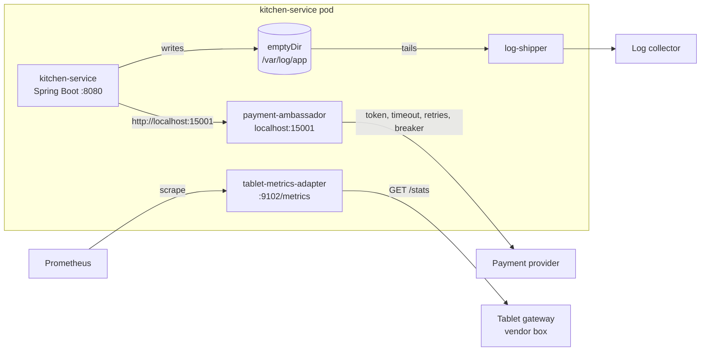

# 17. Sidecar, Ambassador & Adapter

<div class="badges" markdown><span class="badge badge-l2">L2 · Practitioner</span><span class="badge badge-l3">L3 · Senior/Lead</span><span class="badge badge-meta">JDK 25 HTTP · Kubernetes native sidecars · measured on loopback</span></div>

<div class="grid two" markdown>

!!! info "Prerequisites"
    - [Chapter 3](../foundations/ch03-distributed-systems-fundamentals.md): timeouts, retries, idempotency
    - [Chapter 4](../foundations/ch04-twelve-factor.md): processes, config, logs as event streams
    - [Chapter 10](ch10-api-gateway-bff.md): the same concerns at the edge rather than in each pod

!!! abstract "What you'll learn"
    - What a **sidecar** is, and its two specialisations: the **ambassador** (outbound) and the **adapter** (outward-facing interface)
    - **Native sidecar containers** in Kubernetes: start order, shutdown order, probes
    - Measured: an ambassador lifts success against a flaky provider from **89.5% to 99.7%**, for **~0.3 ms** per hop
    - **Library or sidecar?** The trade-off for Java teams
    - How **service meshes**, **ambient mode** and **Dapr** are these patterns at platform scale

</div>

---

## 1 · Introduction & Context

### Three problems in one pod

kitchen-service, a Spring Boot app, has three problems that aren't really kitchen problems:

1. **The payment provider.** Every call needs an API token from a rotated secret, a timeout, retries only when safe, and a circuit breaker for the provider's bad days. The same code is needed in the Node.js rider app backend and the Go fraud service, written three times, slightly differently.
2. **The restaurant-tablet gateway.** A vendor box reports kitchen health on a `/stats` page in its own format (`ORD_ACC=1532`, `LAT_MS_P95=820`). The platform's monitoring speaks Prometheus. The vendor won't change the box.
3. **Logs.** An old library inside kitchen-service can only log to a file, but the platform collects logs from stdout or ships them centrally.

None of these is business logic, and each wants a different owner (the platform team, the observability team). The container-level answer is to put a **helper process next to the app**, in the same pod: same network namespace (they talk over `localhost`), shared volumes, same lifecycle, but a separate image, language and release cycle.

### The patterns

Brendan Burns and David Oppenheimer named them in *Design patterns for container-based distributed systems* (2016):

| Pattern | Direction | Example in this chapter |
|---|---|---|
| **Sidecar** | Extends or enhances the app | Log shipper reading the app's log file |
| **Ambassador** | Represents a remote service to the app (outbound proxy) | Payment ambassador on `localhost:15001` |
| **Adapter** | Presents the app (or a legacy box) to the outside world in a standard form | Tablet stats → Prometheus `/metrics` |

Ambassador and adapter are both sidecars; the names say which way the help points.

### Where they come from

<ul class="mh-timeline">
<li><span class="when">2014 · Netflix Prana</span><span class="what">A sidecar that gave non-JVM services access to Netflix's Java platform libraries (discovery, config).</span></li>
<li><span class="when">2015 · Kubernetes pods</span><span class="what">Multiple containers sharing network and volumes become the unit of deployment.</span></li>
<li><span class="when">2016 · Burns & Oppenheimer</span><span class="what">Sidecar, ambassador and adapter named as container design patterns; Envoy open-sourced by Lyft.</span></li>
<li><span class="when">2017–2019 · Service meshes and Dapr</span><span class="what">Istio and Linkerd put a proxy sidecar in every pod; Dapr offers building blocks (state, pub/sub, bindings) through a sidecar API.</span></li>
<li><span class="when">2023–2025 · Native sidecars, ambient mesh</span><span class="what">Kubernetes native sidecar containers (beta in 1.29, stable in 1.33); Istio ambient mode moves the proxy out of the pod.</span></li>
</ul>

---

## 2 · Core Concepts & Terminology



Pod
:   One or more containers scheduled together, sharing a network namespace (one IP, `localhost` between them) and optionally volumes.

Native sidecar container
:   An init container with `restartPolicy: Always`: it starts before the app containers (and can gate them with a startup probe), keeps running, is restarted if it exits, and is stopped **after** the app containers on shutdown.

Sidecar
:   A helper container that extends the app without the app's code knowing.

Ambassador
:   An outbound proxy representing a remote service: the app talks to `localhost`, the ambassador handles where and how.

Adapter
:   Translates the app's (or a legacy system's) interface into the standard one the platform expects.

---

## 3 · How It Works Internally

### The ambassador

The app calls `http://localhost:15001/v1/authorizations` as if it were the provider. The ambassador:

- binds to **loopback only**, so nothing outside the pod can use it or its credentials;
- **replaces** any `Authorization` header with the provider token read from a mounted secret, re-reading the file when Kubernetes rotates it;
- applies a **per-try timeout**, and **retries only what is safe**: GET/HEAD, or requests carrying an `Idempotency-Key`. A POST without one is sent once, because repeating it could charge twice;
- opens a **circuit breaker** after consecutive failures and answers `503` immediately while open, with one trial request after the open period;
- exposes **counters** for requests, upstream calls, retries, failures and short-circuits.

```java title="ambassador/Ambassador.java (the proxy loop)"
--8<-- "code/chapters/ch17-sidecar-ambassador-adapter/src/main/java/dev/foodfleet/ch17/ambassador/Ambassador.java:100:155"
```

### The adapter

On each Prometheus scrape the adapter fetches the vendor's `/stats`, translates names (`ORD_ACC` → `kitchen_tablet_orders_total{outcome="accepted"}`), units (milliseconds → seconds), types (counter vs gauge) and times (an IST string → Unix seconds). Unknown keys from a firmware update are **counted, not fatal**, and an unreachable gateway still produces a valid page with `kitchen_tablet_gateway_up 0`, so alerts fire on the right thing:

```java title="adapter/TabletStatsTranslator.java"
--8<-- "code/chapters/ch17-sidecar-ambassador-adapter/src/main/java/dev/foodfleet/ch17/adapter/TabletStatsTranslator.java:49:94"
```

### The log-shipping sidecar

The app writes to a file on an `emptyDir` volume shared with the shipper. Naive tailers lose or duplicate lines in three situations; this one handles each:

| Situation | What goes wrong naively | What the shipper does |
|---|---|---|
| Shipper restarts | Re-sends everything, or starts at the end and skips | Saves file identity + offset after every accepted batch (write, then atomic rename) |
| Rotation (rename + new file) | Keeps reading the old file, or misses the new one | New file identity → start at offset 0 |
| Copy-truncate rotation | Offset beyond end of file | File shorter than offset → start at 0 |
| Collector down | Lines dropped | Offset moves only after the sink accepts the batch (at-least-once) |
| Line half-written | Shipped in two pieces | Only complete lines (ending in `\n`) are shipped |

```java title="logship/LogShipper.java"
--8<-- "code/chapters/ch17-sidecar-ambassador-adapter/src/main/java/dev/foodfleet/ch17/logship/LogShipper.java:48:88"
```

One known gap: with copy-truncate, if the app writes more than the old offset between two polls, the truncation is invisible. That's why the platform prefers rename-based rotation, or stdout.

### Native sidecars in Kubernetes

Before native sidecars, helper containers were ordinary containers in the pod: no start order (the app could call `localhost:15001` before the ambassador listened), no stop order (the log shipper could die before the app wrote its last lines), and Jobs never completed because the sidecar never exited. Native sidecars fix all three:

```yaml title="k8s/kitchen-service.yaml (excerpt)"
initContainers:
  - name: payment-ambassador
    image: ghcr.io/foodfleet/payment-ambassador:1.4.0
    restartPolicy: Always            # this line makes it a native sidecar
    startupProbe:                    # app containers start only after this passes
      httpGet: {path: /__ambassador/health, port: 15001}
      periodSeconds: 1
      failureThreshold: 30
```

The full manifest (three sidecars, security contexts, resources, shared volume) is in `k8s/kitchen-service.yaml` and validates against the Kubernetes 1.33 strict JSON schema.

---

## 4 · Design Considerations & Trade-offs

### Measured: the ambassador against a flaky provider

Real HTTP on loopback: a fake payment provider returns `503` for 10% of calls and takes 800 ms for 3%. kitchen-service authorizes 5,000 payments, each with an `Idempotency-Key`, 16 at a time. Directly, as most app code does it (1 s timeout, no retry), versus through the ambassador (400 ms per try, up to 3 attempts). Verified on a 2-vCPU container:

| Path | Success | Authorizations created | p50 | p99 | Max |
|---|---:|---:|---:|---:|---:|
| Direct (1 s timeout, no retry) | 89.54% | 4,477 | 1.1 ms | 803 ms | 830 ms |
| Via ambassador (400 ms × 3 tries) | **99.74%** | 4,994 | 6.1 ms | **420 ms** | 845 ms |

Ambassador counters: 5,000 requests, 5,722 upstream calls, 722 retries, 13 failures.

What it shows:

- **Success rate 89.5% → 99.7%** with no change to the app, because transient 503s and slow responses are retried within the app's own timeout.
- **p99 latency nearly halved**: an 800 ms response is abandoned at 400 ms and retried, and the retry is usually fast. A per-try timeout below the tail cuts the tail.
- **The provider created 4,994 authorizations for 4,987 successes.** A few calls succeeded at the provider but timed out, after three tries, at the app. The ambassador can't make that safe; the **idempotency key** can: the app retries the order later with the same key and gets the same authorization ([chapter 14](ch14-saga-pattern.md)). Retries in a proxy need idempotency in the protocol.
- p50 rose under load because this 2-vCPU box ran the client, the ambassador and the provider at once; retried requests also wait for backoff.

### Measured: what the extra hop costs

On a healthy provider, 5,000 sequential calls each way, after warm-up:

| Path | p50 | p99 |
|---|---:|---:|
| Direct | 268 µs | 3,224 µs |
| Via ambassador | 558 µs | 4,930 µs |
| **Added by the hop** | **290 µs** | **1,706 µs** |

On loopback the cost is the proxy's own processing, a fraction of a millisecond at the median here. Purpose-built proxies (Envoy, Linkerd's proxy) are faster than this JDK one; publish your own numbers rather than vendors'. The cost that matters more at scale is resources, below.

### What sidecars cost a fleet

The three sidecars in the manifest request 35m CPU and 112 MiB memory per pod, against 250m and 512 MiB for kitchen-service itself: **+14% CPU and +22% memory requests**. Across FoodFleet's ~160 pods that is about **5.6 cores and 17.5 GiB** reserved, before anyone adds a mesh proxy. Sidecars also add images to patch, containers to restart, and probes to tune. That is the price of not putting the logic in the app.

### Library or sidecar?

For a Java shop, almost everything an ambassador does can be a library: Spring's HTTP service clients with `@Retryable`, Resilience4j, Micrometer, Logback appenders.

| | In-process library | Sidecar |
|---|---|---|
| Latency | No extra hop | An extra local hop per call |
| Context | Knows the business operation (retry this, not that) | Sees only HTTP |
| Languages | One implementation per language | One implementation for all |
| Upgrades | Every team redeploys to pick up a fix | Platform rolls out a new sidecar image |
| Ownership | App team | Platform team |
| Resources | Shared with the app | Extra container per pod |
| Failure modes | Fails with the app | Another thing that can be down, misconfigured or slow to start |

FoodFleet's rule of thumb: **library** when the logic needs business context or the fleet is one language; **sidecar** when the concern is the same for every language, owned by the platform, or must be changed without touching apps (credentials, mTLS, traffic policy, telemetry export).

### From sidecars to meshes, ambient and Dapr

| Approach | What runs where | Good for | Watch out for |
|---|---|---|---|
| Hand-built sidecars (this chapter) | Your own helper per concern | One or two specific needs | You maintain them |
| Service mesh with sidecars (Istio, Linkerd) | A proxy in every pod for all traffic | mTLS, retries, traffic splitting, telemetry, uniformly | Per-pod cost; upgrades restart pods; debugging through proxies |
| Istio ambient mode | A per-node L4 proxy (ztunnel) for mTLS; optional per-namespace L7 waypoint proxies | Mesh security without a proxy in each pod | L7 features only where waypoints are deployed |
| Dapr | A sidecar exposing building blocks (state, pub/sub, bindings, secrets) over HTTP/gRPC | Polyglot apps that want portable infrastructure APIs | Another runtime and API surface to depend on |

These are covered in depth in [chapter 57](../deployment/ch57-service-mesh.md); the tools pages for [Envoy](../components-tools/envoy.md) and [Istio](../components-tools/istio.md) have configuration detail.

---

## 5 · Hands-on Implementation

Code: `code/chapters/ch17-sidecar-ambassador-adapter/`. Plain JDK 25, no frameworks, so each pattern is visible in a few hundred lines and runs anywhere.

```bash
cd code
mvn -B -pl chapters/ch17-sidecar-ambassador-adapter -am verify
java -cp chapters/ch17-sidecar-ambassador-adapter/target/classes dev.foodfleet.ch17.experiment.AmbassadorExperiment
```

### 🔵 Level 2: the app's side

<div class="badges" markdown><span class="badge badge-l2">L2 · Practitioner</span></div>

kitchen-service only changes its base URL. With an HTTP service client group (chapter 8), configuration is all there is:

```yaml title="kitchen-service application.yml"
spring:
  http:
    serviceclient:
      payment-provider:
        base-url: ${PAYMENT_PROVIDER_URL:http://localhost:15001}   # the ambassador
        read-timeout: 2s     # above the ambassador's 3 x 400 ms, so the ambassador decides
```

Two rules for the app: set its own timeout **above** the ambassador's total retry budget (or the app gives up while the ambassador is still retrying), and send an **`Idempotency-Key`** on every payment POST, or the ambassador won't retry it.

### 🟣 Level 3: the ambassador, tested over real HTTP

<div class="badges" markdown><span class="badge badge-l3">L3 · Senior/Lead</span></div>

```java title="AmbassadorTest.java"
--8<-- "code/chapters/ch17-sidecar-ambassador-adapter/src/test/java/dev/foodfleet/ch17/ambassador/AmbassadorTest.java"
```

The breaker on its own, with a fake clock:

```java title="ambassador/CircuitBreaker.java"
--8<-- "code/chapters/ch17-sidecar-ambassador-adapter/src/main/java/dev/foodfleet/ch17/ambassador/CircuitBreaker.java:6:69"
```

### 🟣 Level 3: the adapter and the shipper

<div class="badges" markdown><span class="badge badge-l3">L3 · Senior/Lead</span></div>

```java title="TabletStatsTranslatorTest.java"
--8<-- "code/chapters/ch17-sidecar-ambassador-adapter/src/test/java/dev/foodfleet/ch17/adapter/TabletStatsTranslatorTest.java"
```

```java title="LogShipperTest.java"
--8<-- "code/chapters/ch17-sidecar-ambassador-adapter/src/test/java/dev/foodfleet/ch17/logship/LogShipperTest.java"
```

### 🟣 Level 3: the pod

<div class="badges" markdown><span class="badge badge-l3">L3 · Senior/Lead</span></div>

```yaml title="k8s/kitchen-service.yaml"
--8<-- "code/chapters/ch17-sidecar-ambassador-adapter/k8s/kitchen-service.yaml"
```

### Run and verify

```text
$ java -cp chapters/ch17-sidecar-ambassador-adapter/target/classes dev.foodfleet.ch17.experiment.AmbassadorExperiment
1. Provider with 10% 503s and 3% slow (800 ms) responses; 5,000 authorizations

path                                 success   auths made    p50 ms    p99 ms    max ms
direct (1 s timeout, no retry)        89.54%         4477       1.1     803.1     830.3
via ambassador (400 ms x 3 tries)     99.74%         4994       6.1     419.8     844.9

ambassador counters:
  ambassador_requests_total 5000
  ambassador_upstream_calls_total 5722
  ambassador_retries_total 722
  ambassador_failures_total 13
  ambassador_short_circuited_total 0

2. Healthy provider: what the extra hop costs (5,000 sequential calls, loopback)

path                                  p50 us    p99 us
direct                                   268      3224
via ambassador                           558      4930
added by the hop                         290      1706
```

!!! question "Try it"
    1. Set the app's timeout in the experiment to 1 s while going through the ambassador (3 × 400 ms tries). What happens to the success rate, and to the number of authorizations created?
    2. Remove the `Idempotency-Key` header from the experiment's requests. Predict the success rate first, then run it.
    3. Add a `X-Ambassador-Retry-Budget` so retries never exceed 20% of requests (a retry budget, as Envoy and Linkerd have). What does it protect against when the provider is fully down?
    4. Start the experiment without `sun.net.httpserver.nodelay`. Explain the latency you see.

---

## 6 · Production Readiness

- [x] **Native sidecars** (`restartPolicy: Always` init containers) so start and stop order are right; startup probes on sidecars the app depends on
- [x] **Resources set** on every sidecar (requests and memory limits); their cost tracked per fleet
- [x] **Security contexts**: non-root, read-only root filesystem, no privilege escalation; ambassadors bound to loopback
- [x] **Secrets only in the sidecar that needs them**; mounted read-only and re-read on rotation
- [x] **Timeout budgets agree**: app timeout > ambassador's per-try timeout × attempts + backoff
- [x] **Retries only for idempotent requests**, with retry budgets; idempotency keys required by the API contract
- [x] **Sidecar telemetry** scraped and dashboarded (retries, short-circuits, translation failures, shipper lag)
- [x] **Sidecar versions managed centrally** (injection webhook or a shared Helm chart), with a rollout plan that restarts pods gradually
- [x] **Graceful shutdown tested**: last log lines shipped, in-flight proxied requests finished
- [x] **Library-or-sidecar decision recorded** per concern, so the same thing isn't done in both places

---

## 7 · Anti-patterns & Pitfalls

!!! pitfall "Incident 1: double retries, triple load"
    **Context.** kitchen-service retried payment calls 3 times (Spring `@Retryable`); the new ambassador also retried 3 times.
    **Symptoms.** When the provider slowed down, it received up to 9 calls per payment; its rate limiter then rejected FoodFleet entirely for 10 minutes.
    **Root cause.** Retries at two layers multiply; nobody owned the total.
    **Fix.** Retries in exactly one layer (the ambassador), a retry budget, and the app's timeout set above the ambassador's total.

!!! pitfall "Incident 2: the app that started before its ambassador"
    **Context.** The ambassador was an ordinary container in the pod.
    **Symptoms.** After every deploy, the first few seconds of payment calls failed with `Connection refused`; Jobs using the same pod template never completed.
    **Root cause.** Ordinary containers start in parallel and the sidecar never exits.
    **Fix.** Native sidecars with a startup probe on the ambassador.

!!! pitfall "Incident 3: the token that never rotated"
    **Context.** The ambassador read the provider token once at start-up.
    **Symptoms.** After the scheduled key rotation, all payments failed with `401` until pods were restarted, 25 minutes later.
    **Root cause.** Kubernetes updates mounted secrets in place; the process didn't notice.
    **Fix.** Re-read the file when its modification time changes (tested in `picksUpARotatedToken`), plus an alert on upstream `401`s.

| Anti-pattern | Symptom | Fix |
|---|---|---|
| Retries in app and sidecar | Multiplied load on failure | One layer owns retries; budgets |
| Sidecar for logic that needs business context | Wrong retries, generic errors | Library in the app |
| Business logic in a sidecar | Split ownership, hidden behaviour | Sidecars do infrastructure only |
| Ordinary containers as sidecars | Start/stop races, Jobs that never finish | Native sidecars |
| No resource requests on sidecars | Noisy neighbours, evictions | Requests and limits on every container |
| Ambassador listening on all interfaces | Credentials usable from the network | Bind to loopback |
| One sidecar per concern, many concerns | 6 containers per pod | Consolidate, or move to node-level agents / ambient mesh |

---

## 8 · Enterprise Case Study

### FoodFleet: platform concerns out of the apps

!!! decision "ADR-017: Payment calls go through a platform-owned ambassador; vendor metrics through adapters"
    **Status:** Accepted · **Date:** 2024-05-20

    **Context.** Three languages call the payment provider with three different retry and credential implementations; a vendor tablet gateway can't be scraped by Prometheus; a legacy library logs only to files.

    **Decision.** Every service calling the payment provider uses the platform's payment ambassador as a native sidecar (loopback only, token from a mounted secret, 400 ms per try, 3 attempts for idempotent requests, circuit breaker, metrics). Apps send an `Idempotency-Key` on every payment POST and do not retry payment calls themselves. Vendor systems are scraped through adapters. File logging is allowed only with the log-shipper sidecar until the library is replaced. Mesh adoption for mTLS is evaluated separately ([chapter 57](../deployment/ch57-service-mesh.md)).

    **Consequences.** ✅ Payment success during provider incidents rose from ~90% to >99.5% for every language at once. ✅ Token rotation and provider changes are platform releases. ⚠️ +35m CPU and +112 MiB per pod for the three sidecars. ⚠️ The platform team is on the critical path for payment-call behaviour.

### Fintech analogue: HSMs and payment network gateways 🔴

Banks have long run "ambassador" processes before containers existed: a local gateway that holds keys or talks to a hardware security module, formats messages for card networks (ISO 8583), and enforces timeouts and reversals. Applications send a simple request to the gateway and never see keys or network formats. Containers moved the same separation into a pod, with secrets mounted only into the ambassador and stricter network policy around it.

### E-commerce analogue: legacy ERP and warehouse systems

Retailers integrating a warehouse management system or an old ERP often deploy **adapters** that expose the legacy system's status as standard metrics and its operations as a REST API, without modifying the vendor product. The adapter is versioned with the integration, not the vendor upgrade cycle, and is the only place that knows the legacy formats.

---

## 9 · Interview Q&A + Summary

#### Q1. What is the sidecar pattern? · <span class="badge badge-l2">L2</span> · Cognizant · SAP · Flipkart

**Short answer:** A helper container deployed in the same pod as the application, sharing its network and volumes, that adds capabilities (logging, proxying, config reload, telemetry) without changing the app's code. It has its own image, language and release cycle.

#### Q2. Ambassador vs adapter? · <span class="badge badge-l2">L2</span><span class="badge badge-l3">L3</span> · SAP · Cognizant

**Short answer:** Both are sidecars. An ambassador is an outbound proxy representing a remote service to the app (credentials, retries, routing). An adapter presents the app or a legacy system to the outside world in a standard form (metrics format, API shape).

#### Q3. What are native sidecar containers in Kubernetes? · <span class="badge badge-l3">L3</span> · Amazon · Flipkart

**Short answer:** Init containers with `restartPolicy: Always`. They start before app containers (startup probes can gate the app), run for the pod's life, are restarted if they exit, and stop after the app containers. They fix start-order races, lost last logs and Jobs that never complete.

#### Q4. Library or sidecar for resilience in a Java service? · <span class="badge badge-l3">L3</span> · Goldman Sachs · JP Morgan

**Short answer:** A library when the logic needs business context (which operations are safe to retry, fallbacks) or the fleet is one language; a sidecar when it must be uniform across languages, owned by the platform, or changed without redeploying apps. Never both for the same concern, or retries multiply.

#### Q5. What does an extra sidecar hop cost? · <span class="badge badge-l3">L3</span> · Amazon

**Short answer:** Latency per call (fractions of a millisecond on loopback for a lightweight proxy; measure yours) and, more significantly, CPU and memory per pod, multiplied across the fleet, plus operational overhead (images, restarts, probes).

#### Q6. Why can a proxy retry a GET but not a POST? · <span class="badge badge-l2">L2</span><span class="badge badge-l3">L3</span> · Flipkart · Amazon

**Short answer:** GETs are safe and idempotent; a POST may have taken effect even if the response was lost, so repeating it could duplicate the effect (a second charge). A POST can be retried only if the API guarantees idempotency, for example with an Idempotency-Key the server deduplicates on.

#### Q7. How do service meshes relate to these patterns? · <span class="badge badge-l3">L3</span><span class="badge badge-l4">L4</span> · Goldman Sachs · Flipkart

**Short answer:** A sidecar mesh puts an ambassador-style proxy (usually Envoy) in every pod for all traffic: mTLS, retries, traffic splitting, telemetry. Ambient mode moves that out of the pod to per-node and per-namespace proxies to cut per-pod cost.

#### Q8. What is Dapr? · <span class="badge badge-l3">L3</span> · startups · SAP

**Short answer:** A sidecar runtime that exposes infrastructure building blocks (state stores, pub/sub, bindings, secrets, workflows) through HTTP/gRPC APIs, so apps in any language use one API and the sidecar talks to the actual backend.

#### Q9. How should timeouts be set between app and ambassador? · <span class="badge badge-l3">L3</span> · JP Morgan · Amazon

**Short answer:** The app's timeout must exceed the ambassador's total budget (per-try timeout × attempts + backoff), otherwise the app gives up while the ambassador is still retrying, wasting work and possibly causing duplicate effects.

#### Q10. How would you ship logs from an app that only writes files? · <span class="badge badge-l2">L2</span><span class="badge badge-l3">L3</span> · any

**Short answer:** Share an emptyDir volume with a log-shipper sidecar that tails the file, keeps its position durably, handles rotation and only advances after the collector accepts a batch. Better long term: log to stdout and let a node-level agent collect.

#### Q11. What are the security considerations for sidecars? · <span class="badge badge-l3">L3</span><span class="badge badge-l4">L4</span> · Goldman Sachs · JP Morgan

**Short answer:** Least privilege per container (secrets mounted only where needed), non-root and read-only filesystems, loopback binding for proxies holding credentials, image provenance and patching for every sidecar image, and network policy around anything that reaches external systems.

#### Q12. When would you not use a sidecar? · <span class="badge badge-l3">L3</span> · any

**Short answer:** When a library does the job in a single-language fleet, when the per-pod cost is significant relative to small pods, when the concern needs business context, or when a node-level agent (log collection, ambient mesh) does it once per node instead of once per pod.

### Key takeaways

- **Sidecar** extends the app; **ambassador** represents remote services to it; **adapter** presents it in a standard form.
- Use **native sidecars** for correct start and stop order.
- Measured: an ambassador raised success against a flaky provider from **89.5% to 99.7%** and cut p99 from 803 to 420 ms, for **~0.3 ms** per hop on loopback; **idempotency keys** were still needed for the cases a proxy can't fix.
- Choose **library or sidecar per concern**, never both; count sidecars' **fleet cost**.
- Meshes, ambient mode and Dapr are the same patterns, run by the platform.

### Further reading

- Brendan Burns and David Oppenheimer, *Design patterns for container-based distributed systems*, USENIX HotCloud 2016
- Brendan Burns, *Designing Distributed Systems* (O'Reilly, 2nd ed. 2024), single-node patterns
- Kubernetes documentation, [Sidecar Containers](https://kubernetes.io/docs/concepts/workloads/pods/sidecar-containers/)
- Microsoft Azure Architecture Center, [Sidecar](https://learn.microsoft.com/azure/architecture/patterns/sidecar), [Ambassador](https://learn.microsoft.com/azure/architecture/patterns/ambassador) and [Anti-corruption Layer](https://learn.microsoft.com/azure/architecture/patterns/anti-corruption-layer) patterns
- [Istio ambient mode overview](https://istio.io/latest/docs/ambient/overview/) and [Dapr documentation](https://docs.dapr.io/)

---

**Previous:** [← 16. Strangler Fig, ACL & Monolith Migration](ch16-strangler-fig-migration.md) · **Next:** [18. Resilience Patterns →](ch18-resilience-patterns.md)
