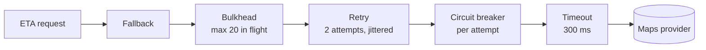

# 18. Resilience Patterns

<div class="badges" markdown><span class="badge badge-l2">L2 · Practitioner</span><span class="badge badge-l3">L3 · Senior/Lead</span><span class="badge badge-meta">Discrete-event simulation · Spring Framework 7 resilience · Resilience4j</span></div>

<div class="grid two" markdown>

!!! info "Prerequisites"
    - [Chapter 3](../foundations/ch03-distributed-systems-fundamentals.md): partial failure and retry arithmetic
    - [Chapter 8](../foundations/ch08-spring-boot-4-essentials.md): HTTP service clients, `@Retryable`, `@ConcurrencyLimit`
    - [Chapter 17](ch17-sidecar-ambassador-adapter.md): the same protections in a sidecar instead of a library

!!! abstract "What you'll learn"
    - Why one slow dependency can take down endpoints that **don't even use it** (cascading failure)
    - The six patterns: **timeout, retry, bulkhead, circuit breaker, rate limiter, fallback**: what each protects and what it costs
    - Measured: availability of an unrelated endpoint **2.4% → 100%** with a timeout; retries **tripled** provider load for **no gain**; a breaker cut it **100×**
    - How the patterns **compose**, and in which order
    - The same stack in **Spring Boot 4**: client timeouts, `@Retryable`, `@ConcurrencyLimit`, Spring Cloud CircuitBreaker

</div>

This chapter is the **pattern view**: what each pattern is for and how they work together. Part 7 goes deeper into the tools and tuning: [Resilience4j](../resilience/ch43-resilience4j-deep-dive.md), [timeouts, retries and backpressure](../resilience/ch44-timeouts-retries-backpressure.md), and [chaos engineering](../resilience/ch45-chaos-engineering.md) to prove it all works.

---

## 1 · Introduction & Context

### The Friday the order-status page died

On a Friday evening FoodFleet's maps provider had a brownout: most routing calls took 2–3 seconds instead of 40 ms. Nothing in FoodFleet called maps except the ETA shown on the tracking screen. Yet within a minute, **the order status endpoint**, which reads one row from tracking-service's own database, was failing for 98% of customers. Support was flooded with "where is my order?" calls, about orders that were fine.

The mechanism is the most common outage pattern in microservices:

1. ETA requests wait 2.5 s on maps instead of 40 ms, each holding a request worker the whole time.
2. At 100 ETA requests a second, they need 250 workers. tracking-service has 50.
3. All workers are soon waiting on maps. Status requests queue behind them, wait longer than the app's 2-second timeout, and fail.
4. One slow dependency took down an endpoint that didn't use it. If other services call tracking-service, the failure keeps spreading: a **cascading failure**.

Nothing was *down*. Something was *slow*, and slow is worse than down, because a dead dependency fails fast and a slow one holds resources.

### The patterns

| Pattern | Protects | By | Costs |
|---|---|---|---|
| **Timeout** | Your resources (threads, connections) | Giving up after a bound | Some answers that would have arrived are lost |
| **Retry** | Success rate against transient failures | Trying again | Extra load, exactly when the dependency is struggling |
| **Bulkhead** | Everything else in your service | Capping concurrent calls to one dependency | Calls beyond the cap wait or fail |
| **Circuit breaker** | The dependency, and your latency | Failing fast while it's unhealthy | Gives up even calls that would have worked |
| **Rate limiter** | A dependency's quota, or your own service | Capping calls per unit of time | Excess calls rejected or delayed |
| **Fallback** | The user experience | A degraded answer instead of an error | Stale or approximate data; must be designed |

### Where they come from

<ul class="mh-timeline">
<li><span class="when">2007 · Michael Nygard</span><span class="what"><em>Release It!</em> names circuit breakers, bulkheads, timeouts and fail fast as stability patterns, from production post-mortems.</span></li>
<li><span class="when">2012 · Netflix Hystrix</span><span class="what">Bulkheads (thread pools), circuit breakers and fallbacks for every dependency call; dashboards for all of them.</span></li>
<li><span class="when">2015 · AWS Architecture Blog</span><span class="what">"Exponential Backoff and Jitter" shows why retries need randomness.</span></li>
<li><span class="when">2016–2018 · Resilience4j</span><span class="what">Lightweight, functional decorators for Java 8+; Hystrix enters maintenance (2018).</span></li>
<li><span class="when">2025 · Spring Framework 7</span><span class="what"><code>@Retryable</code> and <code>@ConcurrencyLimit</code> in the core framework; Resilience4j via Spring Cloud CircuitBreaker for breakers.</span></li>
</ul>

---

## 2 · Core Concepts & Terminology



Each pattern wraps the next, like Resilience4j decorators or Spring's annotation proxies. Read it outside-in: the request first gets a guaranteed answer (fallback), then a bounded share of resources (bulkhead), then a second chance (retry), and each attempt is checked against the dependency's health (breaker) and bounded in time (timeout).

Cascading failure
:   A failure in one component exhausting resources in its callers, which then fail their own callers.

Retry storm (retry amplification)
:   Retries multiplying load on a dependency that is failing *because* of load. Three layers each retrying three times means up to 27 calls per user request.

Brownout
:   Partial degradation: slow or failing for some fraction of requests. Harder to detect and more damaging than a clean outage.

Load shedding
:   A service rejecting work it can't do in time (503) rather than queueing it.

Circuit breaker states
:   **Closed** (calls flow, outcomes recorded), **open** (calls fail at once for a period), **half-open** (a few trial calls decide whether to close or reopen).

---

## 3 · How It Works Internally

Each pattern is a small decorator around an asynchronous `Call`. They're simple enough to read in full, which is the best way to understand what the libraries do.

### Timeout

Answer at the limit, whatever the dependency is doing. Note what it *doesn't* do: the dependency is never told, so it keeps working on the abandoned request.

```java title="resilience/Timeout.java"
--8<-- "code/chapters/ch18-resilience-patterns/src/main/java/dev/foodfleet/ch18/resilience/Timeout.java:6:39"
```

### Retry

Retry transient failures only, with exponential backoff and **full jitter** (a random wait between zero and the ceiling), so synchronized clients don't retry in waves. Rejections by our own bulkhead or breaker are deliberately not retried.

```java title="resilience/Retry.java"
--8<-- "code/chapters/ch18-resilience-patterns/src/main/java/dev/foodfleet/ch18/resilience/Retry.java:7:51"
```

### Bulkhead

```java title="resilience/Bulkhead.java"
--8<-- "code/chapters/ch18-resilience-patterns/src/main/java/dev/foodfleet/ch18/resilience/Bulkhead.java:5:39"
```

Two flavours exist: **rejecting** (this one, Resilience4j's `Bulkhead` with zero wait) and **blocking** (Spring's `@ConcurrencyLimit`, which makes callers wait for a permit, like a connection pool). Blocking is fine with virtual threads as long as something bounds the wait: a time limiter or the breaker around it.

### Circuit breaker

```java title="resilience/CircuitBreaker.java"
--8<-- "code/chapters/ch18-resilience-patterns/src/main/java/dev/foodfleet/ch18/resilience/CircuitBreaker.java:8:107"
```

Two details worth noticing: the breaker only judges once it has `minimumCalls` outcomes (no tripping on the first failure at 3 a.m.), and outcomes of calls that started before the circuit opened are ignored rather than counted twice.

### Rate limiter

A rate limiter caps calls per unit of time instead of concurrent calls. Use it **client-side** to stay within a provider's quota (maps allows 500 requests/second per key) and **server-side** to protect your own service from a noisy caller. The token bucket from [chapter 10](ch10-api-gateway-bff.md) is the usual implementation; Resilience4j has `RateLimiter`. Concurrency limits adapt better to slowdowns (a slow dependency automatically gets fewer calls per second); rate limits are right when the constraint is a quota.

### Fallback

```java title="resilience/Fallback.java"
--8<-- "code/chapters/ch18-resilience-patterns/src/main/java/dev/foodfleet/ch18/resilience/Fallback.java:5:21"
```

The code is trivial; the design isn't. Good fallbacks are decided with product people: the last known ETA marked "about", a cached menu, "we'll confirm by SMS", or hiding a widget. A fallback that calls *another* remote service is just a second dependency with its own failure modes.

---

## 4 · Design Considerations & Trade-offs

### Measured: six scenarios, the same brownout

A deterministic discrete-event simulation: tracking-service with 50 workers and a 200-request accept queue; 200 status and 100 ETA requests a second (Poisson arrivals); the customer app gives up after 2 seconds. From t=60s to t=180s the maps provider browns out: 80% of calls take ~2.5 s, and like real services it slows further under congestion (above 150 in flight) and sheds load with 503 above 300. Abandoned requests still occupy it. Five minutes of traffic run in under a second. Verified output, for requests arriving during the incident:

| Scenario | Status OK | Status p99 | ETA fresh | ETA degraded | ETA failed | Maps calls per ETA | Maps peak in flight |
|---|---:|---:|---:|---:|---:|---:|---:|
| No protection | **2.4%** | 3,284 ms | 0.7% | 0% | 99.3% | 0.25 | 50 |
| Timeout 300 ms | **100%** | 5 ms | 14.9% | 0% | 85.1% | 1.00 | 300 |
| + 3 attempts, no backoff | 100% | 187 ms | 15.1% | 0% | 84.9% | **2.81** | 300 |
| Timeout + bulkhead (20) | 100% | 5 ms | 14.1% | 0% | 85.9% | 0.73 | 168 |
| + circuit breaker | 100% | 5 ms | 0.2% | 0% | 99.8% | **0.01** | 44 |
| + fallback, 2 attempts w/ jittered backoff | 100% | 5 ms | 0.2% | **99.8%** | **0%** | 0.01 | 41 |

Across seeds 1–10 every conclusion below holds; the ranges are in the chapter's README.

What it shows:

1. **No protection: the status endpoint died (2.4%) though it never calls maps.** The cascading failure from the introduction, reproduced. Ironically maps saw *less* load (0.25 calls per ETA request): tracking-service collapsed before it could send more.
2. **A timeout alone saved the status endpoint**: 100%, p99 5 ms. The single most important pattern. ETA still failed 85% of the time, but it failed in 300 ms instead of taking the service down.
3. **Retries tripled the load on maps (2.81 calls per request) and bought nothing**: ETA success 15.1% vs 14.9%. Maps was already shedding at 300 in flight, mostly with requests nobody was waiting for. Status p99 rose from 5 ms to 187 ms as retries held workers longer. A retry storm in miniature.
4. **The bulkhead** capped ETA at 20 workers, guaranteeing the rest for status regardless of timeouts, and lowered maps' peak from 300 to 168.
5. **The circuit breaker cut maps' load 100-fold** (0.01 calls per ETA, peak 44 in flight), giving it room to recover. The price: it also gave up the ~15% of calls that would have succeeded. With an 80% failure rate, failing fast for everyone is the right trade; tune `failureRatePercent` to where that stops being true.
6. **Fallback turned 99.8% failures into 99.8% degraded answers** ("about 25 min"), and with the breaker open, retries cost nothing extra. The customer saw an approximate ETA for two minutes and the status page never blinked.

Recovery after the incident took 1–3 seconds in every scenario, because tracking-service's queue is **bounded** (200). With an unbounded queue, the "no protection" scenario keeps serving minutes of requests whose clients have already gone; bounding queues is itself a resilience decision.

### Setting the numbers

| Setting | Rule of thumb | FoodFleet ETA |
|---|---|---|
| Timeout | Above the dependency's healthy p99.9, below what your caller will wait | 300 ms (healthy maps calls take 20–60 ms; the app waits 2 s) |
| Retry attempts | 1–2 extra, only for idempotent, transient failures; one layer only | 2 attempts total |
| Backoff | Exponential with full jitter, capped | 100 ms ceiling, doubling |
| Total budget | Attempts × timeout + backoff < caller's timeout | 2 × 300 + 100 = 700 ms < 2 s |
| Bulkhead | Concurrency needed when healthy × 2–4 | Healthy: 100/s × 0.042 s ≈ 4; limit 20 |
| Breaker | Window large enough to be stable; open long enough for a dependency to recover | 50 calls, ≥ 20 recorded, 50% failure, 5 s open, 3 trials |

Little's law (concurrency = rate × latency) does most of the sizing: at 100 requests a second and 40 ms, ETA needs about 4 concurrent calls; at 2.5 s it would need 250, which is exactly what the bulkhead must refuse to provide.

### Composition order

| Order | Effect |
|---|---|
| Retry **outside** breaker (this chapter, and Resilience4j's annotation order) | The breaker sees every attempt; an open breaker stops retries immediately |
| Breaker outside retry | The breaker sees one outcome per operation; retries happen inside each "call" |
| Bulkhead outside retry | One permit covers the whole operation, retries included |
| Timeout innermost | Bounds each attempt; add an overall deadline as well (a time limiter outermost) |

Either breaker placement can be right; what matters is knowing which you have. The Spring version below puts the breaker outside (it wraps a `@Retryable` method), so it counts operations rather than attempts.

### Library, sidecar or mesh?

The same patterns can live in the app (Resilience4j, Spring), in a sidecar or mesh ([chapter 17](ch17-sidecar-ambassador-adapter.md)), or at the gateway ([chapter 10](ch10-api-gateway-bff.md)). Timeouts belong everywhere; retries in exactly one layer; fallbacks in the app, because only the app knows what a good degraded answer is.

---

## 5 · Hands-on Implementation

Code: `code/chapters/ch18-resilience-patterns/`. The patterns and simulation are plain Java; `app/` is Spring Boot 4.

```bash
cd code
mvn -B -pl chapters/ch18-resilience-patterns -am verify
java -cp chapters/ch18-resilience-patterns/target/classes dev.foodfleet.ch18.simulation.ResilienceSimulation
```

### 🔵 Level 2: composing the patterns

<div class="badges" markdown><span class="badge badge-l2">L2 · Practitioner</span></div>

The six scenarios differ only in how the decorators are stacked:

```java title="simulation/ResilienceSimulation.java"
--8<-- "code/chapters/ch18-resilience-patterns/src/main/java/dev/foodfleet/ch18/simulation/ResilienceSimulation.java:89:100"
```

Each pattern's behaviour pinned down with a scripted dependency and a simulated clock:

```java title="PatternsTest.java"
--8<-- "code/chapters/ch18-resilience-patterns/src/test/java/dev/foodfleet/ch18/resilience/PatternsTest.java"
```

### 🟣 Level 3: the Spring Boot 4 stack

<div class="badges" markdown><span class="badge badge-l3">L3 · Senior/Lead</span></div>

Timeouts on the HTTP client, the breaker's configuration, and the time limiter Spring Cloud CircuitBreaker adds:

```yaml title="application.yml"
--8<-- "code/chapters/ch18-resilience-patterns/src/main/resources/application.yml"
```

Retry and bulkhead from Spring Framework 7, on the method that calls maps:

```java title="app/MapsGateway.java"
--8<-- "code/chapters/ch18-resilience-patterns/src/main/java/dev/foodfleet/ch18/app/MapsGateway.java:9:37"
```

Circuit breaker and fallback around it:

```java title="app/EtaService.java"
--8<-- "code/chapters/ch18-resilience-patterns/src/main/java/dev/foodfleet/ch18/app/EtaService.java:9:39"
```

Remember `@EnableResilientMethods` on a configuration class; without it `@Retryable` and `@ConcurrencyLimit` are silently ignored.

### Run and verify

```text
$ java -cp chapters/ch18-resilience-patterns/target/classes dev.foodfleet.ch18.simulation.ResilienceSimulation
tracking-service, 50 workers; 200 status + 100 ETA req/s; maps provider browns out
(80% of calls ~2.5 s) from t=60s to t=180s. Figures for requests arriving during the incident.

scenario                                     status ok    status   ETA ok       ETA      ETA maps calls   maps  recovery
                                                          p99 ms           degraded   failed    per ETA   peak     after
no protection                                     2.4%      3284     0.7%      0.0%    99.3%       0.25     50       1 s
timeout 300 ms                                  100.0%         5    14.9%      0.0%    85.1%       1.00    300       1 s
timeout + 3 attempts, no backoff                100.0%       187    15.1%      0.0%    84.9%       2.81    300       1 s
timeout + bulkhead (20)                         100.0%         5    14.1%      0.0%    85.9%       0.73    168       1 s
timeout + bulkhead + circuit breaker            100.0%         5     0.2%      0.0%    99.8%       0.01     44       3 s
+ fallback, 2 attempts w/ jittered backoff      100.0%         5     0.2%     99.8%     0.0%       0.01     41       3 s
```

!!! question "Try it"
    1. Raise the bulkhead to 60. Which scenario's status availability drops, and why is 60 worse than "no bulkhead" with a timeout?
    2. Change the breaker's failure threshold to 90%. What happens to ETA freshness and to maps' load during the brownout?
    3. Make the maps provider cancel work when the client times out (remove abandoned requests from its in-flight count). Do retries help now?
    4. Remove the bound on tracking-service's accept queue. How long does recovery take in the "no protection" scenario?

---

## 6 · Production Readiness

- [x] **Every remote call has a timeout**: connect and read, on every client (HTTP, JDBC, Redis, Kafka producer)
- [x] **Time budgets agree** across layers: attempts × timeout + backoff below the caller's timeout; deadlines propagated where possible
- [x] **Retries in one layer only**, for idempotent operations and transient errors, with jittered backoff and a retry budget
- [x] **Bulkheads per dependency**, sized from Little's law with headroom; especially with virtual threads, which remove the thread pool's implicit limit
- [x] **Circuit breakers** on dependencies that can brown out; minimum calls, slow-call thresholds and open duration tuned from data
- [x] **Fallbacks designed with product**, tested, and visible to users when data is degraded
- [x] **Bounded queues** everywhere (accept queues, executor queues); shed load rather than queue it
- [x] **Rate limits** match provider quotas (client side) and protect your service from callers (server side)
- [x] **Metrics and alerts**: breaker state changes, bulkhead rejections, retry rates, fallback rates, timeouts per dependency
- [x] **Proven by chaos experiments**: inject latency, not only errors ([chapter 45](../resilience/ch45-chaos-engineering.md))

---

## 7 · Anti-patterns & Pitfalls

!!! pitfall "Incident 1: the status page that died for an ETA"
    **Context.** tracking-service called maps with the HTTP client's default (no read timeout).
    **Symptoms.** A maps brownout took the order-status endpoint to ~2% availability; it never calls maps.
    **Root cause.** Request workers exhausted by calls waiting on a slow dependency; no timeout, no bulkhead.
    **Fix.** 300 ms read timeout, a bulkhead of 20 on maps calls, fallback to the last known ETA. Reproduced and verified in the simulation.

!!! pitfall "Incident 2: the retry storm that kept a provider down"
    **Context.** Three layers each retried: the mobile app, the gateway, and tracking-service (3 attempts each).
    **Symptoms.** A 30-second maps hiccup became a 25-minute outage; the provider rate-limited FoodFleet's key.
    **Root cause.** Up to 27 calls per user request during exactly the period maps was overloaded; no jitter, so retries arrived in synchronized waves.
    **Fix.** Retries only in tracking-service, 2 attempts with full jitter, a circuit breaker, and an agreed per-key rate limit.

!!! pitfall "Incident 3: the breaker that never closed"
    **Context.** A breaker with a 60-second open period and a single trial call.
    **Symptoms.** After maps recovered, ETA stayed on fallback for many minutes; a single slow trial call kept reopening it.
    **Root cause.** Open period too long, one trial too few, and slow successes counted as failures with a tight threshold.
    **Fix.** 5 s open, 3 trial calls, slow-call threshold set from healthy latency data; alerts on time spent open.

| Anti-pattern | Symptom | Fix |
|---|---|---|
| No timeouts (or library defaults) | Threads exhausted by slow dependencies | Explicit timeouts on every client |
| Timeouts longer than the caller's | Work nobody is waiting for | Budgets decrease inward |
| Retrying everything | Duplicates, storms | Idempotent + transient only, one layer |
| Retries without jitter | Synchronized waves | Full jitter |
| One shared pool for all dependencies | One bad dependency takes all | Bulkhead per dependency |
| Unbounded queues | Long recovery, memory blowups | Bounded queues, load shedding |
| Fallback calling another remote service | Two failures instead of one | Local, cached or static fallbacks |
| Breakers nobody watches | Silent degraded mode | Alerts on state changes and time open |

---

## 8 · Enterprise Case Study

### FoodFleet: resilience defaults for every dependency

!!! decision "ADR-018: Every remote call is timed out, bulkheaded and observable; retries and breakers by policy"
    **Status:** Accepted · **Date:** 2024-06-03

    **Context.** A maps brownout took down order status, an endpoint unrelated to maps; a retry storm across three layers prolonged another incident. Virtual threads (ADR-008) removed the thread pool's implicit concurrency cap.

    **Decision.** The platform's client starter sets connect and read timeouts on every HTTP service client group (no defaults allowed in review), and a `@ConcurrencyLimit` bulkhead per dependency. Retries live only in the service closest to the dependency: at most 2 attempts, jittered, idempotent operations only; gateways and mobile apps don't retry server errors. Dependencies that can brown out get a Resilience4j breaker (count-based, 50 calls, 50% failure or 80% slow calls, 5 s open, 3 trials) and a product-approved fallback. Breaker states, bulkhead waits, retries and fallbacks are dashboarded per dependency; latency injection is part of the monthly game day.

    **Consequences.** ✅ The next maps brownout showed approximate ETAs for two minutes; status stayed at 100%. ✅ Load on struggling providers falls instead of rising. ⚠️ Fallbacks need product decisions and tests for every dependency. ⚠️ Tuning requires latency data per dependency, which the platform now collects by default.

### Fintech analogue: payment authorisations and the card network 🔴

Payment processors live by the same rules with stricter consequences. Authorisation calls to card networks have tight timeouts (the terminal is waiting), are never blindly retried (a retry could double-charge), and use **stand-in processing** as the fallback: when the issuer is unreachable, the network approves low-value transactions under pre-agreed rules and settles later. That is a fallback designed by the business, with risk limits, and it's why "fallback" is a product decision before it's code.

### E-commerce analogue: recommendations and the product page

On a product page, recommendations, reviews and "frequently bought together" are separate dependencies. Each gets a strict timeout (often 100–200 ms) and its own bulkhead; if one is slow, its widget is hidden or replaced with a static list, and the page (and the add-to-cart button) still renders. Large retailers explicitly classify page components as critical or optional, which is the same decision as choosing where fallbacks are acceptable.

---

## 9 · Interview Q&A + Summary

#### Q1. What is a cascading failure and how do you prevent it? · <span class="badge badge-l2">L2</span><span class="badge badge-l3">L3</span> · Amazon · Flipkart · Cognizant

**Short answer:** A failure (often slowness) in one dependency exhausting resources in its callers, which then fail their callers. Prevent it with timeouts on every call, bulkheads per dependency, bounded queues and load shedding, circuit breakers, and fallbacks.

#### Q2. Explain the circuit breaker states. · <span class="badge badge-l2">L2</span> · SAP · Cognizant · Flipkart

**Short answer:** Closed: calls pass and outcomes are recorded; when the failure (or slow-call) rate over a window exceeds a threshold, it opens. Open: calls fail immediately for a wait duration. Half-open: a limited number of trial calls; if they succeed it closes, otherwise it reopens.

#### Q3. When do retries make things worse? · <span class="badge badge-l3">L3</span> · Amazon · Goldman Sachs

**Short answer:** When the dependency is failing due to overload (retries add load), when several layers retry (multiplication), when retries aren't jittered (synchronized waves), and when operations aren't idempotent (duplicates). In the chapter's simulation, retries tripled load for no gain.

#### Q4. What is a bulkhead, and how is it different from a rate limiter? · <span class="badge badge-l2">L2</span><span class="badge badge-l3">L3</span> · Flipkart · JP Morgan

**Short answer:** A bulkhead caps concurrent calls to a dependency, isolating its slowness from the rest of the service. A rate limiter caps calls per time unit, for quotas or to protect a service from callers. Concurrency limits adapt to latency automatically; rate limits don't.

#### Q5. How do you choose a timeout value? · <span class="badge badge-l3">L3</span> · Amazon · Goldman Sachs

**Short answer:** From data: above the dependency's healthy high percentile (p99.9), below what your caller will wait, and consistent with retries so attempts × timeout + backoff fits the caller's budget. Budgets should shrink as calls go deeper.

#### Q6. Why are timeouts more important with virtual threads? · <span class="badge badge-l3">L3</span> · any Java shop

**Short answer:** Virtual threads remove the thread pool's implicit concurrency limit, so a slow dependency can accumulate thousands of waiting requests and exhaust memory, connections or the dependency itself. Timeouts and explicit concurrency limits (`@ConcurrencyLimit`, semaphores) replace the limit the pool used to give.

#### Q7. What makes a good fallback? · <span class="badge badge-l2">L2</span><span class="badge badge-l3">L3</span> · Flipkart · product companies

**Short answer:** Local and cheap (cache, last known value, static default), clearly marked as degraded to the user, agreed with product, and tested. Not another remote call, and not something that hides data correctness problems (never fall back to "payment succeeded").

#### Q8. In what order do you compose these patterns? · <span class="badge badge-l3">L3</span><span class="badge badge-l4">L4</span> · Goldman Sachs · SAP

**Short answer:** Commonly fallback outermost, then bulkhead, retry, circuit breaker, timeout innermost (Resilience4j's Spring annotations apply Retry(CircuitBreaker(RateLimiter(TimeLimiter(Bulkhead(call)))))). Whether the breaker sees attempts or operations depends on whether it is inside or outside retry; choose deliberately.

#### Q9. Hystrix is in maintenance. What do you use in Spring today? · <span class="badge badge-l2">L2</span><span class="badge badge-l3">L3</span> · Cognizant · SAP

**Short answer:** Spring Framework 7's `@Retryable` and `@ConcurrencyLimit` for retries and concurrency limits; Resilience4j (directly or via Spring Cloud CircuitBreaker) for breakers, rate limiters and time limiters; client-level timeouts on HTTP service clients.

#### Q10. How do you know your resilience settings work? · <span class="badge badge-l3">L3</span><span class="badge badge-l4">L4</span> · Amazon · Flipkart

**Short answer:** Measure: dashboards of timeouts, retries, breaker states and fallbacks per dependency; load tests with injected latency; chaos experiments in staging and production (latency, not just errors); and simulations like this chapter's to reason about settings before an incident.

#### Q11. What is load shedding? · <span class="badge badge-l3">L3</span> · Amazon · Google-style rounds

**Short answer:** Rejecting work early (503, or dropping low-priority requests) when a service can't complete it in time, instead of queueing it. It keeps latency bounded for the work that is accepted and shortens recovery, because no backlog of abandoned requests is left.

#### Q12. Would you put resilience in the app, a sidecar, or the mesh? · <span class="badge badge-l4">L4</span> · Goldman Sachs · Flipkart

**Short answer:** Timeouts everywhere; retries in exactly one layer, usually closest to the dependency; breakers either in the app or the mesh; fallbacks always in the app, because only it knows what a useful degraded answer is.

### Key takeaways

- **Slow is worse than down**: a slow dependency holds your resources until you set a **timeout**.
- **Bulkheads** keep one dependency from consuming everything; **bounded queues** keep recovery short.
- **Retries** are a load multiplier: one layer, jittered, idempotent operations only, and stopped by a **breaker**.
- **Fallbacks** turn failures into degraded answers; design them with product.
- Measured: timeout alone 2.4% → 100% for an unrelated endpoint; naive retries 2.81× load for +0.2% success; breaker 0.01 calls per request; fallback 0% failed ETAs.

### Further reading

- Michael Nygard, *Release It!* (Pragmatic Bookshelf, 2nd ed. 2018), chapters 4–5
- Marc Brooker, [Exponential Backoff And Jitter](https://aws.amazon.com/blogs/architecture/exponential-backoff-and-jitter/) (AWS Architecture Blog, 2015) and the Amazon Builders' Library article [Timeouts, retries, and backoff with jitter](https://aws.amazon.com/builders-library/timeouts-retries-and-backoff-with-jitter/)
- [Resilience4j documentation](https://resilience4j.readme.io/) and [Spring Cloud CircuitBreaker](https://docs.spring.io/spring-cloud-circuitbreaker/reference/)
- Spring Framework reference, [Resilience Features](https://docs.spring.io/spring-framework/reference/core/resilience.html)
- Google SRE book, [Handling Overload](https://sre.google/sre-book/handling-overload/) and [Addressing Cascading Failures](https://sre.google/sre-book/addressing-cascading-failures/)

---

**Previous:** [← 17. Sidecar, Ambassador & Adapter](ch17-sidecar-ambassador-adapter.md) · **Next:** [19. Event-Driven Architecture →](ch19-event-driven-architecture.md)
