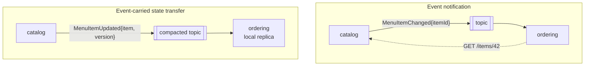

# 19. Event-Driven Architecture

<div class="badges" markdown><span class="badge badge-l2">L2 · Practitioner</span><span class="badge badge-l3">L3 · Senior/Lead</span><span class="badge badge-l4">L4 · Architect</span><span class="badge badge-meta">Discrete-event simulation · Spring Cloud Stream · Kafka</span></div>

<div class="grid two" markdown>

!!! info "Prerequisites"
    - [Chapter 12](ch12-database-per-service.md): each service owns its data
    - [Chapter 13](ch13-cqrs-event-sourcing.md): events as the source of truth, projections
    - [Chapter 15](ch15-outbox-inbox-cdc.md): publishing events reliably

!!! abstract "What you'll learn"
    - The three meanings of "event-driven": **event notification**, **event-carried state transfer**, **event sourcing**
    - What each style **couples** (time, schema, data) and how each **fails**
    - Measured on the same lunch rush: synchronous calls failed **100%** of orders during an outage; notifications accepted **13%** sold-out items; state transfer **0%**, with **zero** calls back
    - Event design: naming, keys, versions, payloads, evolution, compaction
    - The same in **Spring Cloud Stream**: functional consumers, keyed publishing, the test binder

</div>

---

## 1 · Introduction & Context

### Who needs to know that the biryani sold out?

During lunch, restaurants on FoodFleet change their menus constantly: dishes sell out, come back, prices change. catalog-service owns that data. At least three other services need it:

- **ordering-service**, to refuse sold-out items and charge the current price;
- **search-service**, to stop showing sold-out dishes;
- **recommendation-service**, to avoid recommending them.

The first version had each service call catalog-service's API whenever it needed an item. Catalog took 120,000 calls in ten minutes of lunch from ordering alone, and when it went down for two minutes, **every order on the platform failed**, though only menu *reading* was broken.

The second version published events. That's where the important question starts: *what is in the event?* "Item 42 changed" and "item 42 is now sold out, version 17" lead to two very different systems.

### Three things people mean by "event-driven"

Martin Fowler's 2017 talk *The Many Meanings of Event-Driven Architecture* separated the styles that tend to be lumped together:

| Style | The event says | Consumers | Main coupling |
|---|---|---|---|
| **Event notification** | "Item 42 changed" | Call back the owner for details, if they care | Time: the owner must be up when consumers call |
| **Event-carried state transfer (ECST)** | "Item 42 is now: sold out, ₹299, version 17" | Keep their own copy; never call back | Schema: consumers depend on the payload |
| **Event sourcing** | "SoldOut(item 42)", and the log of these *is* the data | Replay the log to build any view | The log is the system of record ([chapter 13](ch13-cqrs-event-sourcing.md)) |

A fourth, **CQRS**, often travels with them but is about separating read and write models, not about events as such.

### Where it comes from

<ul class="mh-timeline">
<li><span class="when">1990s · MOM and pub/sub</span><span class="what">Message-oriented middleware (MQSeries, TIBCO Rendezvous) and publish/subscribe in trading and telecoms.</span></li>
<li><span class="when">2002 · David Luckham</span><span class="what"><em>The Power of Events</em>: complex event processing; events as first-class business facts.</span></li>
<li><span class="when">2003 · Hohpe & Woolf</span><span class="what"><em>Enterprise Integration Patterns</em>: event messages, document messages, channels, idempotent receivers.</span></li>
<li><span class="when">2011 · Apache Kafka</span><span class="what">LinkedIn's distributed log: durable, replayable, partitioned by key, with log compaction. Events become data you can keep.</span></li>
<li><span class="when">2017–2018 · Fowler, CloudEvents</span><span class="what">"The Many Meanings of Event-Driven Architecture"; the CNCF CloudEvents specification for event metadata (1.0 in 2019).</span></li>
</ul>

---

## 2 · Core Concepts & Terminology



Event
:   A fact that happened, named in the past tense (`MenuItemUpdated`, `OrderPlaced`). The publisher doesn't know or care who reacts.

Command
:   A request for something to happen (`ReserveCoupon`), addressed to one receiver who may refuse. Commands on a message bus are still requests, not events; naming them as events hides coupling.

Domain event vs integration event
:   A domain event is internal to a service's model; an integration event is a published contract for other services, designed and versioned like an API.

Topic, partition, key
:   A topic is a named stream; it is split into partitions for scale; the message key chooses the partition, and order is guaranteed only within a partition. Key by the entity (item id) to keep each entity's events in order.

Log compaction
:   A retention mode that keeps at least the latest message per key, so the topic holds "current state per entity" and a new consumer can bootstrap from it.

Consumer group
:   A set of instances sharing a subscription: each event is processed once per group, by one instance.

---

## 3 · How It Works Internally

### Two event shapes for one fact

```java title="bus/Events.java"
--8<-- "code/chapters/ch19-event-driven-architecture/src/main/java/dev/foodfleet/ch19/bus/Events.java"
```

The thin event is about 90 bytes; the state-carrying one about 210. The difference matters less than what each forces the consumer to do.

### Consuming a notification: calling back, carefully

A notification consumer must fetch the item from catalog. Doing that naively (one call per event, retry every second) works on a quiet afternoon and becomes a self-inflicted denial of service after an outage. A careful consumer keeps **at most one fetch in flight per item** (events arriving meanwhile only mark it dirty) and backs off with jitter:

```java title="consumer/NotificationConsumer.java"
--8<-- "code/chapters/ch19-event-driven-architecture/src/main/java/dev/foodfleet/ch19/consumer/NotificationConsumer.java:11:79"
```

### Consuming state: the version check

A state-carrying event can be applied without asking anyone. The one rule: **apply only if newer**. Brokers deliver at least once, and a redelivery after a rebalance can bring an old version after a newer one; comparing versions makes applying idempotent and order-insensitive:

```java title="consumer/Replica.java"
--8<-- "code/chapters/ch19-event-driven-architecture/src/main/java/dev/foodfleet/ch19/consumer/Replica.java:9:46"
```

The version must come from the **owner** (catalog increments it on every change), not from the broker's offset or a timestamp: offsets differ across partitions and topics, and clocks drift ([chapter 3](../foundations/ch03-distributed-systems-fundamentals.md)).

### Delivery: keyed, ordered per key, at least once

The simulated topic behaves like Kafka: messages for the same key arrive in order, 20–80 ms after publication, and 1% are delivered again later, as after a consumer rebalance:

```java title="bus/EventBus.java (publish)"
--8<-- "code/chapters/ch19-event-driven-architecture/src/main/java/dev/foodfleet/ch19/bus/EventBus.java:36:49"
```

---

## 4 · Design Considerations & Trade-offs

### Measured: four ways to share menu data through a lunch rush

A deterministic discrete-event simulation of ten minutes: 5,000 menu items, 50 changes a second (70% sold-out/back-in-stock flips, 30% price changes), three consumers, 200 orders a second at ordering-service. catalog-service's API is down from 4:00 to 6:00 (its outbox keeps publishing, [chapter 15](ch15-outbox-inbox-cdc.md)). Verified output:

| Style | Orders failed | Sold-out accepted | Wrong price | Failed during outage | Sold-out accepted during outage | Catalog API calls | Bus MB | Staleness p50 | Staleness p99 |
|---|---:|---:|---:|---:|---:|---:|---:|---:|---:|
| Synchronous call per order | **20.21%** | 0.00% | 0.00% | **100%** | 0.00% | 120,338 | 0 | n/a | n/a |
| Notification, naive callbacks | 0% | 2.66% | 1.09% | 0% | 12.96% | **1,182,384** | 2.61 | 77 ms | 114 s |
| Notification, coalesced + backoff | 0% | 3.01% | 1.17% | 0% | **13.09%** | 185,383 | 2.61 | 78 ms | 125 s |
| Event-carried state transfer | 0% | **0.02%** | **0.01%** | 0% | **0.00%** | **0** | 6.38 | **50 ms** | **79 ms** |

What it shows:

1. **Synchronous calls couple availability**: the catalog outage failed every order placed during it, a fifth of the lunch rush. Correctness is perfect while catalog is up, because every order reads the source.
2. **Notifications remove the availability coupling but keep the data coupling.** Orders flowed during the outage, but on whatever data consumers had before it: **13% of orders during the outage were for items that had sold out**, each a rejected order and an apology later ([chapter 14](ch14-saga-pattern.md)). Staleness p99 was two minutes: the outage itself.
3. **Naive callbacks turned the outage into 1.18 million calls**, ten times the synchronous style's load, as every consumer retried every pending item every second. Coalescing per item and jittered backoff cut that to 185,000, at the cost of a slightly slower catch-up (p99 125 s vs 114 s).
4. **State transfer needed no calls at all and was unaffected by the outage**: 0.00% sold-out orders during it, p99 staleness 79 ms, because the facts were already in the events. The price: 2.4× the bytes on the bus, and every consumer now depends on the payload's schema.

### Measured: bootstrapping a new consumer

After ten minutes, a new pricing-analytics service needs the whole menu:

| Source | Reads | Size |
|---|---:|---:|
| Catalog API (notification style) | 5,000 requests | (load on catalog) |
| **Compacted topic** (latest event per item) | **5,000 messages** | **1.1 MB** |
| Full event log (every change since the start) | 35,021 messages | 7.4 MB |

The full log grows with time; a compacted topic grows only with the number of items. ECST topics should be **compacted** so new consumers (and rebuilt ones) can start from current state. Event-sourced systems keep the full log by design and use snapshots to bound replay ([chapter 13](ch13-cqrs-event-sourcing.md)).

### Choosing a style

<div class="mh-axes" markdown>
<div class="mh-axes__y">Consumers need the data itself →</div>
<div class="mh-axes__cell ok"><strong>Notification + fetch</strong>Data is large, sensitive, or rarely needed; consumers fetch on demand from an available owner.</div>
<div class="mh-axes__cell good"><strong>Event-carried state transfer</strong>Many consumers read the data often; must keep working when the owner is down.<br><span class="pin">menu items, restaurant hours, zones</span></div>
<div class="mh-axes__cell good"><strong>Event notification</strong>Consumers react to the fact itself and need little or no data.<br><span class="pin">OrderDelivered → rating request, loyalty points</span></div>
<div class="mh-axes__cell bad"><strong>Synchronous everywhere</strong>Every read is a remote call: availability multiplies, the owner carries everyone's load.</div>
<div class="mh-axes__x">Read frequency and availability needs →</div>
</div>

| Concern | Synchronous | Notification | State transfer | Event sourcing |
|---|---|---|---|---|
| Owner must be up for consumers to work | Yes | To update | No | No |
| Load on owner | Every read | Every event × consumers | None | None |
| Consumers store data | No | Yes (fetched) | Yes | Their projections |
| Schema coupling | API | Small event + API | Event payload | Every event type, forever |
| Staleness | None | Event + fetch latency; outages | Event latency | Projection lag |
| New consumer bootstrap | Nothing to do | Scan the API | Compacted topic | Replay (with snapshots) |
| Sensitive data on the bus | No | No | Yes: design payloads | Yes |

### Designing integration events

- **Name facts, not requests**: `MenuItemUpdated`, `OrderPlaced`. If you're naming something `SendSmsEvent`, it's a command.
- **Key by entity id**, so one entity's events stay in order and compaction keeps the latest.
- **Carry an owner-assigned version** (or sequence) and an **event id**; consumers deduplicate and order with them.
- **Carry what known consumers need**, not the whole internal entity. Leave out personal data unless consumers truly need it; events are copied everywhere and kept for a long time.
- **Add a standard envelope**: id, type, source, time, schema version (CloudEvents defines these). Put routing data in headers, facts in the body.
- **Evolve compatibly**: add optional fields; never rename or reuse one; for a breaking change, publish a new event type alongside the old one until consumers move ([chapter 27](../communication/ch27-api-contracts.md)). A schema registry enforces this.
- **Publish from the transaction** through an outbox ([chapter 15](ch15-outbox-inbox-cdc.md)), never as a dual write.

### What EDA doesn't fix

Event-driven systems trade **temporal coupling** (both sides up at once) for **eventual consistency** and **harder visibility**: there is no stack trace across a topic. They need correlation ids and tracing through messages ([chapter 49](../observability/ch49-distributed-tracing-otel.md)), consumer-lag monitoring, dead-letter handling, and someone who knows which services consume which events (an event catalog, [AsyncAPI](../components-tools/asyncapi.md)). Long flows of events reacting to events are choreography; [chapter 14](ch14-saga-pattern.md) covers when to orchestrate instead.

---

## 5 · Hands-on Implementation

Code: `code/chapters/ch19-event-driven-architecture/`. The simulation is plain Java; `app/` is Spring Cloud Stream on Kafka.

```bash
cd code
mvn -B -pl chapters/ch19-event-driven-architecture -am verify
java -cp chapters/ch19-event-driven-architecture/target/classes dev.foodfleet.ch19.simulation.IntegrationStyles
```

### 🔵 Level 2: the event as a contract

<div class="badges" markdown><span class="badge badge-l2">L2 · Practitioner</span></div>

```java title="app/catalog/MenuItemUpdated.java"
--8<-- "code/chapters/ch19-event-driven-architecture/src/main/java/dev/foodfleet/ch19/app/catalog/MenuItemUpdated.java"
```

### 🟣 Level 3: publishing and consuming with Spring Cloud Stream

<div class="badges" markdown><span class="badge badge-l3">L3 · Senior/Lead</span></div>

Publishing through `StreamBridge`; the Kafka binder keys messages by item id from configuration:

```java title="app/catalog/MenuEventPublisher.java"
--8<-- "code/chapters/ch19-event-driven-architecture/src/main/java/dev/foodfleet/ch19/app/catalog/MenuEventPublisher.java"
```

Consuming with the functional model: a `Consumer` bean, bound by name:

```java title="app/ordering/MenuEventsConsumer.java"
--8<-- "code/chapters/ch19-event-driven-architecture/src/main/java/dev/foodfleet/ch19/app/ordering/MenuEventsConsumer.java"
```

```java title="app/ordering/MenuReplica.java"
--8<-- "code/chapters/ch19-event-driven-architecture/src/main/java/dev/foodfleet/ch19/app/ordering/MenuReplica.java"
```

```yaml title="application.yml"
--8<-- "code/chapters/ch19-event-driven-architecture/src/main/resources/application.yml"
```

### 🔴 Level 4: testing the bindings without a broker

<div class="badges" markdown><span class="badge badge-l4">L4 · Architect</span></div>

Spring Cloud Stream's test binder runs the same functions, bindings and serialization in memory. With the Kafka binder also on the classpath, `spring.cloud.stream.default-binder=test` selects it:

```java title="MenuEventsStreamTest.java"
--8<-- "code/chapters/ch19-event-driven-architecture/src/test/java/dev/foodfleet/ch19/app/MenuEventsStreamTest.java"
```

For a real broker in tests, use Testcontainers' Kafka module ([chapter 62](../testing/ch62-unit-slice-integration-tests.md)).

### Run and verify

```text
$ java -cp chapters/ch19-event-driven-architecture/target/classes dev.foodfleet.ch19.simulation.IntegrationStyles
10 min lunch rush: 5,000 items, 50 changes/s, 200 orders/s, 3 consumers;
catalog API down from 4:00 to 6:00.

style                                orders  sold-out    wrong  failed in   sold-out    catalog       bus  staleness  staleness
                                     failed  accepted    price     outage  in outage  API calls        MB     p50 ms     p99 ms
synchronous call per order           20.21%     0.00%    0.00%     100.0%      0.00%     120338      0.00          -          -
notification, naive callbacks         0.00%     2.66%    1.09%       0.0%     12.96%    1182384      2.61         77     114477
notification, coalesced + backoff     0.00%     3.01%    1.17%       0.0%     13.09%     185383      2.61         78     124901
event-carried state transfer          0.00%     0.02%    0.01%       0.0%      0.00%          0      6.38         50         79

A new consumer joins after 10 minutes and needs the whole menu:
  call the catalog API:                  5,000 requests
  read a compacted topic (latest/key):   5,000 messages, 1.1 MB
  replay the full event log:            35,021 messages, 7.4 MB
```

!!! question "Try it"
    1. Give the thin event a `version` field and let the notification consumer skip the fetch when its replica already has that version. How much callback load does that save, and is it still "notification"?
    2. Remove the version check from `Replica` (always apply). How many orders accept sold-out items now, and why only a few?
    3. Make catalog's outage cover the whole run. Which styles still take orders, and how stale is the data at the end?
    4. Model a breaking change: rename `pricePaise` in the ECST event. What has to happen, in which order, for zero consumer downtime?

---

## 6 · Production Readiness

- [x] **Events published through an outbox** (or CDC); no dual writes
- [x] **Integration events designed as contracts**: past-tense names, envelope (id, type, source, time, version), documented in an event catalog (AsyncAPI)
- [x] **Keys by entity id**; ECST topics **compacted**; retention chosen per topic
- [x] **Owner-assigned versions** in every state event; consumers apply newest-wins
- [x] **Consumers idempotent** (version checks or an inbox), and safe under redelivery and reordering across partitions
- [x] **Schema compatibility enforced** (schema registry, consumer contract tests); breaking changes as new event types
- [x] **No unnecessary personal data** in events; retention and erasure considered for what remains
- [x] **Consumer lag, dead-letter topics and rebalances** monitored per group, with alerts on lag age
- [x] **Correlation ids and trace context** propagated in message headers
- [x] **Notification consumers coalesce and back off**; never retry every event every second against an owner
- [x] **Bootstrap procedure** documented and tested for new and rebuilt consumers

---

## 7 · Anti-patterns & Pitfalls

!!! pitfall "Incident 1: the thundering herd after a catalog outage"
    **Context.** search and recommendations consumed thin `MenuItemChanged` events and called catalog for every one, retrying each second.
    **Symptoms.** When catalog came back after a two-minute outage it was hit with ten times its normal load and fell over again, twice.
    **Root cause.** Every pending event in every consumer retried in lockstep; no coalescing, no jitter. The simulation reproduced it: 1.18 million calls in ten minutes.
    **Fix.** Menu events moved to state transfer (no callbacks); where callbacks remain, one fetch in flight per entity and jittered backoff.

!!! pitfall "Incident 2: a field rename that broke four services"
    **Context.** catalog renamed `price` to `pricePaise` in `MenuItemUpdated` "to be clearer".
    **Symptoms.** ordering, search, recommendations and analytics failed to deserialize; messages piled up in dead-letter topics; ordering kept stale prices for 40 minutes.
    **Root cause.** The event was treated as catalog's internal model, not a published contract; no compatibility check.
    **Fix.** A schema registry with backward-compatibility checks in catalog's build, consumer contract tests, and a policy: add fields, never rename; breaking changes as a new event type.

!!! pitfall "Incident 3: the nine-hour bootstrap"
    **Context.** A new fraud-scoring service needed restaurant and menu state; the only source was a topic with seven days' retention of every change.
    **Symptoms.** Its first deployment replayed millions of events for nine hours, and its data was still incomplete: anything not changed in seven days was missing.
    **Root cause.** A delete-retention topic is not a state store; there was no compacted topic or snapshot.
    **Fix.** State topics compacted (latest per key forever); bootstrap from them, then follow the live stream.

| Anti-pattern | Symptom | Fix |
|---|---|---|
| Commands disguised as events (`SendSmsEvent`) | Hidden point-to-point coupling | Name facts; send commands explicitly |
| Thin events + naive callbacks | Owner overloaded after every incident | ECST, or coalescing and backoff |
| Internal entities published as events | Every refactor breaks consumers | Designed integration events, versioned |
| No version in state events | Old data overwrites new after redelivery | Owner-assigned version; newest wins |
| Random or no message keys | Out-of-order updates per entity | Key by entity id |
| Personal data in every event | Copies everywhere, compliance risk | Minimal payloads; references for sensitive data |
| Long event chains for one business flow | Nobody knows the state of an order | Orchestrate (chapter 14) |
| No lag or dead-letter monitoring | Silent staleness | Lag and DLQ alerts per consumer group |

---

## 8 · Enterprise Case Study

### FoodFleet: menu data as state transfer, reactions as notifications

!!! decision "ADR-019: Reference data is shared by event-carried state transfer on compacted topics"
    **Status:** Accepted · **Date:** 2024-06-17

    **Context.** Synchronous menu reads failed every order during a catalog outage; thin events with callbacks overloaded catalog after outages. Menu, restaurant, zone and rider-status data are read far more often than they change, by many services.

    **Decision.** Owners publish integration events carrying the entity's consumer-relevant state, an owner-assigned version and an event id, keyed by entity id, through the outbox, to compacted topics (`foodfleet.<context>.<entity>`). Consumers keep local replicas updated newest-version-wins, and bootstrap from the compacted topic. Reactions to business facts (`OrderDelivered` → rating request, loyalty) use small notification events. Schemas are registered with backward-compatibility checks; events carry no customer personal data beyond ids.

    **Consequences.** ✅ Orders keep flowing, on fresh data, through catalog outages. ✅ No callback load on owners. ⚠️ ~2.4× the bytes on the bus for menu events. ⚠️ Every consumer holds a copy; payload changes need the compatibility process.

### Fintech analogue: reference data and market data 🔴

Banks distribute reference data (instruments, counterparties, calendars) and market data (prices) as state-carrying streams with sequence numbers: every trading system keeps a local copy and never calls the golden source on the hot path. Sequence numbers detect gaps and trigger a resync from a snapshot, the same role compacted topics play here. Trade events, by contrast, are often event-sourced: the immutable sequence of bookings, amendments and cancellations is the record regulators examine.

### E-commerce analogue: inventory and price propagation

Large retailers publish stock levels and prices as keyed state events to search, product pages, carts and marketplaces. Each consumer keeps the latest per SKU; a version or timestamp from the owner prevents an old "in stock" overwriting a newer "out of stock". During sales, when stock changes fastest, this is what keeps "add to cart" honest without every page view calling the inventory service.

---

## 9 · Interview Q&A + Summary

#### Q1. What does "event-driven" mean? · <span class="badge badge-l2">L2</span> · Cognizant · SAP · Flipkart

**Short answer:** Components communicate by publishing facts that happened, without knowing who reacts. It covers different styles: event notification (thin events, consumers call back), event-carried state transfer (events carry state; consumers keep copies) and event sourcing (the event log is the system of record).

#### Q2. Event vs command? · <span class="badge badge-l2">L2</span> · Amazon · SAP

**Short answer:** An event is a past fact broadcast to anyone interested; the publisher doesn't expect anything. A command asks one receiver to do something, and it may refuse. Calling a command an event hides the coupling between sender and receiver.

#### Q3. Event notification vs event-carried state transfer? · <span class="badge badge-l3">L3</span> · Flipkart · Goldman Sachs

**Short answer:** Notification is small and keeps data with the owner, but consumers must call back, so the owner must be available and carries the load. ECST carries the state, so consumers work when the owner is down and never call it, at the cost of larger events, local copies, eventual consistency and schema coupling.

#### Q4. How do you handle duplicates and out-of-order events? · <span class="badge badge-l3">L3</span> · Amazon · JP Morgan

**Short answer:** Key by entity so order holds per entity within a partition; include an owner-assigned version and apply newest-wins (idempotent and order-insensitive); for effects that aren't state updates, record processed event ids in an inbox.

#### Q5. How does a new consumer get the current state? · <span class="badge badge-l3">L3</span><span class="badge badge-l4">L4</span> · Flipkart · Goldman Sachs

**Short answer:** From a compacted topic (latest event per key), then it follows the live stream; or from a snapshot or bulk API plus the stream from a known position. Replaying a delete-retention topic is incomplete and slow.

#### Q6. What is log compaction? · <span class="badge badge-l3">L3</span> · Amazon · Flipkart

**Short answer:** A Kafka retention policy that keeps at least the most recent message for each key, discarding older ones, so the topic represents current state per key. A null-value message (tombstone) deletes a key.

#### Q7. How do you evolve event schemas? · <span class="badge badge-l3">L3</span><span class="badge badge-l4">L4</span> · SAP · JP Morgan

**Short answer:** Treat events as contracts: add optional fields only, never rename or repurpose; enforce compatibility with a schema registry and consumer contract tests; publish breaking changes as a new event type or topic alongside the old one until consumers migrate.

#### Q8. What are the downsides of event-driven architecture? · <span class="badge badge-l3">L3</span> · Goldman Sachs · Amazon

**Short answer:** Eventual consistency, harder debugging and tracing, hidden dependencies (who consumes what?), duplicate and ordering handling, schema governance, data copies (including personal data), and operational load (brokers, lag, dead letters).

#### Q9. When would you still call synchronously? · <span class="badge badge-l3">L3</span> · any

**Short answer:** When the caller needs an answer now that must be authoritative (payment authorisation, a uniqueness check), when data changes faster than it's read, or when the data is sensitive or large and needed rarely. Then protect the call with timeouts and resilience patterns (chapter 18).

#### Q10. How do you include personal data in events safely? · <span class="badge badge-l4">L4</span> · JP Morgan · SAP

**Short answer:** Prefer not to: publish ids and let authorised consumers fetch details. If needed, minimise fields, encrypt sensitive ones (crypto-shredding for erasure), set retention deliberately, and document consumers for data-protection requests.

#### Q11. Design menu availability propagation for a food delivery app. · <span class="badge badge-l4">L4</span> · Swiggy-/Zomato-style rounds

**Short answer:** catalog owns items and publishes `MenuItemUpdated` (state, version, event id) via outbox to a compacted topic keyed by item id; ordering, search and recommendations keep replicas, newest-version-wins; ordering checks availability locally and the kitchen's accept step (the saga pivot) remains the final authority; monitor lag; new consumers bootstrap from the compacted topic.

#### Q12. Kafka, RabbitMQ, or a cloud bus? · <span class="badge badge-l3">L3</span> · any

**Short answer:** Kafka (or Pulsar, Redpanda) when you need a durable, replayable, partitioned log, compaction and high throughput; RabbitMQ for flexible routing, per-message acknowledgement and work queues; cloud services when you want them managed. Chapter 25 compares them.

### Key takeaways

- "Event-driven" means three different things; **name the style** you're using.
- **Notifications** remove availability coupling for publishing but not for reading; **state transfer** removes both and adds schema coupling.
- Measured: synchronous reads failed **100%** of orders in an outage; notifications accepted **13%** sold-out items then, and naive callbacks made **1.18 million** calls; state transfer: **0** calls, **0.00%** sold-out orders, p99 staleness **79 ms**.
- **Key by entity, version every state event, compact state topics**, publish through an outbox.
- Design integration events as **contracts**, and watch lag, dead letters and personal data.

### Further reading

- Martin Fowler, [What do you mean by "Event-Driven"?](https://martinfowler.com/articles/201701-event-driven.html) (2017)
- Gregor Hohpe and Bobby Woolf, *Enterprise Integration Patterns* (Addison-Wesley, 2003)
- Ben Stopford, *Designing Event-Driven Systems* (O'Reilly/Confluent, 2018)
- [CloudEvents specification](https://cloudevents.io/) and [AsyncAPI](https://www.asyncapi.com/)
- [Spring Cloud Stream reference](https://docs.spring.io/spring-cloud-stream/reference/) and [Apache Kafka documentation: log compaction](https://kafka.apache.org/documentation/#compaction)

---

**Previous:** [← 18. Resilience Patterns](ch18-resilience-patterns.md) · **Next:** [20. Microservice Anti-Patterns →](ch20-microservice-anti-patterns.md)
