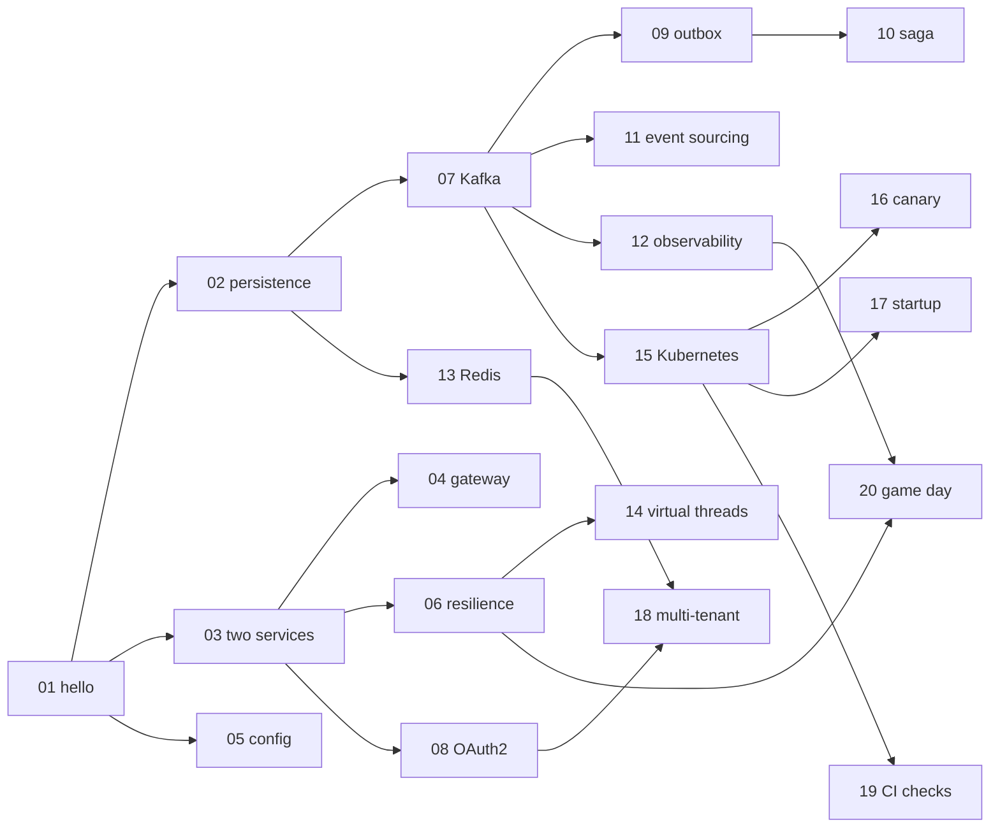

# Code Lab Overview

<div class="badges" markdown><span class="badge badge-l1">L1 · Foundation</span><span class="badge badge-l2">L2 · Practitioner</span><span class="badge badge-l3">L3 · Senior/Lead</span><span class="badge badge-l4">L4 · Architect</span></div>

The chapters explain and measure; the labs are where you build. Each lab is one sitting (45 to 90 minutes), builds a piece of FoodFleet you could deploy, and ends with checks and exercises that break what you built on purpose. The code is in `code/code-lab/`, one directory per lab.

## The labs

| # | Lab | Level | Time | You build |
|---|---|---|---|---|
| 01 | [Hello Microservice](lab-01-hello-microservice.md) | L1 | 45 min | menu-service: a REST endpoint, validation, errors, a slice test |
| 02 | [Persistence with JPA, Flyway & Testcontainers](lab-02-persistence.md) | L1–L2 | 1 h | The menu in PostgreSQL, optimistic locking, migrations, a real-database test |
| 03 | [Two Services Talking](lab-03-two-services.md) | L1–L2 | 1 h | order-service calling menu-service with an HTTP interface client and timeouts |
| 04 | [Discovery, Gateway & Load Balancing](lab-04-discovery-gateway.md) | L2 | 1 h | A gateway with routes and client-side balancing; Kubernetes services |
| 05 | [Centralized Config & Vault](lab-05-config-vault.md) | L2 | 75 min | Config Server, validated settings, secrets from OpenBao with least privilege |
| 06 | [Resilience4j](lab-06-resilience.md) | L2 | 1 h | Retry, circuit breaker, bulkhead and fallback with measured settings |
| 07 | [Kafka Producer & Consumer](lab-07-kafka.md) | L2 | 75 min | Order events, an idempotent consumer with an inbox, a dead-letter topic |
| 08 | [OAuth2 with Keycloak](lab-08-oauth2-keycloak.md) | L2–L3 | 1 h | A resource server, role mapping, object-level authorization, token relay |
| 09 | [Outbox & Debezium](lab-09-outbox-cdc.md) | L3 | 75 min | A transactional outbox, a SKIP LOCKED relay, the Debezium alternative |
| 10 | [Saga with Compensation](lab-10-saga.md) | L3 | 1 h | The place-order saga, orchestrated and choreographed, under 10,000 failures |
| 11 | [CQRS & Event Sourcing](lab-11-cqrs-event-sourcing.md) | L3 | 75 min | An event-sourced wallet, projections, and the position-gap fix on PostgreSQL |
| 12 | [End-to-End Observability](lab-12-observability.md) | L3 | 75 min | One trace across services and threads, correlated logs, RED metrics from spans |
| 13 | [Redis Caching, Locks & Rate Limits](lab-13-redis.md) | L3 | 75 min | A two-level cache, per-tenant token buckets, locks with fencing tokens |
| 14 | [Virtual Threads vs WebFlux](lab-14-virtual-threads-vs-webflux.md) | L4 | 1 h | One endpoint two ways, a Gatling open model, four concurrency models measured |
| 15 | [Kubernetes, Helm & KEDA](lab-15-kubernetes-helm-keda.md) | L4 | 75 min | The shared chart, deploy by digest, an HPA scaling out, KEDA on consumer lag |
| 16 | [Istio mTLS & Canary](lab-16-istio-canary.md) | L4 | 1 h | Mesh identity and authorization, a canary with a tested analysis |
| 17 | [Native Image vs CRaC](lab-17-native-crac.md) | L4 | 1 h | Start time measured plain, with AppCDS and an AOT cache; native and CRaC builds |
| 18 | [Multi-Tenant Service](lab-18-multi-tenancy.md) | L4 | 1 h | Shared tables with forced row-level security, tenant per transaction, bulkheads |
| 19 | [Contracts & Fitness Functions in CI](lab-19-contracts-archunit.md) | L4 | 1 h | Pact consumer and provider, ArchUnit rules, the pull-request workflow |
| 20 | [Chaos Game Day](lab-20-chaos-game-day.md) | L4 | 90 min | The plan, a paging forecast from the real alert rules, a rehearsal, the workflow |

## How they build on each other



Three paths through them, by goal:

- **First microservices (L1–L2):** 01 → 02 → 03 → 06 → 07. Then [the interview bands](../interview-prep/index.md) for L1 and L2.
- **Data and events (L3):** 07 → 09 → 10 → 11, with 13 for caching.
- **Platform and operations (L4):** 12 → 15 → 16 → 17 → 19 → 20.

## What you need

| | For |
|---|---|
| JDK 25 | Every lab. Labs 10, 11, 14, 17 and 19 need nothing else for their measured parts |
| Maven 3.9 and Docker | The Spring modules and their Testcontainers tests (labs 01–09, 12, 13, 14, 18, 19) |
| PostgreSQL 16 binaries | `verify/` scripts in labs 09, 11 and 18 (they start a throwaway server; no setup) |
| `redis-server` 7, Python 3 with PyYAML, `promtool` | Labs 13, 16 and 20 |
| A Kubernetes cluster with metrics-server, Helm 4 | Labs 15 and 16; the handbook used single-node k3s (`code/chapters/ch52-health-checks-actuator/verify/k3s-lab.sh`) |
| The OpenTelemetry Java agent and Collector, OpenBao, `istioctl` | Labs 12, 05 and 16 |

Every lab's code builds on the handbook's parent POM: Spring Boot 4.1.1, Spring Cloud 2025.1.2, Java 25. `mvn -B verify` from `code/code-lab/` builds all the Maven labs; each lab's page shows how to run it alone.

## How the lab code was checked

The handbook was written in an environment that could reach GitHub but not Maven Central or Docker Hub. So Spring code could not be compiled against Spring's published jars, and container images could not be pulled. Every lab says, in a note at its top, which of the following applied to which part. Nothing is described as run that wasn't.

**Run.** Whatever could run without Maven Central was run, and its output is copied into the page:

| What | Labs | On |
|---|---|---|
| Plain-Java programs and experiments, compiled with `javac` | 10, 11, 13, 14, 17, 19, 20 | JDK 25.0.4 |
| SQL: every lab's Flyway migrations (`tools/check_sql.sh`), races and policies | 02, 07, 09, 11, 18 | PostgreSQL 16.13 |
| Lua scripts, through the same files Spring loads | 13 | Redis 7.0.15 |
| Services under the OpenTelemetry Java agent into a Collector | 12 | Agent 2.32.0, Collector 0.162.0 |
| Policies and tokens | 05 | OpenBao 2.4.4 |
| A real deployment and autoscaling | 15 | k3s v1.37.1, Helm 4.1.4 |
| Manifests dry-run against the real CRDs on the API server | 15, 16, 20 | KEDA 2.20.2, Istio 1.31.1, Argo Rollouts 1.9.2, Chaos Mesh 2.8.4 |
| PromQL in alert rules and canary analyses | 16, 20 | promtool 3.15.0 |
| Offline validation | 12, 16 | `otelcol-contrib validate`, `istioctl validate` and `analyze` |

**Checked by import, not compiled.** The Spring Boot code (controllers, configuration, tests) is written for Spring Boot 4.1.1 and the library versions its BOM manages, and checked by `code/code-lab/tools/check_imports.py`:

- Every `import` in every lab's Java files is looked up in the source tree of the library it comes from, at the exact tag the BOM pins: 37 repositories, including Spring Boot, Framework, Data, Kafka, Security, Cloud, Micrometer, Testcontainers, Resilience4j, Jackson, Hibernate, Reactor, Gatling, Pact and ArchUnit. The last run checked 470 imports against 53,776 types: none missing.
- Every Spring Boot and Spring Cloud starter or module named in a `pom.xml` is checked against the project's module directories (87 artifacts).
- Beyond imports, the APIs and property names each lab depends on were read in the library's source at that tag, and each lab's note names them: for example `spring.http.serviceclient.*`, Spring Kafka's dead-letter topic naming, Micrometer's `TestObservationRegistryAssert`, Boot's `FlywayProperties.initSqls`, KEDA's Kafka scaler keys, Pact's Spring 7 provider.

What that doesn't catch: a wrong method signature on an imported type, a misspelt property that Spring would ignore, behaviour that differs from the source's reading. Where a lab's claim depends on behaviour, it comes from something that ran, here or in the chapter it builds on, and the page says which.

```bash
python3 code/code-lab/tools/check_imports.py           # first run clones path indexes (blob-less) into tools/build/
PG_BIN=$(pg_config --bindir) code/code-lab/tools/check_sql.sh
```

If you run the Maven builds and something fails to compile, that's a defect in the lab; the handbook's repository takes issues.

## Conventions

- **Packages** are `dev.foodfleet.labNN`; services keep FoodFleet's names (menu-service, order-service, kitchen-service) so the chapters' figures apply.
- **Ports**: menu-service 8080, order-service from 8090 up; each lab's `application.yml` says which.
- **Topics, schemas and roles** follow [the conventions](../appendix/conventions.md): `foodfleet.<context>.<entity>` for topics, one schema per service, a non-owner application role.
- **Every lab ends with "Break it"**: exercises that undo one decision and ask what happens. Most have a measured answer in the chapter the lab builds on.
