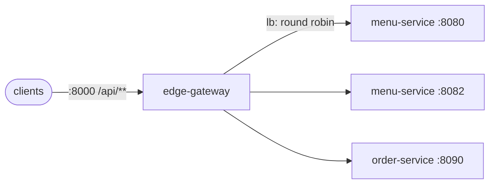

# Lab 04 — Discovery, Gateway & Load Balancing

<div class="badges" markdown><span class="badge badge-l2">L2 · Practitioner</span></div>

| | |
|---|---|
| **You'll build** | edge-gateway: one public entry point routing `/api/**` to load-balanced menu-service and order-service instances |
| **Time** | About an hour |
| **Builds on** | [Lab 01](lab-01-hello-microservice.md) and [Lab 03](lab-03-two-services.md) |
| **Chapters** | [10 (gateway and BFF)](../architecture-patterns/ch10-api-gateway-bff.md), [11 (discovery)](../architecture-patterns/ch11-service-discovery-patterns.md), [68 (scaling)](../performance-scalability/ch68-horizontal-scaling.md) |
| **Code** | `code/code-lab/lab-04-discovery-gateway/` |

!!! note "About the lab code"
    Written for Spring Boot 4.1.1 and Spring Cloud 2025.1.2 (Gateway 5.0.2), checked by import against their source, not compiled here ([how](index.md#how-the-lab-code-was-checked)). The gateway DSL's method signatures and property prefixes were checked in Spring Cloud Gateway's source.



## 1. Routes in Java

```java title="Routes.java"
--8<-- "code/code-lab/lab-04-discovery-gateway/src/main/java/dev/foodfleet/lab04/Routes.java"
```

What the gateway does here, and what it deliberately doesn't ([ADR-010](../architecture-patterns/ch10-api-gateway-bff.md)):

- **Routes by path** to a *service id*, not a host. Services keep no public DNS names, so they can move and split behind stable public paths.
- **Strips `/api`**, so services don't know they're behind a gateway.
- **Adds a request id** if a caller didn't send one, for logs and support.
- **Caps request bodies** at 256 KB ([ADR-040](../security/ch40-api-security.md)).
- **No business logic, no aggregation, no retries.** Aggregation is the BFFs' job; retries belong to the service closest to the dependency, and chapter 42 measured three layers of retries sending 27 calls per request to a dead dependency ([ADR-018](../architecture-patterns/ch18-resilience-patterns.md)).

In production the gateway also validates tokens ([Lab 08](lab-08-oauth2-keycloak.md)) and applies rate limits ([Lab 13](lab-13-redis.md)).

## 2. Where instances come from

`lb("menu-service")` asks Spring Cloud LoadBalancer for an instance of `menu-service`, which asks a `DiscoveryClient`. Which one depends on where you run:

=== "Locally: a static list"

    ```yaml title="application.yml"
    --8<-- "code/code-lab/lab-04-discovery-gateway/src/main/resources/application.yml"
    ```

    The simple discovery client reads instances from configuration. Good for a laptop and for tests.

=== "Kubernetes: the Service is the discovery"

    ```yaml title="k8s/menu-service.yaml"
    --8<-- "code/code-lab/lab-04-discovery-gateway/k8s/menu-service.yaml"
    ```

    FoodFleet's choice ([ADR-011](../architecture-patterns/ch11-service-discovery-patterns.md)): the platform already tracks which pods are ready, so a second registry is one more thing to keep available. Two ways to use it:

    - **Route to the Service's DNS name** (`uri("http://menu-service")`). Simplest; balancing happens per connection unless a mesh balances per request ([ADR-057](../deployment/ch57-service-mesh.md)).
    - **Keep `lb(...)` and add `spring-cloud-starter-kubernetes-client`**, which lists the pods behind the Service for per-request balancing in the gateway itself.

=== "No platform registry: Eureka"

    Outside Kubernetes (VMs, or a migration from Netflix OSS), a Eureka server keeps the registry:

    ```xml
    <!-- the registry: its own small application -->
    <dependency>
        <groupId>org.springframework.cloud</groupId>
        <artifactId>spring-cloud-starter-netflix-eureka-server</artifactId>
    </dependency>
    <!-- every service and the gateway: registers itself and reads the registry -->
    <dependency>
        <groupId>org.springframework.cloud</groupId>
        <artifactId>spring-cloud-starter-netflix-eureka-client</artifactId>
    </dependency>
    ```

    ```yaml
    eureka:
      client:
        service-url:
          defaultZone: http://localhost:8761/eureka
    ```

    Remove the static `instances` block; `lb("menu-service")` now resolves through Eureka. Chapter 11 measured the cost: a registry's view lags reality, so callers hit instances that are already gone until their caches expire.

## 3. Test the gateway against real instances

```java title="RoutesTest.java"
--8<-- "code/code-lab/lab-04-discovery-gateway/src/test/java/dev/foodfleet/lab04/RoutesTest.java:25:85"
```

Two stand-in instances record what reaches them. Four requests through the gateway arrive at the right path, each with a request id, two at each instance: per-request round robin.

## Run it

```bash
# two menu-service instances (lab 01) and order-service (lab 03)
cd code/code-lab/lab-01-hello-microservice
mvn spring-boot:run -Dspring-boot.run.arguments="--server.port=8080 --management.server.port=8081" &
mvn spring-boot:run -Dspring-boot.run.arguments="--server.port=8082 --management.server.port=8083" &
cd ../lab-03-two-services && mvn spring-boot:run &
cd ../lab-04-discovery-gateway && mvn spring-boot:run
```

```console
$ for i in 1 2 3 4; do curl -s -o /dev/null -w "%{http_code} " localhost:8000/api/restaurants/r-1/menu; done
200 200 200 200
$ curl -s localhost:8001/actuator/gateway/routes      # the routes the gateway has loaded
```

Stop the instance on 8082 and send requests again: some fail until you remove it from the list. That's what discovery with health checking (Kubernetes readiness, or Eureka's heartbeats) is for.

## Check yourself

- [ ] `mvn verify` passes both tests.
- [ ] Requests to `/api/restaurants/...` reach menu-service as `/restaurants/...`.
- [ ] A request without `X-Request-Id` reaches the service with one; a request with one keeps it.
- [ ] `/internal/admin` answers `404` at the gateway: only routed paths are reachable.

## Break it

!!! question "Exercises"
    1. Send a 300 KB body to `/api/quotes`. What status comes back, and from whom?
    2. Stop one menu-service instance. How many requests fail before you'd notice, and what would Kubernetes readiness or a load-balancer health check change?
    3. Point lab 03's order-service at `menu-service` through discovery instead of a fixed URL. Since Spring Cloud 2025.1, an HTTP service group without a `base-url` is load-balanced with the group name as the service id ([ch. 11](../architecture-patterns/ch11-service-discovery-patterns.md)): rename the group and remove the URL.
    4. Add a retry filter to the menu route, then make an instance return `503`. Count the calls reaching the instances, and compare with chapter 42's 27 calls per request.

**Next:** [Lab 05](lab-05-config-vault.md) moves configuration and secrets out of the jar.
