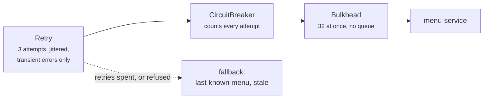

# Lab 06 — Resilience4j

<div class="badges" markdown><span class="badge badge-l2">L2 · Practitioner</span></div>

| | |
|---|---|
| **You'll build** | A resilient menu client in order-service: retry, circuit breaker, bulkhead and fallback |
| **Time** | About an hour |
| **Builds on** | [Lab 03](lab-03-two-services.md) |
| **Chapters** | [18 (resilience patterns)](../architecture-patterns/ch18-resilience-patterns.md), [42 (failure modes)](../resilience/ch42-failure-modes.md), [43 (Resilience4j)](../resilience/ch43-resilience4j-deep-dive.md) |
| **Code** | `code/code-lab/lab-06-resilience/` |

!!! note "About the lab code"
    Written for Spring Boot 4.1.1 with Resilience4j 2.4.0's Boot 4 module, checked by import against their source, not compiled here ([how](index.md#how-the-lab-code-was-checked)). Chapter 43's experiments ran these policies against Resilience4j 2.4.0 built from source; its `order-service.yml` is the original of this lab's configuration.

## 1. Which patterns, in which order

```java title="ResilientMenus.java"
--8<-- "code/code-lab/lab-06-resilience/src/main/java/dev/foodfleet/lab06/ResilientMenus.java:17:50"
```

The order of the annotations in the source doesn't matter; Spring Boot applies them as **Retry ( CircuitBreaker ( Bulkhead ( call ) ) )**:



- **Every retry is an attempt the breaker sees**, so a dead dependency opens the breaker quickly.
- **The fallback goes on the outermost annotation**, `@Retry`. Put it on `@CircuitBreaker` and the first failure is answered from the cache: the retry never runs. Chapter 43 found exactly that misplacement in an incident.
- **The fallback is a product decision** ([ADR-002](../foundations/ch02-characteristics-principles.md)): an old menu, marked stale so the app can say prices may have changed. With no copy at all, the caller gets a clear error.

## 2. Retry only what can succeed next time

```java title="TransientFailure.java"
--8<-- "code/code-lab/lab-06-resilience/src/main/java/dev/foodfleet/lab06/TransientFailure.java"
```

A `404` will be a `404` again. A refusal from our own breaker or bulkhead is protection working, not a failure to retry.

## 3. Settings that were measured

```yaml title="application.yml (resilience4j)"
--8<-- "code/code-lab/lab-06-resilience/src/main/resources/application.yml:15:48"
```

Each differs from the library's default for a reason chapter 43 measured ([ADR-043](../resilience/ch43-resilience4j-deep-dive.md)):

| Setting | Default | Here | Measured |
|---|---|---|---|
| Window | 100 calls | 5 seconds | A count window took ~10 s to open on a quiet endpoint; 5 s opened in 2–4 s at 100/s and at 5/s |
| Slow call | 60 s | 1 s | A default breaker never noticed a 3-second dependency |
| Open for | 60 s | 5 s | A 40-second failure became a minute of "menu unavailable" |
| Jitter | none | full | Retries from many callers otherwise arrive together |
| Bulkhead wait | 0 | 0 (explicit) | A blocking limit queued about 4,000 checkout callers |
| Health indicator | on | off | An open breaker must not take this service out of the load balancer ([ADR-052](../observability/ch52-health-checks-actuator.md)) |

The read timeout (`spring.http.serviceclient.menu.read-timeout: 1s`) is what actually stops a slow call. Without it, a breaker can't see a black hole: no call ever finishes to be counted.

## 4. Tests that count calls

```java title="ResilientMenusTest.java"
--8<-- "code/code-lab/lab-06-resilience/src/test/java/dev/foodfleet/lab06/ResilientMenusTest.java:79:123"
```

The decisive assertion is in the last test: once the breaker is open, **50 requests are answered and none reaches menu-service**. That's the point of a breaker: a struggling dependency gets room to recover instead of more load.

## Run it

```bash
cd code/code-lab/lab-01-hello-microservice && mvn spring-boot:run &      # menu-service on 8080
cd ../lab-06-resilience && mvn spring-boot:run
```

Quote an order once (to warm the copy), stop menu-service, and keep quoting. Then watch the breaker:

```bash
curl -s localhost:8091/actuator/circuitbreakers | python3 -m json.tool
curl -s localhost:8091/actuator/circuitbreakerevents/menu | python3 -m json.tool | head -30
```

You'll see the state move from `CLOSED` to `OPEN`, then `HALF_OPEN` after 5 seconds, then back to `CLOSED` once you restart menu-service and five trial calls succeed.

## Check yourself

- [ ] `mvn verify` passes all four tests.
- [ ] With menu-service stopped and a warm copy, quotes still work and say `"stale": true`.
- [ ] The breaker's events show the transition to `OPEN`, and calls stop reaching the stopped service.

## Break it

!!! question "Exercises"
    1. Move `fallbackMethod` from `@Retry` to `@CircuitBreaker`. Run `aTransientFailureIsRetriedOnce`: what fails, and why?
    2. Remove `retry-exception-predicate`. How many calls does the `404` test now make?
    3. Set `sliding-window-type: COUNT_BASED`, `sliding-window-size: 100` and `minimum-number-of-calls: 100`. How many failed requests does the breaker test need before it opens?
    4. Remove `read-timeout` and make the stand-in sleep for 30 seconds instead of returning 503. Does the breaker ever open? (This is chapter 45's black hole.)

**Next:** [Lab 07](lab-07-kafka.md) takes the call off the critical path altogether, with Kafka.
