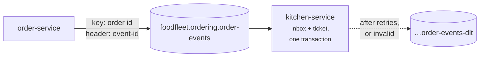

# Lab 07 — Kafka Producer & Consumer

<div class="badges" markdown><span class="badge badge-l2">L2 · Practitioner</span></div>

| | |
|---|---|
| **You'll build** | order-service publishing `OrderPlaced`, and kitchen-service turning each into exactly one ticket |
| **Time** | About 75 minutes |
| **Builds on** | [Lab 02](lab-02-persistence.md) |
| **Chapters** | [25 (messaging)](../communication/ch25-asynchronous-messaging.md), [28 (idempotency)](../communication/ch28-idempotency-correlation.md), [69 (Kafka throughput)](../performance-scalability/ch69-kafka-throughput-tuning.md) |
| **Code** | `code/code-lab/lab-07-kafka/` |
| **Needs** | Docker, for Testcontainers |

!!! note "About the lab code"
    Written for Spring Boot 4.1.1 with Spring Kafka 4.1.1 and Kafka clients 4.2.1, checked by import against their source, not compiled here ([how](index.md#how-the-lab-code-was-checked)). The DLT naming and header names were checked in Spring Kafka's source; the migration ran on PostgreSQL 16.13.



## 1. Publish: keyed, identified, durable

```java title="OrderEvents.java"
--8<-- "code/code-lab/lab-07-kafka/src/main/java/dev/foodfleet/lab07/OrderEvents.java:13:42"
```

- **The key is the order id.** Kafka keeps one key's records in order on one partition, so an order's `OrderPlaced` can't be read after its `OrderCancelled` ([Kafka topic design](../food-delivery-platform/kafka-design.md#keys-and-partitions)).
- **Every message carries an `event-id`**, the consumer's deduplication key ([ADR-028](../communication/ch28-idempotency-correlation.md)).
- **`acks=all` and idempotence on** (in `application.yml`): an acknowledged event survives a broker failure, and producer retries don't duplicate it ([ADR-069](../performance-scalability/ch69-kafka-throughput-tuning.md)).

This publisher has a flaw on purpose, noted in its comment: if order-service saved the order and then crashed before sending, the event is lost. [Lab 09](lab-09-outbox-cdc.md) fixes it with an outbox.

## 2. Consume: commit after, deduplicate inside

```java title="KitchenTickets.java"
--8<-- "code/code-lab/lab-07-kafka/src/main/java/dev/foodfleet/lab07/KitchenTickets.java:29:59"
```

```sql title="V1__kitchen.sql"
--8<-- "code/code-lab/lab-07-kafka/src/main/resources/db/migration/V1__kitchen.sql"
```

Kafka delivers at least once: after a crash, a rebalance or a lost commit, the same record comes again. So:

1. **The container commits the offset only after the listener returns** (`enable-auto-commit: false`, `ack-mode: record`). A crash means redelivery, never loss.
2. **The inbox insert and the ticket insert are one transaction.** If the event id is already there, it's a redelivery: skip. Chapter 25 measured committing after processing with idempotency: 0 lost, 0 duplicated; Spring Kafka's old default silently skipped 16 messages during an outage.

## 3. When processing fails

```java title="KafkaErrorHandling.java"
--8<-- "code/code-lab/lab-07-kafka/src/main/java/dev/foodfleet/lab07/KafkaErrorHandling.java"
```

kitchen-service is an **ordered** consumer: a later event for the same order must not overtake a failing one. So it retries **in place**, with exponential backoff up to 31 seconds, then publishes the record to `<topic>-dlt` with the exception in its headers and moves on. A message that can never succeed (unreadable JSON, a missing header) skips the retries ([ADR-025](../communication/ch25-asynchronous-messaging.md)).

Consumers that don't need order can use `@RetryableTopic` instead: failed records move to retry topics and the partition keeps flowing.

## 4. Test with real infrastructure

```java title="KitchenTicketsTest.java"
--8<-- "code/code-lab/lab-07-kafka/src/test/java/dev/foodfleet/lab07/KitchenTicketsTest.java:30:101"
```

- **A redelivery** sends the same event id twice; one ticket results.
- **A poison message** lands on the DLT with `kafka_dlt-exception-fqcn` set, and the next event on the same key is still processed.
- **Topics are created explicitly**, as in production where auto-creation is off; the DLT gets as many partitions as its source, because the recoverer publishes to the same partition number.

## Run it

```bash
docker run -d --name kafka -p 9092:9092 apache/kafka:4.2.2
docker exec kafka /opt/kafka/bin/kafka-topics.sh --bootstrap-server localhost:9092 --create \
  --topic foodfleet.ordering.order-events --partitions 3
docker exec kafka /opt/kafka/bin/kafka-topics.sh --bootstrap-server localhost:9092 --create \
  --topic foodfleet.ordering.order-events-dlt --partitions 3
cd code/code-lab/lab-07-kafka && mvn verify      # Testcontainers starts its own Kafka and PostgreSQL
```

Watch what a producer really sends, headers included ([cheat sheet](../appendix/cheat-sheets.md#reading-and-writing)):

```bash
docker exec kafka /opt/kafka/bin/kafka-console-consumer.sh --bootstrap-server localhost:9092 \
  --topic foodfleet.ordering.order-events --from-beginning --property print.key=true --property print.headers=true
```

## Check yourself

- [ ] `mvn verify` passes all three tests.
- [ ] The DLT record carries the original key and the exception class in its headers.
- [ ] `kafka-consumer-groups.sh --describe --group kitchen-service` shows lag 0 after the tests' events.

## Break it

!!! question "Exercises"
    1. Move the inbox insert into its own transaction, before the ticket insert, and throw after it. What happens on redelivery?
    2. Set `enable-auto-commit: true` and kill the consumer while it's processing. What can happen to that record?
    3. Make `InvalidEvent` retryable. How long does a poison message now block its partition, and what happens to orders behind it?
    4. Key the events by restaurant id instead of order id. What do you gain and lose? (Chapter 68 found one partition carrying 19–28% of orders when keyed by restaurant.)

**Next:** [Lab 08](lab-08-oauth2-keycloak.md) secures the services with OAuth 2 and Keycloak.
