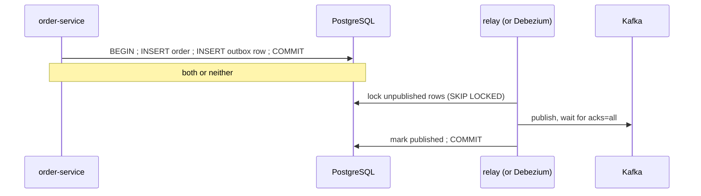

# Lab 09 — Outbox & Debezium

<div class="badges" markdown><span class="badge badge-l3">L3 · Senior/Lead</span></div>

| | |
|---|---|
| **You'll build** | order-service's transactional outbox, a polling relay to Kafka, and the Debezium configuration that replaces it |
| **Time** | About 75 minutes |
| **Builds on** | [Lab 07](lab-07-kafka.md) (its kitchen-service consumes these events) |
| **Chapters** | [15 (outbox, inbox, CDC)](../architecture-patterns/ch15-outbox-inbox-cdc.md), [19 (event-driven)](../architecture-patterns/ch19-event-driven-architecture.md) |
| **Code** | `code/code-lab/lab-09-outbox-cdc/` |
| **Needs** | Docker, for Testcontainers |

!!! note "About the lab code"
    Written for Spring Boot 4.1.1 and Spring Kafka 4.1.1, checked by import against their source, not compiled here ([how](index.md#how-the-lab-code-was-checked)). The SQL **was run**: the migrations on PostgreSQL 16.13, and `verify/relay-race.sh` races two relays on it. The relay follows [chapter 15](../architecture-patterns/ch15-outbox-inbox-cdc.md)'s, which was tested there.

## The problem: two writes, no transaction between them

Lab 07's order-service saved an order and then sent an event. If it crashes between the two, the order exists and nobody hears about it; if the send succeeds and the database commit fails, an event announces an order that doesn't exist. Chapter 15 measured dual writes losing or inventing about 1.6% of events under crashes; outbox and inbox together, none.



## 1. One transaction, two rows

```sql title="V1__orders_outbox.sql"
--8<-- "code/code-lab/lab-09-outbox-cdc/src/main/resources/db/migration/V1__orders_outbox.sql"
```

```java title="PlaceOrder.java"
--8<-- "code/code-lab/lab-09-outbox-cdc/src/main/java/dev/foodfleet/lab09/PlaceOrder.java"
```

The outbox row carries everything the relay needs: the topic (from `aggregate_type`), the key (`aggregate_id`), the event id and type for headers, and the payload.

## 2. The polling relay

```java title="OutboxRelay.java"
--8<-- "code/code-lab/lab-09-outbox-cdc/src/main/java/dev/foodfleet/lab09/OutboxRelay.java:48:82"
```

Three properties to explain in a review:

- **`FOR UPDATE SKIP LOCKED`** lets several relay instances run: each takes rows nobody else holds, instead of waiting or publishing them twice.
- **Stop at the first failure.** Publishing row 5 after row 4 failed would let an order's later event overtake an earlier one.
- **Mark only what the broker acknowledged**, after waiting for `acks=all`. A crash between the send and the commit publishes those rows again: at-least-once, which lab 07's inbox makes harmless.

The race, on real PostgreSQL 16.13: two relays claim a batch of 100 at the same moment from an outbox of 150 rows.

```console
$ PG_BIN=/usr/lib/postgresql/16/bin code/code-lab/lab-09-outbox-cdc/verify/relay-race.sh
relay A claimed 100 rows (positions 1-100), relay B 50 rows (positions 101-150); claimed by both: 0
```

Relay B didn't wait for A's transaction; it took the rows A hadn't locked.

## 3. Or let the database's log do it: Debezium

Polling adds a query every half-second and a delay of up to one interval. **Log-based CDC** reads the outbox inserts from PostgreSQL's write-ahead log instead, as they commit:

```json title="debezium/order-outbox-connector.json"
--8<-- "code/code-lab/lab-09-outbox-cdc/debezium/order-outbox-connector.json"
```

- **The outbox event router** turns each outbox row into a Kafka record: topic from `aggregate_type` (`foodfleet.ordering.order-events`), key from `aggregate_id`, the event id and type as headers, the JSON payload as the value. Consumers can't tell it from the polling relay's output.
- **A replication slot** keeps the WAL Debezium hasn't read yet. If Debezium stops, the slot keeps WAL growing until the disk fills: cap it (`max_slot_wal_keep_size`) and alert on its lag ([ADR-034](../data/ch34-reporting-analytics.md)).
- **The heartbeat** advances the slot even when no orders are placed, so idle periods don't hold WAL:

```sql title="V2__debezium_heartbeat.sql"
--8<-- "code/code-lab/lab-09-outbox-cdc/src/main/resources/db/migration/V2__debezium_heartbeat.sql"
```

| | Polling relay | Debezium |
|---|---|---|
| Delay | Up to one poll interval | Milliseconds after commit |
| Load on the database | A query per interval per relay | Reading the WAL |
| Moving parts | Code in the service | Kafka Connect, a replication slot to monitor |
| FoodFleet uses it for | Most services ([ADR-015](../architecture-patterns/ch15-outbox-inbox-cdc.md)) | High-volume services |

[Spring Modulith](https://docs.spring.io/spring-modulith/reference/) offers a third option inside a modular monolith: an event publication registry that externalises events to Kafka after commit.

## 4. Test it

```java title="OutboxTest.java"
--8<-- "code/code-lab/lab-09-outbox-cdc/src/test/java/dev/foodfleet/lab09/OutboxTest.java:33:102"
```

## Run it

```bash
cd code/code-lab/lab-09-outbox-cdc
PG_BIN=$(pg_config --bindir) verify/relay-race.sh    # the race, on your own PostgreSQL 16
mvn verify                                           # Testcontainers: PostgreSQL and Kafka
```

To try Debezium, run Kafka Connect with the Debezium PostgreSQL connector, set `wal_level=logical` on PostgreSQL, and `POST` the JSON above to Connect's `/connectors` endpoint.

## Check yourself

- [ ] `mvn verify` passes all three tests.
- [ ] `relay-race.sh` shows disjoint claims.
- [ ] Lab 07's kitchen-service, pointed at the same Kafka, creates one ticket per order placed here.

## Break it

!!! question "Exercises"
    1. Remove `SKIP LOCKED` from the claim in `relay-race.sh`. How long does relay B wait, and what does it claim?
    2. Make the relay skip a failing row and continue. Construct the case where a consumer sees an order's `OrderCancelled` before its `OrderPlaced`.
    3. Mark rows published *before* sending. What happens to an event when the broker is down for a minute?
    4. Stop Debezium for an hour on a busy database, with no cap on the slot. What grows, and what eventually stops?

**Next:** [Lab 10](lab-10-saga.md) builds a whole business transaction out of these events.
