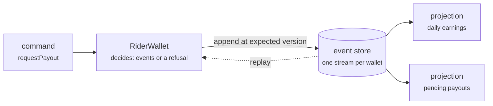

# Lab 11 — CQRS & Event Sourcing

<div class="badges" markdown><span class="badge badge-l3">L3 · Senior/Lead</span></div>

| | |
|---|---|
| **You'll build** | An event-sourced rider wallet, its event store, and two read models kept up to date by projections |
| **Time** | About 75 minutes |
| **Builds on** | [Lab 07](lab-07-kafka.md) (events and idempotency); [lab 10](lab-10-saga.md) for the style |
| **Chapters** | [13 (CQRS and event sourcing)](../architecture-patterns/ch13-cqrs-event-sourcing.md), [31 (data consistency)](../data/ch31-data-consistency.md) |
| **Code** | `code/code-lab/lab-11-cqrs-event-sourcing/`, on [chapter 13](../architecture-patterns/ch13-cqrs-event-sourcing.md)'s wallet |
| **Needs** | JDK 25; PostgreSQL 16 binaries for part 5 (no server to set up, the script starts its own) |

!!! note "About the lab code"
    This lab **was run**: the wallet, store and projections are plain Java, compiled and run with JDK 25.0.4, and `verify/event-store.sh` ran against PostgreSQL 16.13. Chapter 13's `JdbcEventStore` (Spring's `JdbcClient`) is left out of the plain-Java build; its schema is what part 5 exercises, in PostgreSQL form.

## Why a rider's wallet

Wallet disputes took FoodFleet days to investigate, and when a penalty bug hit 1,800 riders there was no way to reconstruct their past balances: a balance column only knows the current number. Chapter 13 made the wallet **event-sourced**: the events are the record, and the balance is whatever they add up to. Every rupee is explainable, and the balance at any past moment can be recomputed ([ADR-013](../architecture-patterns/ch13-cqrs-event-sourcing.md#8-enterprise-case-study)).



## 1. Events, then state

```java title="WalletEvent.java"
--8<-- "code/chapters/ch13-cqrs-event-sourcing/src/main/java/dev/foodfleet/ch13/wallet/WalletEvent.java:5:35"
```

The wallet splits each operation in two. **Deciding** checks the rules against current state and returns events, or refuses:

```java title="RiderWallet.java (decide)"
--8<-- "code/chapters/ch13-cqrs-event-sourcing/src/main/java/dev/foodfleet/ch13/wallet/RiderWallet.java:76:89"
```

**Applying** changes state and never refuses, because an event is a fact that already happened:

```java title="RiderWallet.java (evolve)"
--8<-- "code/chapters/ch13-cqrs-event-sourcing/src/main/java/dev/foodfleet/ch13/wallet/RiderWallet.java:102:131"
```

Loading a wallet is applying its events in order, from the first. `creditEarning` returns no event for an order already credited: a redelivered delivery event can't pay a rider twice.

## 2. Two commands, one wallet

```java title="WalletService.java"
--8<-- "code/chapters/ch13-cqrs-event-sourcing/src/main/java/dev/foodfleet/ch13/wallet/WalletService.java:22:34"
```

Saving appends at the **version the wallet was loaded at**. If another command appended in between, the store refuses and the command runs again on fresh state. So a payout and a penalty that each fit the available balance alone, but not together, can't both succeed.

## 3. Run a rider's evening

```console
$ code/code-lab/lab-11-cqrs-event-sourcing/run.sh
Events in stream: 18
Balance ₹585.00, available ₹85.00, payout pending po-1
Load with snapshots every 10 events reads 8 events, not 18
As of 9:00 pm IST the balance was ₹400.00
Meena's 2023 balance, from a v1 event in rupees: ₹38.50
Projection daily-earnings handled 20 events: 12 deliveries, earnings ₹540.00, tips ₹60.00
Projection pending-payouts: 1 pending
After payout completes: read model still says 1 pending (lag 1), after catch-up 0
Rebuilt daily-earnings from scratch: 21 events, same totals: true
```

Line by line:

- **18 events, ₹585**: 12 deliveries at ₹45, three ₹20 tips, a ₹15 penalty; a duplicate delivery event added nothing. ₹500 of it is held for the pending payout, so ₹85 is available.
- **Snapshots** every 10 events: loading reads the snapshot plus the 8 events after it.
- **Time travel**: the balance at 9:00 pm is the events up to 9:00 pm, applied. No audit table was needed.
- **Upcasting**: Meena's 2023 event stored rupees as a string (schema v1). It's never rewritten; an upcaster turns it into the current shape on read.
- **Lag**: the read model said "1 pending" after the payout completed, until the runner caught up. That's what eventual consistency looks like on a screen.
- **Rebuild**: the read model was thrown away and recomputed from event 1 with identical totals. Fixing a buggy projection, or adding a new one, is the same operation.

## 4. The read side

```java title="PendingPayoutsProjection.java"
--8<-- "code/chapters/ch13-cqrs-event-sourcing/src/main/java/dev/foodfleet/ch13/projection/PendingPayoutsProjection.java:13:51"
```

```java title="ProjectionRunner.java"
--8<-- "code/chapters/ch13-cqrs-event-sourcing/src/main/java/dev/foodfleet/ch13/projection/ProjectionRunner.java:27:49"
```

That's the **CQRS** half: the ops dashboard's question ("which payouts have been pending too long?") gets a model built for it, instead of a query across every rider's stream. In production the read-model update and the checkpoint are written **in one transaction**, so a crash neither skips nor repeats an event.

## 5. The event store on PostgreSQL

```sql title="sql/event-store-pg.sql"
--8<-- "code/code-lab/lab-11-cqrs-event-sourcing/sql/event-store-pg.sql"
```

`verify/event-store.sh` starts a throwaway PostgreSQL and tries two things:

```console
$ PG_BIN=/usr/lib/postgresql/16/bin code/code-lab/lab-11-cqrs-event-sourcing/verify/event-store.sh
-- 1. two writers, both loaded the wallet at version 4
writer 1 (payout): appended version 5
writer 2 (adjustment): duplicate key value violates unique constraint "event_store_stream_version"
stream now: 1 EarningCredited, 2 EarningCredited, 3 EarningCredited, 4 EarningCredited, 5 PayoutRequested
-- 2. the position gap
naive: projection saw [wallet-meena], missed: wallet-asha
tx-filter: projection saw [wallet-asha wallet-meena], missed: none
```

**Concurrency.** Writer 2 waited on writer 1's uncommitted version 5, then failed on the unique key once writer 1 committed. That error is `WalletService`'s cue to reload and retry.

**The position gap**, which chapter 13 warns about and FoodFleet hit in production ([ch. 13](../architecture-patterns/ch13-cqrs-event-sourcing.md#choosing-an-event-store)):

1. Asha's append takes position *n* and stays open for 2 seconds.
2. Meena's append takes *n + 1* and commits at once.
3. The projection reads "after my checkpoint", sees *n + 1*, and moves its checkpoint there.
4. Asha's transaction commits. Position *n* is now behind the checkpoint: **never projected**.

Identity values are handed out at insert time, not commit time. The fix here records each row's transaction id and reads only rows whose transaction is older than **every transaction still running** (`pg_snapshot_xmin`). The projection paused while Asha's append was open, then saw both, in order. The other fixes chapter 13 lists are serialising appends, or a store with a commit-ordered log.

## In production

| Lab | FoodFleet | Why |
|---|---|---|
| In-memory store | A relational event store with appends serialised per partition (this lab's transaction-id filter is the alternative) | Closes the position gap; the team knows SQL |
| Snapshots every 10 events | Every 50 | Fewer snapshots to store; a load still replays at most 49 events |
| Two read models | Four: today's earnings, payout queue, weekly incentives, finance export, each with a transactional checkpoint | Riders, support, finance and ops need different views |
| Events read in-process | Integration events (`PayoutCompleted`) published separately through the outbox ([lab 09](lab-09-outbox-cdc.md)) | Other services never read the wallet's store |
| Personal data in events | Kept out of the events, or encrypted with a per-rider key that can be deleted | Events are immutable; GDPR erasure isn't optional |

## Check yourself

- [ ] `run.sh` prints the nine lines above, and `event-store.sh` shows writer 2 refused and `tx-filter` missing nothing.
- [ ] You can explain why `apply` never throws, and `requestPayout` does.
- [ ] You can draw the four steps of the position gap from memory.

## Break it

!!! question "Exercises"
    1. Remove the `creditedOrders` check from `creditEarning` and run the demo. What does the duplicate delivery event do to Ravi's balance?
    2. Add a `PayoutCancelled` event: decide, apply, and handle it in `PendingPayoutsProjection`. Then rebuild the projection. Which old events did you have to think about?
    3. In `event-store.sh`, make writer 2 a different stream (`wallet-asha`). Do the writers still conflict? Why is a stream per wallet the right unit?
    4. Change the gap test so Asha's append rolls back instead of committing. What does the `tx-filter` projection do when the transaction it waited for never commits?

**Next:** [Lab 12](lab-12-observability.md) follows one order through HTTP and Kafka with traces, metrics and logs.
