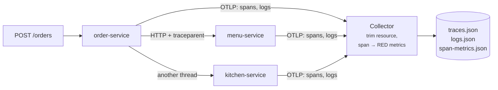

# Lab 12 — End-to-End Observability

<div class="badges" markdown><span class="badge badge-l3">L3 · Senior/Lead</span></div>

| | |
|---|---|
| **You'll build** | One trace per order across three services, logs that link to it, and RED metrics derived from it |
| **Time** | About 75 minutes |
| **Builds on** | [Lab 03](lab-03-two-services.md) (HTTP calls) and [lab 07](lab-07-kafka.md) (Kafka) |
| **Chapters** | [47 (fundamentals)](../observability/ch47-observability-fundamentals.md), [48 (metrics)](../observability/ch48-metrics-micrometer.md), [49 (tracing)](../observability/ch49-distributed-tracing-otel.md), [50 (logging)](../observability/ch50-structured-logging.md) |
| **Code** | `code/code-lab/lab-12-observability/` |
| **Needs** | Part 1: a JDK 21+, the OpenTelemetry Java agent 2.32.0 and `otelcol-contrib` 0.162.0 (both from their GitHub releases). Part 2: Kafka, as in lab 07 |

!!! note "About the lab code"
    Part 1 **was run**: JDK 25.0.4, the Java agent 2.32.0 and the Collector 0.162.0, which also validated `collector-local.yaml`; the output below is from that run. Part 2 is written for Spring Boot 4.1.1 and checked by import against its source, not compiled here ([how](index.md#how-the-lab-code-was-checked)); its property names were checked in Boot's `TracingProperties`, `OpenTelemetryProperties`, `OtlpMetricsProperties`, `ObservationProperties` and `KafkaProperties`.



## Part 1: what the agent sees, with no tracing code

### 1. Three services and a hand-off

`LabServices.java` has no tracing code at all. order-service calls menu-service, then notifies kitchen-service on another thread, either through an executor or a bare `new Thread()`:

```java title="verify/LabServices.java (order-service)"
--8<-- "code/code-lab/lab-12-observability/verify/LabServices.java:51:69"
```

### 2. A Collector that writes to files

```yaml title="verify/collector-local.yaml"
--8<-- "code/code-lab/lab-12-observability/verify/collector-local.yaml"
```

- **`resource/trim`** deletes the JVM command line from every batch. Chapter 47 found a `-D…token` flag riding along in spans and Prometheus labels.
- **`span_metrics`** turns server spans into request counts and latency histograms per route and status, from **every** span, before any sampling ([ADR-047](../observability/ch47-observability-fundamentals.md)).

### 3. Run it

```console
$ BIN=~/otel-bin code/code-lab/lab-12-observability/verify/run.sh
executor:      20 201
thread:        20 201
missing:        5 502
spans: 215, traces: 65; resources still carrying the JVM command line: 0
  executor orders: 20 traces spanning kitchen-service, menu-service, order-service
  missing orders: 5 traces spanning menu-service, order-service
  traces starting at a client span (no request): 20 traces spanning kitchen-service, order-service
  thread orders: 20 traces spanning menu-service, order-service
  the last executor order, as a tree:
    order-service    server   POST /orders             11.5 ms
      order-service    client   GET                      10.8 ms
        menu-service     server   GET /menus/               5.5 ms
      order-service    client   POST                      3.4 ms
        kitchen-service  server   POST /tickets             4.3 ms
logs: 90, with a trace id: 90
  menu-service: WARNING 'menu not found: missing' trace bbc75f24…
  order-service: SEVERE 'order rejected: menu answered 404' trace bbc75f24…
RED from spans (server calls by status):
  kitchen-service  POST /tickets    202  40
  menu-service     GET /menus/      200  40
  menu-service     GET /menus/      404  5
  order-service    POST /orders     201  40
  order-service    POST /orders     502  5
```

What it shows:

- **The executor kept the trace** (20 of 20): one tree from the request to the kitchen ticket. The agent wraps tasks submitted to executors with the current context.
- **`new Thread()` broke every one** (20 of 20). Each of those orders became two traces: the request with its menu call, and a second trace that **starts at a client span**, with no request above it, holding the kitchen call. In a trace UI, the order looks like it never reached the kitchen. Chapter 49 measured the same: `new Thread()`, `Thread.ofVirtual().start()` and hand-made queues lost the trace 200 of 200 times; `Context.wrap` fixed them.
- **Every log line had a trace id**, so menu-service's warning and order-service's error for the same failed order share one: from an alert on the error, one click finds the cause in another service.
- **RED metrics came from spans**: the five 502s at order-service line up with the five 404s at menu-service.

## Part 2: the same, in Spring Boot

Spring instruments the HTTP server, `RestClient` and Kafka through Micrometer Observation, and the OpenTelemetry starter exports it over OTLP.

### 4. Configuration

```yaml title="application.yml"
--8<-- "code/code-lab/lab-12-observability/src/main/resources/application.yml"
```

The two Kafka lines matter most: **observation is off by default** for the Kafka template and listener. Without them, the HTTP part of the trace works and the trace silently stops at the broker; kitchen-service starts a new one for every message. Chapter 49 checked this in Spring Kafka's source.

### 5. A business observation

```java title="PlaceOrder.java"
--8<-- "code/code-lab/lab-12-observability/src/main/java/dev/foodfleet/lab12/PlaceOrder.java:34:53"
```

One `Observation` gives two things: a **span** named "place order", and a **timer** `foodfleet.order.place`. They don't take the same values:

| Key | Low cardinality: metric tag and span attribute | High cardinality: span attribute only |
|---|---|---|
| `payment.method` | ✓ four known values, plus `OTHER` | |
| `order.id`, `restaurant.id` | | ✓ one value per order or restaurant |

A label with a value per restaurant creates a time series per restaurant. Chapter 47 measured a `restaurant_id` label taking Prometheus from 265 series to 260,005, and its memory from about 100 MB to 670 MB. `bounded` also stops a client from inventing tag values.

### 6. Test the observation, not the dashboards

```java title="PlaceOrderTest.java"
--8<-- "code/code-lab/lab-12-observability/src/test/java/dev/foodfleet/lab12/PlaceOrderTest.java:22:60"
```

`TestObservationRegistry` records observations without exporting anything, so the test checks the name, which keys are tags, and that a failure is recorded as an error.

### 7. Logs

`logging.structured.format.console: ecs` writes each line as Elastic Common Schema JSON. Micrometer Tracing puts `traceId` and `spanId` in the MDC, and the ECS formatter copies MDC entries into every line, so `"order placed"` and kitchen's `"ticket created"` carry the same trace id: the Spring version of part 1's correlation ([ADR-050](../observability/ch50-structured-logging.md)).

## Run part 2

```bash
docker run -d --name kafka -p 9092:9092 apache/kafka:4.2.2
otelcol-contrib --config code/code-lab/lab-12-observability/verify/collector-local.yaml &   # LAB12_OUT=/tmp/lab12
cd code/code-lab/lab-01-hello-microservice && mvn spring-boot:run &                         # menu-service on 8080
cd ../lab-12-observability && mvn spring-boot:run
curl -s -X POST localhost:8092/orders -H 'Content-Type: application/json' \
  -d '{"orderId":"o-1","restaurantId":"r-1","paymentMethod":"UPI"}'
python3 verify/analyze.py /tmp/lab12
```

## Check yourself

- [ ] `verify/run.sh` shows 20 complete executor traces and 20 broken thread ones.
- [ ] In part 2, one order gives one trace with the HTTP server span, the menu call, the Kafka send and kitchen's processing span.
- [ ] `mvn verify` passes the three observation tests.

## Break it

!!! question "Exercises"
    1. In part 2, remove `spring.kafka.listener.observation-enabled`. How many traces does one order make now, and which service starts the second?
    2. Make `order.id` a low-cardinality key value. Send 1,000 orders and count the series of `foodfleet_order_place_seconds_count` (chapter 48 shows how).
    3. In `LabServices`, wrap the `new Thread()` runnable with the OpenTelemetry API's `Context.current().wrap(...)` (add `opentelemetry-api` to the class path). Do the thread orders join up?
    4. Remove `resource/trim` and start a service with `-Dpartner.token=secret`. Where does the token end up?

**Next:** [Lab 13](lab-13-redis.md) puts Redis in front of menu-service: caching, a lock, and rate limits.
