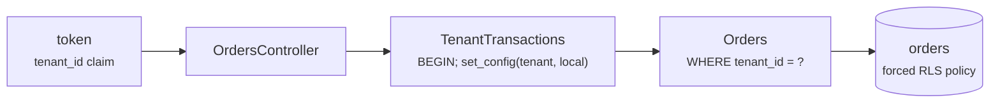

# Lab 18 — Multi-Tenant Service

<div class="badges" markdown><span class="badge badge-l4">L4 · Architect</span></div>

| | |
|---|---|
| **You'll build** | order-service serving many restaurant chains from shared tables, with isolation enforced by the database |
| **Time** | About an hour |
| **Builds on** | [Lab 02](lab-02-persistence.md) (Flyway), [lab 08](lab-08-oauth2-keycloak.md) (tokens) and [lab 13](lab-13-redis.md) (per-tenant rate limits) |
| **Chapters** | [75 (multi-tenancy, multi-region, compliance)](../governance-org/ch75-multi-tenancy-multi-region-compliance.md), [40 (API security)](../security/ch40-api-security.md), [12 (database per service)](../architecture-patterns/ch12-database-per-service.md) |
| **Code** | `code/code-lab/lab-18-multi-tenancy/` |
| **Needs** | PostgreSQL 16 binaries for `verify/rls.sh`; Docker for the Spring tests |

!!! note "About the lab code"
    `verify/rls.sh` **was run** on PostgreSQL 16.13: it applies the service's Flyway migration and roles, writes 1,000 orders for each of three tenants, and tries every way around the policy. The Spring code is written for Spring Boot 4.1.1 and checked by import against its source, not compiled here ([how](index.md#how-the-lab-code-was-checked)); `spring.flyway.init-sqls` was checked in Boot's `FlywayProperties`, `withInitScripts` in Testcontainers 2.0.5.

## Which model, and why shared

Chapter 75 measured three ways to keep tenants apart in PostgreSQL. For 100 tenants:

| Model | Provisioning a tenant | Storage | Relations | Connections |
|---|---|---|---|---|
| Shared tables, forced RLS | 0.3–0.9 ms | 35.8 MB | 423 | One pool |
| Schema per tenant | 5.6–10.4 ms | 43.1 MB | 1,013 | One pool, `search_path` per request |
| Database per tenant | 52–105 ms | 811.1 MB | 41,900 | A pool per tenant: 100 connections for 100 databases |

FoodFleet puts restaurant chains on **shared tables** and gives enterprise-tier chains a database or cell of their own ([ADR-075](../governance-org/ch75-multi-tenancy-multi-region-compliance.md#8-enterprise-case-study)). Shared is the cheapest and the riskiest: one forgotten `WHERE tenant_id = ?` exposes everyone. This lab makes the database catch that.



## 1. The table and its policy

```sql title="V1__orders_rls.sql"
--8<-- "code/code-lab/lab-18-multi-tenancy/src/main/resources/db/migration/V1__orders_rls.sql"
```

```sql title="roles (created by the platform)"
--8<-- "code/code-lab/lab-18-multi-tenancy/src/test/resources/db/roles.sql"
```

- **`USING`** filters what's read; **`WITH CHECK`** refuses rows written for another tenant, including an `UPDATE` that moves a row.
- **`FORCE`** applies the policy to the table's owner too; without it, the owner bypasses it.
- **`nullif(current_setting(..., true), '')`**: no tenant means `NULL`, and `tenant_id = NULL` matches nothing.
- **The application's role owns nothing and is `NOBYPASSRLS`**; migrations run as a different role.

## 2. The tenant per transaction

```java title="TenantTransactions.java"
--8<-- "code/code-lab/lab-18-multi-tenancy/src/main/java/dev/foodfleet/lab18/TenantTransactions.java:8:34"
```

```java title="OrdersController.java (where the tenant comes from)"
--8<-- "code/code-lab/lab-18-multi-tenancy/src/main/java/dev/foodfleet/lab18/OrdersController.java:15:18"

--8<-- "code/code-lab/lab-18-multi-tenancy/src/main/java/dev/foodfleet/lab18/OrdersController.java:61:67"
```

The tenant comes from a claim the identity provider sets per partner organisation, never from something the caller can edit, such as a header or a path. Queries still name their tenant; the policy is the second line of defence, for the query that forgets.

## 3. Try to get around it

```console
$ PG_BIN=/usr/lib/postgresql/16/bin code/code-lab/lab-18-multi-tenancy/verify/rls.sh
== as orders_app, in a transaction for one tenant
  rows visible: 1000, tenants: 1
== a query that forgot its WHERE tenant_id, with no tenant set
  rows visible: 0
== writing another tenant's row while acting for spice-route
  ERROR:  new row violates row-level security policy for table "orders"
== moving a row to another tenant
  ERROR:  new row violates row-level security policy for table "orders"
== who else sees everything
  superuser: 3000
  orders_app with BYPASSRLS: 3000
  table owner, RLS not forced: 3000
  table owner, RLS forced: 0
== a pooled connection: the next request forgot to set a tenant
  session-level SET, next request sees: 1000 rows of spice-route
  transaction-local, next request sees: 0 rows
== the plan for one tenant's recent orders
  Limit
    ->  Result
          One-Time Filter: (NULLIF(current_setting('app.tenant_id'::text, true), ''::text) = 'spice-route'::text)
          ->  Index Scan using orders_recent on orders
                Index Cond: (tenant_id = 'spice-route'::text)
```

**What RLS protects against:** a query without its tenant predicate, and writes into or moves to another tenant.

**What it doesn't:** any role that bypasses it. A superuser, a role with `BYPASSRLS`, and a table owner when the policy isn't forced each saw all 3,000 rows. Hence the separate non-owner application role, `FORCE`, and never connecting the service as a superuser. This includes tests: Spring Boot's `@ServiceConnection` connects as the container's superuser, which would make every isolation test pass for the wrong reason, so `TenantIsolationTest` connects as `orders_app` explicitly.

**The pooled-connection leak.** A session-level `SET app.tenant_id` outlives the request: the next request on that connection that forgot its tenant saw spice-route's 1,000 rows. Chapter 75 measured it with a pool of 4: 177 of 193 forgetful requests saw another tenant's data with per-session settings, none with per-transaction ones.

**It costs one comparison.** The plan evaluates the policy once per query (`One-Time Filter`) and still uses the `(tenant_id, created_at)` index.

## 4. Test as the application

```java title="TenantIsolationTest.java"
--8<-- "code/code-lab/lab-18-multi-tenancy/src/test/java/dev/foodfleet/lab18/TenantIsolationTest.java:19:77"
```

## 5. Noisy neighbours

Isolation of data isn't isolation of load. A chain running its month-end report can slow every other chain on the same database:

```java title="TenantBulkheads.java"
--8<-- "code/code-lab/lab-18-multi-tenancy/src/main/java/dev/foodfleet/lab18/TenantBulkheads.java:9:36"
```

Chapter 75: six concurrent 133 ms reports pushed small tenants' p99 from 3.8–4.8 ms to 25–38 ms. One report per tenant at a time held it at 8.4–10.6 ms and still completed 72–78 of 81 reports; a 100 ms statement timeout instead cancelled every report and didn't help the neighbours (34–40 ms). Request rates per tenant come from [lab 13](lab-13-redis.md)'s token buckets, keyed by the same tenant id.

## Run it

```bash
PG_BIN=$(pg_config --bindir) code/code-lab/lab-18-multi-tenancy/verify/rls.sh
cd code/code-lab/lab-18-multi-tenancy && mvn verify          # Testcontainers: postgres:16
```

## Check yourself

- [ ] `rls.sh` shows 0 rows for the forgotten predicate and two refused writes.
- [ ] You can name the three roles that saw all 3,000 rows, and the setting that stops each.
- [ ] You can explain why `set_config(..., true)` and not `SET`.

## Break it

!!! question "Exercises"
    1. Change `TenantTransactions` to call `set_config(..., false)`. Write a test that places an order for one tenant, then counts visible rows with no tenant on the same pooled connection (`spring.datasource.hikari.maximum-pool-size: 1`). What does it see?
    2. Remove `nullif` from the policy and change `tenant_id` to `uuid`. What happens to a request with no tenant after one with a tenant ran on the same connection?
    3. Switch the test to `@ServiceConnection`. Which tests still pass, and why is that worse than failing?
    4. Add a `restaurants` table that isn't tenant-scoped (shared menus), and join it with `orders`. Does the policy on `orders` still hold in the join?

**Next:** [Lab 19](lab-19-contracts-archunit.md) keeps services' APIs and architecture honest in CI.
