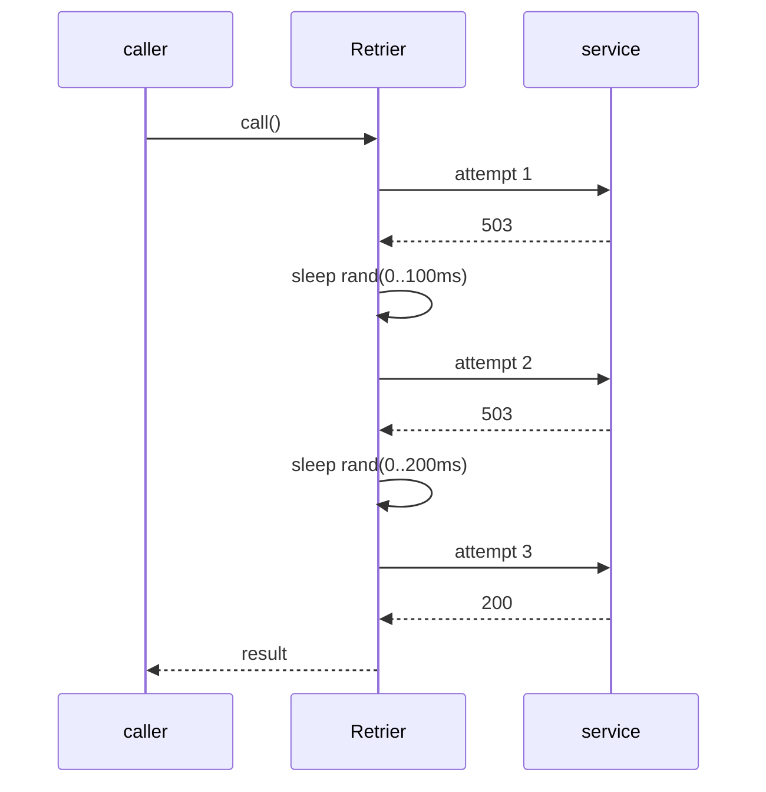

# 1. Retry with Exponential Backoff, Jitter & Budget

<span class="level l2">L2</span> ★★☆ · Backoff, full jitter, retryable vs permanent errors, retry budget

## Problem

> Wrap a remote call so that it retries **transient** failures (503, timeouts) with exponential backoff and jitter, never
> retries **permanent** ones (400, 422), and can't turn an outage into a retry storm.

## Key idea

The delay ceiling doubles on each attempt (`base × 2^(n-1)`, capped). **Full jitter** picks a random delay in
`[0, ceiling)` so that thousands of clients don't retry in lockstep. A **predicate** decides what is retryable. A **retry
budget** (retries ≤ about 20% of requests) caps the amplification when *everything* is failing. Without it, 5 attempts
means 5× the load on a dependency that is already struggling.



## Solution

```java title="RetryWithBackoff.java"
--8<-- "coding-interview/src/RetryWithBackoff.java"
```

## Walkthrough

| Code | Why |
|---|---|
| `Math.min(capMillis, baseMillis << (attempt - 1))` | The exponential ceiling, with a cap so the 10th retry doesn't wait 50 seconds. |
| `(long) (random.nextDouble() * ceiling)` | Full jitter (AWS's recommendation). Spreading retries out is what actually prevents synchronized waves. |
| `if (!retryable.test(e) \|\| attempt == maxAttempts \|\| !budget.tryAcquire()) throw e` | Three ways to stop: the error is permanent, attempts are exhausted, or the budget is spent. The original exception is rethrown. |
| `budget.onRequest() adds 0.2 tokens; each retry spends 1` | Retries can be at most about 20% of traffic over time. The storm test shows 50 failing requests making 59 calls instead of 250. |
| `Random / Sleeper injected` | This makes the test deterministic and instant. In production, pass `ThreadLocalRandom` and `Thread::sleep` (cheap on virtual threads). |

## Complexity

| Approach | Time | Space |
|---|---|---|
| per call | O(attempts) | O(1) |

## Run it

```bash
java coding-interview/src/RetryWithBackoff.java      # JDK 21+ single-file launcher, no build needed
```

```text
--8<-- "coding-interview/outputs/RetryWithBackoff.txt"
```

## Common mistakes

* Retrying non-idempotent operations such as POST /payments without an idempotency key (see problem 3).
* Retrying 4xx errors. They'll fail the same way every time.
* Retrying at every layer (gateway, service, client). 3 layers × 3 attempts = 27 calls to the bottom service.
* Backoff without jitter. All clients retry at the same instant.

## Follow-up questions

??? question "Retry vs circuit breaker: how do they work together?"
    Retries handle short blips. The breaker handles sustained failure by failing fast without calling at all. Put the retry *inside* the breaker, so that a breaker which has tripped stops the retries, and count each attempt toward the breaker's failure rate.

??? question "How does Resilience4j configure this?"
    `RetryConfig.custom().maxAttempts(3).intervalFunction(IntervalFunction.ofExponentialRandomBackoff(100, 2.0)).retryOnException(e -> e instanceof TransientException)`, composed with `Decorators.ofSupplier(..).withRetry(..).withCircuitBreaker(..)`.
