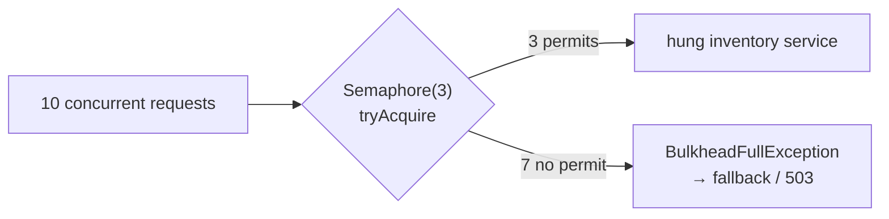

# 2. Bulkhead: Isolate a Slow Dependency

<span class="level l2">L2</span> ★★☆ · `Semaphore`, fail fast, permit release in `finally`

## Problem

> The inventory service sometimes hangs. Make sure calls to it can occupy **at most N** concurrent slots, and that
> excess calls **fail immediately** instead of piling up and exhausting the whole service's threads or connections.

## Key idea

A **bulkhead** is a ship's watertight compartment: a leak in one doesn't sink the ship. A `Semaphore` with N permits
caps concurrency per dependency. `tryAcquire(maxWait)` decides between queuing briefly and failing fast. With virtual
threads, *threads* are no longer the scarce resource, but downstream connections and the dependency's capacity still
are, so bulkheads matter more than ever.



## Solution

```java title="Bulkhead.java"
--8<-- "coding-interview/src/Bulkhead.java"
```

## Walkthrough

| Code | Why |
|---|---|
| `new Semaphore(maxConcurrent, true)` | A fair semaphore gives permits first come, first served, so no caller starves. |
| `permits.tryAcquire(maxWaitMillis, MILLISECONDS)` | `maxWait = 0` means pure fail-fast. A small wait smooths out bursts. Never use the blocking `acquire()`: that just queues forever. |
| `finally { permits.release(); }` | Release on every path. A leaked permit permanently shrinks the bulkhead, and the second test proves that failures release correctly. |
| `maxSeen.accumulateAndGet(inFlight.incrementAndGet(), Math::max)` | The test measures the real concurrency inside the bulkhead and asserts that it never goes above 3. |

## Complexity

| Approach | Time | Space |
|---|---|---|
| acquire / release | O(1) | O(1) |

## Run it

```bash
java coding-interview/src/Bulkhead.java      # JDK 21+ single-file launcher, no build needed
```

```text
--8<-- "coding-interview/outputs/Bulkhead.txt"
```

## Common mistakes

* Releasing a permit you never acquired (calling `release` after a failed `tryAcquire`), which *grows* the bulkhead.
* One shared bulkhead for every dependency. The point is isolation per dependency.
* No timeout on the call itself. A permit held by a hung call is gone until it returns, so combine it with a time limiter.

## Follow-up questions

??? question "Semaphore bulkhead vs thread-pool bulkhead?"
    A semaphore limits concurrency on the caller's thread: low overhead, but it can't time out a blocked call by itself. A thread-pool bulkhead runs calls on a dedicated bounded pool and queue, so you can abandon slow calls, at the cost of thread hand-offs. Resilience4j offers both.

??? question "How do you choose N?"
    Little's law: N ≈ target throughput × p99 latency of the dependency, plus some headroom. Keep it at or below the dependency's own connection pool, and adjust using the rejection-rate metrics.
