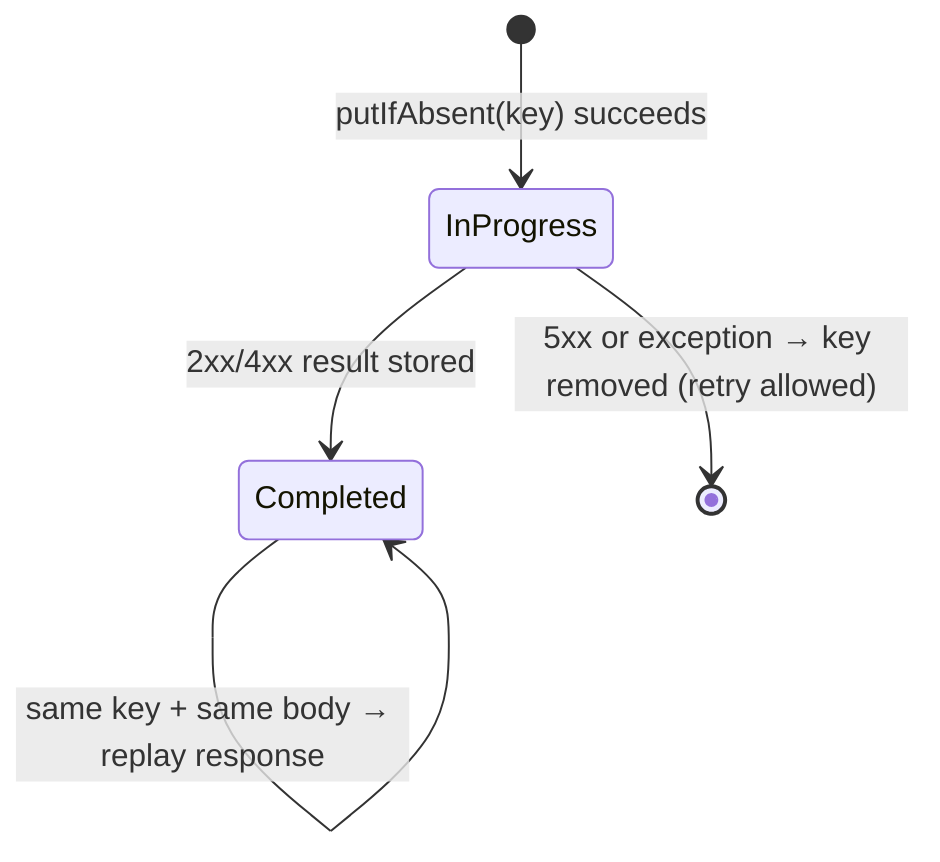

# 3. Idempotency-Key for Safe Retries

<span class="level l3">L3</span> ★★★ · Atomic claim, in-progress vs completed, payload hash, 409 / 422

## Problem

> `POST /payments` may be retried by clients after a timeout. Using an `Idempotency-Key` header, guarantee that the payment is made
> **once**, that a retry gets the **same response**, that reusing a key with a *different* body is rejected, and that concurrent duplicates are safe.

## Key idea

Claim the key **atomically** (`putIfAbsent` here; `INSERT ... ON CONFLICT DO NOTHING` or Redis `SET NX` in production) with
status IN_PROGRESS and a hash of the request. When the work finishes, store the **response**. Lookups can then return
the stored response (completed), 409 (still in progress), or 422 (same key with a different payload). Transient 5xx results aren't stored,
so the client can retry.



## Solution

```java title="IdempotencyKeyStore.java"
--8<-- "coding-interview/src/IdempotencyKeyStore.java"
```

## Walkthrough

| Code | Why |
|---|---|
| `Entry existing = store.putIfAbsent(key, new InProgress(hash))` | The only atomic step, and it decides who executes. Check-then-put would let two duplicates both run. |
| `if (!existing.requestHash().equals(hash)) return 422` | This protects against a client bug where a key is reused for a different payment. Stripe returns an error here as well. |
| `if (existing instanceof Completed c) return c.response()` | A replay returns the **original** status and body, so the client can't tell it was a duplicate. That's the goal. |
| `if (r.status() >= 500) store.remove(key)` | Don't make failures permanent. A 503 should be retryable with the same key. |
| `20 concurrent duplicates → charges = 1` | The test fires 20 identical requests while the first one is slow. Exactly one charge happens. |

## Complexity

| Approach | Time | Space |
|---|---|---|
| per request | O(1) store ops | O(keys within TTL) |

## Run it

```bash
java coding-interview/src/IdempotencyKeyStore.java      # JDK 21+ single-file launcher, no build needed
```

```text
--8<-- "coding-interview/outputs/IdempotencyKeyStore.txt"
```

## Common mistakes

* Check-then-insert (`if (!exists) insert`), which is a race between concurrent duplicates.
* Storing the key in a *different* transaction from the business write. A crash between the two breaks exactly-once. In a DB, write both in one transaction.
* Keys without a TTL, so the table grows forever. Stripe keeps them for 24 hours.
* Hashing the raw JSON. Field order or whitespace changes the hash, so canonicalise it first.

## Follow-up questions

??? question "What if the server crashes while the key is IN_PROGRESS?"
    Add a lease timestamp to the in-progress entry. After it expires, a retry may take over. Combine this with an idempotent downstream call (pass the same key to the payment provider) so the takeover can't double-charge.

??? question "Idempotency-Key (HTTP) vs idempotent consumer (Kafka): what's different?"
    Both dedupe by an id. HTTP must return the *same response* to the caller and handle in-flight duplicates (409). A Kafka consumer just has to skip already-processed event ids, ideally in the same DB transaction as its side effect. See [Coding Rounds](../interview-prep/coding-rounds.md).
