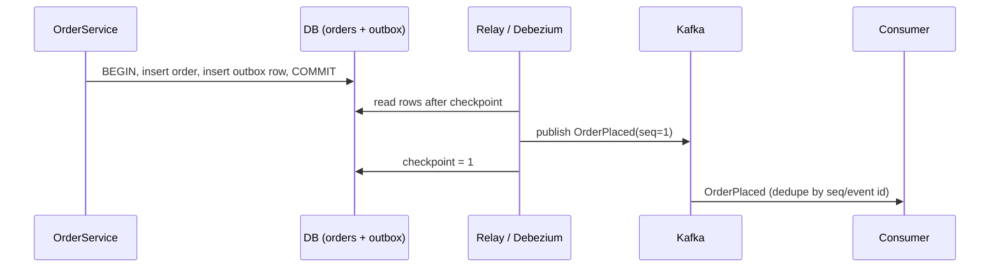

# 4. Transactional Outbox + Relay

<span class="level l3">L3</span> ★★★ · Dual-write problem, same-transaction event row, at-least-once relay, consumer dedupe

## Problem

> Placing an order must **save the order** *and* **publish OrderPlaced**. If you write to the DB and then publish to Kafka, a crash
> in between loses the event. Publishing first and then writing can announce an order that doesn't exist. Make them consistent.

## Key idea

Write the event as a row in an **outbox table in the same DB transaction** as the business change, so they commit or roll back
together. A separate **relay** (a poller, or CDC with Debezium) publishes outbox rows in order and advances a checkpoint. A crash
between publishing and checkpointing re-publishes rows, which makes delivery **at-least-once**, so consumers **dedupe** by event id.



## Solution

```java title="TransactionalOutbox.java"
--8<-- "coding-interview/src/TransactionalOutbox.java"
```

## Walkthrough

| Code | Why |
|---|---|
| `tx.orders.put(...); tx.insertOutbox(...)` | Both writes are in one transaction. The crash test (A-2) shows that a rollback removes the event too. |
| `if (row.seq() <= db.lastPublishedSeq) continue` | The relay resumes from its checkpoint. Ordering by sequence keeps events for the same aggregate in order. |
| `if (crashAfterPublishBeforeCheckpoint) return n` | Simulates the unavoidable window: the message went out but the checkpoint wasn't saved, so it's sent again after a restart. |
| `processed.add(m.substring(m.indexOf("seq=")))` | Consumers dedupe by event id. At-least-once delivery plus idempotent consumers gives an exactly-once *effect*. |

## Complexity

| Approach | Time | Space |
|---|---|---|
| write path | +1 insert in the same tx | outbox rows until cleaned up |
| relay | O(new rows) per poll | O(1) checkpoint |

## Run it

```bash
java coding-interview/src/TransactionalOutbox.java      # JDK 21+ single-file launcher, no build needed
```

```text
--8<-- "coding-interview/outputs/TransactionalOutbox.txt"
```

## Common mistakes

* Publishing to Kafka inside the DB transaction. The broker isn't part of the transaction, so a rollback can't unpublish.
* Never deleting or archiving published outbox rows, so the table and the polling queries grow without bound.
* Polling with several relay instances without locking (`SELECT ... FOR UPDATE SKIP LOCKED`) or leader election, which publishes duplicates and out of order.
* Assuming exactly-once delivery and skipping consumer dedupe.

## Follow-up questions

??? question "Polling relay vs CDC (Debezium): trade-offs?"
    Polling is simple and needs no extra infrastructure, but adds latency and load from the polling queries. CDC tails the WAL/binlog: low latency, no polling load, and preserved order. It needs Kafka Connect, and you have to manage connector offsets.

??? question "Why not just use Kafka transactions?"
    Kafka transactions are atomic across Kafka topics, not across your database. The outbox exists precisely because the DB and the broker can't share a transaction. (The other option is to make Kafka the source of truth, which is event sourcing.)
