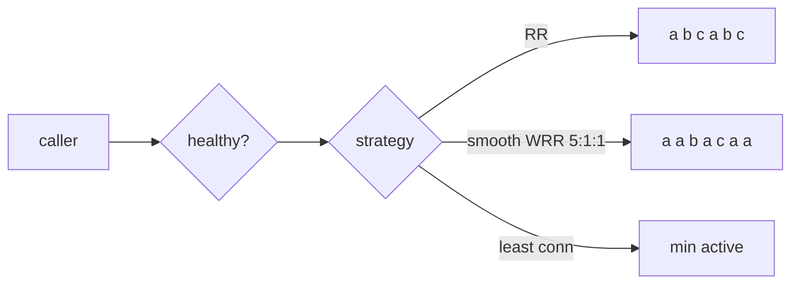

# 5. Client-Side Load Balancer

<span class="level l2">L2</span> ★★☆ · Round robin, smooth weighted round robin, least connections, health filtering

## Problem

> Implement client-side load balancing over service instances: **round robin**, **weighted** (more traffic to bigger
> instances, without bursts) and **least connections**, always **skipping unhealthy** instances.

## Key idea

Filter the healthy instances first, then apply a strategy. Plain round robin is a counter modulo n. **Smooth weighted round robin**
(nginx's algorithm) adds each instance's weight to its current score, picks the highest, and subtracts the total, which spreads a
5:1:1 split as `a a b a c a a` rather than five `a`s in a row. **Least connections** suits requests whose durations vary a lot.



## Solution

```java title="LoadBalancer.java"
--8<-- "coding-interview/src/LoadBalancer.java"
```

## Walkthrough

| Code | Why |
|---|---|
| `Math.floorMod(next.getAndIncrement(), healthy.size())` | `getAndIncrement` is thread-safe. `floorMod` stays non-negative after the int counter overflows, whereas `%` would go negative. |
| `i.currentWeight += i.weight; ... best.currentWeight -= total` | Smooth WRR. Over one cycle of 7 picks, each instance is chosen exactly `weight` times, interleaved. |
| `Comparator.comparingInt(activeConnections).thenComparing(id)` | Least connections, with a deterministic tie-break. |
| `instances.stream().filter(i -> i.healthy)` | Health comes from active checks or outlier detection (passive). If none are healthy, fail clearly rather than call a dead instance. |

## Complexity

| Approach | Time | Space |
|---|---|---|
| RR pick | O(1) | O(1) |
| smooth WRR / least conn | O(n) instances | O(1) |

## Run it

```bash
java coding-interview/src/LoadBalancer.java      # JDK 21+ single-file launcher, no build needed
```

```text
--8<-- "coding-interview/outputs/LoadBalancer.txt"
```

## Common mistakes

* Using `counter % size` with an int that overflows, which gives a negative index.
* Naive weighted RR that sends bursts of consecutive requests to the heavy node.
* Least connections without tracking connections correctly (increment on start, decrement in `finally`).
* Load-balancing on every retry to the *same* failing instance. Retry on a different one.

## Follow-up questions

??? question "What about 'power of two choices'?"
    Pick two random healthy instances and send to the one with fewer active requests. It gets close to least-connections quality in O(1), without global state. Envoy and Finagle use it.

??? question "Client-side vs server-side load balancing?"
    Client-side (Spring Cloud LoadBalancer, gRPC, service mesh sidecars) means no extra hop and per-client decisions, but every client needs discovery. Server-side (ALB, NGINX) is simpler for clients, but adds a hop and is a shared component to operate.
