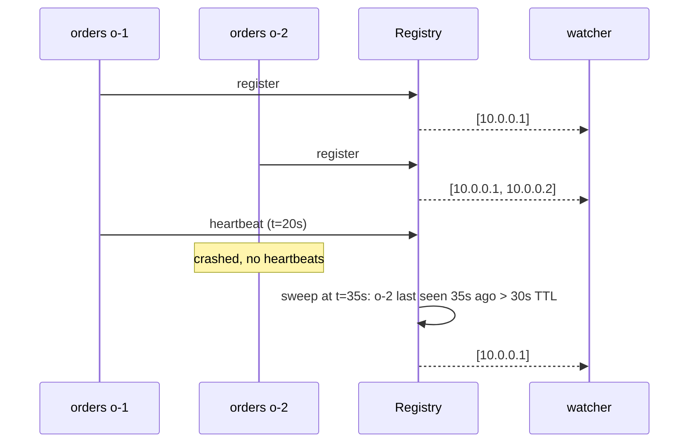

# 6. Service Registry with Heartbeats & TTL

<span class="level l2">L2</span> ★★☆ · Register / heartbeat / evict, watchers, injectable clock

## Problem

> Build a minimal service registry. Instances **register** and send **heartbeats**; instances that miss heartbeats for longer than a **TTL** are
> **evicted**; clients **watch** a service and are told when its address list changes; and a graceful shutdown deregisters.

## Key idea

Keep a map of service → instances, plus each instance's last heartbeat time. A periodic sweep removes entries older than the TTL.
Watchers get the new address set after every change. Time comes from an **injected clock**, so expiry can be tested
without sleeping. Eureka, Consul and Kubernetes Endpoints are all variations of this.



## Solution

```java title="ServiceRegistry.java"
--8<-- "coding-interview/src/ServiceRegistry.java"
```

## Walkthrough

| Code | Why |
|---|---|
| `lastHeartbeat.put(i.id(), clock.now)` | Liveness is tracked separately from the instance metadata. |
| `if (!lastHeartbeat.containsKey(id)) return false` | A heartbeat from an evicted instance is refused, and the client must re-register. This is Eureka's behaviour, and it handles network partitions that heal. |
| `Duration.between(lastHeartbeat, now).compareTo(ttl) > 0` | The expiry rule. A TTL of about 3× the heartbeat interval tolerates the occasional lost heartbeat. |
| `watchers...accept(snapshot)` | Push the change to clients, so they don't poll. Watchers get an immutable snapshot. |
| `FakeClock` | Tests move time forward instantly. In production, inject `java.time.Clock`. |

## Complexity

| Approach | Time | Space |
|---|---|---|
| register / heartbeat | O(1) | O(instances) |
| evict sweep | O(instances) | - |

## Run it

```bash
java coding-interview/src/ServiceRegistry.java      # JDK 21+ single-file launcher, no build needed
```

```text
--8<-- "coding-interview/outputs/ServiceRegistry.txt"
```

## Common mistakes

* Evicting on the first missed heartbeat, which causes flapping during GC pauses or network blips.
* Clients that trust the registry blindly. They should still retry on another instance and use outlier detection.
* Mass eviction during a network partition. Eureka's self-preservation mode stops evicting when too many heartbeats are missing at once.

## Follow-up questions

??? question "Do you need a registry on Kubernetes?"
    Usually not. Services and Endpoints (fed by readiness probes) *are* the registry, and kube-proxy or DNS does the routing. You'd still use Consul or Eureka for workloads outside the cluster or across clusters.

??? question "AP or CP for a registry?"
    Eureka is AP: it serves possibly stale data during partitions, on the grounds that a stale address beats none. Consul and ZooKeeper are CP. For discovery, availability usually wins, provided clients tolerate stale entries by retrying elsewhere.
