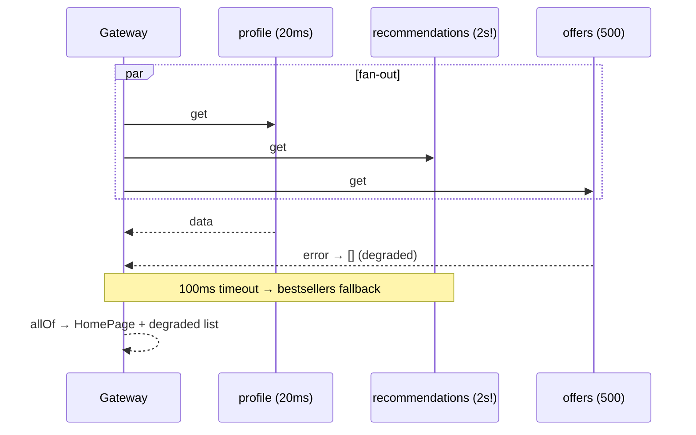

# 7. API Gateway Aggregation with Timeouts

<span class="level l3">L3</span> ★★★ · `CompletableFuture` fan-out/fan-in, `orTimeout`, `completeOnTimeout`, partial responses

## Problem

> `GET /home` needs the user's profile (**required**), recommendations and offers (**optional**). Call all three **in
> parallel**. A slow or failing optional service must degrade the page, not break it or slow it down, and the response must
> say which parts were degraded.

## Key idea

Fan out with `supplyAsync`, then fan in with `allOf`, so the total latency is that of the **slowest** call, not the sum. Required calls get
`orTimeout` (they fail the request). Optional calls get `completeOnTimeout(fallback)` and `exceptionally(fallback)`.
Collect the degradation reasons so the client and your metrics know about them.



## Solution

```java title="ApiGatewayAggregator.java"
--8<-- "coding-interview/src/ApiGatewayAggregator.java"
```

## Walkthrough

| Code | Why |
|---|---|
| `call(...).orTimeout(500, MILLISECONDS)` | A required dependency gets a hard deadline. The request fails with a `TimeoutException`, which the gateway maps to 504. |
| `completeOnTimeout(null, 100, MILLISECONDS).thenApply(r -> r == null ? fallback : r)` | An optional dependency gets a soft deadline, then a fallback. The timeout is per call, inside the overall budget. |
| `exceptionally(e -> { degraded.add(...); return List.of(); })` | A failure becomes an empty section plus a recorded reason. `e` is a `CompletionException`, so use `getCause()`. |
| `CompletableFuture.allOf(profile, recs, offers).thenApply(v -> ... join())` | Fan-in: once `allOf` completes, each `join()` returns immediately. |
| `Executors.newVirtualThreadPerTaskExecutor()` | Blocking calls are cheap on virtual threads. Always pass an executor: the common pool is shared and sized for CPU work. |

## Complexity

| Approach | Time | Space |
|---|---|---|
| latency | max(call latencies, bounded by timeouts) | O(services) |

## Run it

```bash
java coding-interview/src/ApiGatewayAggregator.java      # JDK 21+ single-file launcher, no build needed
```

```text
--8<-- "coding-interview/outputs/ApiGatewayAggregator.txt"
```

## Common mistakes

* Calling the services one after another: latency becomes the **sum**.
* Using the common ForkJoinPool for blocking I/O, which starves unrelated parallel streams.
* A timeout without cancellation: the slow call keeps running and holding resources. Propagate a deadline to downstream services too.
* Silently hiding degradation. Return it in the response or a header, and count it in metrics.

## Follow-up questions

??? question "How would you write this with structured concurrency?"
    `try (var scope = StructuredTaskScope...) { fork the three; join until a deadline; }`. Subtasks are cancelled when the scope closes, so nothing leaks. It's preview in Java 21–24 and evolving in 25.

??? question "BFF vs generic gateway aggregation?"
    A Backend-for-Frontend owns aggregation for **one client type** (mobile vs web) and evolves with it. A generic gateway should stay thin (routing, auth, rate limits) so that one team doesn't become a bottleneck for every screen.
