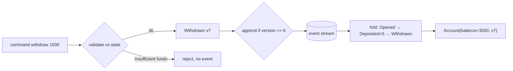

# 8. Event-Sourced Aggregate with Snapshots

<span class="level l3">L3</span> ★★★ · Commands → events, fold to state, optimistic append, snapshots, temporal query

## Problem

> Model a bank account where the **events are the source of truth**. Commands (deposit, withdraw) validate and emit events,
> state is rebuilt by replaying them, concurrent writers are detected, **snapshots** limit replay, and you can ask
> "what was the balance at version 4?".

## Key idea

State is `fold(apply, EMPTY, events)`. A **command** checks the rules against the current state and returns **new events**.
It never mutates. The store **appends** only if the stream is still at the expected version (optimistic concurrency).
A **snapshot** stores the folded state at version *v*, so a load replays only the events after *v*.



## Solution

```java title="EventSourcedAccount.java"
--8<-- "coding-interview/src/EventSourcedAccount.java"
```

## Walkthrough

| Code | Why |
|---|---|
| `Account apply(Event e) { return switch (e) { ... } }` | A pure function from (state, event) to new state. It's exhaustive over the sealed event types and does no I/O and no validation: events are facts. |
| `List<Event> withdraw(long cents) { if (cents > balance) throw ...; return List.of(new Withdrawn(version + 1, cents)); }` | Commands validate and *decide*. Rejected commands leave no trace in the stream. |
| `if (current != expectedVersion) throw new ConcurrentModificationException(...)` | Optimistic concurrency on the stream, equivalent to `INSERT ... WHERE stream_version = ?`. |
| `for (Event e : events) if (e.version() > state.version()) ...` | Replay only what comes after the snapshot. The output shows that a load after the snapshot replays 1 event. |
| `partial replay e.version() <= 4` | Temporal queries come free: replay up to any point in history. |

## Complexity

| Approach | Time | Space |
|---|---|---|
| load (no snapshot) | O(events) | O(1) state |
| load (snapshot) | O(events since snapshot) | O(1) |
| append | O(1) | O(events) total |

## Run it

```bash
java coding-interview/src/EventSourcedAccount.java      # JDK 21+ single-file launcher, no build needed
```

```text
--8<-- "coding-interview/outputs/EventSourcedAccount.txt"
```

## Common mistakes

* Validating inside `apply()`. Old events must always replay, even if today's rules would reject them.
* Changing the meaning of an existing event type. Add a new version (`DepositedV2`) or an upcaster instead.
* Using event sourcing for everything. For CRUD-ish data it adds a lot of complexity. Use it where history and audit matter.
* Querying the event store for lists and reports. Build read models (projections, CQRS) instead.

## Follow-up questions

??? question "How do you handle a schema change in events?"
    Events are immutable, so add **upcasters** that turn old event versions into the current shape at read time, or write new event types and keep the old `apply` branches. Never rewrite history in place, unless it's a deliberate, audited migration.

??? question "Event sourcing vs the outbox pattern?"
    With the outbox, state is the truth and events are notifications derived from it. With event sourcing, events are the truth and state is derived. Event sourcing publishes naturally (the stream *is* the log), but makes queries harder (you need projections).
