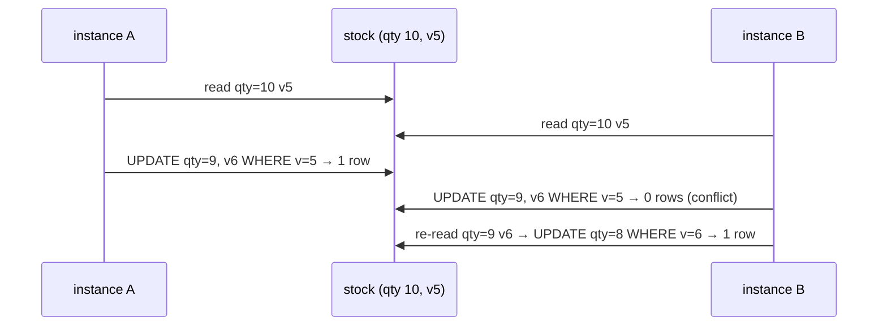

# 9. Optimistic Locking: No Lost Updates

<span class="level l2">L2</span> ★★☆ · Version column, conditional update, bounded retry, 409/412

## Problem

> Several service instances decrement the same stock row. Show the **lost update**, then prevent it **without** holding
> DB locks across the read-compute-write cycle.

## Key idea

Add a **version** to the row. An update succeeds only if the version is still the one you read:
`UPDATE ... SET qty = ?, version = version + 1 WHERE id = ? AND version = ?`. Zero rows updated means someone else won, so
**re-read and retry** (bounded). Over HTTP, the same idea is `ETag` + `If-Match`, which returns 412 when the version is stale.



## Solution

```java title="OptimisticLocking.java"
--8<-- "coding-interview/src/OptimisticLocking.java"
```

## Walkthrough

| Code | Why |
|---|---|
| `table.put("apple", readByA - 1); table.put("apple", readByB - 1);` | The lost update, scripted deterministically: both instances read 10, both write 9, and one sale disappears. |
| `rows.replace(sku, expected, next)` | An atomic compare-and-set on the whole row (version included). It's the in-memory equivalent of the conditional `UPDATE`. |
| `catch (ConflictException e) { ... retry }` | On conflict, **re-read** and recompute. Never retry with the stale value. |
| `if (next < 0) throw new IllegalStateException("out of stock")` | Business rules are re-checked on every attempt against fresh data. |
| `quantity=800, version=200` | 200 concurrent writers and no lost updates: the version equals the number of successful writes. |

## Complexity

| Approach | Time | Space |
|---|---|---|
| uncontended update | O(1) | O(1) |
| contended | O(retries) | - |

## Run it

```bash
java coding-interview/src/OptimisticLocking.java      # JDK 21+ single-file launcher, no build needed
```

```text
--8<-- "coding-interview/outputs/OptimisticLocking.txt"
```

## Common mistakes

* Retrying forever under heavy contention. Bound the attempts, then return 409 or switch to a pessimistic lock or a queue.
* Forgetting `@Version` on the JPA entity. Hibernate then issues a plain update and the lost update comes back.
* Using optimistic locking for a single hot row with very high contention (a flash-sale counter). Use an atomic `UPDATE qty = qty - 1 WHERE qty > 0`, or partition the counter.

## Follow-up questions

??? question "Optimistic vs pessimistic locking: when is each better?"
    Optimistic: conflicts are rare, transactions are short, and no locks are held, which scales reads. Pessimistic (`SELECT ... FOR UPDATE`): conflicts are frequent or retries are expensive, at the cost of lock waits and deadlock risk.

??? question "How does this look in a REST API?"
    `GET` returns `ETag: "v5"`. The client sends `PUT` with `If-Match: "v5"`. If the version has moved on, the server returns `412 Precondition Failed` and the client re-fetches. This stops two users overwriting each other's edits.
