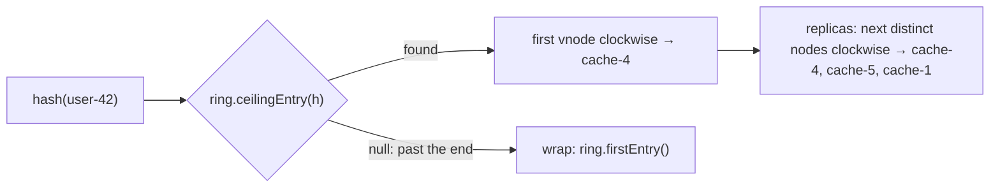

# 10. Consistent Hashing with Virtual Nodes

<span class="level l3">L3</span> ★★★ · `TreeMap` ring, `ceilingEntry`, virtual nodes, replica selection

## Problem

> Route user ids to cache or DB shards so that **adding or removing a node moves only about 1/N of the keys**, the load stays
> balanced, and each key can be placed on **3 distinct replicas**.

## Key idea

Hash both the nodes and the keys onto the same ring (a 64-bit space). A key belongs to the **first node clockwise** from it
(`TreeMap.ceilingEntry`, wrapping around). Giving each physical node **many virtual nodes** (150 here) smooths out the load. Adding a
node takes over only the arcs just before its virtual nodes. Compare that with `hash % N`, where changing N remaps almost everything.



## Solution

```java title="ConsistentHashing.java"
--8<-- "coding-interview/src/ConsistentHashing.java"
```

## Walkthrough

| Code | Why |
|---|---|
| `ring.put(hash(node + "#" + v), node)` | Each physical node owns many points on the ring. More points give a smoother distribution, at the cost of memory. |
| `Map.Entry<Long, String> e = ring.ceilingEntry(hash(key)); return (e != null ? e : ring.firstEntry())` | Clockwise lookup with wrap-around in O(log V). |
| `MessageDigest MD5 → first 64 bits` | You need a well-distributed hash. `String.hashCode` clusters similar strings. Murmur3 or xxHash are faster production choices. |
| `replicasFor: walk tailMap then wrap, collecting DISTINCT nodes` | Skip virtual nodes that belong to a node you already have, so the 3 replicas are on 3 different machines. |
| `moved == movedToNew` | The defining property: when a node is added, keys move only *to* the new node, never between old nodes. |

## Complexity

| Approach | Time | Space |
|---|---|---|
| lookup | O(log V) for V virtual nodes | O(V) |
| add / remove node | O(vnodes × log V) | - |
| keys moved on change | ≈ K / N | - |

## Run it

```bash
java coding-interview/src/ConsistentHashing.java      # JDK 21+ single-file launcher, no build needed
```

```text
--8<-- "coding-interview/outputs/ConsistentHashing.txt"
```

## Common mistakes

* Using `hash % N`. The output shows 80% of keys moving when going from 4 to 5 nodes.
* Too few virtual nodes, so some nodes get twice their share. The output with 150 vnodes shows about 23–28% per node.
* Picking replicas as the next *virtual* nodes, which can put 2 replicas on the same machine.
* A poor hash function such as `String.hashCode`.

## Follow-up questions

??? question "Where is consistent hashing used?"
    In Cassandra and DynamoDB token rings, Memcached client libraries, Envoy and Nginx `hash` load balancing for session stickiness, Kafka-like partition assignment (sort of), and CDN request routing.

??? question "Alternatives: rendezvous hashing, jump hash?"
    Rendezvous (highest random weight): for each key, pick the node with the highest `hash(key, node)`. It's O(N) per lookup but needs no ring and balances perfectly. Jump consistent hash is O(log N) with no memory, but only works for numbered buckets that are added or removed at the end.
