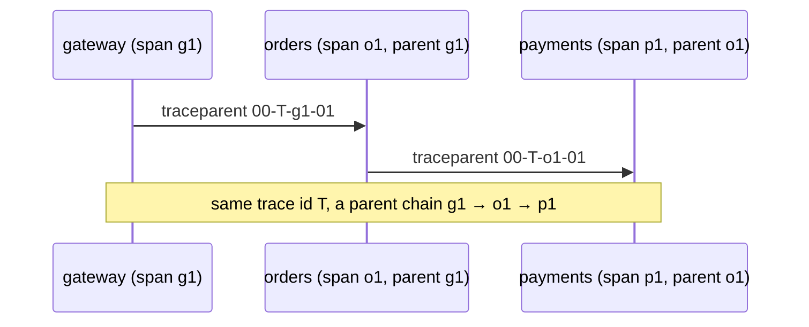

# 11. Distributed Trace Context Propagation

<span class="level l2">L2</span> ★★☆ · W3C `traceparent`, parent/child spans, validation, sampling flag

## Problem

> Make one request traceable across `gateway → orders → payments`. Parse and validate the W3C `traceparent` header,
> continue the trace or start a new one, create child spans with the right parent, and propagate the sampling decision.

## Key idea

`traceparent = 00-<32-hex trace-id>-<16-hex parent span-id>-<flags>`. Each service **keeps the trace id**, creates a
**new span id** for its own work, and records the incoming span id as its **parent**. When it calls the next service it sends
its **own** span id. An invalid or missing header starts a new trace, so propagation never fails because of a bad client.



## Solution

```java title="TraceContext.java"
--8<-- "coding-interview/src/TraceContext.java"
```

## Walkthrough

| Code | Why |
|---|---|
| `p.length != 4 \|\| !p[0].equals("00")` | Strict parsing: the version must be 00, there must be exactly four fields, and the ids must be lowercase hex of the right length. |
| `p[1].equals(ZERO_TRACE)` | An all-zero trace or span id is explicitly invalid in the spec. |
| `(Integer.parseInt(p[3], 16) & 1) == 1` | Bit 0 of the flags is *sampled*. Downstream services honour the upstream decision, so traces are complete or absent, never half. |
| `parent.map(SpanContext::traceId).orElseGet(() -> hex(16))` | Continue the trace if the header is valid, otherwise start a new one. |
| `new Span(traceId, ctx.spanId(), parent.map(SpanContext::spanId).orElse(null), ...)` | The parent link is what lets a tracing UI such as Jaeger or Tempo draw the waterfall. |

## Complexity

| Approach | Time | Space |
|---|---|---|
| parse / create span | O(1) | O(1) |

## Run it

```bash
java coding-interview/src/TraceContext.java      # JDK 21+ single-file launcher, no build needed
```

```text
--8<-- "coding-interview/outputs/TraceContext.txt"
```

## Common mistakes

* Forwarding the incoming `traceparent` unchanged, so every service has the same span id and the waterfall is flat.
* Losing the context across thread hops (executors, `@Async`, reactive). Use context-propagating executors or the OTel instrumentation.
* Rejecting the request when the header is malformed. Tracing must never break business traffic.
* Sampling separately in each service, which leaves broken partial traces.

## Follow-up questions

??? question "How do you correlate logs with traces?"
    Put the trace id and span id into the logging MDC (Micrometer Tracing and OTel do this automatically) and include them in the log pattern. Then you can jump from a log line to its trace in Grafana.

??? question "What about Kafka messages?"
    Put `traceparent` in the message headers. The consumer starts a span whose parent is the producer's span (or a *link*, for batch consumers).
