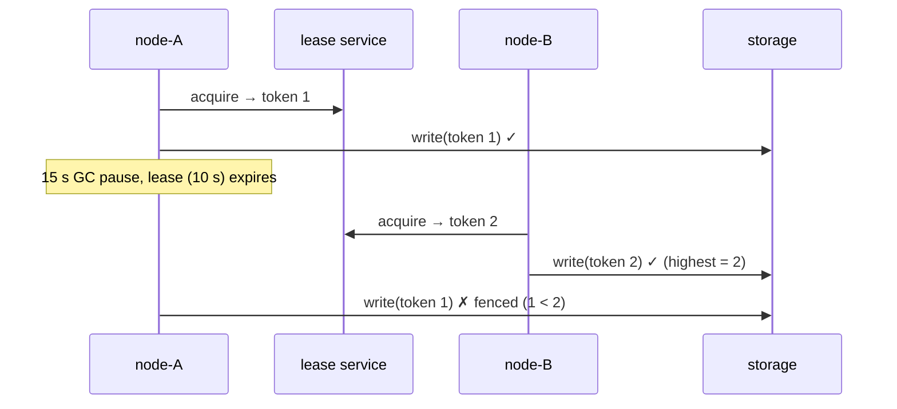

# 12. Leader Election: Lease + Fencing Token

<span class="level l4">L4</span> ★★★ · TTL lease, renewal, GC-pause zombie leader, monotonic fencing tokens

## Problem

> Only **one** instance may run the nightly settlement job. Use a lease-based lock with a TTL. Then handle the hard case:
> the old leader **pauses** (GC, VM freeze) longer than its TTL, a new leader takes over, and the old one wakes up still believing
> it holds the lock.

## Key idea

A lease alone **can't** prevent two leaders, because the paused process can't know its lease expired. The fix (Martin
Kleppmann's) is a **fencing token**: a number that increases every time the lease is granted. The protected resource
**rejects writes carrying a token lower than the highest it has seen**, so the zombie's writes bounce off.



## Solution

```java title="LeaseWithFencing.java"
--8<-- "coding-interview/src/LeaseWithFencing.java"
```

## Walkthrough

| Code | Why |
|---|---|
| `if (current != null && current.expiresAt().isAfter(now) && !holder.equals(who)) return Optional.empty()` | Someone else holds a live lease, so you can't acquire it. |
| `token = renewing ? current.fencingToken() : nextToken++` | A new grant gets a **new, higher** token. A renewal by the same holder keeps its token. |
| `if (token < highestToken) return false` | The storage enforces fencing. The safety guarantee lives in the **resource**, not in the client's belief that it's the leader. |
| `clock.advance(15s)` | Simulates the pause deterministically. Real pauses (GC, stop-the-world, VM migration) are exactly what breaks lock-only designs. |

## Complexity

| Approach | Time | Space |
|---|---|---|
| acquire / renew / write | O(1) | O(1) |

## Run it

```bash
java coding-interview/src/LeaseWithFencing.java      # JDK 21+ single-file launcher, no build needed
```

```text
--8<-- "coding-interview/outputs/LeaseWithFencing.txt"
```

## Common mistakes

* Believing a Redis `SET NX PX` lock (or Redlock) guarantees mutual exclusion for correctness. Without fencing, it doesn't.
* Renewing the lease on a fixed timer without checking that the renewal *succeeded* before doing more work.
* A TTL that's too short (GC pauses cause flapping) or too long (failover is slow).
* Protected resources that can't check tokens. Then store the token in the data and use a conditional write (`WHERE token <= ?`).

## Follow-up questions

??? question "Where do fencing tokens come from in real systems?"
    ZooKeeper's `zxid` or znode version, etcd's revision or lease ID plus mod-revision, or a DB sequence. Kafka uses the same idea: the controller *epoch* and producer epochs fence zombies.

??? question "Do you even need a leader?"
    Often not. Make the job idempotent and partition the work (each instance claims rows with `FOR UPDATE SKIP LOCKED`), or use a scheduler with a single-run guarantee such as ShedLock or a Kubernetes CronJob with `concurrencyPolicy: Forbid`, which still needs idempotency.
