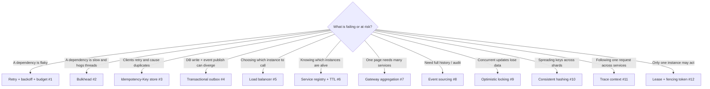

# Coding Interview: 12 Microservice Building Blocks

Microservice coding rounds rarely ask for algorithms. They ask you to **build one of the mechanisms the architecture
depends on**, in plain Java and in 30–45 minutes, and then probe the edge cases: concurrency, partial failure and time.
This tab has twelve of them. Every solution is a **runnable, self-checking** single file in
[`coding-interview/src`](https://github.com/khiruashish/microservice-playbook/tree/main/coding-interview/src).
Each one asserts its own results, prints `PASS`, and is run by CI on every change. Time-dependent code takes an
injectable clock, so the output on each page is reproducible.

The four most common ones (**circuit breaker, per-key token-bucket rate limiter, idempotent Kafka consumer, saga
coordinator**) are covered in depth, with 24 tests, in [Coding Rounds](../interview-prep/coding-rounds.md). This
tab covers the next twelve.

Each page follows the same structure:

1. **Problem**: the statement as an interviewer would give it.
2. **Key idea**: the shape of the solution before any code, with a diagram.
3. **Solution**: the complete, runnable code (included from the repository, so it is exactly what CI ran).
4. **Walkthrough**: the important lines and *why* they are written that way.
5. **Complexity**: time and space for each approach.
6. **Run it**: the command and its real output.
7. **Common mistakes** and **follow-up questions** with answers.

## Problem map

| # | Problem | What it tests | Level | Difficulty |
|---|---|---|---|---|
| 1 | [Retry with Exponential Backoff, Jitter & Budget](01-retry-backoff.md) | Backoff, full jitter, retryable vs permanent errors, retry budget | <span class="level l2">L2</span> | ★★☆ |
| 2 | [Bulkhead: Isolate a Slow Dependency](02-bulkhead.md) | `Semaphore`, fail fast, permit release in `finally` | <span class="level l2">L2</span> | ★★☆ |
| 3 | [Idempotency-Key for Safe Retries](03-idempotency-key.md) | Atomic claim, in-progress vs completed, payload hash, 409 / 422 | <span class="level l3">L3</span> | ★★★ |
| 4 | [Transactional Outbox + Relay](04-transactional-outbox.md) | Dual-write problem, same-transaction event row, at-least-once relay, consumer dedupe | <span class="level l3">L3</span> | ★★★ |
| 5 | [Client-Side Load Balancer](05-load-balancer.md) | Round robin, smooth weighted round robin, least connections, health filtering | <span class="level l2">L2</span> | ★★☆ |
| 6 | [Service Registry with Heartbeats & TTL](06-service-registry.md) | Register / heartbeat / evict, watchers, injectable clock | <span class="level l2">L2</span> | ★★☆ |
| 7 | [API Gateway Aggregation with Timeouts](07-gateway-aggregation.md) | `CompletableFuture` fan-out/fan-in, `orTimeout`, `completeOnTimeout`, partial responses | <span class="level l3">L3</span> | ★★★ |
| 8 | [Event-Sourced Aggregate with Snapshots](08-event-sourcing.md) | Commands → events, fold to state, optimistic append, snapshots, temporal query | <span class="level l3">L3</span> | ★★★ |
| 9 | [Optimistic Locking: No Lost Updates](09-optimistic-locking.md) | Version column, conditional update, bounded retry, 409/412 | <span class="level l2">L2</span> | ★★☆ |
| 10 | [Consistent Hashing with Virtual Nodes](10-consistent-hashing.md) | `TreeMap` ring, `ceilingEntry`, virtual nodes, replica selection | <span class="level l3">L3</span> | ★★★ |
| 11 | [Distributed Trace Context Propagation](11-trace-context.md) | W3C `traceparent`, parent/child spans, validation, sampling flag | <span class="level l2">L2</span> | ★★☆ |
| 12 | [Leader Election: Lease + Fencing Token](12-lease-fencing.md) | TTL lease, renewal, GC-pause zombie leader, monotonic fencing tokens | <span class="level l4">L4</span> | ★★★ |

Levels: <span class="level l1">L1</span> 0–2 yrs · <span class="level l2">L2</span> 2–5 yrs · <span class="level l3">L3</span> 5–10 yrs · <span class="level l4">L4</span> 10+ yrs / architect.

## Which technique fits? (the interviewer's hidden question)



## How to answer a coding round

1. **State the failure mode first** ("the client times out and retries, so we charge twice"). The mechanism exists because of it.
2. **Define the contract**: inputs, outputs and error responses (409, 422, 429, 503). Microservice rounds care about the HTTP semantics.
3. **Code the core with injectable time and randomness** (`Clock`, `Random`) so it's testable. Interviewers notice.
4. **Walk through concurrency and partial failure**: two requests at once, a crash between steps, a slow dependency.
5. **Name the production version** (Resilience4j, Debezium, Eureka/Consul, OpenTelemetry, etcd) and what it adds.

## Run every solution

```bash
coding-interview/run-all.sh          # runs all 12, writes outputs/
coding-interview/run-all.sh --check  # what CI runs: fails on any failure or changed output
```
