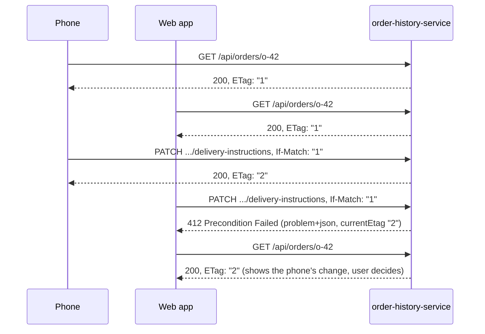

# 21. Synchronous REST

<div class="badges" markdown><span class="badge badge-l1">L1 · Foundation</span><span class="badge badge-l2">L2 · Practitioner</span><span class="badge badge-l3">L3 · Senior/Lead</span><span class="badge badge-meta">Spring Boot 4 · PostgreSQL 16 benchmark · RFC 9110 / 9457 / 8288</span></div>

<div class="grid two" markdown>

!!! info "Prerequisites"
    - [Chapter 2](../foundations/ch02-characteristics-principles.md) and [chapter 8](../foundations/ch08-spring-boot-4-essentials.md): API versioning with Spring Boot 4
    - Basic HTTP: methods, status codes, headers

!!! abstract "What you'll learn"
    - Designing **resources** and using **methods and status codes** for what they mean
    - **Keyset (cursor) pagination**: measured **9,664× faster** than offset at the last page of 2 million rows, and free of the duplicates and skips offset paging shows on live data
    - **Conditional requests**: ETag + `If-None-Match` for 304s, `If-Match` for safe concurrent updates (412, 428)
    - **RFC 9457 Problem Details** as the one error format
    - Versioning and **hypermedia**: what FoodFleet uses and what it skips

</div>

---

## 1 · Introduction & Context

### Four bugs in one screen

FoodFleet's order-history screen (and the support dashboard built on the same API) collected four kinds of complaint in one quarter:

1. **"The support dashboard times out on old orders."** `GET /orders?page=9000&size=20` made the database read and discard 180,000 rows before returning 20.
2. **"I saw the same order twice and missed another."** Agents paging through open orders while new ones arrived saw duplicates; when orders closed mid-list, others silently slid past them.
3. **"The app shows 'Something went wrong' for everything."** Errors came back as `200 {"error": "..."}`, `500` with an HTML page, or `400` with a different JSON shape per endpoint, so the app couldn't tell "retry" from "fix your input".
4. **"My delivery instructions disappeared."** A customer edited instructions on the phone while the web app, open on a laptop, saved an older copy over it: a lost update.

None of these needs a new technology. Each is HTTP and REST used for what they already provide: cursors instead of offsets, ETags and conditional requests, a standard error format.

### REST in one paragraph

REST (Fielding, 2000) is an architectural style: **resources** identified by URIs, manipulated through a **uniform interface** (HTTP methods with defined semantics), with **representations** (JSON), **stateless** requests, and **cacheable** responses. Most "REST APIs" use the first three; the payoff of the rest (caching, conditional requests, links) is where this chapter spends its time.

### Where the standards come from

<ul class="mh-timeline">
<li><span class="when">1999–2000 · HTTP/1.1, Fielding</span><span class="what">RFC 2616 defines methods, status codes, caching and conditional requests; Fielding's dissertation names REST.</span></li>
<li><span class="when">2008 · Richardson maturity model</span><span class="what">Levels 0–3: one endpoint, resources, HTTP verbs, hypermedia.</span></li>
<li><span class="when">2016–2017 · RFC 7807, RFC 8288</span><span class="what">Problem Details for HTTP APIs; Web Linking (the <code>Link</code> header).</span></li>
<li><span class="when">2022 · RFC 9110</span><span class="what">HTTP Semantics consolidates methods, status codes, ETags and preconditions.</span></li>
<li><span class="when">2023 · RFC 9457</span><span class="what">Problem Details revised (obsoletes 7807); Spring Framework 6 had already made <code>ProblemDetail</code> first-class.</span></li>
</ul>

---

## 2 · Core Concepts & Terminology

### Resources, not procedures

| Do | Avoid | Why |
|---|---|---|
| `GET /api/customers/c-1/orders` | `POST /api/getOrderHistory` | GET is safe and cacheable; the URI names a thing |
| `GET /api/orders/o-42` | `GET /api/order?id=o-42&action=view` | One URI per resource |
| `PATCH /api/orders/o-42/delivery-instructions` | `POST /api/updateInstructions` | A sub-resource the client changes |
| `POST /api/orders/o-42/cancellation` | `POST /api/orders/o-42/cancel` | An action modelled as creating a resource (a cancellation, with its own status) |
| Plural nouns, lower-case, hyphens | Verbs, camelCase, file extensions | Consistency across 40 services |

### Methods mean something

| Method | Safe | Idempotent | Typical use | Retry after a timeout? |
|---|---|---|---|---|
| GET, HEAD | ✅ | ✅ | Read | Yes |
| PUT | ❌ | ✅ | Replace a resource at a known URI | Yes |
| DELETE | ❌ | ✅ | Remove | Yes |
| PATCH | ❌ | ❌ (unless conditional) | Partial update | Only with `If-Match` |
| POST | ❌ | ❌ | Create, or any non-idempotent action | Only with an Idempotency-Key ([chapter 28](ch28-idempotency-correlation.md)) |

Proxies, gateways and HTTP clients rely on these properties to decide what they may retry ([chapter 17](../architecture-patterns/ch17-sidecar-ambassador-adapter.md), [chapter 18](../architecture-patterns/ch18-resilience-patterns.md)). Breaking them breaks the infrastructure's assumptions.

### Status codes clients can act on

| Code | Meaning | Client action |
|---|---|---|
| 200 / 201 / 204 | OK / created (with `Location`) / no content | Proceed |
| 304 | Not modified (conditional GET) | Use the cached copy |
| 400 | The request is wrong | Fix input; don't retry as is |
| 401 / 403 | Not authenticated / not allowed | Re-authenticate / stop |
| 404 | No such resource | Stop |
| 409 | Conflicts with the resource's current state | Re-read, decide |
| 412 | `If-Match` precondition failed: someone else changed it | Re-read, reapply, retry |
| 422 | Well-formed but semantically invalid | Fix input |
| 428 | Precondition required (send `If-Match`) | Fetch, then retry with `If-Match` |
| 429 | Too many requests | Wait `Retry-After` |
| 500 | Server bug | Report; maybe retry |
| 503 / 504 | Unavailable / upstream timeout | Retry with backoff, honour `Retry-After` |

Never `200` with an error body: every cache, gateway, retry policy and dashboard in between will believe it succeeded.

### Richardson maturity, honestly

| Level | What | FoodFleet |
|---|---|---|
| 0 | One endpoint, RPC over POST | No |
| 1 | Resources | Yes |
| 2 | HTTP methods and status codes as designed | Yes: the standard |
| 3 | Hypermedia (HATEOAS): clients navigate by links in responses | Partly: `next`, `self` and action links where they save clients from building URLs |

Full HATEOAS (HAL or Siren, clients discovering every transition from links) pays off for long-lived public APIs consumed by many unknown clients. For FoodFleet's own apps, the useful core is **links for pagination and for actions whose availability changes** (a `cancel` link only while cancellable). Spring HATEOAS provides `EntityModel`, `Link` and HAL rendering when you want more.

---

## 3 · How It Works Internally

### Offset vs keyset pagination

**Offset** pagination asks the database for "rows 180,001 to 180,020 in this order". To find row 180,001 it must walk past the first 180,000, every time. **Keyset** pagination asks for "the 20 rows after this one": with an index on the sort key, the database seeks straight there.

```sql
-- offset: cost grows with the page number
select ... from orders order by placed_at desc, id desc limit 20 offset 180000;

-- keyset: cost is constant; the last row of the previous page is the cursor
select ... from orders
where (placed_at, id) < ('2026-10-03 08:30:00+00', 'o-4')
order by placed_at desc, id desc limit 20;
```

The sort key must be **unique**, so `id` breaks ties between orders placed in the same instant. The row-value comparison `(placed_at, id) < (…, …)` matches the index `(placed_at desc, id desc)` exactly; PostgreSQL uses it as an index condition (verified with `EXPLAIN`):

```text
Limit
  ->  Index Only Scan using orders_customer_placed on orders
        Index Cond: ((customer_id = 'c-1') AND (ROW(placed_at, id) < ROW('2026-10-03 08:30:00+00', 'o-4')))
```

```java title="orders/JdbcOrderStore.java (page)"
--8<-- "code/chapters/ch21-rest-api/src/main/java/dev/foodfleet/ch21/orders/JdbcOrderStore.java:24:47"
```

The client never sees `placed_at` or `id` as such: it receives an **opaque cursor** and sends it back. Opaque means the server can change what's inside (a version prefix allows a new format alongside the old), and clients can't build cursors for pages they shouldn't jump to.

```java title="paging/Cursor.java"
--8<-- "code/chapters/ch21-rest-api/src/main/java/dev/foodfleet/ch21/paging/Cursor.java"
```

### Conditional requests

The order's `version` column, incremented on every update, is its **ETag**.



- **`If-None-Match`** on a GET: if the ETag still matches, the server answers `304 Not Modified` with no body. Clients and caches revalidate cheaply.
- **`If-Match`** on a write: the update happens only if the resource is still at that version (`update ... where id = :id and version = :expected`). Otherwise `412 Precondition Failed`. This is **optimistic concurrency over HTTP**: no locks, and no lost updates.
- **`428 Precondition Required`** (RFC 6585) when a client tries to update without `If-Match`: the API refuses blind overwrites.
- `If-Match` uses **strong comparison**: a weak ETag (`W/"2"`) never matches.

### RFC 9457 Problem Details

Every error is an `application/problem+json` document with standard members and optional extensions:

```json
{
  "type": "https://docs.foodfleet.example/problems/stale-version",
  "title": "Order was changed by someone else",
  "status": 412,
  "detail": "Fetch the order again, reapply your change, and send the new ETag in If-Match.",
  "instance": "/api/orders/o-42/delivery-instructions",
  "currentEtag": "\"2\""
}
```

- **`type`** is the stable identifier clients switch on; it should resolve to documentation.
- **`title`** is stable per type; **`detail`** is specific to this occurrence and meant for humans.
- **Extensions** (`currentEtag`, `maximum`) carry what a client needs to recover.
- With `spring.mvc.problemdetails.enabled=true`, Spring's own errors (bad JSON, unsupported media type, 405) use the same format.

```java title="api/ApiProblems.java"
--8<-- "code/chapters/ch21-rest-api/src/main/java/dev/foodfleet/ch21/api/ApiProblems.java:11:55"
```

### Versioning

Spring Boot 4's built-in API versioning (header `API-Version`, defaults, deprecation headers) was covered in [chapter 2](../foundations/ch02-characteristics-principles.md) and [chapter 8](../foundations/ch08-spring-boot-4-essentials.md). The rules that matter more than the mechanism: **additive changes don't need a version**; clients must **ignore unknown fields** (tolerant reader); a new version is for breaking changes only, runs alongside the old one, and is announced with `Deprecation` and `Sunset` headers. Contract tests keep everyone honest ([chapter 27](ch27-api-contracts.md)).

---

## 4 · Design Considerations & Trade-offs

### Measured: offset vs keyset on 2,000,000 orders

PostgreSQL 16.13 on 2 vCPUs, 2,000,000 orders (478 MB with indexes), newest first, 20 per page, median of 7 runs with the data cached. The script checks that both queries return identical rows before timing them. Verified:

| Page | Rows skipped | OFFSET | Buffers | KEYSET | Buffers | Keyset faster by |
|---:|---:|---:|---:|---:|---:|---:|
| 1 | 0 | 0.057 ms | 4 | 0.057 ms | 4 | 1× |
| 10 | 180 | 0.090 ms | 7 | 0.065 ms | 5 | 1× |
| 100 | 1,980 | 0.498 ms | 40 | 0.068 ms | 5 | 7× |
| 1,000 | 19,980 | 4.783 ms | 368 | 0.101 ms | 4 | 47× |
| 10,000 | 199,980 | 57.540 ms | 3,640 | 0.084 ms | 5 | 685× |
| 50,000 | 999,980 | 245.972 ms | 18,193 | 0.073 ms | 4 | 3,369× |
| 99,999 | 1,999,960 | **550.832 ms** | 35,994 | **0.057 ms** | 4 | **9,664×** |

Offset cost is linear in the page number (it reads and discards every skipped row: 36,000 buffers for the last page); keyset cost is flat at 4–5 buffers. With the data *not* cached, or under concurrency, the gap only widens. Note the first ten pages are equally fast either way: offset is fine for shallow, bounded lists.

### Measured: paging through a list that changes

A support agent pages through 2,000 open orders, 20 per page, 15 seconds per page, while new orders arrive at the top and open orders close anywhere in the list. Every order that was open at the start and stayed open should be seen exactly once. Verified:

| New / closed per page | Strategy | Should see | Duplicates | Skipped |
|---|---|---:|---:|---:|
| 0 / 0 | offset, keyset | 1,000 | 0 | 0 |
| 3 / 0 | offset | 853 | **147** | 0 |
| 3 / 0 | keyset | 1,000 | 0 | 0 |
| 0 / 3 | offset | 998 | 0 | **45** |
| 0 / 3 | keyset | 953 | 0 | 0 |
| 10 / 10 | offset | 553 | **379** | 0 |
| 10 / 10 | keyset | 883 | 0 | 0 |

- **Arrivals push offset pages down**: the agent re-reads items from the previous page (147 duplicates) and, in 50 pages, gets 15% less far through the real list.
- **Removals pull offset pages up**: items slide into ranges already read and are **never shown** (45 skipped), silently.
- **Keyset doesn't move**: "after this order" means the same thing however the list changes. (New orders above the cursor aren't shown; the client refreshes the top for those.)

### Choosing a pagination style

| Style | Good for | Costs |
|---|---|---|
| Offset/limit (`?page=3`) | Small, bounded lists; "jump to page 7" UIs | Linear cost; duplicates and skips on live data |
| Keyset / cursor (`?cursor=…`) | Feeds, histories, large or live lists, infinite scroll | No random page access; sort must be on an indexed unique key |
| Server-side snapshot / token | Exact consistency over a long scan (exports) | Server state; expiry |
| Bulk export / streaming | "Give me everything" | Different endpoint (or async job) |

And skip `count(*)` on every page: on large tables it costs as much as the deepest offset. Fetch `limit + 1` rows to know whether a next page exists.

### Caching and ETags

| Header | Use |
|---|---|
| `ETag` | Version of this representation (from a version column, or a hash) |
| `Cache-Control: private, max-age=0, must-revalidate` | Personal data: browsers may cache but must revalidate every time (cheap with 304s) |
| `Cache-Control: public, max-age=60` | Shared data like menus: CDNs and gateways may cache |
| `Vary` | Representation depends on a header (`Accept-Language`, `API-Version`) |

A version column gives strong ETags for free and doubles as the optimistic lock. Hash-based ETags (Spring's `ShallowEtagHeaderFilter`) save bandwidth but not server work: the response is still computed.

### When not to use REST

REST is the default for request/response between services and to apps. Use [gRPC](ch23-grpc.md) for high-volume internal calls with strict contracts and streaming, [GraphQL](ch24-graphql.md) when many clients need differently shaped data from many sources, [messaging](ch25-asynchronous-messaging.md) when the caller doesn't need an answer now, and [SSE/WebSockets](ch26-websockets-sse.md) for server push.

---

## 5 · Hands-on Implementation

Code: `code/chapters/ch21-rest-api/`. A Spring Boot 4 service on PostgreSQL; the paging pieces are plain Java.

```bash
cd code
mvn -B -pl chapters/ch21-rest-api -am verify        # the store tests need Docker; skipped without it
java -cp chapters/ch21-rest-api/target/classes dev.foodfleet.ch21.paging.PagingAnomalySimulation
```

### 🟢 Level 1: the resource and its page

<div class="badges" markdown><span class="badge badge-l1">L1 · Foundation</span></div>

```java title="api/OrderHistoryController.java (collection)"
--8<-- "code/chapters/ch21-rest-api/src/main/java/dev/foodfleet/ch21/api/OrderHistoryController.java:40:61"
```

A response:

```http
HTTP/1.1 200 OK
Content-Type: application/json
Link: </api/customers/c-1/orders?limit=2&cursor=djF8MjAyNi0xMC0wNFQxMjowMDowMFp8by00>; rel="next"

{"items":[{"id":"o-5","restaurant":"Restaurant 5","totalPaise":50000,"status":"DELIVERED",
           "placedAt":"2026-10-05T12:00:00Z","self":"/api/orders/o-5"}, ...],
 "next":"/api/customers/c-1/orders?limit=2&cursor=djF8MjAyNi0xMC0wNFQxMjowMDowMFp8by00"}
```

### 🔵 Level 2: ETags, 304 and If-Match

<div class="badges" markdown><span class="badge badge-l2">L2 · Practitioner</span></div>

```java title="api/OrderHistoryController.java (one order)"
--8<-- "code/chapters/ch21-rest-api/src/main/java/dev/foodfleet/ch21/api/OrderHistoryController.java:63:93"
```

```java title="api/ETags.java"
--8<-- "code/chapters/ch21-rest-api/src/main/java/dev/foodfleet/ch21/api/ETags.java"
```

### 🟣 Level 3: testing the contract

<div class="badges" markdown><span class="badge badge-l3">L3 · Senior/Lead</span></div>

Web-layer tests with `MockMvcTester` and an in-memory store implementing the same interface:

```java title="OrderHistoryControllerTest.java"
--8<-- "code/chapters/ch21-rest-api/src/test/java/dev/foodfleet/ch21/api/OrderHistoryControllerTest.java:42:106"
```

The SQL on real PostgreSQL, including orders placed in the same instant split across pages:

```java title="JdbcOrderStoreContainerTest.java"
--8<-- "code/chapters/ch21-rest-api/src/test/java/dev/foodfleet/ch21/orders/JdbcOrderStoreContainerTest.java:19:78"
```

### Run and verify

```text
$ python3 bench/pagination_benchmark.py "psql -X -d bench"
   page  rows skipped |  OFFSET ms   buffers |  KEYSET ms   buffers |   ratio
      1             0 |      0.057         4 |      0.057         4 |      1x
     10           180 |      0.090         7 |      0.065         5 |      1x
    100         1,980 |      0.498        40 |      0.068         5 |      7x
  1,000        19,980 |      4.783       368 |      0.101         4 |     47x
 10,000       199,980 |     57.540     3,640 |      0.084         5 |    685x
 50,000       999,980 |    245.972    18,193 |      0.073         4 |   3369x
 99,999     1,999,960 |    550.832    35,994 |      0.057         4 |   9664x
```

```text
$ java -cp chapters/ch21-rest-api/target/classes dev.foodfleet.ch21.paging.PagingAnomalySimulation
Support dashboard: 2,000 open orders, an agent reads 50 pages of 20 (15 s per page);
meanwhile orders arrive at the top and close anywhere in the list.

strategy  per page: new / closed   should see  duplicates   skipped
OFFSET    0 / 0                          1000           0         0
KEYSET    0 / 0                          1000           0         0
OFFSET    3 / 0                           853         147         0
KEYSET    3 / 0                          1000           0         0
OFFSET    0 / 3                           998           0        45
KEYSET    0 / 3                           953           0         0
OFFSET    3 / 3                           855         111         0
KEYSET    3 / 3                           966           0         0
OFFSET    10 / 10                         553         379         0
KEYSET    10 / 10                         883           0         0
```

!!! question "Try it"
    1. Add `?sort=total` to the history endpoint. What must the cursor contain now, and what index does the query need?
    2. Run the benchmark with the data not cached (restart PostgreSQL, drop OS caches). How does page 10,000 change for each strategy?
    3. Make the ETag a hash of the JSON body instead of the version. What does If-Match need to do differently?
    4. Add a `cancel` link to an order's representation only while it is cancellable. What does the app no longer need to know?

---

## 6 · Production Readiness

- [x] **Resource naming** reviewed against a style guide (plural nouns, sub-resources for actions, no verbs)
- [x] **Methods used for their semantics**; unsafe operations never on GET; POSTs that may be retried carry an Idempotency-Key
- [x] **Every error is RFC 9457** with a stable `type`, consistent titles, and extensions clients can act on; Spring's own errors included
- [x] **Keyset pagination** for anything large or live; bounded `limit` with a documented maximum; `next` links; no `count(*)` per page
- [x] **Indexes match the sort keys** used by cursors, verified with `EXPLAIN`
- [x] **ETags on single resources**; `If-Match` required for updates (428 without, 412 when stale)
- [x] **Cache-Control set deliberately** per resource (private personal data, public reference data)
- [x] **Versioning policy**: additive changes without versions; breaking changes as new versions with `Deprecation`/`Sunset`
- [x] **Contract published** (OpenAPI) and checked in CI ([chapter 27](ch27-api-contracts.md))
- [x] **Request ids** returned in a header and logged, to match client reports to traces

---

## 7 · Anti-patterns & Pitfalls

!!! pitfall "Incident 1: the dashboard that timed out on old orders"
    **Context.** The support dashboard paged with `?page=N&size=20` over all orders.
    **Symptoms.** Pages beyond a few thousand took seconds; agents' clicks queued database work that ran on after they gave up; the primary's CPU spiked during audits.
    **Root cause.** OFFSET reads and discards every skipped row; cost grows with the page number (550 ms for the last page of 2 million rows, measured).
    **Fix.** Keyset cursors with an index on `(placed_at, id)`; "jump to date" replaced "jump to page 9000".

!!! pitfall "Incident 2: the order nobody saw"
    **Context.** Agents worked through open orders page by page with offset pagination.
    **Symptoms.** Some escalations were never picked up; others were handled twice.
    **Root cause.** Orders closing above the current offset shifted items into pages already read (skipped); new orders shifted items into the next page again (duplicated).
    **Fix.** Keyset pagination; the simulation reproduces both effects (45 skipped, 147 duplicates).

!!! pitfall "Incident 3: the lost delivery instructions"
    **Context.** `PUT /orders/{id}` replaced the whole order representation, unconditionally.
    **Symptoms.** Customers' instructions ("gate code 4412") vanished; the last device to save won.
    **Root cause.** No optimistic concurrency: a stale copy overwrote a newer one.
    **Fix.** A `PATCH` on the instructions sub-resource requiring `If-Match`; 412 with the current ETag on conflict; the app shows both versions and asks.

| Anti-pattern | Symptom | Fix |
|---|---|---|
| `200` with an error body | Caches, retries and dashboards think it worked | Real status codes + problem details |
| A different error shape per endpoint | Clients can't handle errors generically | RFC 9457 everywhere |
| Verbs in URIs, RPC over POST | No caching, no retry semantics | Resources and methods |
| Offset pagination on large or live lists | Slow deep pages, duplicates, skips | Keyset cursors |
| `count(*)` on every page | Each page as slow as the deepest | `limit + 1`, or counts on demand |
| Unconditional updates | Lost updates | ETag + If-Match |
| Exposing database ids and sort keys in cursors | Clients build cursors; you can't change them | Opaque, versioned cursors |
| Versioning every change | Version sprawl | Additive changes, tolerant readers |

---

## 8 · Enterprise Case Study

### FoodFleet: the REST API style guide

!!! decision "ADR-021: FoodFleet REST APIs use keyset pagination, conditional updates and RFC 9457 errors"
    **Status:** Accepted · **Date:** 2024-07-15

    **Context.** Deep offset pages timed out, live lists showed duplicates and skipped items, errors had a different shape per service, and concurrent edits lost data.

    **Decision.** Collections that can grow beyond a few hundred items use opaque, versioned keyset cursors (`limit` default 20, maximum 100) with a `next` link in the body and a `Link: rel="next"` header; the sort key ends with a unique id and is backed by a matching index. Single resources return a strong ETag from a version column; updates require `If-Match` (428 without, 412 when stale). All errors are RFC 9457 problem documents with `type` URIs under `https://docs.foodfleet.example/problems/`, documented per API; `spring.mvc.problemdetails.enabled` is on everywhere. Versioning follows ADR-008. Hypermedia is limited to pagination, `self` and state-dependent action links.

    **Consequences.** ✅ Deep pages cost the same as the first; no duplicates or skips; the app handles errors by `type`; no more lost updates. ⚠️ No "jump to page N"; UIs offer search and date filters instead. ⚠️ Clients must handle 412 with a re-read.

### Fintech analogue: statements and payment status 🔴

Banking APIs (open-banking standards among them) page account transactions with cursors or continuation keys rather than page numbers, because statements are long and new transactions keep arriving at the top. Payment instructions use idempotency keys for creation and ETag-style versioning or explicit state checks for amendments, and errors are machine-readable codes so a payment app can tell "insufficient funds" (tell the user) from "try again later" (retry).

### E-commerce analogue: catalogue browsing

Product listings sorted by relevance or price use cursors (search engines return continuation tokens) for infinite scroll; product pages use ETags and `Cache-Control: public` so CDNs serve most traffic; carts use conditional updates so two tabs don't overwrite each other.

---

## 9 · Interview Q&A + Summary

#### Q1. What makes an API RESTful? · <span class="badge badge-l1">L1</span><span class="badge badge-l2">L2</span> · Cognizant · SAP

**Short answer:** Resources identified by URIs, a uniform interface (HTTP methods with their defined semantics), representations, stateless requests, cacheable responses, and ideally links between resources. In practice: nouns in URIs, methods and status codes used for what they mean.

#### Q2. PUT vs PATCH vs POST? · <span class="badge badge-l1">L1</span><span class="badge badge-l2">L2</span> · Cognizant · Flipkart

**Short answer:** PUT replaces a resource at a known URI and is idempotent. PATCH partially updates and isn't idempotent by itself (make it safe with If-Match). POST creates a subordinate resource or performs a non-idempotent action; make retries safe with an Idempotency-Key.

#### Q3. Which methods are safe and which are idempotent, and why does it matter? · <span class="badge badge-l2">L2</span> · Amazon · Flipkart

**Short answer:** GET and HEAD are safe and idempotent; PUT and DELETE are idempotent; POST and PATCH are neither by default. Clients, gateways and proxies decide what they may retry or cache from these properties.

#### Q4. Offset vs cursor pagination? · <span class="badge badge-l2">L2</span><span class="badge badge-l3">L3</span> · Amazon · Flipkart · Goldman Sachs

**Short answer:** Offset skips N rows each time, so cost grows with depth and live inserts/deletes cause duplicates and skips. Keyset/cursor pagination seeks to the last seen sort key using an index: constant cost and stable under changes, but no random page jumps. Use a unique sort key (add the id as tie-breaker) and opaque cursors.

#### Q5. How do you prevent lost updates in a REST API? · <span class="badge badge-l2">L2</span><span class="badge badge-l3">L3</span> · JP Morgan · SAP

**Short answer:** Optimistic concurrency: return an ETag (from a version column), require If-Match on updates, update with `where version = :expected`, return 412 when stale and 428 when If-Match is missing.

#### Q6. What is RFC 9457? · <span class="badge badge-l2">L2</span> · SAP · Goldman Sachs

**Short answer:** Problem Details for HTTP APIs (obsoletes RFC 7807): a standard JSON error format with type, title, status, detail and instance, plus extensions. Spring supports it through `ProblemDetail` and `spring.mvc.problemdetails.enabled`.

#### Q7. 400 vs 422 vs 409? · <span class="badge badge-l2">L2</span> · any

**Short answer:** 400 for malformed or invalid requests (bad syntax, out-of-range parameter); 422 when the request is well-formed but semantically invalid for the business rules (many APIs use 400 for both, consistently); 409 when it conflicts with the resource's current state (cancel a delivered order).

#### Q8. How do ETags help performance? · <span class="badge badge-l2">L2</span><span class="badge badge-l3">L3</span> · Amazon · Flipkart

**Short answer:** Clients and caches revalidate with If-None-Match; an unchanged resource returns 304 with no body, saving bandwidth and, if the ETag comes from a version column checked cheaply, server work too.

#### Q9. How do you version a REST API? · <span class="badge badge-l2">L2</span><span class="badge badge-l3">L3</span> · SAP · JP Morgan

**Short answer:** Avoid versions for additive changes (clients ignore unknown fields). For breaking changes, version by header, media type or URI path, run versions side by side, announce deprecation with Deprecation/Sunset headers, and watch usage before removal. Spring Boot 4 supports this natively.

#### Q10. Is HATEOAS worth it? · <span class="badge badge-l3">L3</span> · SAP · Goldman Sachs

**Short answer:** Partly. Links for pagination, self and state-dependent actions spare clients from building URLs and encoding business rules; full hypermedia-driven clients make sense mostly for long-lived public APIs with many unknown consumers.

#### Q11. How would you design an order-history API for 50 million customers? · <span class="badge badge-l3">L3</span> · Swiggy-/Zomato-style rounds

**Short answer:** `GET /customers/{id}/orders` with keyset cursors on `(placed_at, id)` backed by a `(customer_id, placed_at desc, id desc)` index, limit ≤ 100, `next` links, no counts; single orders with ETags and private caching; problem details for errors; read replicas or a read model for scale.

#### Q12. What would you put in a REST API style guide? · <span class="badge badge-l3">L3</span> · any

**Short answer:** Naming, method semantics, status codes, error format (RFC 9457 with type URIs), pagination (cursors, limits, links), concurrency (ETag/If-Match), idempotency keys for POST, caching headers, versioning and deprecation, request ids, and how contracts are published and tested.

### Key takeaways

- Use HTTP as designed: **resources, method semantics, real status codes**.
- **Keyset pagination** for large or live lists: measured constant **~0.06 ms** vs **551 ms** for offset at 2 million rows, and no duplicates or skips.
- **ETags + If-Match** end lost updates; **If-None-Match** makes revalidation cheap.
- **RFC 9457** is the one error format; clients switch on `type`.
- Version only for breaking changes; use **links** where they save clients from knowing your URLs.

### Further reading

- RFC 9110 *HTTP Semantics*, RFC 9457 *Problem Details for HTTP APIs*, RFC 8288 *Web Linking*, RFC 6585 (428)
- Roy Fielding, *Architectural Styles and the Design of Network-based Software Architectures*, chapter 5 (2000)
- Markus Winand, [We need tool support for keyset pagination](https://use-the-index-luke.com/no-offset) (Use The Index, Luke)
- Spring Framework reference: [Error Responses](https://docs.spring.io/spring-framework/reference/web/webmvc/mvc-ann-rest-exceptions.html) and [HTTP Caching](https://docs.spring.io/spring-framework/reference/web/webmvc/mvc-caching.html)
- Zalando, [RESTful API Guidelines](https://opensource.zalando.com/restful-api-guidelines/)

---

**Previous:** [← Part 3 — Communication](index.md) · **Next:** [22. HTTP Clients →](ch22-http-clients.md)
