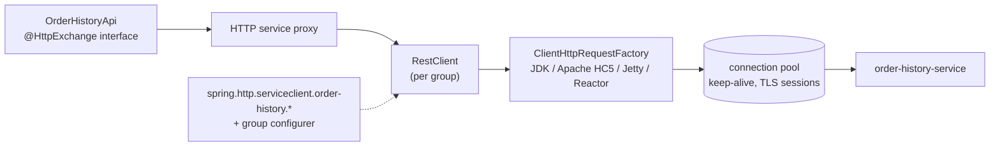

# 22. HTTP Clients

<div class="badges" markdown><span class="badge badge-l1">L1 · Foundation</span><span class="badge badge-l2">L2 · Practitioner</span><span class="badge badge-l3">L3 · Senior/Lead</span><span class="badge badge-meta">RestClient · HTTP service clients · JDK HttpClient measurements</span></div>

<div class="grid two" markdown>

!!! info "Prerequisites"
    - [Chapter 8](../foundations/ch08-spring-boot-4-essentials.md): HTTP service clients and groups, first look
    - [Chapter 21](ch21-rest-api-design.md): the API this chapter's client calls

!!! abstract "What you'll learn"
    - Which Spring client to use in 2026: **RestClient**, **HTTP service clients**, **WebClient**; RestTemplate's deprecation and OpenFeign's status
    - Measured: a **new client per call** costs **6–7×** at p50 over TLS; **no timeout** means waiting forever; **virtual threads** ran 1,000 slow calls **7×** faster than a 50-thread pool
    - Turning **RFC 9457 problems** into exceptions callers can act on
    - Client-side habits: **following cursors**, **revalidating with ETags**, timeouts per group
    - **Migrating from OpenFeign** annotation by annotation

</div>

---

## 1 · Introduction & Context

### The client is half of every API

Chapter 21 made order-history-service a well-behaved server. tracking-service, its caller, can still undo most of that:

- It created a `RestTemplate` per request "to be safe", paying a new TCP connection and TLS handshake every time.
- It had no read timeout, so when order-history stalled during a database failover, tracking-service's threads all waited, and its own health checks failed.
- It turned every 4xx into "something went wrong", ignoring the problem document that said exactly what to fix.
- It fetched page after page of order history it never displayed, and re-downloaded unchanged orders on every screen refresh.

Every one of these is a client-side decision, and in Spring Boot 4 most of them are a line of configuration.

### The Spring client landscape in 2026

| Client | Style | Status | Use it for |
|---|---|---|---|
| **RestClient** | Fluent, synchronous | Recommended | Most service-to-service calls; with virtual threads, blocking is cheap |
| **HTTP service clients** (`@HttpExchange` interfaces) | Declarative, on RestClient or WebClient | Recommended; groups and Boot properties since Spring Framework 7 / Boot 4 | Calling a service with more than one or two endpoints |
| **WebClient** | Fluent, reactive | Actively maintained | Reactive applications, streaming responses, backpressure |
| **RestTemplate** | Template, synchronous | Deprecation announced in 7.0; to be formally deprecated in 7.1 and removed in 8.0 | Migrate to RestClient |
| **Spring Cloud OpenFeign** | Declarative | Feature-complete; the project suggests migrating to HTTP service clients | Existing code, until migrated |

### Where it comes from

<ul class="mh-timeline">
<li><span class="when">2009 · RestTemplate</span><span class="what">Spring 3's template-style HTTP client.</span></li>
<li><span class="when">2013–2016 · Feign, Spring Cloud OpenFeign</span><span class="what">Netflix's declarative clients: an annotated interface instead of code.</span></li>
<li><span class="when">2017 · WebClient</span><span class="what">Spring 5's reactive client; RestTemplate enters maintenance.</span></li>
<li><span class="when">2018 · JDK HttpClient</span><span class="what">Java 11's standard client: HTTP/2, sync and async.</span></li>
<li><span class="when">2022–2023 · HTTP interfaces, RestClient</span><span class="what">Spring 6 adds <code>@HttpExchange</code> interfaces (6.0) and RestClient (6.1).</span></li>
<li><span class="when">2025 · Spring Framework 7, Boot 4</span><span class="what">HTTP service groups with <code>@ImportHttpServices</code> and Boot properties; RestTemplate deprecation announced.</span></li>
</ul>

---

## 2 · Core Concepts & Terminology



HTTP service client
:   An interface annotated with `@HttpExchange`/`@GetExchange`; Spring generates the implementation on top of a RestClient (or WebClient).

Group
:   A set of HTTP service interfaces sharing one configured client: base URL, timeouts, error handling, interceptors. Declared with `@ImportHttpServices(group = …)`, configured with `spring.http.serviceclient.<group>.*` and an `…HttpServiceGroupConfigurer` bean.

Request factory
:   The engine underneath RestClient. Spring Boot picks one from the classpath (Apache HttpClient 5, Jetty, Reactor Netty, then the JDK's `HttpClient`); all pool connections.

Connect timeout / read timeout
:   How long to wait for a connection, and for response data. Neither has a safe default: the JDK client's request timeout is unset (infinite) unless configured.

---

## 3 · How It Works Internally

### Connection reuse

An HTTP client keeps a pool of open connections per host. Reusing one skips DNS, the TCP handshake and, over HTTPS, the TLS handshake (key exchange, certificate verification). A client created per request has an empty pool every time, and it is also an object to build, a selector thread to start and resources to release.

```java title="experiment/ClientExperiments.java (reuse)"
--8<-- "code/chapters/ch22-http-clients/src/main/java/dev/foodfleet/ch22/experiment/ClientExperiments.java:55:75"
```

In Spring: inject the auto-configured `RestClient.Builder` (or use HTTP service groups) and build clients **once**, as beans.

### Timeouts: bounded waiting

A request without a timeout waits as long as the server takes. With platform threads that exhausts the pool (chapter 18); with virtual threads it accumulates connections, memory and callers instead. Set both:

```yaml
spring:
  http:
    serviceclient:
      order-history:
        connect-timeout: 500ms    # a dead or unreachable host fails fast
        read-timeout: 2s          # below this service's own budget for the caller
```

One JDK detail the experiment exposed: `HttpClient.close()` **waits for in-flight requests**. A client with a hung request takes as long to close as the request takes to hang; `shutdownNow()` aborts them.

### Blocking calls on virtual threads

A blocking `send()` on a **platform** thread holds that thread for the whole round trip; a pool of 50 can have at most 50 calls in flight. On a **virtual** thread, blocking parks the virtual thread and frees its carrier; thousands of calls can be in flight with plain, sequential code. With `spring.threads.virtual.enabled=true`, Spring MVC requests run on virtual threads, so RestClient's blocking style is no longer a scalability compromise: that is why RestClient, not WebClient, is the default recommendation for MVC services.

```java title="experiment/ClientExperiments.java (concurrency)"
--8<-- "code/chapters/ch22-http-clients/src/main/java/dev/foodfleet/ch22/experiment/ClientExperiments.java:107:140"
```

### Errors: reading what the server said

A RestClient throws on 4xx/5xx by default, but the exception's message doesn't include the problem document. A group-wide status handler turns RFC 9457 responses into an exception with `type`, `title`, `status` and extensions, and keeps the body for anything else:

```java title="client/ProblemDetailErrorHandler.java"
--8<-- "code/chapters/ch22-http-clients/src/main/java/dev/foodfleet/ch22/client/ProblemDetailErrorHandler.java:16:53"
```

---

## 4 · Design Considerations & Trade-offs

### Measured: three client decisions

The JDK `HttpClient` (one of RestClient's engines) against a local server on a 2-vCPU container (JDK 21 runtime). Verified output; across three runs the numbers stayed within the ranges noted.

**1. Reuse over HTTPS: 300 sequential GETs**

| Client | p50 | p99 | Total |
|---|---:|---:|---:|
| One shared client (keep-alive) | **2.14 ms** | 8.18 ms | 735 ms |
| New client per call (new TLS handshake) | **15.75 ms** | 33.64 ms | 5,090 ms |

A client per call cost **7×** at the median here (6–7× across runs: 2.1–2.6 ms vs 13.7–16.2 ms) on loopback, with no network latency at all. Across a real network each new connection adds round trips for TCP and TLS on top, and the server pays for every handshake too.

**2. Timeouts: an endpoint that takes 60 s**

| Client | Outcome |
|---|---|
| No request timeout | Still blocked after 3,005 ms (we stopped watching): a caller, a connection and a request held |
| 300 ms request timeout | `HttpTimeoutException` after 302 ms |

**3. Concurrency: 1,000 calls to an endpoint that takes 200 ms**

| Style | Wall time |
|---|---:|
| Blocking calls on a 50-thread platform pool | 4,173 ms |
| Blocking calls on virtual threads | **560 ms** |
| `sendAsync` (CompletableFuture API) | 1,374 ms |

- The pool's time is its arithmetic: 1,000 / 50 × 200 ms = 4 s. Concurrency is capped by threads, not by the server (which saw all 1,000 at once in the other styles).
- **Virtual threads** ran the same blocking code **7× faster** than the pool here (0.52–0.70 s across runs), within a few hundred ms of the ideal 200 ms on a 2-vCPU box doing both sides.
- The async API was also far better than the pool, but in this setup slower than virtual threads (1.1–1.4 s), and its code is harder to read and debug. For MVC services on Boot 4, blocking RestClient on virtual threads is the simpler and, here, faster choice.

### Choosing a client

| Situation | Choose |
|---|---|
| Spring MVC service calling another REST service | HTTP service client on RestClient, in a group |
| One or two ad-hoc calls | RestClient from the injected builder |
| WebFlux application, or streaming large/unbounded responses (SSE, NDJSON) | WebClient (or HTTP service client on WebClient) |
| Existing RestTemplate code | Migrate to RestClient: `RestClient.create(restTemplate)` reuses its configuration while you move call sites |
| Existing Feign clients | Migrate to HTTP service clients (table below) |
| Very high fan-out with backpressure needs | WebClient / reactive, or virtual threads with explicit concurrency limits |

### What to configure per group

| Concern | Where | FoodFleet default |
|---|---|---|
| Base URL | `spring.http.serviceclient.<group>.base-url` (or `lb://` service id with Spring Cloud LoadBalancer, [chapter 11](../architecture-patterns/ch11-service-discovery-patterns.md)) | Kubernetes Service DNS name |
| Connect / read timeout | `…connect-timeout`, `…read-timeout` | 500 ms / 2 s, tuned per dependency |
| Error handling | Group configurer: `defaultStatusHandler` | RFC 9457 → `ApiProblemException` |
| Retries, bulkheads, breakers | `@Retryable`, `@ConcurrencyLimit`, Resilience4j around the client ([chapter 18](../architecture-patterns/ch18-resilience-patterns.md)) | One layer, idempotent calls only |
| Auth | Spring Security's OAuth2 client support for HTTP service groups ([chapter 36](../security/ch36-oauth2-oidc-jwt.md)) | Client-credentials tokens per group |
| Observability | Automatic with Boot's builder: `http.client.requests` metrics and trace propagation | Always on |
| Request factory | Classpath (JDK by default; Apache HC5 or Jetty for finer pool control) | JDK |

### Migrating from OpenFeign

| OpenFeign | HTTP service client |
|---|---|
| `@FeignClient(name = "order-history", url = "…")` | `@HttpExchange` interface + `@ImportHttpServices(group = "order-history", types = …)` + `spring.http.serviceclient.order-history.base-url` |
| `@GetMapping` / `@PostMapping` on the interface | `@GetExchange` / `@PostExchange` |
| `@PathVariable`, `@RequestParam`, `@RequestHeader`, `@RequestBody` | Same annotations |
| `ErrorDecoder` | `defaultStatusHandler` in the group configurer |
| `RequestInterceptor` | `requestInterceptor(…)` on the group's builder |
| `Retryer` | `@Retryable` (Spring Framework 7) or Resilience4j |
| Fallbacks via Spring Cloud CircuitBreaker | Spring Cloud CircuitBreaker around the call ([chapter 18](../architecture-patterns/ch18-resilience-patterns.md)) |
| Load balancing by `name` | Group with an `lb://` base URL and Spring Cloud LoadBalancer |
| `feign.client.config.<name>.*` timeouts | `spring.http.serviceclient.<group>.*` |

Migrate one client at a time: both can coexist, and contract tests ([chapter 27](ch27-api-contracts.md)) confirm the new client sends the same requests.

---

## 5 · Hands-on Implementation

Code: `code/chapters/ch22-http-clients/`.

```bash
cd code
mvn -B -pl chapters/ch22-http-clients -am verify
java -cp chapters/ch22-http-clients/target/classes dev.foodfleet.ch22.experiment.ClientExperiments
```

### 🟢 Level 1: the interface

<div class="badges" markdown><span class="badge badge-l1">L1 · Foundation</span></div>

```java title="client/OrderHistoryApi.java"
--8<-- "code/chapters/ch22-http-clients/src/main/java/dev/foodfleet/ch22/client/OrderHistoryApi.java"
```

### 🔵 Level 2: the group and its configuration

<div class="badges" markdown><span class="badge badge-l2">L2 · Practitioner</span></div>

```java title="client/ClientConfiguration.java"
--8<-- "code/chapters/ch22-http-clients/src/main/java/dev/foodfleet/ch22/client/ClientConfiguration.java"
```

```yaml title="application.yml"
--8<-- "code/chapters/ch22-http-clients/src/main/resources/application.yml"
```

### 🟣 Level 3: following cursors and revalidating

<div class="badges" markdown><span class="badge badge-l3">L3 · Senior/Lead</span></div>

```java title="client/OrderHistoryReader.java"
--8<-- "code/chapters/ch22-http-clients/src/main/java/dev/foodfleet/ch22/client/OrderHistoryReader.java:18:102"
```

Tested against a mocked server (`MockRestServiceServer` bound to the RestClient builder), including the 304 path:

```java title="OrderHistoryApiTest.java"
--8<-- "code/chapters/ch22-http-clients/src/test/java/dev/foodfleet/ch22/client/OrderHistoryApiTest.java:23:83"
```

### Run and verify

```text
$ java -cp chapters/ch22-http-clients/target/classes dev.foodfleet.ch22.experiment.ClientExperiments
1. Reuse over HTTPS: 300 sequential GETs to a local server
                                        p50 ms   p99 ms   total ms
   one shared client (keep-alive)         2.14     8.18        735
   new client per call (new TLS)         15.75    33.64       5090
2. Timeouts: GET /hang (the server takes 60 s)
   no request timeout:    still blocked after 3005 ms (a request thread, a connection and a caller held)
   300 ms request timeout: HttpTimeoutException after 302 ms
3. Concurrency: 1,000 calls to an endpoint that takes 200 ms
   PLATFORM_POOL_50                       4173 ms
   VIRTUAL_THREADS                         560 ms
   ASYNC_API                              1374 ms
   server's peak concurrent requests: 1000
```

!!! question "Try it"
    1. Switch the experiment's client to HTTP/2 (`HttpClient.Version.HTTP_2`) over HTTPS. What happens to the reuse numbers and to the number of connections in the concurrency test?
    2. Set the concurrency test's platform pool to 1,000 threads. How does it compare with virtual threads, and what does it cost in memory?
    3. Make `OrderHistoryReader.allOrders` fetch the next page in the background while the caller reads the current one. When is that worth the complexity?
    4. Port one Feign client from your own codebase to an HTTP service client using the table above. What did you have to change besides annotations?

---

## 6 · Production Readiness

- [x] **Clients are beans**, built once from Boot's builders or HTTP service groups; never per request
- [x] **Connect and read timeouts on every group**, consistent with the caller's own budget ([chapter 18](../architecture-patterns/ch18-resilience-patterns.md))
- [x] **Errors mapped** from RFC 9457 problems to typed exceptions; bodies kept (truncated) in logs for anything else
- [x] **Retries in one layer**, idempotent requests only, with jitter
- [x] **Observability on**: `http.client.requests` metrics per client and URI template, traces propagated
- [x] **Credentials** from Spring Security's client support or a sidecar ([chapter 17](../architecture-patterns/ch17-sidecar-ambassador-adapter.md)), never hard-coded
- [x] **Pool sizing and keep-alive** reviewed for high-traffic clients (request factory choice)
- [x] **Cursors followed lazily**; no "fetch all pages" for screens that show one
- [x] **Conditional requests** for frequently re-read resources
- [x] **No RestTemplate or Feign in new code**; migrations tracked

---

## 7 · Anti-patterns & Pitfalls

!!! pitfall "Incident 1: the client created per request"
    **Context.** tracking-service built a new `RestTemplate` (with a new HttpClient underneath) inside each request handler.
    **Symptoms.** p50 latency to order-history several times what the server reported; order-history's CPU showed TLS handshakes as a top consumer; ephemeral ports in TIME_WAIT on the nodes.
    **Root cause.** No connection reuse: a TCP and TLS handshake per call (measured: 15.8 ms vs 2.1 ms at p50 on loopback).
    **Fix.** HTTP service client beans in a group; one pool per destination.

!!! pitfall "Incident 2: the failover that took tracking down with it"
    **Context.** order-history's database failed over; queries stalled for 40 s.
    **Symptoms.** tracking-service stopped answering, including endpoints that don't call order-history; Kubernetes restarted it in a loop.
    **Root cause.** No read timeout on the client: every request waited on order-history (chapter 18's cascading failure).
    **Fix.** Group timeouts (500 ms connect, 2 s read) and a bulkhead; the screen shows cached history when order-history is slow.

!!! pitfall "Incident 3: 'invalid request' with no explanation"
    **Context.** The app sent malformed cursors after a client update.
    **Symptoms.** Logs showed `400 Bad Request` thousands of times; nobody knew why for a day.
    **Root cause.** The client discarded response bodies on errors; the server's problem document said exactly what was wrong.
    **Fix.** A status handler mapping problems to `ApiProblemException` with `type` and `detail`, logged and alerted by type.

| Anti-pattern | Symptom | Fix |
|---|---|---|
| New client per call | Handshakes, latency, exhausted ports | Clients as beans |
| No timeouts | Callers hang; cascading failure | Connect + read timeouts per group |
| Ignoring error bodies | Undiagnosable 4xx/5xx | Problem details → typed exceptions |
| Retrying non-idempotent POSTs | Duplicate side effects | Idempotency keys; retry only safe calls |
| Fetching all pages "just in case" | Load and latency for unused data | Lazy cursor paging |
| WebClient `.block()` everywhere in MVC | Reactive complexity, none of the benefit | RestClient on virtual threads |
| Copy-pasted client config per service | Inconsistent timeouts, auth, logging | Groups + a shared configurer |

---

## 8 · Enterprise Case Study

### FoodFleet: one way to call a service

!!! decision "ADR-022: Service calls use HTTP service clients on RestClient, configured per group"
    **Status:** Accepted · **Date:** 2024-07-29

    **Context.** Services used RestTemplate, WebClient with `.block()`, OpenFeign and hand-written JDK clients, with inconsistent timeouts and error handling. Virtual threads (ADR-008) removed the main reason for WebClient in MVC services. Spring announced RestTemplate's deprecation; Spring Cloud OpenFeign is feature-complete.

    **Decision.** MVC services call other services through `@HttpExchange` interfaces in groups (`@ImportHttpServices`), one group per destination, configured with `spring.http.serviceclient.<group>.*` (base URL, connect and read timeouts are mandatory) and the platform's group configurer (RFC 9457 error mapping, auth, user agent). WebClient is used only in WebFlux services and for streaming. No new RestTemplate or Feign code; existing usages migrate by Q4.

    **Consequences.** ✅ Consistent timeouts, errors, metrics and auth across services. ✅ Clients are interfaces, easy to fake in tests. ⚠️ A migration effort for ~60 Feign clients and ~40 RestTemplate call sites. ⚠️ Teams must understand virtual-thread pinning and concurrency limits ([chapter 8](../foundations/ch08-spring-boot-4-essentials.md)).

### Fintech analogue: calling payment networks and core banking 🔴

Payment services call external gateways with strict timeouts (the customer is waiting), mutual TLS with long-lived pooled connections (handshakes are expensive and some gateways rate-limit new connections), never-retried POSTs without idempotency keys, and status-check endpoints to resolve unknown outcomes. Client configuration is reviewed like code because a wrong timeout means either double charges or failed payments.

### E-commerce analogue: the product page aggregator

A product page backend calls price, stock, reviews and recommendations in parallel. With virtual threads it does that with straightforward blocking calls in a structured way, each with its own timeout and fallback, rather than a reactive pipeline; the page still renders when one call is slow.

---

## 9 · Interview Q&A + Summary

#### Q1. RestTemplate, RestClient, WebClient: which and why? · <span class="badge badge-l1">L1</span><span class="badge badge-l2">L2</span> · Cognizant · SAP · Flipkart

**Short answer:** RestClient (synchronous, fluent) for most cases; WebClient for reactive applications and streaming. RestTemplate's deprecation was announced in Spring Framework 7.0, with formal deprecation planned for 7.1 and removal in 8.0; migrate to RestClient.

#### Q2. What are HTTP service clients? · <span class="badge badge-l2">L2</span> · SAP · Flipkart

**Short answer:** Interfaces annotated with `@HttpExchange` for which Spring generates the client on top of RestClient or WebClient. Since Spring Framework 7/Boot 4 they are organised in groups (`@ImportHttpServices`) configured by properties and configurers.

#### Q3. Why not create a client per request? · <span class="badge badge-l1">L1</span><span class="badge badge-l2">L2</span> · Amazon · Cognizant

**Short answer:** You lose connection reuse: every call pays TCP and TLS handshakes, and you churn threads, sockets and memory. Measured here: 15.8 ms vs 2.1 ms at p50 on loopback over TLS. Build clients once.

#### Q4. Connect timeout vs read timeout? · <span class="badge badge-l2">L2</span> · Amazon · JP Morgan

**Short answer:** Connect timeout bounds establishing the connection (dead host, full backlog); read timeout bounds waiting for response data. Both must be set; defaults are often infinite or very long.

#### Q5. Is a blocking HTTP client a scalability problem? · <span class="badge badge-l2">L2</span><span class="badge badge-l3">L3</span> · Flipkart · Goldman Sachs

**Short answer:** On platform threads, yes: concurrency is capped by the pool. On virtual threads, blocking parks cheaply; measured here, 1,000 concurrent 200 ms calls took 0.56 s on virtual threads vs 4.2 s on a 50-thread pool. Still bound concurrency explicitly to protect the dependency.

#### Q6. When would you still use WebClient? · <span class="badge badge-l2">L2</span><span class="badge badge-l3">L3</span> · any

**Short answer:** In WebFlux applications, for streaming responses (SSE, large NDJSON), and where reactive composition and backpressure across many concurrent streams are genuinely needed.

#### Q7. How do you handle error responses from another service? · <span class="badge badge-l2">L2</span> · SAP · Amazon

**Short answer:** Map them in one place (a default status handler): RFC 9457 problems into typed exceptions carrying `type` and details, others into exceptions with status and a truncated body; decide per type whether to retry, fix input, or fail.

#### Q8. How would you migrate from Feign? · <span class="badge badge-l2">L2</span><span class="badge badge-l3">L3</span> · Cognizant · SAP

**Short answer:** Replace `@FeignClient` with an `@HttpExchange` interface in an HTTP service group; Spring MVC annotations map to `@GetExchange` etc.; ErrorDecoder → status handler, RequestInterceptor → request interceptor, Retryer → `@Retryable`; timeouts move to `spring.http.serviceclient.<group>.*`. Migrate per client with contract tests.

#### Q9. What should every service client have configured? · <span class="badge badge-l2">L2</span> · any

**Short answer:** Base URL from configuration, connect and read timeouts, error mapping, auth, observability (metrics and trace propagation), and resilience (bulkhead, retries only where safe).

#### Q10. Sync or async API with virtual threads? · <span class="badge badge-l3">L3</span> · Goldman Sachs · Amazon

**Short answer:** Prefer synchronous calls on virtual threads for readability and debuggability; use structured concurrency or parallel calls for fan-out. Async/reactive APIs remain useful for streaming and backpressure, not for basic concurrency.

#### Q11. How should a client consume a paginated API? · <span class="badge badge-l2">L2</span> · any

**Short answer:** Follow the server's cursor or `next` link without interpreting it, fetch pages lazily as the caller needs them, respect the page-size maximum, and handle an invalid-cursor problem by restarting from the first page.

#### Q12. How do ETags help a client? · <span class="badge badge-l2">L2</span><span class="badge badge-l3">L3</span> · any

**Short answer:** The client keeps the last representation and its ETag and sends If-None-Match; a 304 means no body to transfer or parse. For updates, it sends If-Match so it never overwrites changes it hasn't seen.

### Key takeaways

- **RestClient** and **HTTP service clients** for MVC services; **WebClient** for reactive and streaming; RestTemplate and Feign are on their way out.
- **Build clients once**: a client per call cost **7×** at p50 over TLS here.
- **Always set timeouts**: without one, a hung server holds the caller indefinitely.
- On **virtual threads**, simple blocking code ran 1,000 slow calls **7×** faster than a 50-thread pool.
- Make the client honour the server's contract: **problem types**, **cursors**, **ETags**.

### Further reading

- Spring blog, [The state of HTTP clients in Spring](https://spring.io/blog/2025/09/30/the-state-of-http-clients-in-spring/) (2025) and [HTTP Service Client Enhancements](https://spring.io/blog/2025/09/23/http-service-client-enhancements/) (2025)
- Spring Framework reference, [REST Clients](https://docs.spring.io/spring-framework/reference/integration/rest-clients.html)
- Spring Cloud OpenFeign reference, [project status note](https://docs.spring.io/spring-cloud-openfeign/reference/spring-cloud-openfeign.html)
- JDK `java.net.http.HttpClient` API documentation, and JEP 444 (virtual threads)

---

**Previous:** [← 21. Synchronous REST](ch21-rest-api-design.md) · **Next:** [23. gRPC & Protocol Buffers →](ch23-grpc.md)
