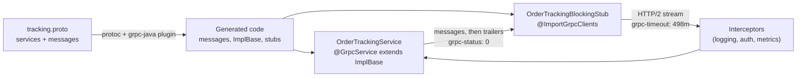
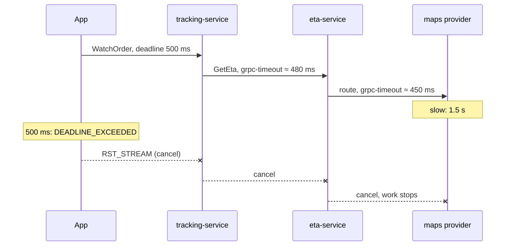

# 23. gRPC & Protocol Buffers

<div class="badges" markdown><span class="badge badge-l2">L2 · Practitioner</span><span class="badge badge-l3">L3 · Senior/Lead</span><span class="badge badge-meta">Spring gRPC in Boot 4.1 · wire format verified · deadline propagation measured</span></div>

<div class="grid two" markdown>

!!! info "Prerequisites"
    - [Chapter 21](ch21-rest-api-design.md): resource APIs, errors and versioning over HTTP
    - [Chapter 22](ch22-http-clients.md): clients, timeouts and reuse
    - [Chapter 18](../architecture-patterns/ch18-resilience-patterns.md): timeouts and cascading failure

!!! abstract "What you'll learn"
    - How **Protocol Buffers** encode a message, byte by byte, and why **field numbers** are the contract
    - Measured: protobuf is **2.5× smaller** than JSON per message, but a gzipped JSON stream was **smaller still**: size alone is a weak reason to choose gRPC
    - **Unary and streaming** RPCs with **Spring gRPC**, built into Spring Boot 4.1
    - Measured: **propagated deadlines** cut wasted downstream work from **639 ms to 2 ms** per request in an incident
    - Interceptors, **status codes**, schema evolution, **load balancing** on Kubernetes, and when REST still wins

</div>

---

## 1 · Introduction & Context

### The tracking screen

When a customer opens FoodFleet's tracking screen, the app needs the order's stage, the ETA and the rider's position, refreshed every five seconds for half an hour. Behind it, tracking-service asks eta-service, which asks a maps provider for a route.

In 2024 all of this was REST and polling:

- The app polled `GET /orders/{id}/tracking` every 5 seconds: 360 requests per order, almost all returning "nothing changed".
- tracking-service called eta-service with a 1-second timeout, eta-service called maps with its own 1-second timeout. When the app gave up after 500 ms, both kept working on an answer nobody would read.
- The JSON contract between tracking and eta lived in a wiki page. A renamed field broke the ETA on Android for a day.

gRPC addresses all three: a **server stream** replaces polling, a **deadline** travels with the call down the chain, and a **`.proto` file** is a contract that generates the code on both sides. It also brings costs: a binary protocol you can't `curl`, HTTP/2 connections that confuse simple load balancers, and generated code in the build.

### What gRPC is

gRPC is a remote procedure call framework: you define services and messages in a `.proto` file, generate client stubs and server base classes in each language, and calls travel over HTTP/2 with messages encoded as Protocol Buffers.

| | REST with JSON (chapter 21) | gRPC |
|---|---|---|
| Contract | OpenAPI, often written after the code | `.proto` file, code generated from it |
| Payload | JSON text | Protocol Buffers binary (JSON mapping available) |
| Transport | HTTP/1.1 or HTTP/2 | HTTP/2 only (gRPC-Web or a gateway for browsers) |
| Interaction | Request/response; SSE or WebSocket for streams | Unary, server, client and bidirectional streaming |
| Deadlines | Each client sets its own timeout | Deadline sent with the call, propagated by the framework |
| Errors | HTTP status + RFC 9457 body | 17 gRPC status codes + optional rich details |
| Tooling | curl, browsers, every proxy and cache | grpcurl, Postman, reflection; needs HTTP/2-aware proxies |

### Where it comes from

<ul class="mh-timeline">
<li><span class="when">2001 · Protocol Buffers at Google</span><span class="what">A compact, schema-based format for Google's internal RPC system, Stubby.</span></li>
<li><span class="when">2008 · protobuf open-sourced</span><span class="what">proto2; Thrift (Facebook, 2007) and Avro (2009) follow similar ideas.</span></li>
<li><span class="when">2015 · gRPC and HTTP/2</span><span class="what">Google open-sources gRPC, a Stubby successor built on the new HTTP/2 standard.</span></li>
<li><span class="when">2016 · gRPC 1.0, proto3</span><span class="what">Simpler proto3 syntax (no required fields, defaults not sent) and a canonical JSON mapping.</span></li>
<li><span class="when">2017 · CNCF</span><span class="what">gRPC joins the Cloud Native Computing Foundation; Envoy and service meshes speak it natively.</span></li>
<li><span class="when">2025 · Spring gRPC 1.0</span><span class="what">An official Spring project (promoted in May, 1.0 in December) for Boot 4.</span></li>
<li><span class="when">2026 · Spring Boot 4.1</span><span class="what">gRPC auto-configuration moves into Spring Boot itself: <code>spring-boot-starter-grpc-server</code> and <code>-client</code>.</span></li>
</ul>

---

## 2 · Core Concepts & Terminology



Protocol Buffers (protobuf)
:   A language-neutral schema language and binary encoding. A message is a list of fields, each identified on the wire by its **field number**, never its name.

Service, RPC, stub
:   A `.proto` `service` declares RPC methods. Code generation produces a server base class (`OrderTrackingImplBase`) to extend and client **stubs**: blocking, asynchronous and future-based.

Four RPC types
:   **Unary** (one request, one response); **server streaming** (one request, many responses: `WatchOrder`); **client streaming** (many requests, one response: uploading GPS points); **bidirectional** (both sides stream independently: chat, live dispatch).

Channel
:   A client's logical connection to a target, managing one or more HTTP/2 connections, name resolution and load balancing. Expensive to create; shared and long-lived, like chapter 22's HTTP clients.

Deadline
:   An absolute point in time by which the caller needs an answer, sent as the `grpc-timeout` header and, in grpc-java, propagated to calls the server makes while handling the request.

Status code
:   The outcome of every call: `OK` or one of 16 error codes (`NOT_FOUND`, `INVALID_ARGUMENT`, `DEADLINE_EXCEEDED`, `UNAVAILABLE`, …), sent in HTTP/2 trailers.

Interceptor
:   Code that wraps every call on the client or server: logging, authentication, metrics, tracing. The gRPC counterpart of a servlet filter.

---

## 3 · How It Works Internally

### A message on the wire

Here is one `OrderStatus` from `tracking.proto`, encoded. The chapter's `ProtoWriter` writes it by hand, and `verify/verify_wire.py` builds the same schema with Google's protobuf runtime: **the 104 bytes are identical**.

```protobuf
--8<-- "code/chapters/ch23-grpc/src/main/proto/foodfleet/tracking/v1/tracking.proto:46:54"
```

```text
0a 11 6f2d32303236313030362d303030303432   field 1, LEN, 17 bytes: "o-20261006-000042"
10 03                                      field 2, VARINT: 3 (PICKED_UP)
18 11                                      field 3, VARINT: 17 (eta_minutes)
22 26 0a06722d37373331 1208537572...       field 4, LEN, 38 bytes: the Rider message
2a 0b 08cde793d606 10809c9c39              field 5, LEN, 11 bytes: Timestamp {seconds, nanos}
32 1a 4d656768616e6120466f6f6473...        field 6, LEN, 26 bytes: "Meghana Foods, Koramangala"
```

Every field starts with a **tag**: `(field_number << 3) | wire_type`. `0x0a` is field 1, wire type 2 (length-delimited); `0x10` is field 2, wire type 0 (varint). Integers are varints (small numbers take one byte); doubles take 8 bytes; strings and nested messages are a length then bytes. In proto3, fields holding their default value (0, "", false, empty) **are not written at all**.

```java
--8<-- "code/chapters/ch23-grpc/src/main/java/dev/foodfleet/ch23/wire/ProtoWriter.java:20:37"
```

Two consequences matter for design:

- **Names are not on the wire; numbers are.** Renaming `eta_minutes` breaks nothing in binary (it does break the JSON mapping). Changing field 3's number or type breaks every client.
- **Unknown fields are skipped.** A reader built from an older schema sees field 8, reads its wire type, skips the right number of bytes and carries on (the Java and Python runtimes even keep it and write it back out). The verification run confirmed it: *"v1 reader on v2 bytes: fields it knows intact: True | unknown field kept, re-serialised: True"*. That is why adding a field is a compatible change.

### A call on the wire

A gRPC call is one **HTTP/2 stream**:

1. **Request headers**: `:method POST`, `:path /foodfleet.tracking.v1.OrderTracking/GetStatus`, `content-type: application/grpc`, `grpc-timeout: 498m` (the remaining deadline), plus metadata (your own headers, such as auth tokens).
2. **Messages**: each prefixed with 5 bytes: a compressed flag and a 4-byte length. A stream is simply more of them on the same HTTP/2 stream.
3. **Trailers**: `grpc-status: 0` and optionally `grpc-message`. The status arrives *after* the data, so a stream can fail halfway and still say why.

Many calls share one TCP connection, multiplexed as separate streams. Cancelling a call sends `RST_STREAM` for that stream only. Flow control windows per stream stop a fast server from flooding a slow client.

### Deadlines propagate

The client sets a deadline (`withDeadlineAfter(500, MILLISECONDS)`); it travels as `grpc-timeout`. On the server, grpc-java puts the deadline in the request's `Context`, and **any call the server makes while handling the request inherits it**: if 380 ms remain, eta-service's call to maps gets at most 380 ms. When the deadline passes, the client cancels, the server's context is cancelled, and that cancellation reaches the downstream calls too.



With plain HTTP, every hop has its own fixed timeout and knows nothing of the caller's. Chapter 22 set them per client group; gRPC passes the remaining budget along automatically.

### What Spring Boot sets up

Since Spring Boot 4.1, gRPC support is part of Boot itself (Spring gRPC 1.1 moved its auto-configuration there):

- `spring-boot-starter-grpc-server` runs a Netty-based gRPC server on port **9090** and registers every `@GrpcService` bean. With `io.grpc:grpc-services` on the classpath, it also adds the standard **health** service (bridged to Spring Boot health) and **server reflection** (so `grpcurl` can list services).
- `spring-boot-starter-grpc-client` creates channels from `spring.grpc.client.channel.<name>.*` and stub beans from `@ImportGrpcClients`. Micrometer observation (metrics and traces) is added to clients automatically when Micrometer is present.
- The `protobuf-maven-plugin` generates code from `src/main/proto`; Boot's parent POM already configures `protoc` and the grpc-java plugin versions.
- Tests can swap every channel for an in-process one with `@AutoConfigureTestGrpcTransport`: real gRPC, no ports.

---

## 4 · Design Considerations & Trade-offs

### Measured: is protobuf smaller?

The same data as protobuf and as proto3's canonical JSON (what a JSON API would return): one `OrderStatus`, and a 30-minute ride of 360 rider positions sent as separate messages (what `WatchOrder` streams). Verified output, cross-checked with Google's runtime:

| Bytes on the wire | Protobuf | JSON | JSON / protobuf |
|---|---:|---:|---:|
| One `OrderStatus` | **104** | 255 | 2.45× |
| One `OrderStatus`, gzip | 124 | 217 | 1.75× |
| Ride: 360 positions, raw | **16,920** | 43,114 | 2.55× |
| Ride, each message gzipped (how gRPC compresses) | 23,840 | 44,563 | 1.87× |
| Ride, whole stream gzipped at once | 5,558 | **3,539** | 0.64× |

- Uncompressed, protobuf is **2.5× smaller**: no field names, no quotes, binary numbers.
- **Gzip on a single small message made both larger** for protobuf (104 → 124 bytes): the gzip header and dictionary cost more than they save. gRPC compresses per message, so for small streamed messages, compression is usually off.
- **Compressed as one stream, JSON beat protobuf.** Repeated field names are exactly what gzip removes, while protobuf's dense doubles look random. A JSON API behind a gzipping proxy is not much bigger than gRPC on the wire.

The lesson: **don't choose gRPC for payload size alone.** Choose it for the contract and code generation, streaming, deadlines, and cheaper encoding and decoding (no text parsing).

### Measured: fixed timeouts vs propagated deadlines

A simulation of tracking (20 ms of work) → eta (30 ms) → maps, with the app's deadline at 500 ms, 10,000 requests per row. In the incident, maps takes ~1.5 s for 60% of calls. Each request is computed independently, so the numbers isolate the effect of deadlines (no queueing).

| Maps | Mode | Succeeded | Maps busy per request | Work after the app gave up | p99 time held |
|---|---|---:|---:|---:|---:|
| Healthy | Fixed 1 s timeout per hop | 100.0% | 40 ms | 0 ms | 130 ms |
| Healthy | Propagated deadline | 100.0% | 40 ms | 0 ms | 130 ms |
| 60% slow | Fixed 1 s timeout per hop | 39.3% | 928 ms | **639 ms** | 1,841 ms |
| 60% slow | Propagated deadline | 39.3% | 291 ms | **2 ms** | 504 ms |

- Users see **the same success rate** either way: once maps is slow, the 500 ms answer is lost regardless.
- What changes is the **waste**. With fixed timeouts, every hop kept working for up to 1.8 s on answers the app had already abandoned, and maps was busy **3.2× longer** per request. In a real incident that is extra load on the very dependency that is struggling, plus threads and connections held in every service in between (chapter 18's cascading failure).
- With a propagated deadline, cancellation reached maps within the 2 ms per hop it took to travel, and nothing in the chain held a request past ~504 ms.

```java
--8<-- "code/chapters/ch23-grpc/src/main/java/dev/foodfleet/ch23/deadline/DeadlineSimulation.java:57:69"
```

### gRPC or REST?

| Choose gRPC when… | Choose REST/JSON when… |
|---|---|
| Internal service-to-service calls with many consumers in several languages | Public or partner APIs; browsers calling directly |
| You need streaming (live tracking, telemetry, dispatch) | Request/response is all you need |
| Latency-sensitive chains where deadlines and cancellation matter | Caching by intermediaries (CDNs, `ETag`s) matters |
| The contract should generate code and be checked in CI | Consumers want `curl` and human-readable payloads |
| High message rates where JSON parsing shows up in CPU profiles | Teams and tooling are HTTP-only (some gateways, WAFs, proxies) |

Many systems use both: **REST at the edge, gRPC inside**, or a gRPC service exposed to browsers through **gRPC-Web**, the **Connect** protocol, or JSON transcoding at the gateway.

### Schema evolution rules

| Change | Safe? | Why |
|---|---|---|
| Add a field with a new number | ✅ | Old readers skip it; new readers see the default when it's missing |
| Remove a field, `reserved` its number and name | ✅ | Prevents someone reusing the number for different data |
| Rename a field | ⚠️ | Binary-compatible; breaks JSON mapping and source code |
| Change a field's type | ❌ (mostly) | Different wire types or interpretation; a few pairs (int32/int64/uint32/bool) are compatible |
| Reuse a removed field's number | ❌ | Old clients decode new data as the old meaning |
| Add an enum value | ✅ with care | Old clients see an unknown value; always define `*_UNSPECIFIED = 0` and handle unknowns |
| Change the package (`v1` → `v2`) | New API | A different service name; run both during migration |

Run a breaking-change check (for example `buf breaking`) against the main branch in CI, so these rules are enforced by tooling rather than memory.

### Load balancing: the HTTP/2 trap

gRPC keeps one long-lived HTTP/2 connection per backend and multiplexes calls on it. A Kubernetes `ClusterIP` Service balances **connections** (layer 4), not requests, so a client that opened its connection to pod A keeps sending every call to pod A, even after you scale to ten pods. Options:

- **Client-side load balancing**: a headless Service (`clusterIP: None`) so DNS returns every pod IP, a `dns:///eta-service.foodfleet.svc.cluster.local:9090` target and the `round_robin` policy (grpc-java defaults to `pick_first`).
- **A layer-7 proxy or mesh** (Envoy, Istio, Linkerd: [chapter 57](../deployment/ch57-service-mesh.md)) that balances individual requests.
- **Server-side max connection age**, so clients reconnect periodically and spread out after a scale-up.

---

## 5 · Hands-on Implementation

The example is tracking-service's `OrderTracking` API: `GetStatus` (unary) and `WatchOrder` (server streaming).

```text
ch23-grpc/
├── src/main/proto/foodfleet/tracking/v1/tracking.proto   the contract
├── src/main/java/dev/foodfleet/ch23/
│   ├── wire/       ProtoWriter, ProtoReader, PayloadComparison (the measurements above)
│   ├── deadline/   DeadlineSimulation
│   └── grpc/       TrackingApplication, OrderTrackingService, TrackingStore,
│                   GrpcServerConfig, RequestLoggingInterceptor, TrackingClient
└── verify/verify_wire.py   cross-check with Google's protobuf runtime
```

### 🔵 Level 2: the contract and the build

<div class="badges" markdown><span class="badge badge-l2">L2 · Practitioner</span></div>

The `.proto` file is the API. Note the versioned package, the `UNSPECIFIED` zero enum value, `oneof` for "either a status or a position", and the `reserved` number.

```protobuf
--8<-- "code/chapters/ch23-grpc/src/main/proto/foodfleet/tracking/v1/tracking.proto"
```

Two starters, the health/reflection library, the test starters and the code generator. No plugin configuration: Spring Boot's parent sets the `protoc` and grpc-java versions.

```xml
--8<-- "code/chapters/ch23-grpc/pom.xml:24:70"
```

```yaml
--8<-- "code/chapters/ch23-grpc/src/main/resources/application.yml"
```

### 🔵 Level 2: unary and streaming service

<div class="badges" markdown><span class="badge badge-l2">L2 · Practitioner</span></div>

A `@GrpcService` extends the generated base class. Unary: one `onNext`, then `onCompleted`, or `onError` with a status. Streaming: `onNext` as often as needed. Two details matter for streams: `StreamObserver` is **not thread-safe** (events arrive on publishing threads, so calls are synchronised), and the **cancel handler** stops the subscription when the client leaves or its deadline passes.

```java
--8<-- "code/chapters/ch23-grpc/src/main/java/dev/foodfleet/ch23/grpc/OrderTrackingService.java:19:69"
```

### 🟣 Level 3: interceptors, errors and the client

<div class="badges" markdown><span class="badge badge-l3">L3 · Senior/Lead</span></div>

Server-wide concerns live in one configuration: a `@GlobalServerInterceptor` applied to every service, and a `GrpcExceptionHandler` that turns domain exceptions into status codes (returning `null` for exceptions it doesn't classify; they become `UNKNOWN`).

```java
--8<-- "code/chapters/ch23-grpc/src/main/java/dev/foodfleet/ch23/grpc/GrpcServerConfig.java:11:32"
```

```java
--8<-- "code/chapters/ch23-grpc/src/main/java/dev/foodfleet/ch23/grpc/RequestLoggingInterceptor.java:24:39"
```

On the client side, `@ImportGrpcClients(target = "tracking", types = OrderTrackingGrpc.OrderTrackingBlockingStub.class)` on the application class creates a stub bean on the `tracking` channel. Every call gets a deadline, and status codes become decisions:

```java
--8<-- "code/chapters/ch23-grpc/src/main/java/dev/foodfleet/ch23/grpc/TrackingClient.java:13:38"
```

The blocking stub fits the rest of the handbook's style: on virtual threads ([chapter 8](../foundations/ch08-spring-boot-4-essentials.md)), a blocked call costs little. Use the async stub when you need to consume a stream without holding a thread, or to run client- and bidirectional streams.

### 🟣 Level 3: testing over the in-process transport

<div class="badges" markdown><span class="badge badge-l3">L3 · Senior/Lead</span></div>

`@AutoConfigureTestGrpcTransport` replaces the channels with in-process ones: the test goes through real serialisation, status codes, deadlines and cancellation without opening a port. The last test shows the deadline's effect on the *server*: when the client's 300 ms pass, its subscription is removed.

```java
--8<-- "code/chapters/ch23-grpc/src/test/java/dev/foodfleet/ch23/grpc/OrderTrackingServiceTest.java:27:98"
```

### 🔴 Level 4: the platform view

<div class="badges" markdown><span class="badge badge-l4">L4 · Architect</span></div>

At scale, what matters is less the code than the rules around it:

- **One repository of `.proto` files** (or a schema registry such as the Buf Schema Registry), with CI running lint and breaking-change checks; services depend on generated artifacts, not copied files.
- **A platform starter** that adds the standard interceptors (auth, tenant, logging), the exception handler conventions and channel defaults (TLS bundle, keepalive, max message size), the way chapter 22's group configurer did for HTTP.
- **Deadline budgets per user journey**: the edge sets the deadline; services never extend it, and alerts fire on calls arriving without one.
- **Load balancing decided once** for the platform (mesh or client-side) rather than discovered per incident.

### Run and verify

```text
$ java -cp chapters/ch23-grpc/target/classes dev.foodfleet.ch23.wire.PayloadComparison
bytes on the wire                                 protobuf      JSON   ratio
one OrderStatus                                        104       255   2.45x
one OrderStatus, gzip                                  124       217   1.75x
30-min ride: 360 positions, raw                      16920     43114   2.55x
30-min ride, each message gzipped (gRPC-style)       23840     44563   1.87x
30-min ride, whole stream gzipped at once             5558      3539   0.64x

$ python3 chapters/ch23-grpc/verify/verify_wire.py <hex>
official protobuf runtime: 104 bytes
Java ProtoWriter:          104 bytes
byte-for-byte identical:   True
official parser reads the Java bytes back equal: True
v1 reader on v2 bytes: fields it knows intact: True | unknown field kept, re-serialised: True

$ java -cp chapters/ch23-grpc/target/classes dev.foodfleet.ch23.deadline.DeadlineSimulation
maps behaviour         mode                    succeeded maps busy ms/req      wasted ms/req    p99 held ms
healthy                FIXED_HOP_TIMEOUTS         100.0%               40                  0            130
healthy                PROPAGATED_DEADLINE        100.0%               40                  0            130
60% slow (~1.5 s)      FIXED_HOP_TIMEOUTS          39.3%              928                639           1841
60% slow (~1.5 s)      PROPAGATED_DEADLINE         39.3%              291                  2            504
```

With the service running (`mvn -pl chapters/ch23-grpc spring-boot:run`), reflection lets you explore it without the `.proto` file:

```bash
grpcurl -plaintext localhost:9090 list
grpcurl -plaintext -d '{"order_id":"o-1"}' localhost:9090 foodfleet.tracking.v1.OrderTracking/GetStatus
# ERROR: Code: NotFound  Message: no order o-1     (the store starts empty)
```

!!! question "Try it"
    1. Add `google.protobuf.Timestamp promised_by = 8;` to `OrderStatus`, regenerate, and call the new server from a client built with the old stubs. What does the old client see? Then try reusing number 7.
    2. Change `TrackingClient` to call eta-service inside a gRPC request and log `Context.current().getDeadline()` in eta-service. How much of the budget arrives?
    3. Make `WatchOrder` respect flow control: use `isReady()` and `setOnReadyHandler` to coalesce rider positions when the client is slow.
    4. Scale a gRPC server to three pods behind a ClusterIP Service and run a load test from one client. How are calls distributed? Repeat with a headless Service and `round_robin`.

---

## 6 · Production Readiness

- [x] **`.proto` files versioned and reviewed**, with lint and breaking-change checks in CI; `reserved` for every removed field
- [x] **Every call has a deadline**, set at the edge and propagated; servers log or reject calls without one
- [x] **Status codes used deliberately**: `INVALID_ARGUMENT` vs `FAILED_PRECONDITION` vs `NOT_FOUND`; exception handlers instead of `UNKNOWN`
- [x] **Retries only for idempotent methods** and retriable codes (`UNAVAILABLE`), with backoff and a retry budget ([chapter 18](../architecture-patterns/ch18-resilience-patterns.md))
- [x] **Load balancing per request** (mesh or client-side `round_robin` with a headless Service), verified under scale-up
- [x] **Health service** exposed and used by Kubernetes `grpc` probes; reflection enabled where tooling needs it
- [x] **TLS or mTLS** via SSL bundles (`spring.grpc.server.ssl.bundle`), or the mesh
- [x] **Max message size** and **keepalive** set deliberately; streams have an end condition and a cancel handler
- [x] **Metrics and traces** per method and status (Micrometer observation); trace context propagated in metadata
- [x] **Browser and partner access** through gRPC-Web, Connect or JSON transcoding at the edge, not by exposing internal services

---

## 7 · Anti-patterns & Pitfalls

!!! pitfall "Incident 1: ten pods, one doing all the work"
    **Context.** eta-service moved to gRPC behind its existing ClusterIP Service and was scaled from 3 to 10 pods for a cricket final.
    **Symptoms.** Three pods at 95% CPU and rising latency; seven pods nearly idle. HPA kept adding pods that received nothing.
    **Root cause.** HTTP/2 connections are long-lived; the layer-4 Service balanced connections, which tracking-service had opened hours earlier to the original pods.
    **Fix.** Headless Service with client-side `round_robin`, plus a server max connection age; later, the mesh balanced requests (ADR-057).

!!! pitfall "Incident 2: the field number reused"
    **Context.** A developer removed `promo_banner = 7` from `OrderStatus` and, a sprint later, added `delivery_fee_paise = 7` (an int64).
    **Symptoms.** Old app versions showed garbage promo banners; some crashed decoding a varint as a string.
    **Root cause.** Field numbers are the contract; old clients still decoded field 7 with its old meaning.
    **Fix.** `reserved 7;` (and the old name) in the schema, and `buf breaking` in CI, which flags exactly this change.

!!! pitfall "Incident 3: the stream that never ended"
    **Context.** `WatchOrder` subscribed to order events and only unsubscribed on delivery.
    **Symptoms.** tracking-service memory grew all evening; heap dumps showed hundreds of thousands of listeners for cancelled orders and closed apps.
    **Root cause.** No cancel handler and no end condition for cancelled orders; clients that went away left subscriptions behind.
    **Fix.** `setOnCancelHandler` to unsubscribe, completion on `DELIVERED` and `CANCELLED`, a maximum stream duration, and a gauge of active streams.

| Anti-pattern | Symptom | Fix |
|---|---|---|
| gRPC behind a layer-4 load balancer | Uneven load; new pods idle | Client-side LB or an L7 proxy/mesh |
| No deadlines | Hung calls, wasted downstream work | Deadline at the edge, propagated |
| Every error as `UNKNOWN`/`INTERNAL` | Clients can't decide what to do | Exception handlers mapping to specific codes |
| Reusing or renumbering fields | Corrupted data in old clients | `reserved`; breaking-change checks |
| Copying `.proto` files between repos | Drifting contracts | One schema source, generated artifacts |
| Huge unary messages instead of streams | Memory spikes, max-size errors | Paginate or stream |
| Exposing internal gRPC directly to browsers | Needs special proxies; leaks internal API | gRPC-Web/Connect or REST at the edge |
| Choosing gRPC for "it's faster" alone | Complexity without the benefits used | Decide on contract, streaming, deadlines |

---

## 8 · Enterprise Case Study

### FoodFleet: gRPC inside, REST at the edge

!!! decision "ADR-023: Internal latency-sensitive and streaming APIs use gRPC; the edge stays REST"
    **Status:** Accepted · **Date:** 2024-09-16

    **Context.** The tracking screen polled every 5 seconds (360 requests per order); the tracking → eta → maps chain had independent 1 s timeouts and kept working after the app gave up; the tracking/eta JSON contract was undocumented and broke on a field rename. Partner and browser clients need plain HTTP, caching and familiar tooling.

    **Decision.** Service-to-service APIs on latency-sensitive paths (tracking, eta, dispatch) and all streaming APIs use gRPC, with `.proto` files in the `foodfleet-apis` repository (`buf lint` and `buf breaking` in CI) and generated artifacts per language. The mobile BFF ([chapter 10](../architecture-patterns/ch10-api-gateway-bff.md)) sets a deadline per screen and calls gRPC services; public and partner APIs remain REST (ADR-021). Load balancing per request through the mesh (ADR-057); until then, headless Services with `round_robin`. Every server rejects calls without a deadline after a migration period.

    **Consequences.** ✅ One stream per tracking screen instead of 360 polls; deadlines and cancellation end at the slow dependency. ✅ Contracts reviewed and checked by tooling. ⚠️ A schema repository and generation pipeline to own. ⚠️ Debugging needs grpcurl and reflection; proxies, WAF rules and dashboards had to learn HTTP/2. ⚠️ Two API styles to support, with clear rules for which to use.

### Fintech analogue: market data and order routing 🔴

Trading platforms stream prices and order updates over gRPC to internal consumers (risk, pricing, front-office apps), use deadlines measured in milliseconds on order routing, and rely on bidirectional streams for session-like protocols. Schemas are governed strictly (every field change reviewed, numbers never reused) because regulators and reconciliation jobs read historical messages years later. External clearing and payment networks still use their own standards (FIX, ISO 20022), translated at the edge by adapters ([chapter 17](../architecture-patterns/ch17-sidecar-ambassador-adapter.md)).

### E-commerce analogue: the search and recommendations fan-out

A product listing page fans out to search, ranking, pricing and recommendation services with a shared deadline of a few hundred milliseconds. gRPC lets each backend see the remaining budget and drop optional work (personalised re-ranking) when it is nearly spent, while the storefront's public API remains JSON over HTTP with CDN caching.

---

## 9 · Interview Q&A + Summary

#### Q1. What is gRPC, and how is it different from REST? · <span class="badge badge-l1">L1</span><span class="badge badge-l2">L2</span> · Cognizant · SAP · Flipkart

**Short answer:** An RPC framework: services and messages defined in `.proto` files, code generated for clients and servers, calls over HTTP/2 with Protocol Buffers payloads. REST models resources over HTTP with (usually) JSON and HTTP semantics such as caching. gRPC adds streaming, deadlines and a code-generated contract; REST is simpler to consume and works everywhere.

#### Q2. How does Protocol Buffers encode data? · <span class="badge badge-l2">L2</span> · Amazon · Goldman Sachs

**Short answer:** Each field is a tag, `(field_number << 3) | wire_type`, followed by the value: varints for integers and enums, fixed 4 or 8 bytes for floats and doubles, length-prefixed bytes for strings and nested messages. Names aren't sent; in proto3 default values aren't sent either.

#### Q3. Is gRPC always faster or smaller than JSON? · <span class="badge badge-l2">L2</span><span class="badge badge-l3">L3</span> · Flipkart · Amazon

**Short answer:** Smaller per message (2.5× in this chapter) and cheaper to parse, but not always smaller once compressed: a gzipped JSON stream was smaller than gzipped protobuf here, because gzip removes repeated field names. Choose gRPC for contracts, streaming and deadlines, and measure if size is the argument.

#### Q4. What are the four RPC types? Give a use for each. · <span class="badge badge-l2">L2</span> · SAP · Cognizant

**Short answer:** Unary (get an order's status), server streaming (live tracking updates), client streaming (a rider app uploading GPS points, one summary back), bidirectional (dispatch negotiation or chat, both sides sending independently).

#### Q5. How do deadlines work, and why are they better than timeouts? · <span class="badge badge-l2">L2</span><span class="badge badge-l3">L3</span> · Goldman Sachs · JP Morgan · Amazon

**Short answer:** The client sets an absolute deadline, sent as `grpc-timeout`; servers that make further calls inside the request pass the remaining time on, and cancellation propagates when it expires. Fixed per-hop timeouts know nothing about the caller's budget, so work continues after the caller has given up: 639 ms of wasted work per request vs 2 ms in this chapter's simulation.

#### Q6. How do you handle errors in gRPC? · <span class="badge badge-l2">L2</span> · SAP · Amazon

**Short answer:** Return a specific status code with a description (`NOT_FOUND`, `INVALID_ARGUMENT`, `FAILED_PRECONDITION`, `UNAVAILABLE`…) and, where useful, rich details (`google.rpc.Status` with `ErrorInfo` or `BadRequest`). Map exceptions centrally (Spring's `GrpcExceptionHandler`); clients decide on retry or fallback by code.

#### Q7. How do you evolve a protobuf schema without breaking clients? · <span class="badge badge-l2">L2</span><span class="badge badge-l3">L3</span> · Flipkart · JP Morgan

**Short answer:** Add fields with new numbers; never change a field's number or (incompatibly) its type; `reserved` removed numbers and names; keep a zero `UNSPECIFIED` enum value and handle unknown values; put a version in the package for breaking changes; enforce with a breaking-change checker in CI.

#### Q8. Why does gRPC load balancing behave oddly on Kubernetes? · <span class="badge badge-l3">L3</span> · Amazon · Flipkart

**Short answer:** gRPC multiplexes calls over a long-lived HTTP/2 connection, and a ClusterIP Service balances connections, not requests, so one client sticks to one pod. Use client-side balancing (headless Service, `round_robin`), an L7 proxy or service mesh, and max connection age on servers.

#### Q9. How would a browser call a gRPC service? · <span class="badge badge-l2">L2</span><span class="badge badge-l3">L3</span> · SAP · Cognizant

**Short answer:** Browsers can't use raw gRPC (no control of HTTP/2 framing and trailers), so use gRPC-Web through a proxy (such as Envoy), the Connect protocol, or JSON transcoding at the gateway; or keep a REST/BFF layer at the edge, which is often simplest.

#### Q10. How does streaming handle a slow client? · <span class="badge badge-l3">L3</span> · Goldman Sachs · Amazon

**Short answer:** HTTP/2 flow control limits how much a sender can have in flight per stream. In grpc-java, a server checks `isReady()` and uses `setOnReadyHandler` to send only when the client can take more, and coalesces or drops intermediate updates (like old rider positions) rather than buffering without bound.

#### Q11. How do you implement cross-cutting concerns in gRPC with Spring? · <span class="badge badge-l2">L2</span> · SAP · any

**Short answer:** Interceptors: server interceptors registered globally (`@GlobalServerInterceptor`) or per service, client interceptors per channel. Use them for auth, logging, metrics and propagating context in metadata; Spring Boot adds observation interceptors when Micrometer is present.

#### Q12. When would you not use gRPC? · <span class="badge badge-l3">L3</span><span class="badge badge-l4">L4</span> · any

**Short answer:** Public or partner APIs, browser-facing endpoints, cacheable resource reads, small teams with HTTP-only tooling, and simple request/response integrations where the benefits (streaming, deadlines, generated contracts) won't be used. The cost is real: schema tooling, HTTP/2-aware infrastructure and harder debugging.

### Key takeaways

- **Field numbers are the contract**; unknown fields are skipped, so adding fields is safe and reusing numbers is not.
- Protobuf was **2.5× smaller** than JSON uncompressed, but **gzipped JSON streams can be smaller**: choose gRPC for contracts, streaming and deadlines, not size alone.
- **Propagated deadlines** cut wasted downstream work from **639 ms to 2 ms** per request in the simulated incident.
- Since **Spring Boot 4.1**, gRPC is built in: `@GrpcService`, `@ImportGrpcClients`, global interceptors, exception handlers, in-process tests.
- On Kubernetes, balance **requests, not connections**; at the edge, REST or gRPC-Web.

### Further reading

- Spring Boot reference, [gRPC](https://docs.spring.io/spring-boot/reference/io/grpc.html), and Spring gRPC reference, [Server](https://docs.spring.io/spring-grpc/reference/server.html)
- Spring blog, [Spring gRPC 1.0.0 goes GA](https://spring.io/blog/2025/12/04/spring-grpc-1/) (2025) and [Spring gRPC 1.1.0 available now](https://spring.io/blog/2026/06/10/spring-grpc-1-1-0-available-now/) (2026)
- Protocol Buffers documentation, [Encoding](https://protobuf.dev/programming-guides/encoding/) and [proto3 language guide](https://protobuf.dev/programming-guides/proto3/)
- gRPC documentation, [Deadlines](https://grpc.io/docs/guides/deadlines/), [Status codes](https://grpc.io/docs/guides/status-codes/) and [gRPC over HTTP/2](https://github.com/grpc/grpc/blob/master/doc/PROTOCOL-HTTP2.md)
- Kubernetes blog, *gRPC Load Balancing on Kubernetes without Tears* (2018)

---

**Previous:** [← 22. HTTP Clients](ch22-http-clients.md) · **Next:** [24. GraphQL →](ch24-graphql.md)
