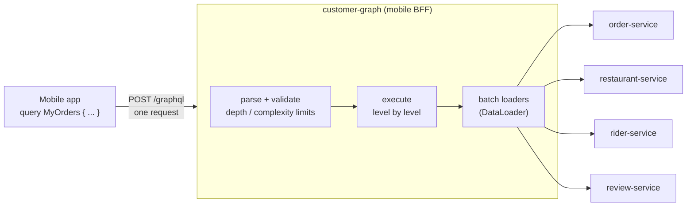

# 24. GraphQL

<div class="badges" markdown><span class="badge badge-l2">L2 · Practitioner</span><span class="badge badge-l3">L3 · Senior/Lead</span><span class="badge badge-meta">Spring for GraphQL · N+1 and batching measured · query cost limits</span></div>

<div class="grid two" markdown>

!!! info "Prerequisites"
    - [Chapter 10](../architecture-patterns/ch10-api-gateway-bff.md): API gateway and backend for frontend
    - [Chapter 21](ch21-rest-api-design.md): resource APIs, caching and errors over HTTP
    - [Chapter 22](ch22-http-clients.md) and [23](ch23-grpc.md): how the BFF calls the services behind it

!!! abstract "What you'll learn"
    - What GraphQL is for: **clients choosing the shape of the data**, one schema for many screens
    - How a query executes, why naive resolvers cause **N+1 calls**, and how **batch loading** fixes it
    - Measured on one mobile screen: GraphQL cut **12 requests to 1** and the bytes by **8×**, but **without batching it was slower than REST** (19 backend calls vs 3)
    - Measured: each nesting level multiplied the work by **10×**; **complexity limits** reject a query before it runs
    - Errors, caching, persisted queries, security, and **federation** when several teams own the graph

</div>

---

## 1 · Introduction & Context

### One API, many screens

By 2024 FoodFleet's mobile BFF ([chapter 10](../architecture-patterns/ch10-api-gateway-bff.md)) had grown to 140 REST endpoints, most of them shaped for a single screen: `/bff/home`, `/bff/my-orders`, `/bff/order-detail`, `/bff/order-detail-v2` for the redesign, `/bff/my-orders-lite` for the low-end Android build. Every screen change was a backend change, a deploy and a version check in the app. The web team wanted the same data in different shapes and was building its own BFF.

The underlying problem: **the client knows what data a screen needs; the server decides what each endpoint returns.** REST resource APIs return whole resources (too much for a list screen) and make the client compose them (too many round trips on a phone). Screen-specific BFF endpoints fix both, at the cost of one endpoint per screen and per version.

GraphQL moves the choice to the client. The server publishes a **schema** (a typed graph of what can be asked for) and the client sends a **query** that names exactly the fields a screen needs, across types, in one request.

```graphql
query MyOrders {
  myOrders(first: 10) {
    id status totalPaise placedAt
    restaurant { name area }
    rider { name }
    items { name quantity }
  }
}
```

That convenience moves work and risk to the server: it must resolve arbitrary combinations of fields efficiently, protect itself from expensive queries, and give up some of HTTP's built-in caching.

### Where GraphQL fits

| Layer | Typical choice | Why |
|---|---|---|
| Client app ↔ backend (mobile, web) | **GraphQL** or BFF REST | Many screens, changing often; clients choose the data |
| Partner or public API | REST ([chapter 21](ch21-rest-api-design.md)) | Cacheable, familiar, easy to rate-limit and document per resource |
| Service ↔ service, synchronous | REST or gRPC ([chapter 23](ch23-grpc.md)) | Fixed contracts, deadlines, no need for client-chosen shapes |
| Service ↔ service, facts and events | Messaging ([chapter 25](ch25-asynchronous-messaging.md)) | Decoupling in time |

GraphQL is a **client-facing aggregation layer**. Using it as the protocol *between* microservices is usually a mistake: services gain a query language they don't need and lose the clear contracts of REST or gRPC.

### Where it comes from

<ul class="mh-timeline">
<li><span class="when">2012 · Facebook</span><span class="what">Built to feed the native iOS News Feed from one flexible API instead of many REST endpoints.</span></li>
<li><span class="when">2015 · Open-sourced</span><span class="what">The specification and the reference implementation (graphql-js) are published; DataLoader follows.</span></li>
<li><span class="when">2016 · GitHub API v4</span><span class="what">A large public API in GraphQL; tooling (GraphiQL, Apollo, Relay) matures.</span></li>
<li><span class="when">2018 · GraphQL Foundation</span><span class="what">Governance moves to the Linux Foundation.</span></li>
<li><span class="when">2019 · Apollo Federation</span><span class="what">One graph composed from subgraphs owned by different teams.</span></li>
<li><span class="when">2022 · Spring for GraphQL 1.0</span><span class="what">The Spring and graphql-java teams' joint project; annotated controllers, batch loading, testing.</span></li>
<li><span class="when">2024 · Spring for GraphQL 1.3</span><span class="what">Federation support (<code>@EntityMapping</code>) on top of federation-jvm.</span></li>
<li><span class="when">2025 · Spring for GraphQL 2.0</span><span class="what">With Spring Boot 4 and Spring Framework 7.</span></li>
</ul>

---

## 2 · Core Concepts & Terminology



Schema (SDL)
:   The typed description of the graph: object types, fields, arguments, enums, and the root types `Query`, `Mutation` and `Subscription`. It is the contract between clients and server.

Query, mutation, subscription
:   Reads, writes (executed one after another), and a stream of events over WebSocket or SSE ([chapter 26](ch26-websockets-sse.md)).

Selection set
:   The fields a query asks for at each level. The response has exactly that shape: no more fields, no fewer.

Resolver (data fetcher)
:   The code that produces one field's value for one parent object. In Spring for GraphQL, `@QueryMapping`, `@SchemaMapping` and `@BatchMapping` methods; fields without one are read from the parent object's properties.

DataLoader / batch loading
:   A per-request utility that collects the keys requested by many resolvers at one level and loads them in a single call, with a per-request cache. `@BatchMapping` registers one for you.

Introspection
:   Queries about the schema itself (`__schema`, `__type`), used by tools such as GraphiQL and code generators.

Persisted queries
:   Clients send a query's hash (or ID) instead of its text; the server looks up the registered document. Smaller requests, and the server can refuse anything not registered.

Federation
:   One supergraph composed from **subgraphs** owned by different services, with a **router** that plans each query across them.

---

## 3 · How It Works Internally

### Parse, validate, execute

A GraphQL server handles a request in three steps:

1. **Parse** the document into a syntax tree.
2. **Validate** it against the schema: fields exist, arguments have the right types, fragments fit. Instrumentation can also check **depth** and **complexity** here, before any data is fetched.
3. **Execute**: resolve the root fields, then each selected field of every result, level by level, and assemble a response of exactly the requested shape.

The response is JSON with `data` and, if anything failed, `errors`. Failures are **per field**: a resolver that throws produces an error entry with a `path`, and its field becomes `null` while the rest of the response is still returned.

```json
{
  "data": { "myOrders": [ { "id": "o-9001", "rider": null } ] },
  "errors": [ { "message": "rider-service unavailable", "path": ["myOrders", 0, "rider"],
                "extensions": { "classification": "INTERNAL_ERROR" } } ]
}
```

With the traditional `application/json` response type, that response is **HTTP 200**, even when everything failed. The GraphQL-over-HTTP specification adds `application/graphql-response+json`, which lets servers return 4xx for requests that fail before execution; monitoring must still look inside the body.

### The N+1 problem

Execution resolves fields **per parent object**. For `myOrders { restaurant { name } }`, the `restaurant` resolver runs once per order. If it calls restaurant-service each time, a list of 10 orders costs 1 + 10 calls; add `rider` and it's 1 + 10 + 8. That is the N+1 problem, and the query looks innocent.

To make this visible, the chapter's code includes a small executor (`mini/Engine`) that resolves level by level, as graphql-java does. With a per-item resolver it calls once per parent; with a **batch resolver** it calls once for *all* parents at that level:

```java
--8<-- "code/chapters/ch24-graphql/src/main/java/dev/foodfleet/ch24/mini/Engine.java:153:168"
```

graphql-java's DataLoader achieves the same thing asynchronously: resolvers call `loader.load(key)` and get a future; when a level's fields have been visited, the loader **dispatches** all collected keys as one batch (de-duplicated, and cached for the rest of the request). Spring's `@BatchMapping` declares such a loader and the field's resolver in one method.

### What a query can cost

Because clients choose the shape, a client can also choose an expensive one. In this schema a review links back to its restaurant, so this is a valid query:

```graphql
{
  restaurant(id: "r-11") {
    name
    reviews(first: 10) {          # 10 reviews
      rating
      restaurant {                # each review's restaurant
        name
        reviews(first: 10) {      # 10 x 10 reviews
          rating
        }
      }
    }
  }
}
```

Each `reviews(first: 10)` level multiplies everything below it by 10. The cost is knowable **before execution**: walk the document, give each field a cost, multiply lists by their page size. graphql-java ships `MaxQueryDepthInstrumentation` and `MaxQueryComplexityInstrumentation` for this; the latter counts each field once by default, and takes a `FieldComplexityCalculator` to multiply by page sizes.

---

## 4 · Design Considerations & Trade-offs

### Measured: one screen, four ways

The "My orders" screen: the 10 most recent orders with status, total, restaurant name and area, rider name and items (6 distinct restaurants, 5 riders, 2 cancelled orders without one). The counts come from executing each approach against the four in-memory services; latency uses a simple model: **80 ms mobile round trip** per sequential wave of requests, 4 Mbit/s down and 1 Mbit/s up for the gzipped bytes, **6 ms per backend call**, calls made one after another inside GraphQL (blocking resolvers) and in parallel where an approach can.

| Approach | Phone requests | Request bytes | Response bytes (gzip) | Backend calls | Modelled latency |
|---|---:|---:|---:|---:|---:|
| REST resources, composed by the app | 12 (2 waves) | 239 | 16,314 (4,834) | 12 | 184 ms |
| GraphQL, per-item resolvers | **1** | 177 | 2,579 (583) | **19** | 197 ms |
| GraphQL, batched (`@BatchMapping`) | **1** | 177 | 2,579 (583) | **3** | **101 ms** |
| BFF endpoint for this screen | 1 | 27 | 2,568 (575) | 3 | 93 ms |

```text
per-item resolvers, calls by service: {order-service: recent orders=1, restaurant-service: one=10, rider-service: one=8}
batched resolvers,  calls by service: {order-service: recent orders=1, restaurant-service: batch=1, rider-service: batch=1}
identical responses, per-item vs batched: true
```

What the numbers say:

- **GraphQL removed the client-side composition**: 12 requests in two waves became one, and the response shrank **6.3× raw, 8.3× gzipped**, because full order, restaurant and rider resources carry addresses, charges, opening hours and links this screen never shows.
- **Without batching, GraphQL was the slowest option** (197 ms): 19 backend calls, including restaurant-service called 10 times for 6 restaurants. The app saw one fast-looking request; restaurant-service saw 10× the traffic.
- **With batching**, the same query made 3 backend calls and returned identical data.
- **A hand-written BFF endpoint was as good or slightly better** for this one screen. GraphQL's advantage is not this screen: it is the next forty screens, the redesign and the web app, served by one schema instead of one endpoint each.
- Persisted queries shrank the request only from 177 to 127 bytes here. Their real value is elsewhere (below).

### Measured: what nesting costs

`restaurant → reviews(first: 10) → restaurant → …`, nested deeper each row. Complexity is computed from the document alone; "fields if run" is what executing it produced. The limit is 2,000 (FoodFleet's production setting, comfortably above its largest real screen query).

| Levels | Depth | Complexity (static) | Fields if run | Calls, per-item | Calls, batched | With the limit |
|---:|---:|---:|---:|---:|---:|---|
| 1 | 3 | 13 | 13 | 2 | 2 | allowed |
| 2 | 5 | 143 | 143 | 22 | 4 | allowed |
| 3 | 7 | 1,443 | 1,443 | 222 | 6 | allowed |
| 4 | 9 | 14,443 | 14,443 | 2,222 | 8 | **rejected up front** |
| 5 | 11 | 144,443 | 144,443 | 22,222 | 10 | **rejected up front** |

- The static complexity **predicted the work exactly**, so the server can refuse a query without running any of it. The same calculator plugged into graphql-java (section 5) gives the same numbers.
- **Batching kept the calls linear** (2 per level) but **not the work**: level 5 still asks for 144,443 field values. Batching fixes N+1; it does not make an expensive query cheap.
- Depth limits alone are a blunt tool: depth 7 can be cheap or expensive depending on page sizes. Use both.

### GraphQL, BFF REST, or both?

| Concern | GraphQL | Screen-specific BFF REST |
|---|---|---|
| New screen or new field | Often a client-only change | Backend change and deploy |
| Several clients (iOS, Android, web, kiosk) | One schema | One BFF per client, or shared endpoints that fit nobody |
| HTTP caching (CDN, `ETag`) | Hard: POST, one URL; needs persisted GET queries or client caches | Natural |
| Protecting the backend | Needs cost limits, batching discipline, persisted queries | Each endpoint's cost is fixed and known |
| Monitoring | Per operation and field; HTTP status says little | Per endpoint; standard tooling |
| Error model | Partial data + `errors` | HTTP status + RFC 9457 |
| Tooling and skills | Schema-first, codegen, GraphiQL; new skills for the team | Familiar |

A common, sensible end state: **GraphQL in the BFF for first-party apps**, REST for partners and public APIs, REST/gRPC/events between services.

### One graph, many teams: federation

With one BFF, one team owns the whole schema and becomes a bottleneck. **Federation** lets each domain team publish a **subgraph** for its types, while a **router** (Apollo Router, or other federation-compatible gateways) composes them into one supergraph and plans each query across subgraphs. An entity such as `Restaurant` can be defined by restaurant-service and extended with `reviews` by review-service; the router fetches each part from its owner.

Spring for GraphQL supports subgraphs through federation-jvm: a `FederationSchemaFactory` and `@EntityMapping` methods that resolve entity references (in batches, too). The cost is real: a router to run, composition checks in CI, query planning across services, and distributed debugging. Federation pays off when **many teams** contribute to one client-facing graph; with one or two teams, a single BFF graph calling services is simpler.

### Security points specific to GraphQL

- **Authorise per field or per object**, in the resolvers or the services, not only per endpoint: there is only one endpoint.
- **Turn off introspection in production** for first-party apps (clients use generated types), or restrict it.
- **Persisted queries as an allow-list**: the app's build registers its queries; the production endpoint accepts only those hashes. Arbitrary queries, including expensive ones, are then impossible from outside.
- **Limit depth, complexity, page sizes, aliases and batch size** in requests; time out execution.
- **Identity from the gateway**, never from arguments: the customer comes from a verified header, not `myOrders(customerId: …)`.

---

## 5 · Hands-on Implementation

The example is FoodFleet's customer graph, served by the mobile BFF.

```text
ch24-graphql/
├── src/main/resources/graphql/customer.graphqls   the schema
├── src/main/java/dev/foodfleet/ch24/
│   ├── mini/         Query, Engine, Json: a small executor to see N+1 and batching
│   ├── experiment/   FoodFleetBackends, FoodFleetGraph, ScreenComparison, QueryCost
│   └── graph/        GraphApplication, CustomerGraphController, GraphQlConfig
```

### 🔵 Level 2: schema first

<div class="badges" markdown><span class="badge badge-l2">L2 · Practitioner</span></div>

Spring Boot loads `*.graphqls` files from `src/main/resources/graphql/`. Nullability is part of the contract: `rider: Rider` can be null, `restaurant: Restaurant!` cannot.

```graphql
--8<-- "code/chapters/ch24-graphql/src/main/resources/graphql/customer.graphqls"
```

```xml
--8<-- "code/chapters/ch24-graphql/pom.xml:25:47"
```

### 🔵 Level 2: resolvers with batching

<div class="badges" markdown><span class="badge badge-l2">L2 · Practitioner</span></div>

`@QueryMapping` methods serve root fields. `@BatchMapping` methods receive **all** parent objects at once and return a map from parent to value: one call to restaurant-service for every order in the response. Parents missing from the map get `null`, which is how cancelled orders have no rider. `@SchemaMapping` is the per-parent form, used for `reviews` because batch methods can't take field arguments.

```java
--8<-- "code/chapters/ch24-graphql/src/main/java/dev/foodfleet/ch24/graph/CustomerGraphController.java:19:88"
```

### 🟣 Level 3: limits, errors and context

<div class="badges" markdown><span class="badge badge-l3">L3 · Senior/Lead</span></div>

Spring Boot registers `Instrumentation`, `DataFetcherExceptionResolver` and `GraphQlSourceBuilderCustomizer` beans with graphql-java automatically. The complexity calculator multiplies by `first`, so the score is the one measured above. `HttpRequestHeaderInterceptor` copies the gateway's verified customer header into the GraphQL context, where `@ContextValue` reads it. Schema inspection logs schema fields with no resolver at startup.

```java
--8<-- "code/chapters/ch24-graphql/src/main/java/dev/foodfleet/ch24/graph/GraphQlConfig.java:16:63"
```

```yaml
--8<-- "code/chapters/ch24-graphql/src/main/resources/application.yml"
```

### 🟣 Level 3: testing the graph

<div class="badges" markdown><span class="badge badge-l3">L3 · Senior/Lead</span></div>

`@GraphQlTest` starts only the GraphQL layer (schema, controllers, instrumentation, resolvers) with graphql-java executing real queries; `ExecutionGraphQlServiceTester` runs them without HTTP and lets the test put the customer into the context. The tests check the data, the number of service calls (the N+1 regression test), the error type and the complexity limit.

```java
--8<-- "code/chapters/ch24-graphql/src/test/java/dev/foodfleet/ch24/graph/CustomerGraphControllerTest.java:19:70"
```

### 🔴 Level 4: from one graph to a federated one

<div class="badges" markdown><span class="badge badge-l4">L4 · Architect</span></div>

If review-service's team owned `Restaurant.reviews`, it would publish a subgraph that extends the `Restaurant` entity, and resolve references to it in batches. A sketch with Spring for GraphQL's federation support (not part of the chapter's module):

```graphql
# review-service subgraph
extend schema @link(url: "https://specs.apollo.dev/federation/v2.5", import: ["@key"])

type Restaurant @key(fields: "id") {
  id: ID!
  reviews(first: Int = 10): [Review!]!
}
```

```java
@Configuration
class FederationConfig {

    @Bean
    FederationSchemaFactory schemaFactory() {
        return new FederationSchemaFactory();
    }

    @Bean
    GraphQlSourceBuilderCustomizer federation(FederationSchemaFactory factory) {
        return builder -> builder.schemaFactory(factory::createGraphQLSchema);
    }
}

@Controller
class RestaurantReviewsController {

    @EntityMapping                       // the router asks: "Restaurant with id r-11, r-12, ..."
    List<Restaurant> restaurant(@Argument List<String> idList) {
        return idList.stream().map(Restaurant::new).toList();
    }

    @SchemaMapping
    List<Review> reviews(Restaurant restaurant, @Argument int first) { ... }
}
```

The decisions that matter at this level are organisational: who owns which types, how schema changes are reviewed and composed (composition and breaking-change checks in CI, as in [chapter 27](ch27-api-contracts.md)), and whether the router is platform-owned.

### Run and verify

```text
$ java -cp chapters/ch24-graphql/target/classes dev.foodfleet.ch24.experiment.ScreenComparison
"My orders" screen: 10 orders, 6 restaurants, 5 riders

approach                               requests  waves    req B    resp B   gzip B  backend latency ms
REST resources, composed by the app          12      2      239     16314     4834       12        184
GraphQL, per-item resolvers                   1      1      177      2579      583       19        197
GraphQL, batched (DataLoader)                 1      1      177      2579      583        3        101
BFF endpoint for this screen                  1      1       27      2568      575        3         93

GraphQL request body: 177 bytes; as a persisted query hash: 127 bytes
identical responses, per-item vs batched: true

$ java -cp chapters/ch24-graphql/target/classes dev.foodfleet.ch24.experiment.QueryCost
 levels  depth   complexity    fields if run   calls per-item   calls batched  with the limit
      1      3           13               13                2               2  allowed
      2      5          143              143               22               4  allowed
      3      7         1443             1443              222               6  allowed
      4      9        14443            14443             2222               8  rejected up front
      5     11       144443           144443            22222              10  rejected up front
```

With the application running (`GRAPHIQL_ENABLED=true mvn -pl chapters/ch24-graphql spring-boot:run`):

```bash
curl -s localhost:8080/graphql -H 'Content-Type: application/json' -H 'X-Customer-Id: c-1001' \
  -d '{"query":"{ myOrders(first: 2) { id status restaurant { name } rider { name } } }"}'
```

!!! question "Try it"
    1. Replace `@BatchMapping restaurant` with a `@SchemaMapping` that calls `services.restaurant(id)`. How many calls does `theOrdersScreenNeedsThreeServiceCalls` now see? Keep that test as your N+1 regression guard.
    2. Make `reviews` batched with `BatchLoaderRegistry`, passing `first` through the loader's context. Which queries benefit?
    3. Ask for `myOrders { restaurant { name } }` with aliases twenty times in one query. What does the complexity calculator say? What should it say?
    4. Throw an exception from the rider resolver. What do `data` and `errors` look like, and what HTTP status does the app receive?

---

## 6 · Production Readiness

- [x] **Schema reviewed as a contract**: nullability chosen deliberately, deprecations with `@deprecated(reason:)`, breaking-change checks in CI
- [x] **Every cross-service field batched** (`@BatchMapping` or `BatchLoaderRegistry`), with tests that count backend calls
- [x] **Depth and complexity limits** with a cost function that reflects page sizes; maximum page sizes enforced in resolvers
- [x] **Persisted queries** (allow-list) for first-party apps in production; introspection and GraphiQL off there
- [x] **Identity and tenant from the gateway** into the GraphQL context; authorisation per field or object
- [x] **Errors classified** (`BAD_REQUEST`, `NOT_FOUND`, `FORBIDDEN`, …) with no internal details in messages
- [x] **Monitoring per operation**: operation name, duration, error count per field; alert on `errors`, not only HTTP status
- [x] **Timeouts** on every call the resolvers make ([chapter 22](ch22-http-clients.md)), and on execution as a whole
- [x] **Caching plan**: client cache (Apollo/Relay normalised cache), persisted GET queries for CDN where useful, server-side caches in services
- [x] **Schema inspection** at startup with no unmapped fields

---

## 7 · Anti-patterns & Pitfalls

!!! pitfall "Incident 1: the home screen that multiplied restaurant traffic"
    **Context.** The new home screen listed 30 nearby restaurants, each with its 3 best dishes and current offers, via the new GraphQL BFF.
    **Symptoms.** At the evening peak restaurant-service and offer-service ran at 5× their usual request rate; the BFF's own latency looked fine at first, then p99 hit 4 s.
    **Root cause.** `dishes` and `offers` were `@SchemaMapping` resolvers calling services per restaurant: 1 + 30 + 30 calls per screen load (N+1).
    **Fix.** `@BatchMapping` for both, a test asserting the number of backend calls per screen query, and a dashboard of backend calls per GraphQL operation.

!!! pitfall "Incident 2: one query, eleven thousand calls"
    **Context.** The BFF's GraphQL endpoint was reachable from the internet with introspection on and no limits.
    **Symptoms.** review-service saturated within minutes; logs showed a single client sending deeply nested `restaurant → reviews → restaurant` queries.
    **Root cause.** No depth or complexity limit; each nesting level multiplied the work by the page size (this chapter measured 14,443 fields for four levels).
    **Fix.** Complexity limit 2,000 and depth 8, maximum page sizes, introspection off, and persisted queries only in production: unregistered queries are rejected.

!!! pitfall "Incident 3: green dashboards, broken screen"
    **Context.** rider-service was failing for 40 minutes.
    **Symptoms.** The BFF's HTTP dashboards showed 100% 200 responses; customers saw orders without rider details and complained on social media.
    **Root cause.** GraphQL returned partial data with `errors` and HTTP 200; monitoring looked only at HTTP status.
    **Fix.** Metrics per operation and per field error (Spring for GraphQL's observations), alerts on error rate inside responses, and clients that show a clear "rider details unavailable" state.

| Anti-pattern | Symptom | Fix |
|---|---|---|
| Per-item resolvers calling services | N+1: backend traffic multiplies with list size | `@BatchMapping` / DataLoader; call-count tests |
| No query limits | One request can saturate services | Depth + complexity limits, page caps, persisted queries |
| GraphQL between microservices | A query language where a fixed contract was needed | REST, gRPC or events between services |
| One giant schema owned by nobody (or everybody) | Inconsistent types, slow reviews, breaking changes | Clear ownership; federation when many teams contribute |
| Exposing the database model as the schema | Clients coupled to tables; every migration breaks apps | Design the schema for clients, map in resolvers |
| Monitoring HTTP status only | Partial failures invisible | Per-operation and per-field metrics |
| Identity as a query argument | Customers reading others' data | Context from the gateway; authorise in resolvers |
| Expecting HTTP caching to work as with REST | Cache misses, origin load | Client caches, persisted GET queries, service-side caches |

---

## 8 · Enterprise Case Study

### FoodFleet: one graph for the customer apps

!!! decision "ADR-024: The customer apps use a GraphQL API in the mobile BFF; services keep their own protocols"
    **Status:** Accepted · **Date:** 2024-10-21

    **Context.** The customer BFF had 140 screen-specific REST endpoints, versioned per app release, and the web team was building a second BFF with overlapping endpoints. Most changes requested by the apps were new fields or new combinations of existing data. Partner APIs are REST (ADR-021); services talk REST, gRPC (ADR-023) and events (ADR-019).

    **Decision.** The customer BFF exposes one GraphQL schema for iOS, Android and web, built with Spring for GraphQL. Fields that cross to another service use batch loading; a test per screen query asserts its backend call count. Production accepts only persisted queries registered by app builds; complexity limit 2,000, depth 8, page size at most 50; introspection and GraphiQL are disabled outside development. The customer and tenant come from the gateway's verified headers. Metrics and alerts are per operation and per field error. Services do not expose GraphQL to each other. Federation is deferred until more than two teams need to contribute types (expected with the grocery vertical).

    **Consequences.** ✅ New screens and redesigns mostly ship without backend changes; one schema replaces two BFFs. ✅ Measured on the orders screen: 1 request instead of 12, 8× fewer bytes. ⚠️ The BFF team owns batching, limits and the schema review process. ⚠️ HTTP caching at the CDN is mostly lost; client-side caches and service-side caches replace it. ⚠️ Monitoring had to move from HTTP status to GraphQL operations.

### Fintech analogue: the banking app's account overview 🔴

A retail banking app shows accounts, balances, recent transactions, cards and offers on one screen, from five core systems. A GraphQL layer in the BFF lets the app fetch exactly what each screen shows, with strict per-field authorisation (a joint account holder sees some fields, not others), persisted queries only, and aggressive cost limits, because core banking systems are expensive to call and slow to scale. Balances and transactions are never cached in the client longer than the regulator and product rules allow.

### E-commerce analogue: product pages across many teams

A large marketplace's product page combines catalogue, pricing, inventory, reviews, seller ratings and recommendations, each owned by a different team. A federated graph lets each team own its subgraph and evolve its fields independently, while the router composes them; composition checks in CI stop one team's change from breaking another's. Smaller retailers with one or two backend teams get most of the benefit from a single BFF graph.

---

## 9 · Interview Q&A + Summary

#### Q1. What is GraphQL, and what problem does it solve? · <span class="badge badge-l1">L1</span><span class="badge badge-l2">L2</span> · Cognizant · SAP · Flipkart

**Short answer:** A query language and runtime for APIs: the server publishes a typed schema, and clients request exactly the fields they need, across related types, in one request. It addresses over-fetching (whole resources for a small screen), under-fetching (many round trips to compose a screen) and endpoint sprawl for many client screens.

#### Q2. How is GraphQL different from REST? · <span class="badge badge-l2">L2</span> · Amazon · Cognizant

**Short answer:** REST exposes resources at URLs with HTTP semantics (methods, status codes, caching); the server decides each response's shape. GraphQL exposes one endpoint and a schema; the client decides the shape. GraphQL gains flexibility and fewer round trips; REST keeps HTTP caching, simple per-endpoint cost and familiar tooling.

#### Q3. What is the N+1 problem in GraphQL and how do you fix it? · <span class="badge badge-l2">L2</span><span class="badge badge-l3">L3</span> · Flipkart · Amazon · Goldman Sachs

**Short answer:** Resolvers run per parent object, so a list of N items whose field calls a service makes 1 + N calls. Fix it with batch loading: DataLoader collects keys at one execution level and loads them in one call (Spring's `@BatchMapping` or `BatchLoaderRegistry`). In this chapter a screen went from 19 backend calls to 3, with identical data.

#### Q4. How do `@SchemaMapping` and `@BatchMapping` differ in Spring for GraphQL? · <span class="badge badge-l2">L2</span> · SAP · Cognizant

**Short answer:** `@SchemaMapping` resolves a field for one parent at a time and can take field arguments. `@BatchMapping` receives all parents at once and returns a map (or ordered list) of values, registering a DataLoader underneath; it can't take field arguments, for which you use `BatchLoaderRegistry`.

#### Q5. How do you protect a GraphQL API from expensive queries? · <span class="badge badge-l3">L3</span> · Goldman Sachs · JP Morgan · Amazon

**Short answer:** Limit depth and computed complexity before execution (graphql-java instrumentations, with a cost function that multiplies by page sizes), cap page sizes, time out execution, and in production accept only persisted queries from your own apps. Batching alone doesn't help: it reduces calls, not the amount of work.

#### Q6. How are errors reported in GraphQL? · <span class="badge badge-l2">L2</span> · SAP · Amazon

**Short answer:** In an `errors` array alongside `data`, each with a message, a `path` to the failed field and `extensions` such as a classification. Other fields still return, so responses can be partially successful, usually with HTTP 200. Map exceptions to error types centrally and monitor errors in responses, not just HTTP status.

#### Q7. How do you cache GraphQL responses? · <span class="badge badge-l3">L3</span> · Flipkart · Amazon

**Short answer:** HTTP caching is hard because queries are POSTs to one URL. Options: normalised client caches (Apollo, Relay) keyed by type and ID, persisted queries sent as GET so CDNs can cache them, caching inside the services, and per-request DataLoader caching for repeated keys.

#### Q8. Should microservices talk to each other in GraphQL? · <span class="badge badge-l3">L3</span><span class="badge badge-l4">L4</span> · any

**Short answer:** Usually not. Between services you want fixed contracts, predictable cost, deadlines and simple tooling: REST, gRPC or events. GraphQL's strength is letting many changing client screens choose their data, so it belongs at the client-facing edge, typically in a BFF or a federated gateway.

#### Q9. What is GraphQL federation and when is it worth it? · <span class="badge badge-l3">L3</span><span class="badge badge-l4">L4</span> · Amazon · SAP

**Short answer:** A supergraph composed from subgraphs owned by different services, with a router planning each query across them; entities like `Restaurant` can be extended by several subgraphs. It is worth it when many teams contribute to one client-facing graph; otherwise a single BFF graph is simpler to run and debug.

#### Q10. How do you secure a GraphQL endpoint? · <span class="badge badge-l2">L2</span><span class="badge badge-l3">L3</span> · JP Morgan · Goldman Sachs

**Short answer:** Authenticate at the gateway and pass identity in context (never as arguments), authorise per field or object, disable introspection in production for first-party apps, use persisted queries as an allow-list, limit depth, complexity, aliases and page sizes, and avoid leaking internals in error messages.

#### Q11. How do you evolve a GraphQL schema without versioning the API? · <span class="badge badge-l2">L2</span><span class="badge badge-l3">L3</span> · SAP · Flipkart

**Short answer:** Add fields and types freely (clients only get what they ask for); deprecate fields with `@deprecated(reason:)`, track their usage per client operation, and remove them when usage drops to zero. Changing a field's type or nullability is breaking; run schema breaking-change checks in CI.

#### Q12. GraphQL or a BFF with REST endpoints: how do you decide? · <span class="badge badge-l3">L3</span><span class="badge badge-l4">L4</span> · any

**Short answer:** A BFF endpoint per screen is simple, cacheable and predictable, and was as fast as GraphQL for one screen here. GraphQL wins when there are many screens and clients that change often, because one schema replaces many endpoints, at the cost of batching discipline, query limits, new monitoring and weaker HTTP caching.

### Key takeaways

- GraphQL lets **clients choose the data**: one request instead of 12, and 8× fewer bytes, for the measured screen.
- **N+1 is the default** with per-item resolvers: 19 backend calls instead of 3, slower than plain REST. Batch every cross-service field and test the call count.
- Clients choosing the shape means clients choosing the **cost**: each nesting level multiplied the work by 10×. Limit **complexity and depth before execution**, and use **persisted queries** in production.
- Errors are **partial and HTTP 200**: monitor operations and field errors.
- Keep GraphQL at the **client-facing edge**; consider **federation** when many teams own the graph.

### Further reading

- Spring for GraphQL reference: [Annotated Controllers](https://docs.spring.io/spring-graphql/reference/controllers.html), [Request Execution](https://docs.spring.io/spring-graphql/reference/request-execution.html), [Federation](https://docs.spring.io/spring-graphql/reference/federation.html), [Testing](https://docs.spring.io/spring-graphql/reference/testing.html)
- Spring Boot reference, [Spring for GraphQL](https://docs.spring.io/spring-boot/reference/web/spring-graphql.html)
- [GraphQL specification](https://spec.graphql.org/) and [GraphQL over HTTP](https://graphql.github.io/graphql-over-http/)
- graphql-java documentation on [batching with DataLoader](https://www.graphql-java.com/documentation/batching) and [instrumentation](https://www.graphql-java.com/documentation/instrumentation)
- Apollo, [Federation documentation](https://www.apollographql.com/docs/federation/)

---

**Previous:** [← 23. gRPC & Protocol Buffers](ch23-grpc.md) · **Next:** [25. Asynchronous Messaging →](ch25-asynchronous-messaging.md)
