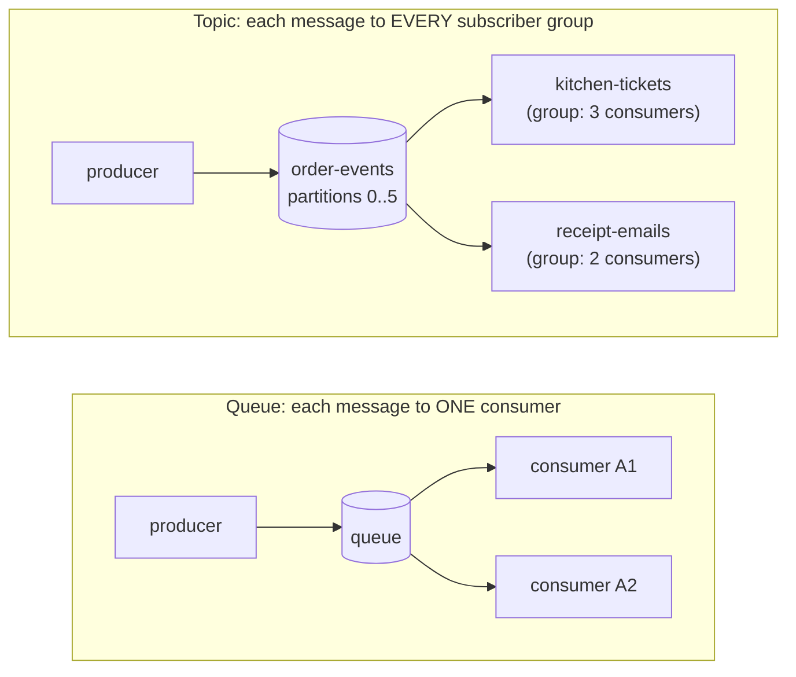

# 25. Asynchronous Messaging

<div class="badges" markdown><span class="badge badge-l2">L2 · Practitioner</span><span class="badge badge-l3">L3 · Senior/Lead</span><span class="badge badge-meta">Queues vs topics · delivery semantics · ordering · retries and DLTs, measured</span></div>

<div class="grid two" markdown>

!!! info "Prerequisites"
    - [Chapter 15](../architecture-patterns/ch15-outbox-inbox-cdc.md): publishing reliably (outbox) and consuming idempotently (inbox)
    - [Chapter 19](../architecture-patterns/ch19-event-driven-architecture.md): what to put in events, and why
    - [Chapter 18](../architecture-patterns/ch18-resilience-patterns.md): retries, backoff and timeouts

!!! abstract "What you'll learn"
    - **Queues vs topics**, and **queue brokers** (RabbitMQ) vs **logs** (Kafka)
    - **When to commit**: measured, committing before processing lost messages; committing every 500 duplicated **6,180** effects; committing after with an idempotent consumer: **0 and 0**
    - **Ordering**: an 8-thread pool in a partition was 8× faster and put **19%** of events out of order; per-key lanes were as fast with **0**
    - **Retries and DLTs**: through a poison message and an outage, "retry forever" stopped the partition, Spring Kafka's unconfigured default **silently skipped 16 good messages**, classified backoff + DLT lost **0**
    - The Spring for Apache Kafka configuration for each, tested on an embedded broker

</div>

---

## 1 · Introduction & Context

### Three bad evenings

FoodFleet's `order-events` topic carries every order's life: `PLACED`, `ACCEPTED`, `PICKED_UP`, `DELIVERED`. In 2024 three of its consumers had a bad evening each:

- **The stuck partition.** One event with a missing restaurant id reached kitchen-tickets. The listener threw, the container retried, forever. Every later order on that partition (a sixth of the city) waited behind it for 40 minutes, until someone deleted the consumer group's offset by hand.
- **The silent skip.** After that, the team "fixed retries" by removing their custom loop. During a 30-second outage of the restaurant tablets' API, Spring Kafka's default error handler retried each failing event 10 times in a row, logged it, and **moved on**. Sixteen kitchens never saw their orders.
- **The reordered tablets.** To keep up with the dinner peak, a developer handed records to a thread pool inside the listener. Tablets started showing `ACCEPTED` before `PLACED`, and some orders reverted to an earlier status.

None of these is a broker problem. They are **consumer decisions**: when to acknowledge, how to parallelise, what to do when a message fails. This chapter measures each decision and shows the configuration that makes it explicit.

### Why asynchronous messaging

A message broker sits between a producer and its consumers:

- **Decoupling in time.** The producer doesn't wait for the consumer, and the consumer can be down for a while ([chapter 19](../architecture-patterns/ch19-event-driven-architecture.md) measured sync calls failing 100% of orders during an outage, events 0%).
- **Load levelling.** A burst is queued and processed at the consumers' pace.
- **Fan-out.** One event, many independent consumers, each at its own speed.

The price: consumers must handle **duplicates**, **ordering**, **failures with nobody to return an error to**, and **lag**.

### Where it comes from

<ul class="mh-timeline">
<li><span class="when">1993 · IBM MQSeries</span><span class="what">Message queuing for enterprise integration: transactional, persistent, point-to-point.</span></li>
<li><span class="when">2001 · JMS 1.0.2 / 1.1</span><span class="what">A Java API for queues and topics; ActiveMQ (2004) follows.</span></li>
<li><span class="when">2006–2007 · AMQP, RabbitMQ</span><span class="what">An open wire protocol with exchanges and routing; RabbitMQ implements it.</span></li>
<li><span class="when">2011 · Apache Kafka</span><span class="what">LinkedIn's distributed commit log: retention, replay, partitions, consumer groups.</span></li>
<li><span class="when">2017 · Kafka 0.11</span><span class="what">Idempotent producers and transactions ("exactly-once" within Kafka).</span></li>
<li><span class="when">2024 · RabbitMQ 4.0</span><span class="what">Quorum queues get a default delivery limit of 20: poison messages stop looping, and are dropped unless dead-lettering is configured.</span></li>
<li><span class="when">2025 · Kafka 4.0</span><span class="what">ZooKeeper removed (KRaft only); share groups (queue semantics on Kafka, KIP-932) in early access.</span></li>
</ul>

---

## 2 · Core Concepts & Terminology



Queue (point-to-point)
:   Each message is delivered to one of the consumers reading the queue (**competing consumers**), then removed once acknowledged.

Topic (publish-subscribe)
:   Each message goes to every subscriber. In Kafka, every **consumer group** gets every message; within a group, each **partition** is read by one consumer.

Queue broker vs log
:   A queue broker (RabbitMQ, ActiveMQ, SQS) tracks each message's state and deletes acknowledged ones. A log (Kafka, Pulsar, RabbitMQ Streams) keeps messages for a retention period; consumers track their position (**offset**) and can replay.

Acknowledge / commit
:   Telling the broker a message is done. Per message in a queue broker (`ack`, `nack`, `reject`); per partition **offset** in Kafka (everything before offset *n* is done).

Delivery semantics
:   **At-most-once** (acknowledge first: may lose), **at-least-once** (acknowledge after: may duplicate), **effectively once** (at-least-once plus an idempotent consumer). End-to-end exactly-once across systems is not something a broker can promise on its own.

Ordering scope
:   Kafka orders messages **within a partition**; with a key, all messages for that key go to one partition. A queue with competing consumers has no useful ordering guarantee once more than one consumer processes in parallel.

Poison message
:   A message that can never be processed (malformed, violates an invariant). Retrying it is pointless; if retried in place, it blocks everything behind it.

Dead-letter queue / topic (DLQ/DLT)
:   Where messages go when they can't be processed, with the error attached, for alerting, inspection and replay.

Consumer lag
:   How far a consumer group is behind the latest offset: the key health metric for a log consumer.

---

## 3 · How It Works Internally

### The Kafka consumer loop

A Kafka consumer **polls** a batch of records from its assigned partitions, processes them, and **commits offsets**. Three consequences shape everything else:

- **An offset is one number per partition.** You can't acknowledge record 7 and leave record 6 pending. If record 6 fails, the consumer either retries it in place (blocking everything behind it), or moves it elsewhere (a retry topic or DLT) and carries on.
- **Uncommitted records are redelivered** after a crash or a **rebalance** (a consumer joins, leaves, or exceeds `max.poll.interval.ms`). How many depends on how often you commit. Spring Kafka's default `AckMode.BATCH` commits after the records from each poll are processed: up to `max.poll.records` redeliveries per crash.
- **Parallelism is per partition.** A group can use at most as many consumers as the topic has partitions. Processing one partition's records in parallel is possible, but then ordering and offset tracking are your problem.

### The queue broker loop

RabbitMQ **pushes** messages to consumers, up to a **prefetch** count of unacknowledged messages each. The consumer acknowledges each one, or rejects it, with or without requeueing. A rejected or expired message can be routed to a **dead-letter exchange** (DLX). Quorum queues count deliveries; since RabbitMQ 4.0 they have a default delivery limit of 20, after which the message is dead-lettered (or dropped if no DLX is configured).

Messages are removed once acknowledged; there is no replay, and ordering is lost as soon as several consumers or requeues are involved. In exchange, per-message acknowledgement, routing and priorities are built in.

### What Spring Kafka does when a listener throws

The listener container hands the exception to its **error handler**. `DefaultErrorHandler`:

1. **Seeks** the partition back to the failed record (so it and everything after it will be re-polled).
2. Applies a **BackOff** (wait, on the consumer thread) and redelivers, until the back-off is exhausted.
3. Calls a **recoverer**, e.g. `DeadLetterPublishingRecoverer`, which publishes the record to `<topic>-dlt` with headers describing the exception, then commits past it.

Certain exceptions are **not retryable** by default (deserialization and conversion failures, `ClassCastException`, …) and go straight to the recoverer; you can add your own. **With no configuration**, the back-off is 9 retries with no delay, and the recoverer **only logs**: after 10 quick failures the record is skipped.

`@RetryableTopic` takes the other approach, **non-blocking retries**: a failed record is published to a retry topic (`order-events-retry-1000`, …) and consumed again after a delay by a separate consumer, while the main partition keeps flowing. The price is ordering: later events for the same key are processed before the retried one.

---

## 4 · Design Considerations & Trade-offs

### Measured: when to commit

100,000 messages; the consumer crashes about once every 5,000 messages, at a random point (before processing, after processing, or after committing), and restarts from the last committed offset. Verified output:

| Commit | Crashes | Lost | Duplicate effects | Redelivered |
|---|---:|---:|---:|---:|
| Before processing (at-most-once) | 26 | **8** | 0 | 0 |
| After each message (at-least-once) | 26 | 0 | **9** | 17 |
| After every 500 (batch or periodic commit) | 28 | 0 | **6,180** | 6,188 |
| After each, idempotent consumer (effectively once) | 26 | **0** | **0** | 17 |

- Committing first **loses** what was in flight. Committing after **duplicates** it. Neither is acceptable for orders, so FoodFleet consumers commit after processing **and** are idempotent (the inbox of [chapter 15](../architecture-patterns/ch15-outbox-inbox-cdc.md)).
- The commit interval sets the **size** of the duplicate burst: 500 per crash here. Idempotency makes the size irrelevant, which is why batch commits (Spring's default) are fine for idempotent consumers and dangerous for the rest.

### Measured: ordering vs parallelism

2,000 events of 500 orders on one partition, 2–20 ms each:

| Consumer | Time | Events/s | Out of order |
|---|---:|---:|---:|
| One thread per partition | 10,021 ms | 200 | 0 |
| Listener hands records to an 8-thread pool | 1,263 ms | 1,583 | **384 (19%)** |
| 8 lanes by hash(order id) | 1,309 ms | 1,528 | **0** |

- A plain pool (or competing consumers on a queue) gives the speed and breaks per-order sequence for a fifth of events.
- **Key-ordered lanes** gave the same speed-up with no violations: parallel across orders, sequential within one. More partitions keyed by order id, one consumer each, produce the same schedule; libraries such as Confluent's Parallel Consumer do it within a partition (and track which offsets are safe to commit).
- The usual answer is the simplest: **enough partitions** for the consumers you need, keyed by the entity whose order matters.

### Measured: retries, poison messages and dead letters

One partition, 18,000 order events over 180 s (100/s); a successful attempt takes 4 ms. At ~20 s a **poison message** arrives. From 60 s to 90 s the **dependency fails** (each call times out after 200 ms): either completely, or for 1 in 20 orders (one partner's API down). Verified output:

**Full outage**

| Strategy | Delivered | Lost | Good in DLT | Stuck at end | p99 latency | Out of order |
|---|---:|---:|---:|---:|---:|---:|
| Retry forever, blocking | 1,768 | 0 | 0 | **16,231** | — | 0 |
| 10 quick attempts, then log and skip (Spring's default) | 17,984 | **16** | 0 | 0 | 28.8 s | 11 |
| Blocking backoff 1–16 s, then DLT | 17,999 | 0 | 0 | 0 | 48.5 s | 1 |
| Blocking backoff, **not-retryable → DLT at once** | 17,999 | 0 | 0 | 0 | **30.9 s** | 1 |
| Retry topics 1 s / 10 s / 60 s, classified | 17,999 | 0 | 0 | 0 | 28.3 s | 95 |

**Partial outage (1 in 20 orders affected)**

| Strategy | Delivered | Lost | Stuck at end | p99 latency | Out of order |
|---|---:|---:|---:|---:|---:|
| Retry forever, blocking | 1,768 | 0 | 16,231 | — | 0 |
| 10 quick attempts, then log and skip | 17,985 | **15** | 0 | 26.5 s | 9 |
| Blocking backoff, then DLT | 17,999 | 0 | 0 | 48.4 s | 1 |
| Blocking backoff, classified | 17,999 | 0 | 0 | 30.9 s | 1 |
| Retry topics, classified | 17,999 | 0 | 0 | **8.2 s** | 18 |

(In every strategy that dead-letters, the DLT received exactly the poison message. "Out of order" counts an order's later event applied while an earlier one was pending or never applied; the 1 in the blocking rows is the poison message's order.)

- **Retry forever** turned one bad message into a stopped partition: 16,231 events never processed.
- **Skipping** kept the partition moving and silently **lost good messages** during a 30-second outage. Spring Kafka's default handler behaves exactly like this; configure a recoverer.
- **Classification matters most**: sending the not-retryable poison message straight to the DLT cut p99 from 48.5 s to 30.9 s, because the partition no longer waited 31 s on a message that could never succeed.
- **Retry topics shine when only some messages fail**: with one partner down, p99 fell from 30.9 s to **8.2 s**, because other orders no longer waited behind the failing ones, at the cost of 18 out-of-order events. In a full outage they don't help much: every message fails anyway, and each failed call still costs its timeout (a circuit breaker, [chapter 18](../architecture-patterns/ch18-resilience-patterns.md), would make those failures fast).

### Blocking or non-blocking retries?

| | Blocking (`DefaultErrorHandler` + BackOff) | Non-blocking (`@RetryableTopic`) |
|---|---|---|
| Ordering per key | Kept | Broken for retried messages |
| Effect of one failing message | Whole partition waits | Only that message waits |
| Max retry delay | Keep the total within `max.poll.interval.ms` (or let the container pause the partition with `ContainerPausingBackOffHandler`) | Minutes or hours (separate topics) |
| Extra topics and consumers | DLT only | Retry topics + DLT |
| Batch listeners, container transactions | Supported | Not supported |
| Use for | State machines, ledgers, anything applied in sequence | Independent side effects: emails, notifications, indexing |

FoodFleet uses both on the same topic: kitchen-tickets (order matters) blocks; receipt-emails (independent) uses retry topics.

### Queue broker or log?

| Need | Queue broker (RabbitMQ, SQS) | Log (Kafka) |
|---|---|---|
| Work distribution, task queues | Natural: competing consumers, per-message ack | Possible; parallelism limited by partitions (share groups add queue semantics) |
| Replay, new consumers reading history | No | Yes, within retention |
| Many independent subscribers | Exchange per subscriber queue | Consumer groups, no copies |
| Ordering | Per queue, single consumer | Per partition / key, at scale |
| Routing, priorities, per-message TTL | Rich | Minimal |
| Throughput and retention at scale | Good | Very high, long retention |

FoodFleet uses Kafka for domain events (replay, many subscribers, per-order ordering) and RabbitMQ for task queues where per-message acknowledgement and priorities matter (rider payout jobs, document generation).

### A DLT is an operational process, not a bin

A message in a DLT is a business event that didn't happen: an order a kitchen never saw, a receipt never sent. Treat the DLT like an incident queue:

- **Alert** on any message arriving (per topic and error type), not on a daily count.
- Keep the **cause** with the message (Spring adds exception class, message and stack trace headers, and the original topic, partition and offset).
- Provide a **replay** tool that republishes after the fix, through the same idempotent consumer.
- Define who owns each DLT and the time to resolution.

---

## 5 · Hands-on Implementation

The example is two consumers of `order-events` (key: order id) in one application.

```text
ch25-messaging/
└── src/main/java/dev/foodfleet/ch25/
    ├── sim/     DeliverySemantics, OrderingSimulation, RetryStrategies (the tables above)
    └── kafka/   OrderEvent, KitchenTicketListener, ReceiptEmailListener,
                 KafkaErrorHandlingConfig, ProcessedEvents, MessagingApplication
```

### 🔵 Level 2: consumer configuration

<div class="badges" markdown><span class="badge badge-l2">L2 · Practitioner</span></div>

Commits are made by the container after processing (`enable-auto-commit: false`); `max-poll-records` bounds the redelivery burst; `ErrorHandlingDeserializer` turns an unreadable record into an error the handler can dead-letter, instead of a poll that fails forever.

```yaml
--8<-- "code/chapters/ch25-messaging/src/main/resources/application.yml"
```

```xml
--8<-- "code/chapters/ch25-messaging/pom.xml:24:41"
```

### 🔵 Level 2: an ordered, idempotent listener

<div class="badges" markdown><span class="badge badge-l2">L2 · Practitioner</span></div>

Validation throws a not-retryable exception; the duplicate check comes before the effect, and is **undone if the effect fails**, otherwise the retry would be skipped as a duplicate (in production the inbox row and the effect share a transaction, which does this for you).

```java
--8<-- "code/chapters/ch25-messaging/src/main/java/dev/foodfleet/ch25/kafka/KitchenTicketListener.java:6:37"
```

### 🟣 Level 3: blocking retries, classification and the DLT

<div class="badges" markdown><span class="badge badge-l3">L3 · Senior/Lead</span></div>

One `DefaultErrorHandler` bean; Spring Boot applies a single `CommonErrorHandler` bean to its listener container factory. Exponential backoff 1–16 s keeps order; `InvalidEventException` skips the retries; the recoverer publishes to `order-events-dlt`.

```java
--8<-- "code/chapters/ch25-messaging/src/main/java/dev/foodfleet/ch25/kafka/KafkaErrorHandlingConfig.java:12:37"
```

### 🟣 Level 3: non-blocking retry topics

<div class="badges" markdown><span class="badge badge-l3">L3 · Senior/Lead</span></div>

Receipts are independent, so failures leave the partition: retry topics after 1 s, 10 s and 60 s, then a DLT handled by `@DltHandler`. Topic suffixes keep this consumer's DLT separate from the kitchen's.

```java
--8<-- "code/chapters/ch25-messaging/src/main/java/dev/foodfleet/ch25/kafka/ReceiptEmailListener.java:17:78"
```

### 🟣 Level 3: testing against a broker

<div class="badges" markdown><span class="badge badge-l3">L3 · Senior/Lead</span></div>

`@EmbeddedKafka` starts a broker in the test JVM and points `spring.kafka.bootstrap-servers` at it. The tests check behaviour that only shows up with a real container: order kept through retries, the DLT record and its cause header, duplicates, the receipt DLT handler. The backoff is shortened by a property.

```java
--8<-- "code/chapters/ch25-messaging/src/test/java/dev/foodfleet/ch25/kafka/OrderEventsKafkaTest.java:72:104"
```

### 🔴 Level 4: the platform view

<div class="badges" markdown><span class="badge badge-l4">L4 · Architect</span></div>

- **Topic conventions**: key = the entity whose order matters; partitions sized for peak consumer parallelism (adding partitions later changes key placement); `<topic>-dlt` per consumer group where groups need different handling.
- **A consumer starter** that registers the error handler (classified exceptions, backoff, DLT recoverer), the `ErrorHandlingDeserializer`, observation and lag metrics, so teams don't rediscover the defaults.
- **DLT tooling**: browse, explain (headers), replay to the original topic or a replay topic, with audit.
- **The same rules on RabbitMQ**: quorum queues, a dead-letter exchange on every queue, an explicit delivery limit, manual acknowledgement after processing. A sketch with Spring AMQP:

```java
@Bean
Queue riderPayouts() {
    return QueueBuilder.durable("rider-payouts")
            .quorum()
            .deliveryLimit(5)                          // then dead-lettered, not looped
            .deadLetterExchange("rider-payouts.dlx")
            .build();
}
```

### Run and verify

```text
$ java -cp chapters/ch25-messaging/target/classes dev.foodfleet.ch25.sim.DeliverySemantics
commit                          crashes     lost  duplicate effects   redelivered
COMMIT_BEFORE_PROCESSING             26        8                  0             0
COMMIT_AFTER_EACH                    26        0                  9            17
COMMIT_EVERY_500                     28        0               6180          6188
COMMIT_AFTER_EACH_IDEMPOTENT         26        0                  0            17

$ java -cp chapters/ch25-messaging/target/classes dev.foodfleet.ch25.sim.OrderingSimulation
consumer                        time ms     events/s     out of order
ONE_THREAD_PER_PARTITION          10021          200                0
POOL_OF_8                          1263         1583              384
KEY_ORDERED_LANES_8                1309         1528                0

$ java -cp chapters/ch25-messaging/target/classes dev.foodfleet.ch25.sim.RetryStrategies
FULL OUTAGE: every call fails (200 ms timeout)
strategy                                        delivered  lost  poison>DLT  good>DLT unprocessed    p99 s    max s out of order
Retry forever (blocking)                             1768     0           0         0       16231      0.0      0.0            0
10 quick attempts, then log and skip                17984    16           0         0           0     28.8     29.9           11
Blocking backoff (31 s), then DLT                   17999     0           1         0           0     48.5     49.6            1
Blocking backoff + not-retryable to DLT             17999     0           1         0           0     30.9     32.0            1
Retry topics 1s/10s/60s + not-retryable to DLT      17999     0           1         0           0     28.3     89.1           95
```

!!! question "Try it"
    1. In `RetryStrategies`, make failed calls fail fast (1 ms, as with an open circuit breaker). How do the full-outage rows change, and which strategy benefits most?
    2. Set `ack-mode: record` and compare commit traffic with `batch` for the same throughput. When is the extra load worth it?
    3. Remove the `forget` call in `KitchenTicketListener` and run `aTemporaryFailureIsRetriedInPlaceAndOrderIsKept`. What happens to the `PLACED` event?
    4. Increase the outage to 60 s. The blocking backoff gives up after 31 s: where do the affected events end up, and what would you change?

---

## 6 · Production Readiness

- [x] **Commit after processing**; consumers **idempotent** (inbox keyed by event id, in the same transaction as the effect)
- [x] **Keys chosen for ordering** (order id, account id); partition count sized for peak parallelism
- [x] **No unordered parallelism inside a partition**; concurrency via partitions or key-ordered processing
- [x] **Error handler configured explicitly**: backoff, not-retryable exceptions, DLT recoverer; never the log-and-skip default
- [x] **`ErrorHandlingDeserializer`** so unreadable records are dead-lettered, not looped
- [x] **Blocking retries for sequential processing, retry topics for independent side effects**; retry budget below the dependency's typical outage handling ([chapter 18](../architecture-patterns/ch18-resilience-patterns.md))
- [x] **Every DLT alerted, owned and replayable**; replays go through the same idempotent consumer
- [x] **Consumer lag** monitored per group and partition, with alerts on growth, not only size
- [x] **`max.poll.interval.ms`** larger than the worst-case processing + backoff per poll, or long waits moved to retry topics
- [x] **RabbitMQ**: quorum queues, DLX on every queue, explicit delivery limit, manual ack, sensible prefetch

---

## 7 · Anti-patterns & Pitfalls

!!! pitfall "Incident 1: one bad event, forty minutes of missing orders"
    **Context.** kitchen-tickets retried failed events in a loop inside the listener until they succeeded.
    **Symptoms.** At 19:42 tablets for a sixth of the city's restaurants stopped receiving orders; consumer lag on partition 3 grew steadily; the logs repeated the same `NullPointerException`.
    **Root cause.** A poison message (missing restaurant id) retried in place forever; every later event on the partition waited behind it (measured: 16,231 of 18,000 events never processed).
    **Fix.** Validation throwing a not-retryable exception, `DefaultErrorHandler` with backoff and a DLT recoverer, and a lag alert per partition.

!!! pitfall "Incident 2: the outage that skipped sixteen orders"
    **Context.** The custom retry loop was removed and nothing configured instead.
    **Symptoms.** After a 30-second outage of the tablet API, sixteen restaurants never received orders; the only trace was `ERROR ... Backoff ... exhausted for order-events-3@...` in the logs.
    **Root cause.** Spring Kafka's default error handler: 10 attempts with no delay, then log and skip (measured: 16 good messages lost).
    **Fix.** An explicit recoverer to the DLT, exponential backoff, and an alert on every DLT message.

!!! pitfall "Incident 3: ACCEPTED before PLACED"
    **Context.** To handle the dinner peak, the listener submitted each record to an 8-thread executor and returned.
    **Symptoms.** Tablets showed orders as accepted before they were placed; some orders reverted to an earlier status; after a restart, a few events were never processed at all.
    **Root cause.** Parallel processing within a partition (measured: 19% of events out of order), and offsets committed for records still being processed in the pool.
    **Fix.** More partitions, keyed by order id, with container concurrency; the listener processes synchronously.

| Anti-pattern | Symptom | Fix |
|---|---|---|
| Retry forever in place | Partition stops; lag grows without bound | Bounded backoff, classification, DLT |
| Log and skip (default handler) | Silent data loss | DLT recoverer + alert |
| Unordered thread pool in the listener | Reordering; commits for unprocessed records | Partitions / key-ordered concurrency |
| Commit before processing | Lost messages on crash | Commit after; idempotent consumer |
| "Processed" marked before the effect, never undone | Retries skipped as duplicates | Inbox + effect in one transaction |
| Retrying validation errors | Wasted time, stalled partitions | Not-retryable exceptions straight to DLT |
| DLT nobody watches | Business events silently missing | Alerting, ownership, replay tooling |
| Long blocking backoff | Rebalances (`max.poll.interval.ms`), duplicate processing | Shorter blocking budget; retry topics |
| One queue/topic for unrelated message types | Head-of-line blocking across features | Separate topics per stream with its own consumers |

---

## 8 · Enterprise Case Study

### FoodFleet: consuming order events

!!! decision "ADR-025: Consumers commit after processing, are idempotent, and dead-letter instead of skipping or looping"
    **Status:** Accepted · **Date:** 2024-11-04

    **Context.** Three incidents in two months: a poison message stopped a partition for 40 minutes; the default error handler skipped orders during a partner outage; in-listener thread pools reordered order events. Consumers of `order-events` include ordered state machines (kitchen tickets, rider assignment) and independent side effects (receipts, push notifications, search indexing).

    **Decision.** All consumers use the platform consumer starter: container-managed commits after processing, an inbox for idempotency, `ErrorHandlingDeserializer`, and an explicit error handler. Ordered consumers use blocking exponential backoff (at most 31 s) and then `<topic>-dlt`; independent consumers use `@RetryableTopic` (1 s, 10 s, 60 s) and their own DLT. Validation failures are not retryable. No unordered parallelism inside a partition: `order-events` has 24 partitions keyed by order id. Every DLT message pages the owning team during business hours and is replayed through the DLT tool after the fix. Lag alerts fire on 2 minutes of growth.

    **Consequences.** ✅ No lost or stuck orders since; poison messages cost one DLT entry, not an outage. ✅ Receipt delivery no longer delayed by one customer's mail server. ⚠️ Retry topics and DLTs multiply topics (3–4 per consumer group). ⚠️ Teams must own their DLTs; replay requires idempotent consumers, which some legacy consumers lacked.

### Fintech analogue: ledger postings 🔴

A bank's ledger consumes payment events keyed by account: postings for one account must apply in order, and nothing may be lost or applied twice. Consumers commit after a database transaction that writes the posting and the inbox row together; failures block the account's partition with bounded backoff and then dead-letter to a queue worked by operations under four-eyes approval. Retry topics are not used for postings, because reordering a debit and a credit can produce false overdrafts. Notifications about the same payments use non-blocking retries.

### E-commerce analogue: stock updates and emails

An online retailer's inventory service consumes stock movements keyed by SKU, blocking on failure because the order of reservations and releases matters; its marketing emails and search-index updates consume the same events with retry topics, since a delayed email or index update is harmless and must not hold back stock. During sales, partition counts (not thread pools) give the parallelism.

---

## 9 · Interview Q&A + Summary

#### Q1. What is the difference between a queue and a topic? · <span class="badge badge-l1">L1</span><span class="badge badge-l2">L2</span> · Cognizant · SAP · Flipkart

**Short answer:** A queue delivers each message to one of its consumers (competing consumers, work distribution). A topic delivers each message to every subscriber; in Kafka, to every consumer group, with partitions shared out among the group's consumers.

#### Q2. How is Kafka different from RabbitMQ? · <span class="badge badge-l2">L2</span> · Amazon · Flipkart · SAP

**Short answer:** Kafka is a partitioned, replicated log: messages are retained and replayable, consumers track offsets, ordering is per partition, and parallelism is bounded by partitions. RabbitMQ is a queue broker: it routes messages through exchanges to queues, tracks per-message acknowledgement, and deletes acknowledged messages; it offers priorities, TTLs and flexible routing, but no replay.

#### Q3. Explain at-most-once, at-least-once and exactly-once. · <span class="badge badge-l2">L2</span> · Goldman Sachs · JP Morgan · Amazon

**Short answer:** Acknowledge before processing: at-most-once, messages can be lost. Acknowledge after: at-least-once, messages can be duplicated. Exactly-once effects come from at-least-once delivery plus an idempotent consumer (or a transaction covering both the effect and the offset, as Kafka transactions do within Kafka). In this chapter's simulation, idempotency turned 9 duplicates into 0.

#### Q4. How does Kafka guarantee ordering, and how can you lose it? · <span class="badge badge-l2">L2</span><span class="badge badge-l3">L3</span> · Flipkart · Amazon

**Short answer:** Within a partition, records are stored and delivered in order; a key sends all records of an entity to one partition. You lose it by processing a partition's records in parallel, by non-blocking retries, by changing the partition count (keys move), or with producer retries without idempotence. Use enough partitions and key-ordered concurrency.

#### Q5. What is a poison message and how do you handle it? · <span class="badge badge-l2">L2</span> · SAP · Cognizant

**Short answer:** A message that can never be processed. Detect it (validation, deserialization errors), classify it as not retryable, and send it to a DLT with the error attached, so the partition or queue keeps moving. Retrying it in place blocks everything behind it.

#### Q6. Blocking or non-blocking retries in Spring Kafka? · <span class="badge badge-l3">L3</span> · Amazon · Goldman Sachs

**Short answer:** Blocking (`DefaultErrorHandler` with a BackOff) keeps per-partition order but stalls the partition while retrying. Non-blocking (`@RetryableTopic`) moves failed records to delayed retry topics so the main topic keeps flowing, at the cost of ordering. Use blocking for sequential state, non-blocking for independent side effects. Measured: with one partner down, retry topics cut p99 from 30.9 s to 8.2 s.

#### Q7. What does Spring Kafka do by default when a listener throws? · <span class="badge badge-l2">L2</span><span class="badge badge-l3">L3</span> · any

**Short answer:** `DefaultErrorHandler` retries the record up to 10 times with no delay, then logs it and commits past it: the message is skipped. Always configure a recoverer (usually `DeadLetterPublishingRecoverer`), a backoff, and not-retryable exceptions.

#### Q8. How do you scale a Kafka consumer? · <span class="badge badge-l2">L2</span> · Flipkart · Amazon

**Short answer:** Add consumers to the group up to the number of partitions; beyond that, add partitions (planning for key redistribution) or use key-ordered parallel processing within a partition. Watch consumer lag, and keep processing per poll within `max.poll.interval.ms`.

#### Q9. What is consumer lag and why does it matter? · <span class="badge badge-l2">L2</span> · any

**Short answer:** The difference between a partition's latest offset and the group's committed offset: how far behind the consumer is. Growing lag means the consumer can't keep up or is stuck; it is the primary health signal for log consumers, and should be alerted on growth per partition.

#### Q10. How would you design dead-letter handling for a payments system? · <span class="badge badge-l3">L3</span><span class="badge badge-l4">L4</span> · JP Morgan · Goldman Sachs

**Short answer:** Classify errors; retry transient ones with bounded backoff in order (per account); dead-letter the rest with full context (headers, original offset, error); alert immediately; give operations a tool to inspect, fix and replay with approval and audit; make consumers idempotent so replays are safe; never drop.

#### Q11. When would you choose RabbitMQ over Kafka? · <span class="badge badge-l3">L3</span> · SAP · Cognizant

**Short answer:** For task queues and work distribution with per-message acknowledgement, priorities, TTLs, delayed or routed delivery, and no need for replay or long retention; or when consumers need to scale independently of a partition count. Kafka for event streams with many subscribers, replay, high throughput and per-key ordering.

#### Q12. What goes wrong if a consumer marks a message as processed before applying it? · <span class="badge badge-l3">L3</span> · Amazon · any

**Short answer:** If the effect fails, the retry is treated as a duplicate and skipped: the message is silently lost despite at-least-once delivery. The processed marker and the effect must commit together (one database transaction), or the marker must be removed when the effect fails.

### Key takeaways

- **Commit after processing and make consumers idempotent**: measured, that's the only combination with neither losses nor duplicates.
- **Order is per partition and key**; parallelise with partitions or key-ordered lanes, never an unordered pool (19% out of order).
- **Never retry forever, never skip silently**: classify, back off, dead-letter. Spring Kafka's default skips.
- **Blocking retries for sequential state, retry topics for independent side effects.**
- A **DLT is an incident queue**: alerted, owned, replayable.

### Further reading

- Spring for Apache Kafka reference: [Handling Exceptions](https://docs.spring.io/spring-kafka/reference/kafka/annotation-error-handling.html) and [Non-Blocking Retries](https://docs.spring.io/spring-kafka/reference/retrytopic.html)
- Apache Kafka documentation, [Design: message delivery semantics](https://kafka.apache.org/documentation/#semantics) and [consumer configuration](https://kafka.apache.org/documentation/#consumerconfigs)
- RabbitMQ, [Quorum queues in 4.0](https://www.rabbitmq.com/blog/2024/08/28/quorum-queues-in-4.0) and [Dead Letter Exchanges](https://www.rabbitmq.com/docs/dlx)
- Gregor Hohpe and Bobby Woolf, *Enterprise Integration Patterns* (2003): Competing Consumers, Dead Letter Channel, Idempotent Receiver
- KIP-932, *Queues for Kafka* (share groups)

---

**Previous:** [← 24. GraphQL](ch24-graphql.md) · **Next:** [26. WebSockets & Server-Sent Events →](ch26-websockets-sse.md)
