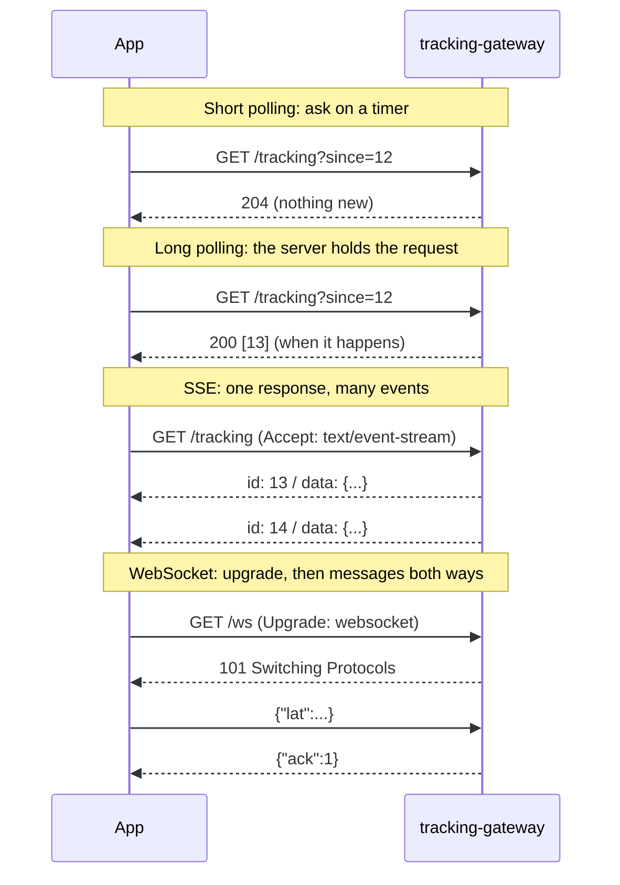

# 26. WebSockets & Server-Sent Events

<div class="badges" markdown><span class="badge badge-l2">L2 · Practitioner</span><span class="badge badge-l3">L3 · Senior/Lead</span><span class="badge badge-meta">Polling vs SSE vs WebSocket measured · 10,000 streams in one JVM · reconnect storms</span></div>

<div class="grid two" markdown>

!!! info "Prerequisites"
    - [Chapter 22](ch22-http-clients.md): connections, timeouts and virtual threads
    - [Chapter 25](ch25-asynchronous-messaging.md): where the events come from
    - [Chapter 18](../architecture-patterns/ch18-resilience-patterns.md): backoff and jitter

!!! abstract "What you'll learn"
    - **Short polling, long polling, SSE and WebSocket**: how each works on the wire and when to use it
    - Measured on real sockets: polling every second saw **10 of 40** rider positions at **~1,190 bytes** each; SSE and WebSocket saw **all 40** at **100–120 bytes**, about 1 ms stale
    - Measured: a 200-thread pool served **200** of 10,000 streams; virtual threads served **10,000** at ~**50 KB** each
    - Measured: 200,000 clients reconnecting at once took **20 s** and wasted **209,000** handshakes; with jitter, **9.9 s** and **none**
    - Spring's `SseEmitter` and WebSocket support, and fan-out across instances

</div>

---

## 1 · Introduction & Context

### The map that polled

FoodFleet's tracking screen shows the rider moving towards you. In 2024 the app asked `GET /orders/{id}/tracking` every five seconds, and the rider app posted its GPS position every four. At the dinner peak, 300,000 open tracking screens made 60,000 requests a second to the tracking service, almost all answered "nothing new", each carrying an 800-byte token through the gateway, TLS termination and authentication. Riders' phones spent battery opening requests. And the map still jumped every five seconds.

The data flows one way, from server to screen, as things happen. HTTP request/response is the wrong shape for that. The web has two standard answers:

- **Server-Sent Events (SSE)**: the client makes one HTTP request and the server keeps the response open, writing an event whenever there is one. One direction, plain HTTP, automatic reconnection.
- **WebSocket**: the client upgrades an HTTP connection into a full-duplex channel of messages in both directions.

Both turn many requests into one long-lived connection, which moves the hard problems from request rate to **connection count**: memory per connection, idle timeouts in proxies, what happens when thousands of connections drop at once, and how an event reaches the one server instance holding a given customer's connection.

### Where it comes from

<ul class="mh-timeline">
<li><span class="when">2005–2006 · Ajax and Comet</span><span class="what">XMLHttpRequest polling, then long polling and streaming hacks ("Comet") for push.</span></li>
<li><span class="when">2009–2011 · EventSource</span><span class="what">Server-Sent Events specified in HTML5; shipped by browsers from 2010–2011.</span></li>
<li><span class="when">2011 · RFC 6455</span><span class="what">The WebSocket protocol: an HTTP upgrade, then framed messages both ways.</span></li>
<li><span class="when">2013 · Spring Framework 4.0</span><span class="what">WebSocket support with SockJS fallback and STOMP messaging.</span></li>
<li><span class="when">2018 · RFC 8441</span><span class="what">WebSockets over HTTP/2 streams.</span></li>
<li><span class="when">2023 · Java 21 virtual threads</span><span class="what">A blocked thread per open connection becomes affordable again.</span></li>
</ul>

---

## 2 · Core Concepts & Terminology



Short polling
:   The client asks on a timer. Simple and cache-friendly, but stale by up to the interval, wasteful when nothing changes, and it misses intermediate states.

Long polling
:   The client asks; the server holds the request until there is something new (or a timeout), then the client asks again immediately. Fresh, but a full request and response per update.

Server-Sent Events (SSE)
:   A `text/event-stream` response that never ends. Each event has optional `id:`, `event:` and `retry:` fields and `data:` lines. Browsers' `EventSource` reconnects automatically and sends the last id in `Last-Event-ID`. Server to client only, text only.

WebSocket
:   An HTTP/1.1 `Upgrade` (or an HTTP/2 extended CONNECT) after which both sides exchange framed text or binary messages, plus ping/pong and close frames. Full duplex; no built-in reconnection or resume.

Heartbeat
:   A small message sent on an idle connection (an SSE comment line, a WebSocket ping) so that proxies and load balancers with idle timeouts don't close it, and so either side notices a dead peer.

Fan-out
:   Delivering one event to every connection interested in it, possibly spread over many server instances.

Slow consumer
:   A client that can't receive as fast as events are produced (bad network, backgrounded app). The server must bound what it buffers for it.

---

## 3 · How It Works Internally

### SSE on the wire

After normal response headers (`Content-Type: text/event-stream`), the body is a series of events separated by blank lines:

```text
retry: 6417
: tracking o-9001

id: 13
event: position
data: {"orderId":"o-9001","lat":12.938912,"lng":77.627721}

: keep-alive
```

A line starting with `:` is a comment (used as a heartbeat). `retry:` tells the client how many milliseconds to wait before reconnecting. When the connection drops, `EventSource` reconnects after that delay and sends `Last-Event-ID: 13`, so the server can replay what was missed. Over HTTP/1.1 browsers allow only about six connections per host, which limits SSE tabs; over HTTP/2 streams share one connection.

### WebSocket on the wire

The client sends `GET` with `Upgrade: websocket`, `Connection: Upgrade` and a random `Sec-WebSocket-Key`; the server answers `101 Switching Protocols` with `Sec-WebSocket-Accept`, the Base64 SHA-1 of the key plus a fixed GUID. From then on the TCP connection carries frames: a 2-byte header for small messages (FIN bit and opcode, then length), an optional extended length, a 4-byte mask for client-to-server frames, and the payload. The chapter's minimal server builds exactly these bytes; its test checks the RFC's own example (`dGhlIHNhbXBsZSBub25jZQ==` → `s3pPLMBiTxaQ9kYGzzhZRbK+xOo=`) and that "Hello" becomes `81 05 48 65 6c 6c 6f`, and the JDK's WebSocket client talks to it.

```java
--8<-- "code/chapters/ch26-websockets-sse/src/main/java/dev/foodfleet/ch26/experiment/MiniWebSocketServer.java:40:60"
```

### What an open connection costs a server

Each open stream holds a socket, kernel and user-space buffers, and whatever the server's programming model ties to it. With **thread-per-request on platform threads** (classic Servlet), an SSE response that never ends holds a thread forever: the pool size becomes the connection limit. With **virtual threads**, a blocked thread costs a few kilobytes of heap, so the limit moves to memory and file descriptors. Reactive servers (WebFlux on Netty) hold no thread at all between events. Load balancers and proxies also count: their idle timeouts (often 60 s) close silent connections, and their connection limits apply.

---

## 4 · Design Considerations & Trade-offs

### Measured: four ways to keep a map up to date

One tracking screen; the rider's position is published 40 times, every 250 ms, over real loopback sockets with a byte-counting proxy in between. Every HTTP request (and the SSE/WebSocket handshake) carries a 700-character bearer token, as the app's would. Short polling asks every second. *Staleness* is, for each published position, the time until the app had it or a newer one. Verified output (three runs; byte counts identical except short polling's 2,202–2,345 bytes down):

| Transport | Requests | Bytes up / down | Positions seen | Bytes per position | Staleness mean / p95 |
|---|---:|---:|---:|---:|---:|
| Short polling (1 s) | 12 | 9,704 / 2,202 | **10 / 40** | 1,191 | **564** / 1,000 ms |
| Long polling | 40 | 33,364 / 8,504 | 40 / 40 | 1,047 | 2.9 / 6.5 ms |
| Server-Sent Events | 1 | 826 / 3,963 | 40 / 40 | **120** | 1.3 / 2.7 ms |
| WebSocket | 1 | 923 / 3,114 | 40 / 40 | **101** | 1.0 / 2.3 ms |

- **Short polling** was half a second stale on average, saw a quarter of the positions (the map jumps instead of moving), and paid ~1,190 bytes for each one it saw, mostly the token going up.
- **Long polling** was fresh but made a full request per update: the most bytes of all. On loopback its staleness is tiny; over a mobile network, each update also waits for the next request's round trip.
- **SSE and WebSocket** delivered every position for **~100–120 bytes each**, with ~1 ms staleness, after a single handshake. WebSocket frames (2-byte header) are a little smaller than SSE's `id:`/`data:` lines and chunked encoding.

For FoodFleet's peak, the difference is the 60,000 requests a second described above versus a few hundred new connections a second.

### Measured: how many open streams one server holds

`CapacityServer` holds SSE streams with a blocked thread per stream (JDK HttpServer), run in its own JVM (`-Xmx1g`) so its memory can be measured; 10,000 clients connect from another JVM on the same 2-vCPU machine, then one event is broadcast to all. Two runs:

| Server threads | Clients | Streams served | Received the event | p50 / p99 delivery | Server RSS increase | Per stream |
|---|---:|---:|---:|---:|---:|---:|
| 200 platform threads (pool) | 10,000 | **200** | 200 | 20–90 / 26–100 ms | 54–63 MB | — |
| Virtual thread per stream | 10,000 | **10,000** | **10,000** | 221–230 / 317–387 ms | 465–492 MB | **~48–50 KB** |

- With a pool, **the pool size is the connection limit**: 9,800 clients connected at the TCP level and never got a response. Streams and thread pools don't mix.
- On virtual threads the same blocking code held all 10,000 streams at about **50 KB each** (socket buffers, per-stream queue, the virtual thread) and delivered the broadcast to all of them; delivery took a few hundred milliseconds because 10,000 clients and the server shared two vCPUs.
- At ~50 KB per stream, one instance with a few GB of memory can hold tens of thousands of tracking screens; file descriptor limits (`ulimit -n`), the load balancer and broadcast CPU are the next limits.

### Measured: when everyone reconnects at once

A load balancer restart drops 200,000 tracking connections. The fleet can complete 20,000 handshakes per second (TLS plus token check), so the best possible recovery is 10 s. A client gives up on an attempt after 5 s; the server doesn't know and still spends a handshake on it when it reaches the front of the queue. Simulation, verified output:

| Reconnect policy | 99% back after | Peak attempts/s | Attempts per client | Wasted handshakes |
|---|---:|---:|---:|---:|
| Immediately, then every 1 s | 20.4 s | 200,000 | 2.05 | **209,000** |
| Fixed 3 s (no randomness, like a browser's `EventSource` default) | 20.9 s | 200,000 | 1.68 | 135,400 |
| Exponential backoff, no jitter | 19.9 s | 200,000 | 1.78 | 155,600 |
| Exponential backoff, **full jitter** (first reconnect spread over 10 s) | **9.9 s** | **20,233** | 1.00 | **0** |
| Immediately, but the server **drops attempts whose client has given up** | 10.9 s | 200,000 | 1.49 | 0 |

- Every policy without randomness sent all 200,000 clients in the same second and took **twice the minimum** to recover, because the server spent most of its capacity on handshakes nobody was waiting for. Backoff alone doesn't help if everyone backs off in step.
- **Jitter** matched arrivals to capacity: recovery in the minimum time with no wasted work. For SSE the server controls this: send each client a random `retry:` value (the chapter's controller picks 1–10 s).
- **Deadline-aware shedding** on the server (check the attempt's age, or the client's deadline as in [chapter 23](ch23-grpc.md), before doing expensive work) recovered nearly as well even with impatient clients.

### SSE or WebSocket?

| Need | SSE | WebSocket |
|---|---|---|
| Server → client updates (tracking, notifications, dashboards) | Natural fit | Works |
| Client → server stream (GPS, chat, game input) | No (use ordinary requests) | Natural fit |
| Resume after reconnect | Built in (`Last-Event-ID`, `retry:`) | Build it yourself |
| Through proxies, CDNs, corporate networks | Plain HTTP | Usually fine; some proxies need configuration |
| Auth | Ordinary HTTP auth on the request | At the handshake (headers or a ticket); browsers can't set custom headers on `new WebSocket()` |
| Binary data | No (text) | Yes |
| HTTP/2 multiplexing | Yes | With RFC 8441 support |

FoodFleet uses **SSE for customers** (one-way, resumable, plain HTTP) and **WebSocket for riders** (a continuous stream of positions in, acknowledgements and instructions out). When the app is in the background, neither works reliably on mobile: **push notifications** (FCM, APNs) carry the important moments ("Your order is arriving") instead.

### Fan-out across instances

With 20 gateway instances and 200,000 open tracking screens, a position update for order `o-9001` must reach the one instance holding that customer's stream. At 2,000 updates a second:

| Approach | How | Messages into the gateway fleet per second | Costs |
|---|---|---:|---|
| Broadcast | Every instance consumes every update (a Kafka consumer group per instance, or a pub/sub channel) and drops the ones it has no stream for | 40,000 (20 × 2,000) | Simple; every instance does 20× the work; fine at small scale |
| Routed | A registry maps order → instance (Redis); the publisher sends to that instance's channel | 2,000 | Registry writes on every connect and reconnect; stale entries after crashes |
| Per-key channels | Instances subscribe to a channel per order they serve (Redis pub/sub `tracking:o-9001`) | 2,000 | Many channels; subscription churn on reconnects |
| Partitioned | The load balancer routes `hash(orderId)` to an instance that consumes only that partition | 2,000 | Routing at the edge; rebalancing moves connections when instances change |

FoodFleet started with broadcast (one Kafka consumer group per instance on a compact `tracking-positions` topic) and moved to per-order Redis pub/sub channels when the fleet passed ten instances. Spring's STOMP support offers the same idea for WebSocket apps through a **broker relay** (RabbitMQ or ActiveMQ as the shared broker).

---

## 5 · Hands-on Implementation

```text
ch26-websockets-sse/
└── src/main/java/dev/foodfleet/ch26/
    ├── experiment/  TransportComparison, TrackingHttpServer, MiniWebSocketServer, ByteCountingProxy,
    │                ConnectionCapacity, CapacityServer, ReconnectStorm
    └── tracking/    TrackingStreamController (SSE), RiderLocationHandler + WebSocketConfig +
                     RiderIdentityInterceptor (WebSocket), TrackingHub
```

### 🔵 Level 2: an SSE stream with resume

<div class="badges" markdown><span class="badge badge-l2">L2 · Practitioner</span></div>

`SseEmitter` keeps the response open; the controller replays what the client missed (`Last-Event-ID`), randomises the reconnect delay, cleans up on completion, timeout or error, sends heartbeats, and sheds load with `503 Retry-After` when the instance is full.

```java
--8<-- "code/chapters/ch26-websockets-sse/src/main/java/dev/foodfleet/ch26/tracking/TrackingStreamController.java:19:90"
```

```yaml
--8<-- "code/chapters/ch26-websockets-sse/src/main/resources/application.yml"
```

### 🔵 Level 2: a WebSocket for riders

<div class="badges" markdown><span class="badge badge-l2">L2 · Practitioner</span></div>

The rider app keeps one WebSocket open for the shift. Messages are validated (a malformed one closes the session with 1007), rate-limited to one per second, and acknowledged. `ConcurrentWebSocketSessionDecorator` serialises sends and bounds the time and buffer spent on a slow phone.

```java
--8<-- "code/chapters/ch26-websockets-sse/src/main/java/dev/foodfleet/ch26/tracking/RiderLocationHandler.java:15:67"
```

### 🟣 Level 3: authentication at the handshake

<div class="badges" markdown><span class="badge badge-l3">L3 · Senior/Lead</span></div>

A WebSocket is authenticated once, when it opens. The gateway verifies the rider's token and sets `X-Rider-Id`; the interceptor refuses the upgrade without it and stores the identity in the session. Browsers can't set custom headers on a WebSocket, so browser clients typically use a cookie or a short-lived ticket in the URL obtained from an authenticated request.

```java
--8<-- "code/chapters/ch26-websockets-sse/src/main/java/dev/foodfleet/ch26/tracking/RiderIdentityInterceptor.java:10:34"
```

```java
--8<-- "code/chapters/ch26-websockets-sse/src/main/java/dev/foodfleet/ch26/tracking/WebSocketConfig.java:8:26"
```

### 🟣 Level 3: testing over real connections

<div class="badges" markdown><span class="badge badge-l3">L3 · Senior/Lead</span></div>

`@SpringBootTest(webEnvironment = RANDOM_PORT)` starts the server; the JDK's `HttpClient` reads the SSE stream line by line and its `WebSocket` client plays the rider. Note `shutdownNow()`: closing an HTTP client waits for its open streams.

```java
--8<-- "code/chapters/ch26-websockets-sse/src/test/java/dev/foodfleet/ch26/tracking/TrackingIntegrationTest.java:45:69"
```

### 🔴 Level 4: running a connection fleet

<div class="badges" markdown><span class="badge badge-l4">L4 · Architect</span></div>

- **Separate the connection tier** (tracking-gateway) from business services: it scales on connections and memory, deploys differently, and its instances are stateful for the life of a connection.
- **Deploys drain gradually**: stop accepting new streams, then close existing ones in batches over a minute, so clients (with jittered `retry:`) reconnect to other instances without a storm. Remember that graceful shutdown otherwise waits for open streams.
- **Idle timeouts aligned end to end**: heartbeat interval < the shortest idle timeout among load balancer, proxies and NAT (FoodFleet: 15 s heartbeat, 60 s LB timeout).
- **Capacity by connections**: alert on open streams per instance, file descriptors and broadcast latency, not only on requests per second.
- **Fan-out** chosen for the fleet size (above), with the event source idempotent and ordered per order (chapter 25), so a resumed stream never shows an older position after a newer one.

### Run and verify

```text
$ java -cp $CP dev.foodfleet.ch26.experiment.TransportComparison
transport             requests  conns  bytes up bytes down  updates seen bytes/update stale mean stale p95
SHORT_POLLING_1S            12      1      9704       2202         10/40         1191      564.3     999.7
LONG_POLLING                40      1     33364       8504         40/40         1047        2.9       6.5
SERVER_SENT_EVENTS           1      1       826       3963         40/40          120        1.3       2.7
WEBSOCKET                    1      1       923       3114         40/40          101        1.0       2.3

$ java -cp $CP dev.foodfleet.ch26.experiment.ConnectionCapacity 10000
executor    clients  streams open  received   p50 ms   p99 ms      RSS +MB  KB/stream
pool200       10000           200       200     19.7     26.2         63.4      324.6
virtual       10000         10000     10000    229.9    387.4        464.8       47.6

$ java -cp $CP dev.foodfleet.ch26.experiment.ReconnectStorm
reconnect policy                 99% back after    peak attempts/s    attempts/client wasted handshakes
IMMEDIATE_THEN_1S                         20.4s             200000               2.05           209000
FIXED_3S                                  20.9s             200000               1.68           135400
EXPONENTIAL_NO_JITTER                     19.9s             200000               1.78           155600
EXPONENTIAL_FULL_JITTER                    9.9s              20233               1.00                0
IMMEDIATE_SERVER_SHEDS_STALE              10.9s             200000               1.49                0
```

(The pool's "KB/stream" divides the memory of 200 platform threads by the 200 streams they serve; it isn't comparable with the virtual-thread figure.)

!!! question "Try it"
    1. Change the transport experiment to publish every 2 s instead of 250 ms. How do short polling's bytes per update and staleness compare now? When is polling good enough?
    2. Put a 60-second idle timeout in `ByteCountingProxy` and remove the SSE heartbeat. What happens to the stream, and what does `Last-Event-ID` save you?
    3. In `TrackingHub`, listeners run on the publisher's thread. Make one SSE client read very slowly and observe the rider's WebSocket. How would you bound it?
    4. Run `ConnectionCapacity` with 15,000 clients. What fails first on your machine: memory, file descriptors or ports?

---

## 6 · Production Readiness

- [x] **The right transport per direction**: SSE for server → client, WebSocket only where the client streams too, push notifications for backgrounded apps
- [x] **No thread pool as the connection limit**: virtual threads (or a reactive server), `server.tomcat.max-connections` and `ulimit -n` sized for the target
- [x] **Heartbeats** shorter than every idle timeout on the path
- [x] **Resume**: event ids, a replay buffer per stream, `Last-Event-ID` handled; WebSocket clients send their last id on reconnect
- [x] **Jittered reconnects** (randomised `retry:`, full-jitter backoff in apps) and **gradual draining** on deploy
- [x] **Load shedding**: refuse new streams (503 + `Retry-After`) before memory runs out; drop stale handshake work
- [x] **Slow consumers bounded**: per-connection send time and buffer limits; conflate positions (latest wins) rather than queue them
- [x] **Auth at the handshake** and re-checked for long sessions (token expiry closes or refreshes the session); origins restricted for browser WebSockets
- [x] **Input validated and rate-limited** on inbound WebSocket messages
- [x] **Fan-out** strategy chosen for the fleet size; monitored end-to-end latency from event to screen
- [x] **Metrics**: open connections per instance, connects/disconnects per second, broadcast latency, replay hits

---

## 7 · Anti-patterns & Pitfalls

!!! pitfall "Incident 1: the streams that died every 60 seconds"
    **Context.** The first SSE release sent events only when the rider moved.
    **Symptoms.** Waiting customers' maps froze; logs showed every stream reconnecting about once a minute, and positions published during the gap never appeared.
    **Root cause.** The load balancer's 60 s idle timeout closed silent streams; the server didn't assign event ids, so reconnecting clients couldn't resume.
    **Fix.** A comment heartbeat every 15 s, event ids with a 50-event replay buffer, and `Last-Event-ID` handling.

!!! pitfall "Incident 2: the deploy that took tracking down for half a minute"
    **Context.** A rolling restart of the load balancers dropped 200,000 streams at once.
    **Symptoms.** Handshake errors and 5 s timeouts for about 20 s; gateway CPU at 100% on TLS; the gateway's own health checks failed, triggering more restarts.
    **Root cause.** Every client reconnected immediately and in step; the gateways spent most of their capacity on handshakes whose clients had already given up (measured: 209,000 wasted, 20.4 s to recover).
    **Fix.** Randomised `retry:` per client, full-jitter backoff in the apps, deadline-aware shedding in the gateway, and draining in batches on deploys.

!!! pitfall "Incident 3: one slow phone, every rider delayed"
    **Context.** Rider positions were published to customer streams on the rider's WebSocket handler thread.
    **Symptoms.** Riders' acknowledgements arrived seconds late in some areas; heap grew with buffered output.
    **Root cause.** Writing to a customer on a poor connection blocked the publishing thread, and output for slow clients was buffered without limit.
    **Fix.** Per-stream bounded queues that keep only the latest position (conflation), sends on the stream's own thread, and send-time and buffer limits that close hopeless connections.

| Anti-pattern | Symptom | Fix |
|---|---|---|
| Polling for live data | Request floods, stale and jumpy UI | SSE or WebSocket |
| WebSocket for one-way updates | Custom reconnect/resume logic, proxy issues | SSE |
| Streams on a fixed thread pool | Connection limit = pool size (measured: 200 of 10,000) | Virtual threads or reactive |
| No heartbeats | Silent disconnects by proxies | Comments/pings under the idle timeout |
| No event ids | Lost updates on every reconnect | Ids + replay buffer + `Last-Event-ID` |
| Synchronized reconnects | Reconnect storms | Jitter; randomised `retry:`; draining |
| Unbounded per-client buffers | Memory growth, OOM | Bounded queues, conflation, send limits |
| Auth only at connect, forever | Revoked users stay connected | Session expiry tied to token lifetime |
| Business logic in the connection tier | Deploys disconnect everyone | Thin gateway; logic in services |

---

## 8 · Enterprise Case Study

### FoodFleet: live tracking

!!! decision "ADR-026: Customers receive tracking over SSE, riders send positions over WebSocket, through a dedicated tracking gateway"
    **Status:** Accepted · **Date:** 2024-12-02

    **Context.** Tracking by polling produced 60,000 requests a second at peak, maps that jumped every 5 s, and rider battery drain. Customer updates are one-way; rider updates are a continuous inbound stream. Mobile apps go to the background often.

    **Decision.** A separate `tracking-gateway` service on Spring MVC with virtual threads. Customers: `GET /orders/{id}/tracking` as SSE, with event ids, a 50-event replay buffer, a random `retry:` of 1–10 s, 15 s heartbeats, and 503 when an instance reaches 20,000 streams. Riders: one WebSocket per shift at `/ws/rider`, authenticated at the handshake by the gateway's `X-Rider-Id`, validated, rate-limited to one position per second. Positions flow through Kafka (`tracking-positions`, keyed by order) and per-order Redis pub/sub channels to the instance holding each stream. Deploys drain streams in batches over 60 s. Push notifications (FCM/APNs) carry key moments when the app is in the background.

    **Consequences.** ✅ Tracking traffic fell from 60,000 requests a second to a few hundred connects a second; the map moves smoothly. ✅ One instance holds ~20,000 streams in about 1 GB. ⚠️ A stateful connection tier to operate: draining, fan-out, connection metrics. ⚠️ Reconnect behaviour must be engineered (jitter, shedding) or a network blip becomes an outage.

### Fintech analogue: market data to trading screens 🔴

Trading front ends stream prices over WebSockets with binary frames and **conflation**: a slow client gets the latest price per instrument, never a growing backlog. Subscriptions are authorised per instrument and entitlement at subscribe time and re-checked when entitlements change; sessions end when the user's token expires. Heartbeats run every few seconds, because a silently dead connection showing stale prices is a financial risk; the screen marks data stale when heartbeats stop.

### E-commerce analogue: order status and flash sales

An online store pushes order status changes and "only 3 left" stock counters to product and checkout pages over SSE, behind a CDN or edge proxy configured for streaming responses. During a flash sale, the stock counter is conflated (one update per second per product) and the reconnect delay is randomised, because the sale's start is exactly the moment when every page opens at once.

---

## 9 · Interview Q&A + Summary

#### Q1. What are the options for pushing updates from server to client? · <span class="badge badge-l1">L1</span><span class="badge badge-l2">L2</span> · Cognizant · SAP · Flipkart

**Short answer:** Short polling (ask on a timer), long polling (the server holds the request until there is news), Server-Sent Events (a streaming HTTP response of events) and WebSocket (a full-duplex connection after an HTTP upgrade); plus push notifications for mobile apps in the background.

#### Q2. SSE or WebSocket: how do you choose? · <span class="badge badge-l2">L2</span> · Amazon · Flipkart

**Short answer:** SSE when data flows server → client: it's plain HTTP, has automatic reconnection and resume (`Last-Event-ID`), and works through proxies. WebSocket when the client also streams (chat, GPS, collaborative editing, games) or you need binary frames. Measured here, both delivered every update for ~100–120 bytes each.

#### Q3. Why is polling a problem at scale? · <span class="badge badge-l2">L2</span> · Amazon · Cognizant

**Short answer:** Each poll is a full request (headers, auth, TLS, routing), most answer "nothing new", data is stale by up to the interval, and intermediate states are missed. Here 1 s polling saw 10 of 40 positions at ~1,190 bytes each, 564 ms stale on average.

#### Q4. How does the WebSocket handshake work? · <span class="badge badge-l2">L2</span> · SAP · any

**Short answer:** The client sends an HTTP GET with `Upgrade: websocket`, `Connection: Upgrade`, `Sec-WebSocket-Key` and `Sec-WebSocket-Version: 13`; the server responds `101 Switching Protocols` with `Sec-WebSocket-Accept` = Base64(SHA-1(key + a fixed GUID)). After that, both sides send frames; client frames are masked.

#### Q5. How do you scale WebSocket or SSE connections across many servers? · <span class="badge badge-l3">L3</span> · Amazon · Flipkart · Goldman Sachs

**Short answer:** Keep connections in a dedicated, horizontally scaled tier; get events to the right instance by broadcast (simple, N× work), routing via a registry, per-key pub/sub channels, or partitioned routing at the load balancer; use a shared broker (Kafka, Redis, or a STOMP broker relay). Size instances by connections and memory, not requests per second.

#### Q6. How many concurrent connections can one Java server hold? · <span class="badge badge-l3">L3</span> · Goldman Sachs · JP Morgan

**Short answer:** With a blocked platform thread per connection, about as many as the thread pool (measured: 200 of 10,000). With virtual threads or a reactive server, tens of thousands per instance; here 10,000 SSE streams used ~50 KB each. File descriptors, memory, the load balancer and broadcast CPU become the limits.

#### Q7. What is a reconnect storm and how do you prevent it? · <span class="badge badge-l3">L3</span> · Amazon · any

**Short answer:** Many clients losing connections at once and reconnecting in step, overloading handshakes; timed-out attempts waste capacity and trigger retries. Prevent it with jittered reconnect delays (randomised SSE `retry:`, full-jitter backoff), gradual draining on deploys, and servers that drop work for clients that have already given up. Measured: 20.4 s and 209,000 wasted handshakes without jitter, 9.9 s and none with.

#### Q8. How do you avoid losing updates when a connection drops? · <span class="badge badge-l2">L2</span><span class="badge badge-l3">L3</span> · SAP · Flipkart

**Short answer:** Give every event an id, keep a short replay buffer per stream, and have the client send its last id on reconnect (`Last-Event-ID` for SSE, a resume message for WebSocket). For state like positions, sending the latest state on reconnect may be enough.

#### Q9. Why do long-lived connections need heartbeats? · <span class="badge badge-l2">L2</span> · any

**Short answer:** Load balancers, proxies and NAT devices close connections that are idle longer than their timeout, often silently; heartbeats keep them open and let both sides detect dead peers. Send them more often than the shortest idle timeout on the path.

#### Q10. How do you authenticate WebSocket connections? · <span class="badge badge-l2">L2</span><span class="badge badge-l3">L3</span> · JP Morgan · SAP

**Short answer:** At the handshake: headers from native clients (or verified by the gateway), cookies or a short-lived ticket for browsers (which can't set custom headers on WebSocket). Store the identity in the session, check origins for browsers, authorise each subscription, and close or refresh sessions when tokens expire.

#### Q11. What happens with a slow consumer, and how do you handle it? · <span class="badge badge-l3">L3</span> · Goldman Sachs · Amazon

**Short answer:** Its output buffers grow or the sending thread blocks, which can delay other clients and exhaust memory. Bound per-connection buffers and send time, conflate (keep only the latest value per key), send asynchronously per connection, and close connections that can't keep up.

#### Q12. How does Spring support SSE and WebSockets? · <span class="badge badge-l2">L2</span> · SAP · Cognizant

**Short answer:** Spring MVC's `SseEmitter` (or WebFlux's `Flux<ServerSentEvent>`) for SSE; Spring WebSocket's `WebSocketHandler`, handshake interceptors and `ConcurrentWebSocketSessionDecorator` for raw WebSockets; and STOMP messaging over WebSocket with `@MessageMapping`, a simple in-memory broker or a broker relay to RabbitMQ/ActiveMQ for multi-instance fan-out.

### Key takeaways

- **Push beats polling** for live data: every update, ~1 ms stale, ~100 bytes each, versus a quarter of the updates at ~1,190 bytes.
- **SSE for one-way updates, WebSocket when the client streams too**; push notifications for the background.
- Connections, not requests, are the scaling unit: **virtual threads** held 10,000 streams at ~50 KB each; a **thread pool** held 200.
- **Heartbeats, event ids and replay** keep streams alive and complete.
- **Jitter** turns a reconnect storm into an orderly recovery: 9.9 s instead of 20.4 s, no wasted work.

### Further reading

- HTML Living Standard, [Server-sent events](https://html.spec.whatwg.org/multipage/server-sent-events.html)
- [RFC 6455: The WebSocket Protocol](https://www.rfc-editor.org/rfc/rfc6455) and [RFC 8441: Bootstrapping WebSockets with HTTP/2](https://www.rfc-editor.org/rfc/rfc8441)
- Spring Framework reference: [WebSockets](https://docs.spring.io/spring-framework/reference/web/websocket.html) and [Asynchronous Requests (SSE)](https://docs.spring.io/spring-framework/reference/web/webmvc/mvc-ann-async.html)
- AWS Architecture Blog, *Exponential Backoff and Jitter* (2015)

---

**Previous:** [← 25. Asynchronous Messaging](ch25-asynchronous-messaging.md) · **Next:** [27. API Contracts & Schema Evolution →](ch27-api-contracts.md)
