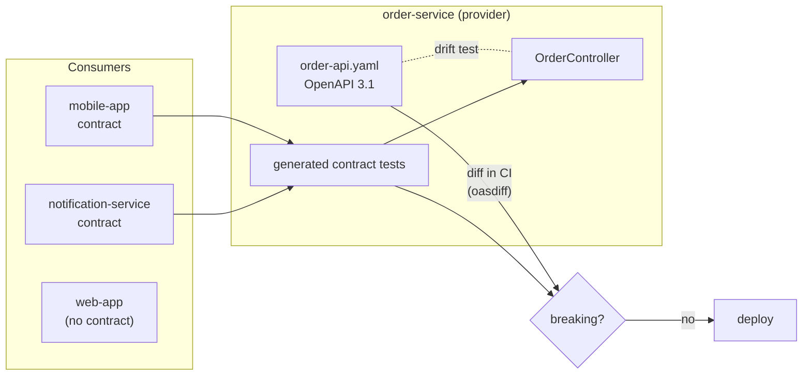

# 27. API Contracts & Schema Evolution

<div class="badges" markdown><span class="badge badge-l2">L2 · Practitioner</span><span class="badge badge-l3">L3 · Senior/Lead</span><span class="badge badge-l4">L4 · Architect</span><span class="badge badge-meta">OpenAPI 3.1 · AsyncAPI 3.0 · Spring Cloud Contract · Jackson 3 tolerant reader</span></div>

<div class="grid two" markdown>

!!! info "Prerequisites"
    - [Chapter 21](ch21-rest-api-design.md): resources, versioning and problem details
    - [Chapter 23](ch23-grpc.md): field numbers and protobuf's evolution rules
    - [Chapter 19](../architecture-patterns/ch19-event-driven-architecture.md): events as contracts between teams

!!! abstract "What you'll learn"
    - What a contract is: **shape, behaviour and meaning**, and which of those tools can check
    - **OpenAPI-first** and **AsyncAPI** documents as the source of truth, with drift tests in the build
    - The **tolerant reader**: on a year of changes, strict consumers broke on **11 of 12**; tolerant readers on **8**
    - **Structural diff vs consumer-driven contracts**: each caught changes the other missed; together they caught **7 of 11**; a change of **meaning** escaped both
    - **Compatibility modes** in schema registries and what they mean for deploy order

</div>

---

## 1 · Introduction & Context

### A year of "small" changes

FoodFleet's `GET /orders/{id}` started simple in 2024 and changed twelve times in a year: a field added for promised delivery times, a new status for orders ready at the counter, a rename for clarity, amounts sent as strings for decimal safety, a field removed because "nobody uses it", an ETA that started counting to pickup instead of delivery, a "harmless" change returning an empty 200 for unknown orders instead of 404.

Each change was reviewed. Each looked compatible to its author. Eleven of the twelve broke at least one of the five consumers: the Android app crashed on a field it didn't know, notifications stopped for cancelled orders, analytics silently lost a day of revenue figures, the web app showed blank addresses.

An API is a contract between teams that deploy independently. The contract has three layers:

| Layer | Example | Checkable by tools? |
|---|---|---|
| **Shape** | `etaMinutes` is an integer; `status` is one of seven values | Yes: schema diff, schema registry |
| **Behaviour** | An unknown order returns 404 with a problem document | Partly: contract tests with examples |
| **Meaning** | `etaMinutes` counts to delivery, not pickup | No: only people, docs and versioning |

This chapter is about keeping all three stable while the API keeps changing.

### Where it comes from

<ul class="mh-timeline">
<li><span class="when">1980 · Postel's robustness principle</span><span class="what">"Be conservative in what you send, liberal in what you accept" (RFC 761).</span></li>
<li><span class="when">2006 · Consumer-driven contracts</span><span class="what">Ian Robinson's article: let consumers state what they need, and test providers against it.</span></li>
<li><span class="when">2011 · Tolerant reader; Swagger</span><span class="what">Fowler names the pattern; Swagger describes REST APIs in a machine-readable document.</span></li>
<li><span class="when">2013–2016 · Pact, Spring Cloud Contract</span><span class="what">Contract-testing tools for HTTP and messaging.</span></li>
<li><span class="when">2015 · OpenAPI Initiative, schema registries</span><span class="what">Swagger becomes OpenAPI under the Linux Foundation; Confluent's Schema Registry enforces Avro compatibility for Kafka.</span></li>
<li><span class="when">2021 · OpenAPI 3.1</span><span class="what">Full alignment with JSON Schema 2020-12.</span></li>
<li><span class="when">2023 · AsyncAPI 3.0</span><span class="what">Channels, operations and messages for event-driven APIs, separated cleanly.</span></li>
</ul>

---

## 2 · Core Concepts & Terminology



Contract
:   Everything a consumer relies on: shape, behaviour, meaning, and also performance and availability expectations.

API-first (spec-first)
:   The OpenAPI/AsyncAPI document is written and reviewed before the code, and the code is checked against it (generation or drift tests). The opposite, code-first, generates the document from the code.

Backward compatible
:   New provider, old consumer: existing consumers keep working after the change. (In schema registries, "backward" is defined from the reader's side: the new schema can read data written with the old one. Read the definition each tool uses.)

Forward compatible
:   Old provider, new consumer: a consumer built for the new version works against the old provider (or, for data, the old schema can read data written with the new one).

Tolerant reader
:   A consumer that reads only what it needs, ignores unknown fields, and maps unknown enum values to a safe default. The single most effective protection against "additive" changes.

Structural diff
:   Comparing two versions of a schema document and classifying changes (tools: oasdiff, openapi-diff, Buf for protobuf, schema registry compatibility checks).

Consumer-driven contract (CDC)
:   Each consumer publishes the requests it makes and the parts of responses it uses; the provider's build replays them against the real provider. Tools: Pact, Spring Cloud Contract.

Expand and contract (parallel change)
:   Make a breaking change in steps: add the new form alongside the old, migrate consumers, then remove the old form.

---

## 3 · How It Works Internally

### Why "additive" changes break consumers

A change is only safe if every consumer's client library and code tolerate it. What the decoders do by default matters, and it differs:

| Client | Unknown field | Unknown enum value |
|---|---|---|
| Jackson 3 (Spring Boot 4) | Ignored (`FAIL_ON_UNKNOWN_PROPERTIES` now defaults to false) | **Fails** (`InvalidFormatException`) |
| Jackson 2 without Spring Boot | **Fails** | **Fails** |
| Kotlin serialization (Android) | **Fails** unless `ignoreUnknownKeys = true` | **Fails** |
| Swift `Codable` | Ignored | **Fails** for enums |
| TypeScript (web) | Ignored (no runtime check) | Ignored, but `switch` falls through |
| Protobuf (chapter 23) | Kept as unknown field | Kept as the number |

The chapter's `TolerantReaderTest` checks the Jackson 3 row against Jackson 3.0 itself:

```java
--8<-- "code/chapters/ch27-api-contracts/src/test/java/dev/foodfleet/ch27/consumer/TolerantReaderTest.java:11:40"
```

```java
--8<-- "code/chapters/ch27-api-contracts/src/main/java/dev/foodfleet/ch27/consumer/OrderSummary.java:5:22"
```

### What a structural diff sees

A diff tool compares two schema documents. It reliably flags removals, type changes, a response property becoming optional, and removed enum values; it usually only *warns* about added enum values, and it says nothing about added fields. It can't see behaviour that isn't in the document, or meaning at all. It also doesn't know who uses what, so removing a field nobody reads is reported as breaking.

### What a consumer-driven contract checks

A contract is an executable example from a consumer: "when I `GET /orders/o-9001`, I need a 200 with `id`, `status`, `etaMinutes` (an integer) and `restaurant.name`". The provider's build turns it into a test against the real controller. Extra fields in the response are fine; missing or retyped listed fields fail. It also pins down behaviour ("an unknown order is a 404 problem"). It can only check what consumers wrote down, with the example values used, and only for consumers that publish contracts.

```yaml
--8<-- "code/chapters/ch27-api-contracts/src/test/resources/contracts/tracking-service/shouldReturnOrderStatus.yml"
```

---

## 4 · Design Considerations & Trade-offs

### Measured: a year of changes against five consumers

The `compat` package models FoodFleet's five consumers of `GET /orders/{id}` (what each reads, whether its decoder is strict about unknown fields and enum values, which status values its logic acts on, whether it publishes contracts) and applies the twelve changes in order. Before each change, every consumer is up to date with the previous version. For each change it reports who actually breaks, the structural diff's verdict, and whether the contract tests fail. Verified output:

| # | Change | Breaks (as built) | Breaks (tolerant readers) | Diff | Contracts |
|---:|---|---|---|---|---|
| 1 | Add optional field `promisedBy` | mobile | – | – | pass |
| 2 | Add status `READY_FOR_PICKUP` | mobile, notification | – | warn | pass |
| 3 | Rename `eta` → `etaMinutes` | mobile, notification | mobile, notification | **error** | **fail** |
| 4 | `riderName` absent until assigned | mobile | mobile | **error** | pass |
| 5 | `totalPaise` as a string | web, analytics | web, analytics | **error** | **fail** |
| 6 | Remove `legacyCode` (nobody reads it) | – | – | **error** | pass |
| 7 | Add `restaurant.cuisine` | mobile | – | – | pass |
| 8 | `etaMinutes` now counts to pickup | mobile, notification | mobile, notification | – | pass |
| 9 | `placedAt` as epoch millis | analytics | analytics | **error** | **fail** |
| 10 | Remove `restaurant.area` | web | web | **error** | pass |
| 11 | Unknown order: empty 200 instead of 404 | mobile, web, notification | mobile, web, notification | – | **fail** |
| 12 | Split `CANCELLED` into two values | mobile, notification | notification | **error** | pass |

| | Changes that broke someone | Diff caught | Contracts caught | Either caught | Missed by both | Diff false alarms |
|---|---:|---:|---:|---:|---:|---:|
| Consumers as built | **11** | 6 | 4 | 7 | **4** | 1 |
| All consumers tolerant readers | **8** | 6 | 4 | 7 | **1** | 1 |

What this shows:

- **Strict readers turned three "safe" additions into outages** (1, 2 and 7). Neither tool flags them, because they are compatible by the rules; the consumer was the problem. Making every consumer a tolerant reader removed those breaks (and mobile's break in 12) and left the tools with only one break they missed.
- **The diff and the contracts catch different things.** The diff caught optionality (4) and the removal of a field used by a consumer without contracts (10); only the contracts caught the behaviour change (11), which isn't in the schema. The diff raised one false alarm (6) that contracts correctly ignored, because no contract uses `legacyCode`.
- **Contracts only protect consumers who write them**: the web app had none, so the contracts couldn't see changes 5 and 10 breaking it.
- **A change of meaning (8) escaped everything.** Same name, same type, different meaning: only review, documentation and treating it as a new field (`etaToPickupMinutes`) prevent it.

This is a model: how each consumer decodes is set explicitly, not discovered. The direction of each conclusion matches FoodFleet's incident history, and the Jackson 3 behaviour it assumes is checked against the real library above.

### Compatibility rules for responses and events

| Change | Response / event (consumers read it) | Request (provider reads it) |
|---|---|---|
| Add an optional field | ✅ for tolerant readers | ✅ |
| Add a required field | ✅ for tolerant readers | ❌ old clients don't send it |
| Remove a field | ❌ if anyone reads it | ✅ if the provider ignores it |
| Make a field optional / nullable | ❌ for consumers that need it | ✅ |
| Make a field required | ✅ | ❌ |
| Rename a field | ❌ (it's remove + add) | ❌ |
| Change a type or format | ❌ | ❌ |
| Add an enum value | ⚠️ breaks strict readers; document it as an open set | ✅ |
| Remove an enum value | ❌ for logic that acts on it | ❌ for clients that send it |
| Change meaning or units | ❌ and invisible to tools | ❌ |
| Change behaviour (status codes, defaults, ordering) | ❌ usually; contract tests catch some | ❌ |

### Schema registry modes and deploy order

For events, a schema registry (Confluent, Apicurio, Buf for protobuf) checks every new schema version against previous ones before producers can use it. The mode decides which changes are allowed, and therefore **who must deploy first**:

| Mode | New schema can… | Allowed changes (Avro) | Deploy first |
|---|---|---|---|
| `BACKWARD` (default) | read data written with the previous schema | Delete fields; add optional fields | Consumers |
| `FORWARD` | have its data read by the previous schema | Add fields; delete optional fields | Producers |
| `FULL` | both | Add or delete optional fields | Either |
| `*_TRANSITIVE` | the same, against **all** earlier versions, not just the last | | |
| `NONE` | anything | | Coordinate by hand |

Topics are read long after they are written (replays, new consumers, retention), so FoodFleet uses `FULL_TRANSITIVE` for domain events: any consumer can read any event ever written, and deploys don't need an order.

### When a change must break: versioning

When a breaking change is really needed:

1. **Expand**: add the new field or endpoint alongside the old (`etaToPickupMinutes` next to `etaMinutes`; `/v2/orders/{id}` or a new media type next to v1).
2. **Migrate**: tell consumers (deprecation headers, `Sunset`, changelog, the `x-consumers` list in the document), and watch usage of the old form per consumer.
3. **Contract**: remove the old form when usage is zero, or after the announced date.

For events, publish the new version as a new event type or to a new topic, and run both until consumers have moved ([chapter 15](../architecture-patterns/ch15-outbox-inbox-cdc.md)'s outbox can write both).

---

## 5 · Hands-on Implementation

```text
ch27-api-contracts/
├── src/main/resources/static/contracts/
│   ├── order-api.yaml                 OpenAPI 3.1: the Order API
│   └── order-events.asyncapi.yaml     AsyncAPI 3.0: the order-events topic
├── src/main/java/dev/foodfleet/ch27/
│   ├── api/       OrderController, OrderView
│   ├── consumer/  OrderSummary (tolerant reader)
│   └── compat/    Schema, Consumer, StructuralDiff, ContractChecks, ChangeHistory
├── src/test/resources/contracts/tracking-service/   consumer contracts (YAML)
└── verify/validate_contracts.py       documents and responses against the official schemas
```

### 🔵 Level 2: the contract documents

<div class="badges" markdown><span class="badge badge-l2">L2 · Practitioner</span></div>

The OpenAPI document is reviewed like code. It states what the schema can't say on its own: `status` is an **open set** that clients must tolerate, `riderName` is absent until assigned, and who the consumers are. Both documents validate against the official OpenAPI 3.1 and AsyncAPI 3.0.0 JSON Schemas, and two real responses (as Jackson 3 writes `OrderView`) validate against the `Order` schema.

```yaml
--8<-- "code/chapters/ch27-api-contracts/src/main/resources/static/contracts/order-api.yaml"
```

```yaml
--8<-- "code/chapters/ch27-api-contracts/src/main/resources/static/contracts/order-events.asyncapi.yaml"
```

### 🔵 Level 2: the spec and the code can't drift

<div class="badges" markdown><span class="badge badge-l2">L2 · Practitioner</span></div>

Whether the code is generated from the document or written by hand, a test compares the operations the document declares with the ones the application implements.

```java
--8<-- "code/chapters/ch27-api-contracts/src/test/java/dev/foodfleet/ch27/api/SpecDriftTest.java:16:47"
```

### 🟣 Level 3: consumer-driven contracts with Spring Cloud Contract

<div class="badges" markdown><span class="badge badge-l3">L3 · Senior/Lead</span></div>

Consumers' contracts live in the provider's repository (or are pulled from a contracts repository). The Maven plugin generates a JUnit 5 test per contract, extending a base class that sets up the controller; it also packages WireMock stubs that consumers use in their own tests.

```xml
--8<-- "code/chapters/ch27-api-contracts/pom.xml:25:60"
```

```java
--8<-- "code/chapters/ch27-api-contracts/src/test/java/dev/foodfleet/ch27/api/ContractVerifierBase.java:6:16"
```

```yaml
--8<-- "code/chapters/ch27-api-contracts/src/test/resources/contracts/tracking-service/shouldReturnProblemForUnknownOrder.yml"
```

### 🟣 Level 3: tolerant readers in Spring Boot

<div class="badges" markdown><span class="badge badge-l3">L3 · Senior/Lead</span></div>

In Spring Boot 4 (Jackson 3), unknown fields are already ignored; unknown enum values need one property and an `@JsonEnumDefaultValue` constant, plus business logic that gives that constant a sensible meaning.

```yaml
--8<-- "code/chapters/ch27-api-contracts/src/main/resources/application.yml"
```

### 🔴 Level 4: the governance pipeline

<div class="badges" markdown><span class="badge badge-l4">L4 · Architect</span></div>

FoodFleet's pipeline for any API or event change:

1. **Lint** the document (Spectral rules: naming, open enums documented, problem details on errors, `x-consumers` present).
2. **Diff** against the version on `main` (oasdiff for OpenAPI, the registry's compatibility check for event schemas, `buf breaking` for protobuf). Errors fail the build unless the change is a new major version.
3. **Run consumer contracts** (Spring Cloud Contract or Pact) against the provider.
4. **Can I deploy?** For Pact, the broker checks that the provider version is verified against the consumer versions in production; for Spring Cloud Contract, consumers test against the stubs of the provider version deployed.
5. **Review meaning changes by people**: any change to a field's description, units or semantics requires sign-off from the consumers listed in `x-consumers`.

### Run and verify

```text
$ java -cp chapters/ch27-api-contracts/target/classes dev.foodfleet.ch27.compat.ChangeHistory
as built:         11 of 12 changes break a consumer; diff fails the build for 6 of them (plus 1 that broke nobody); contracts for 4; either: 7; missed by both: 4
tolerant readers: 8 of 12 changes break a consumer; diff fails the build for 6 of them (plus 1 that broke nobody); contracts for 4; either: 7; missed by both: 1

$ python3 verify/validate_contracts.py schema.yaml asyncapi-3.0.0.json verify/sample-responses.jsonl
order-api.yaml against the OpenAPI 3.1 schema: valid
order-events.asyncapi.yaml against the AsyncAPI 3.0.0 schema: valid
response o-9001 against components.schemas.Order: valid
response o-9002 against components.schemas.Order: valid
```

!!! question "Try it"
    1. Add `READY_FOR_PICKUP` handling to `OrderSummary.Status` and remove the default value. Which test fails, and what does that tell you about releasing the consumer before the provider?
    2. Write a contract for analytics that includes `placedAt` with a `by_regex` matcher for ISO-8601. Re-run change 9: is it caught?
    3. Change the `etaMinutes` description in `order-api.yaml` to "minutes until pickup" and run oasdiff on the two versions. What does it report? What process would catch it?
    4. Pick one of your own APIs and fill in the decoder table in section 3 for each of its consumers. Which "additive" change would break one of them today?

---

## 6 · Production Readiness

- [x] **A contract document per API and topic** (OpenAPI 3.1, AsyncAPI 3.0, `.proto`), versioned with the code and reviewed
- [x] **Spec-first or drift-tested**: the build fails if code and document disagree
- [x] **Breaking-change checks in CI** (oasdiff, schema registry compatibility, `buf breaking`), with a deliberate exception path for new major versions
- [x] **Consumer-driven contracts** for consumers that matter, run in the provider's build; "can I deploy" checks before release
- [x] **Tolerant readers everywhere**: unknown fields ignored, unknown enum values mapped to a default, only needed fields read
- [x] **Open enums documented** as such; consumers' logic has a default branch
- [x] **Behaviour documented and tested**: error codes, defaults, pagination and ordering are part of the contract
- [x] **Meaning changes = new fields**, never a silent redefinition
- [x] **Expand–migrate–contract** for breaking changes; deprecation and `Sunset` headers; usage tracked per consumer
- [x] **Event schemas in a registry** with `FULL_TRANSITIVE` (or a documented reason for another mode)
- [x] **Consumers listed** (`x-consumers`, registry subjects, API gateway keys) so a change has an owner to ask

---

## 7 · Anti-patterns & Pitfalls

!!! pitfall "Incident 1: the field that crashed Android"
    **Context.** order-service added an optional `promisedBy` field; the diff tool reported no breaking change.
    **Symptoms.** Crash rate on the Android tracking screen jumped from 0.1% to 31% within minutes of the deploy; iOS and web were fine.
    **Root cause.** The Android app's Kotlin serialization was configured without `ignoreUnknownKeys`: a strict reader. An additive change broke it, and old app versions stay installed for months.
    **Fix.** Server-side rollback, then a tolerant decoder in the next app release; additive changes held back until 98% of active installs had the fix; "tolerant reader" added to the mobile release checklist.

!!! pitfall "Incident 2: the ETA that meant something else"
    **Context.** To support a new pickup screen, `etaMinutes` was changed to count to pickup instead of delivery. Same name, same type; every check passed.
    **Symptoms.** Customers were told their food would arrive 15 minutes earlier than it did; complaints and refunds rose for two days before anyone connected them to the release.
    **Root cause.** A change of meaning, invisible to schema diffs and to contract tests that only check types.
    **Fix.** Reverted; added `etaToPickupMinutes` as a new field; the API review checklist now treats any description change as potentially breaking, with sign-off from listed consumers.

!!! pitfall "Incident 3: the empty 200"
    **Context.** A refactor made `GET /orders/{id}` return 200 with an empty body for unknown orders, to "simplify clients".
    **Symptoms.** The tracking screen showed a blank order instead of "Order not found"; notification-service sent notifications for orders that didn't exist.
    **Root cause.** A behaviour change outside the schema. The OpenAPI document still declared the 404.
    **Fix.** The tracking-service team's contract for the 404 interaction (now in the build) failed on the next attempt; the refactor was reverted.

| Anti-pattern | Symptom | Fix |
|---|---|---|
| Strict readers | "Additive" changes break consumers | Ignore unknown fields; default for unknown enums |
| Closed enums in public contracts | Every new value is breaking | Document open sets; default branches |
| Redefining a field's meaning | Silent wrong behaviour | New field; deprecate the old |
| Removing fields "nobody uses" without data | Breaks a consumer you didn't know | Usage tracking per consumer; contracts |
| Contract document written after the code, never checked | Docs and API drift | Spec-first or drift tests |
| Contract tests with full-response equality | Every addition breaks tests | Contracts list only what the consumer uses |
| Versioning every change | Many parallel versions to maintain | Additive evolution; version only real breaks |
| Schema registry mode `NONE` | Old events unreadable after a change | `FULL_TRANSITIVE` for domain events |
| Breaking change in one step | Coordinated deploys, outages | Expand–migrate–contract |

---

## 8 · Enterprise Case Study

### FoodFleet: contracts as a team agreement

!!! decision "ADR-027: Contracts are documents in the repo, checked by diff and by consumers' contracts; consumers are tolerant readers"
    **Status:** Accepted · **Date:** 2025-01-13

    **Context.** Eleven of twelve changes to the Order API in 2024 broke a consumer, including three customer-facing incidents. APIs and events were documented after the fact, if at all; the Android app was a strict reader; a meaning change went unnoticed for two days.

    **Decision.** Every HTTP API has an OpenAPI 3.1 document and every topic an AsyncAPI 3.0 document, in the producing service's repository, listing consumers in `x-consumers`. CI lints them, runs oasdiff (or the schema registry check, `FULL_TRANSITIVE`, for event schemas) and fails on breaking changes outside a new major version. Consumers whose failure is customer-facing (apps, notifications, payments) publish Spring Cloud Contract contracts that run in the provider's build. All consumers are tolerant readers: unknown fields ignored, unknown enum values mapped to a default (Jackson's `@JsonEnumDefaultValue`, Kotlin `ignoreUnknownKeys` and custom enum serializers). Meaning changes are new fields. Breaking changes follow expand–migrate–contract with usage tracking per consumer.

    **Consequences.** ✅ In the model of 2024's history, tolerant readers alone remove three of the eleven breaking changes, and the tools then catch all but the meaning change. ✅ Removing unused fields is safe when contracts show nobody uses them. ⚠️ Teams maintain documents and contracts; reviews include consumers. ⚠️ Mobile apps need a release before the API can rely on tolerance, because old versions stay installed.

### Fintech analogue: payment messages and ISO 20022 🔴

Banks exchange payment messages in ISO 20022 schemas, versioned centrally, with long coexistence periods (SWIFT's MT-to-MX migration ran for years with both formats in parallel). Internally, payment services publish events with registry-enforced compatibility, consumer-driven contracts for every downstream system (ledger, fraud, reporting), and four-eyes review for any change to amount, currency or status semantics, because a meaning change can misstate money.

### E-commerce analogue: partner and marketplace APIs

A marketplace's seller API has thousands of external consumers it cannot coordinate with. It evolves only additively within a version, publishes OpenAPI documents and changelogs, documents enums as open, returns deprecation and `Sunset` headers on old endpoints, tracks usage per API key, and supports two major versions at a time with a published retirement schedule.

---

## 9 · Interview Q&A + Summary

#### Q1. What is an API contract? · <span class="badge badge-l1">L1</span><span class="badge badge-l2">L2</span> · Cognizant · SAP

**Short answer:** Everything consumers rely on: the shape of requests and responses, behaviour (status codes, errors, defaults, ordering), the meaning of fields, and non-functional expectations. Schema documents (OpenAPI, AsyncAPI, protobuf) capture the shape and part of the behaviour; meaning needs documentation and review.

#### Q2. What's the difference between backward and forward compatibility? · <span class="badge badge-l2">L2</span> · Flipkart · Amazon

**Short answer:** Backward compatible: existing consumers keep working with the new version (new provider, old consumer). Forward compatible: consumers built for the new version work with the old provider or old data. Schema registries define them from the reader's side; with `BACKWARD` you upgrade consumers first, with `FORWARD` producers first, with `FULL` either.

#### Q3. Is adding a field a breaking change? · <span class="badge badge-l2">L2</span> · Amazon · SAP

**Short answer:** In a response, not by the rules, but it breaks strict readers (Kotlin serialization without `ignoreUnknownKeys`, Jackson 2 outside Spring Boot). In a request, adding a required field breaks old clients. In this chapter's history, three "safe" additions broke strict consumers.

#### Q4. What is a tolerant reader? · <span class="badge badge-l2">L2</span> · any

**Short answer:** A consumer that reads only what it needs, ignores unknown fields and maps unknown enum values to a safe default, so additive changes don't break it. With Jackson 3, unknown fields are ignored by default; unknown enum values need `READ_UNKNOWN_ENUM_VALUES_USING_DEFAULT_VALUE` and an `@JsonEnumDefaultValue` constant.

#### Q5. What are consumer-driven contracts, and how do they differ from a schema diff? · <span class="badge badge-l2">L2</span><span class="badge badge-l3">L3</span> · Goldman Sachs · Flipkart

**Short answer:** Consumers publish executable expectations (requests and the response parts they use) that run against the provider in its build. A diff compares schema versions: broad, but blind to behaviour and usage, so it raises false alarms and misses behaviour changes. Contracts are precise but cover only consumers who write them. Here each caught breaks the other missed.

#### Q6. Spring Cloud Contract or Pact? · <span class="badge badge-l3">L3</span> · SAP · JP Morgan

**Short answer:** Spring Cloud Contract: contracts usually live with the provider, generate provider tests and WireMock stubs for consumers; natural for Spring-only shops. Pact: consumers generate contracts from their tests, a broker stores them and answers "can I deploy?"; polyglot and consumer-led. Both test examples, not every possible response.

#### Q7. How do you version a REST API? · <span class="badge badge-l2">L2</span> · Cognizant · Amazon

**Short answer:** Avoid versions for additive changes; for real breaks, a new major version via URL (`/v2`), media type or header, run in parallel with the old one, with deprecation and `Sunset` headers, usage tracking and a retirement date (chapter 21 covers the mechanics).

#### Q8. How would you rename a field without breaking consumers? · <span class="badge badge-l2">L2</span><span class="badge badge-l3">L3</span> · Flipkart · any

**Short answer:** Expand and contract: add the new field and populate both, migrate consumers (contracts and usage data show who's left), then remove the old field. Never rename in one step.

#### Q9. What is AsyncAPI, and why does an event-driven system need it? · <span class="badge badge-l2">L2</span> · SAP · Goldman Sachs

**Short answer:** AsyncAPI documents event-driven APIs: channels (topics), operations (send/receive), messages, headers and payload schemas. Events are contracts between teams just like HTTP APIs; documenting them enables review, code generation, validation and discovery, alongside a schema registry for runtime compatibility.

#### Q10. Which schema registry compatibility mode would you choose for domain events, and why? · <span class="badge badge-l3">L3</span><span class="badge badge-l4">L4</span> · Amazon · JP Morgan

**Short answer:** `FULL_TRANSITIVE`: any consumer version can read any event ever written, which matters for replays, new consumers reading history, and deploys in any order. The cost is that only optional fields (with defaults) can be added or removed; anything else is a new event type or topic.

#### Q11. What can't contract tests and schema checks catch? · <span class="badge badge-l3">L3</span><span class="badge badge-l4">L4</span> · any

**Short answer:** Changes of meaning or units with the same name and type, behaviour not covered by examples, performance changes, and consumers that publish no contracts. Prevent these with treating meaning changes as new fields, consumer review of semantic changes, and usage tracking.

#### Q12. How do you govern APIs across a hundred teams? · <span class="badge badge-l4">L4</span> · Amazon · SAP

**Short answer:** Contracts in repos (spec-first), linting with shared rules, automated breaking-change checks, consumer contracts for critical consumers, a catalogue of APIs and their consumers, tolerant-reader defaults in the platform's client libraries, and a lightweight review only for breaking or semantic changes; teams evolve additively without asking permission.

### Key takeaways

- A contract is **shape, behaviour and meaning**; tools check the first, partly the second, never the third.
- **Tolerant readers** prevent most "additive" breaks: 11 broken changes became 8, and the rest were mostly visible to tools.
- **Diffs and consumer-driven contracts are complementary**: together they caught 7 of 11 breaks; neither caught a change of meaning.
- Make breaking changes in steps: **expand, migrate, contract**; meaning changes are new fields.
- For events, a **registry mode** (`FULL_TRANSITIVE`) decides what can change and who deploys first.

### Further reading

- [OpenAPI Specification 3.1](https://spec.openapis.org/oas/v3.1.0) and [AsyncAPI 3.0](https://www.asyncapi.com/docs/reference/specification/v3.0.0)
- Spring Cloud Contract reference: [Getting started](https://docs.spring.io/spring-cloud-contract/reference/getting-started.html) and [Maven project](https://docs.spring.io/spring-cloud-contract/reference/maven-project.html)
- Ian Robinson, *Consumer-Driven Contracts: A Service Evolution Pattern* (martinfowler.com, 2006); Martin Fowler, *TolerantReader* (2011)
- Confluent documentation, *Schema Evolution and Compatibility*
- [oasdiff](https://github.com/oasdiff/oasdiff) breaking-change checks for OpenAPI

---

**Previous:** [← 26. WebSockets & Server-Sent Events](ch26-websockets-sse.md) · **Next:** [28. Idempotency, Deduplication & Correlation →](ch28-idempotency-correlation.md)
