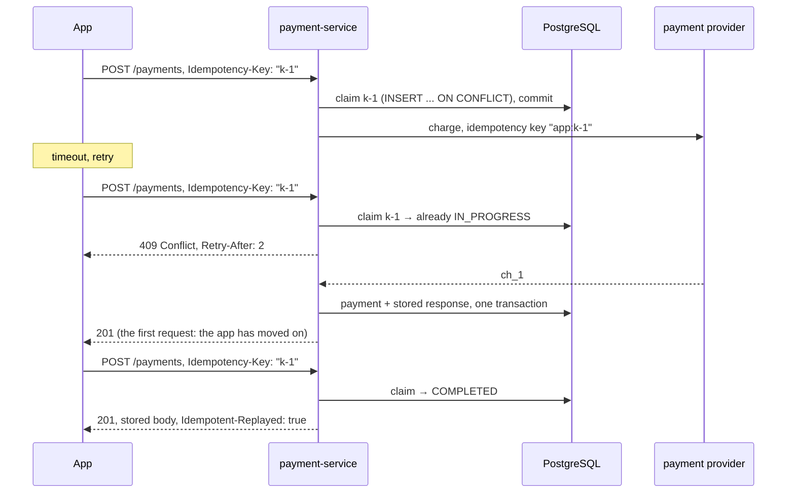

# 28. Idempotency, Deduplication & Correlation

<div class="badges" markdown><span class="badge badge-l2">L2 · Practitioner</span><span class="badge badge-l3">L3 · Senior/Lead</span><span class="badge badge-meta">Idempotency-Key on PostgreSQL · dedup windows · correlation and causation ids</span></div>

<div class="grid two" markdown>

!!! info "Prerequisites"
    - [Chapter 15](../architecture-patterns/ch15-outbox-inbox-cdc.md): outbox and inbox
    - [Chapter 18](../architecture-patterns/ch18-resilience-patterns.md): retries and timeouts
    - [Chapter 25](ch25-asynchronous-messaging.md): at-least-once delivery

!!! abstract "What you'll learn"
    - Why every retry needs an **idempotency** story, and where duplicates come from
    - Measured on PostgreSQL 16, 4 concurrent copies of 200 payment requests: no key **800 charges**; check-then-insert **~330**; SERIALIZABLE **~470**; a unique constraint **800 charges for 200 rows**; an **idempotency key claimed first: exactly 200**
    - **Dedup windows**: a per-instance cache let **2,513 of 3,000** rebalance duplicates through; replays days later need the **entity's version**, not a bigger cache
    - **Correlation, causation and trace ids**: with clocks a few ms apart, timestamps misordered **8%** of orders; one drifting instance made it **39%**; causation ids **0**

</div>

---

## 1 · Introduction & Context

### The double charge

A customer taps *Pay* in the FoodFleet app. The request reaches payment-service, which charges the card through the payment provider in 1.8 s. The app's timeout is 1.5 s, so it shows "Something went wrong, retrying…" and sends the request again. payment-service, seeing a new request, charges again. The customer is charged twice; support refunds one charge three days later.

Every layer behaved as designed: the client retried on a timeout (chapter 22), the gateway retried an idempotent-looking failure, the service processed a valid request. What was missing is the one property that makes retries safe: **idempotency**, so that performing an operation twice has the same effect as performing it once.

Duplicates come from everywhere in a distributed system:

| Source | Example | Typical delay |
|---|---|---|
| Client retries after a timeout | The app's 1.5 s timeout above | 0.1–30 s |
| Proxies and gateways | A retry policy on 502/504 | ms–s |
| Users | Double taps, refresh on the payment page | s |
| Message brokers | Redelivery after a rebalance or a crash before commit (chapter 25) | s–min |
| Outbox relays | Re-publish after a crash between send and mark-as-sent (chapter 15) | min |
| Operations | DLT replays, backfills, reprocessing | days |

**Exactly-once delivery** isn't available across a network; **exactly-once effects** are, by combining at-least-once delivery with idempotent processing.

The second half of the chapter is about knowing **what happened** once many services have handled one order: correlation ids tie every event and log line of a flow together, causation ids record which event led to which, and trace context carries both across hops.

### Where it comes from

<ul class="mh-timeline">
<li><span class="when">1975 · Two Generals problem</span><span class="what">No protocol over an unreliable channel can guarantee agreement; a sender can never be sure its message was processed exactly once.</span></li>
<li><span class="when">2003 · Correlation Identifier</span><span class="what">Hohpe and Woolf's <em>Enterprise Integration Patterns</em> names the pattern, along with Idempotent Receiver.</span></li>
<li><span class="when">2017 · Idempotency keys go mainstream</span><span class="what">Stripe's API popularises the Idempotency-Key header; Kafka 0.11 adds idempotent producers.</span></li>
<li><span class="when">2019 · OpenTelemetry</span><span class="what">OpenTracing and OpenCensus merge.</span></li>
<li><span class="when">2020 · W3C Trace Context</span><span class="what"><code>traceparent</code>/<code>tracestate</code> become a W3C Recommendation; vendors converge on one header.</span></li>
<li><span class="when">2021–2025 · IETF Idempotency-Key</span><span class="what">The httpapi working group drafts a standard <code>Idempotency-Key</code> header (draft-07, October 2025).</span></li>
</ul>

---

## 2 · Core Concepts & Terminology



Idempotent operation
:   One whose effect is the same whether performed once or many times. `PUT` and `DELETE` are idempotent by HTTP semantics; `POST` usually isn't, so it needs a key.

Idempotency key
:   A unique value chosen by the client per logical operation (not per attempt) and sent with every retry. The server remembers the key, a fingerprint of the request and the response.

Request fingerprint
:   A hash of the meaningful request content, stored with the key, so a key reused for a *different* request is rejected (422) instead of silently returning the wrong response.

Deduplication (dedup) store
:   What a consumer remembers about processed messages (event ids), for how long. Its retention is the **dedup window**.

Natural idempotency
:   Making the operation itself safe to repeat: set instead of increment, upsert by key, "apply only if the version is newer".

Correlation id
:   One id shared by everything that happened because of one business request, across services, messages and days.

Causation id
:   The id of the message or command that directly caused this one. Correlation says *which flow*; causation says *which step led to which*.

Trace context
:   The W3C `traceparent` header (trace id, parent span id, flags) that tracing systems propagate across HTTP and messaging hops.

---

## 3 · How It Works Internally

### Claim first, call later

The core of an idempotency key implementation is one atomic **claim**: the first request for a key inserts it as `IN_PROGRESS` and owns it; every concurrent or later request finds it. Spring's `JdbcClient` runs this statement:

```java
--8<-- "code/chapters/ch28-idempotency-correlation/src/main/java/dev/foodfleet/ch28/payments/IdempotencyKeys.java:8:41"
```

- `INSERT ... ON CONFLICT` is atomic: under any concurrency exactly one session inserts. Verified on PostgreSQL 16 with the statement as written: **1,600 concurrent attempts on 200 keys, 200 claims**.
- The **lease** (`locked_until`) handles crashes: if the owner dies after claiming, the key would otherwise stay `IN_PROGRESS` forever. After the lease, a retry of the *same* request takes it over (the `DO UPDATE ... WHERE` clause); a different request with the same key never does.
- The claim is **committed before** the provider is called. The external call never runs inside a database transaction: a rollback can't undo a charge, and a long transaction holds locks.

### The provider must be idempotent too

The claim protects payment-service's own work. It can't know whether a provider call that timed out actually charged the card. So payment-service passes a key derived from ours to the provider (most payment providers accept one), and a retry after an unknown outcome asks the provider again with the same key, getting the original charge instead of a second one. Idempotency has to hold **end to end**, at every system that has side effects.

```java
--8<-- "code/chapters/ch28-idempotency-correlation/src/main/java/dev/foodfleet/ch28/payments/PaymentService.java:13:78"
```

### W3C trace context

A `traceparent` header is `version-traceid-parentid-flags`:

```text
traceparent: 00-4bf92f3577b34da6a3ce929d0e0e4736-00f067aa0ba902b7-01
             │  │                                │                └ sampled
             │  │                                └ the calling span (changes every hop)
             │  └ trace id: the same for the whole request tree
             └ version
```

Spring Boot's Micrometer Tracing reads it on incoming HTTP requests and Kafka records, creates spans, writes it on outgoing calls and messages, and puts `traceId` and `spanId` in the logging MDC. Business correlation (an order's checkout id) can travel alongside as **baggage** (`management.tracing.baggage.remote-fields`).

---

## 4 · Design Considerations & Trade-offs

### Measured: five ways to handle duplicate payment requests

PostgreSQL 16.13. 200 payment keys, each requested **4 times concurrently** (a retry plus duplicates), 16 sessions at a time; the provider call takes 20 ms. Each strategy is a psql script in `verify/`; "charges" counts calls to the provider, the side effect that matters. Verified output, four runs:

| Strategy | Charges (of 200 wanted) | Keys charged more than once | Payment rows | Errors / responses |
|---|---:|---:|---:|---|
| A. No key | 800 | 200 | 800 | all 201 |
| B. Check, then insert (`SELECT` → call → `INSERT`) | 315–346 | 83–94 | 315–346 | none; some "replayed" |
| C. **Idempotency key, claimed first** | **200** | **0** | **200** | 201 ×200, replayed ~460, 409 ~140 |
| D. Check-then-insert in a SERIALIZABLE transaction | 457–487 | 135–145 | 189–192 | 265–296 serialization failures |
| E. Unique constraint on the payments table | **800** | **200** | 200 | 600 duplicate-key errors |

- **Check-then-insert races.** Concurrent requests all see "not processed yet" before any of them writes: 83–94 of 200 customers charged at least twice.
- **SERIALIZABLE protects the database, not the provider.** PostgreSQL correctly aborted conflicting transactions, so payment rows never duplicated, but each aborted transaction had already called the provider: more charges than check-then-insert, plus 8–11 customers charged with no payment recorded at all.
- **A unique constraint is the most deceptive**: 200 tidy rows and 800 charges. Constraints deduplicate *your table*; the side effect happened before the insert failed.
- **Claim first** gave exactly one charge per key in every run. Duplicates got the stored response or a 409 while the first was in flight.

The rule: **decide ownership before the side effect**, atomically, and make the side effect itself idempotent.

### Measured: how long must a consumer remember?

notification-service handles 500 events/s on 6 instances. Duplicates arrive for four reasons, each with its own delay. Simulation (9,500 duplicates), verified output:

| Dedup store | Producer retry (0.1–2 s) | Rebalance (1–30 s, other instance) | Outbox re-publish (1–10 min) | Replay (1–3 days) | Applied twice | Ids kept |
|---|---:|---:|---:|---:|---:|---:|
| None | 5,000 | 3,000 | 500 | 1,000 | 9,500 | 0 |
| In-memory LRU per instance (100k) | 0 | **2,513** | 0 | 1,000 | 3,513 | 600,000 |
| Shared cache, 1 h TTL | 0 | 0 | 0 | **1,000** | 1,000 | 1.8 M |
| Inbox table, 7-day retention | 0 | 0 | 0 | 0 | 0 | **302 M** |
| 1 h cache + **version on the order row** | 0 | 0 | 0 | 0 | **0** | 1.8 M |

- **Per-instance memory misses rebalance duplicates**: after a rebalance the partition, and its duplicates, move to another instance with an empty cache (2,513 of 3,000 slipped through).
- **The window must cover the slowest source.** A 1-hour cache handles everything except replays days later.
- A 7-day inbox catches everything but stores 302 million ids at this rate. Instead, the **entity can deduplicate**: events carry the order's version, and the consumer's own row records the last version it acted on, so an old replay is a no-op. One column instead of hundreds of millions of rows.

### Measured: rebuilding what happened

10,000 orders, each producing six events in six services (three instances each). Each effect really happens 2–60 ms after its cause. Simulation, verified output:

| Clocks | Cause → effect links shown in the wrong order by timestamp | Orders with a wrong timeline by timestamp | Wrong by causation id |
|---|---:|---:|---:|
| All within a few ms (good NTP) | 829 of 50,000 (1.7%) | 817 (8.2%) | **0** |
| One kitchen instance 250 ms behind | 4,184 (8.4%) | 3,930 (39.3%) | **0** |

Also: searching by the `orderId` field found **67%** of an order's events; loyalty and notification events are about customers and don't carry it. The correlation id found all of them.

- **Timestamps from different machines can't order causally related events** that happen milliseconds apart, even with good clocks. Causation ids record the order directly.
- **Correlation ids find a flow's events** even where the business key isn't a field.

### Choosing the idempotency technique

| Situation | Technique |
|---|---|
| `POST` that creates something or moves money | Idempotency key: claim first, stored response, fingerprint, provider-side key |
| State-setting update (`status = DELIVERED`) | Natural idempotency: set, not toggle; conditional on version |
| Increments (`points += 10`) | Inbox (event id) in the same transaction, or convert to "set points for event X" |
| Consumer with external side effects (email, push, payment) | Inbox / version check **plus** the downstream system's own idempotency key |
| Replays and backfills | Version checks on the entity; replays through the same idempotent consumer |
| Kafka producer retries | `enable.idempotence=true` (the default in modern clients) |

### Correlation, causation and trace ids: which for what

| Id | Scope | Set by | Used for |
|---|---|---|---|
| `traceparent` trace id | One request tree (minutes) | Tracing (Micrometer, OpenTelemetry) | Latency analysis, finding the slow hop |
| Correlation id | One business flow (can span days and several traces) | The first service, from the request | Joining logs and events of an order, support investigations |
| Causation id | One link | Every producer: the id of the message it was handling | Rebuilding the exact sequence; debugging event storms |
| Event id | One event | The producer | Deduplication |

A long-running flow (an order lasting 40 minutes, a refund days later) spans many traces; the correlation id joins them. Traces are often sampled (10% by default in Spring Boot); correlation and causation ids are always present.

---

## 5 · Hands-on Implementation

```text
ch28-idempotency-correlation/
├── src/main/java/dev/foodfleet/ch28/
│   ├── payments/     PaymentController, PaymentService, IdempotencyKeys, PaymentProvider
│   ├── dedup/        DedupWindows
│   └── correlation/  TraceParent, EventEnvelope, CausationVsClocks
├── src/main/resources/db/migration/V1__payments_idempotency.sql
└── verify/           the PostgreSQL experiment and the service's SQL as psql scripts
```

### 🔵 Level 2: the API contract for idempotency

<div class="badges" markdown><span class="badge badge-l2">L2 · Practitioner</span></div>

The IETF draft defines the header as a Structured Field string and the error responses: **400** when a required key is missing, **422** when a key is reused with a different request, **409** while the first request is in progress. Completed requests are replayed with the original status and body.

```java
--8<-- "code/chapters/ch28-idempotency-correlation/src/main/java/dev/foodfleet/ch28/payments/PaymentController.java:25:57"
```

```sql
--8<-- "code/chapters/ch28-idempotency-correlation/src/main/resources/db/migration/V1__payments_idempotency.sql"
```

`provider_reference` is unique: if a slow original owner and a retry that took over its expired lease both finish, the provider returned the same charge to both, and the second payment row is refused (checked on PostgreSQL in `verify/service_flow.sql`).

### 🟣 Level 3: testing the hard cases on real PostgreSQL

<div class="badges" markdown><span class="badge badge-l3">L3 · Senior/Lead</span></div>

Concurrency, replay, misuse and crash recovery, each a test against PostgreSQL in a container.

```java
--8<-- "code/chapters/ch28-idempotency-correlation/src/test/java/dev/foodfleet/ch28/payments/PaymentIdempotencyContainerTest.java:21:93"
```

### 🟣 Level 3: correlation and causation on every event

<div class="badges" markdown><span class="badge badge-l3">L3 · Senior/Lead</span></div>

Every event carries its own id, the flow's correlation id, the id of the message it was handling, and the trace context. On Kafka these go in record headers; Spring Kafka's observation support (`spring.kafka.template.observation-enabled`, `spring.kafka.listener.observation-enabled`) propagates `traceparent` for you.

```java
--8<-- "code/chapters/ch28-idempotency-correlation/src/main/java/dev/foodfleet/ch28/correlation/EventEnvelope.java:6:32"
```

```yaml
--8<-- "code/chapters/ch28-idempotency-correlation/src/main/resources/application.yml"
```

### 🔴 Level 4: platform defaults

<div class="badges" markdown><span class="badge badge-l4">L4 · Architect</span></div>

- **API guidelines**: every non-idempotent operation with side effects requires `Idempotency-Key`; retention of keys is published (FoodFleet: 24 h); gateways may retry only idempotent requests or requests carrying a key.
- **Client libraries** generate one key per user action (not per attempt) and reuse it across retries and app restarts.
- **A consumer starter** with an inbox and version-check helpers, and standard event headers (`event-id`, `correlation-id`, `causation-id`, `traceparent`).
- **Observability**: logs include `traceId`, `spanId` and `correlation-id`; the event catalogue can show an order's causation tree.

### Run and verify

```text
$ PGHOST=... PGPORT=... PGUSER=postgres verify/experiment.sh
strategy                             charges keys >1 charge payment rows   errors  responses
a_no_key                                 800           200         800        0  201=800
b_check_then_insert                      346            94         346        0  201=346, replayed=454
c_idempotency_key                        200             0         200        0  201=200, 201 replayed=466, 409 in progress=134
d_serializable                           481           138         192      289  -
e_unique_constraint                      800           200         200      600  -

$ java -cp $CP dev.foodfleet.ch28.correlation.CausationVsClocks
                                       links inverted by time orders misordered by time   by causation
all clocks within a few ms                        829 ( 1.7%)              817 ( 8.2%)              0
one kitchen instance 250 ms behind               4184 ( 8.4%)             3930 (39.3%)              0
```

!!! question "Try it"
    1. In `verify/c_idempotency_key.sql`, move the provider call inside the transaction that inserts the key. What do concurrent duplicates see now, and what happens to the database under load?
    2. Make the app generate a new key per *attempt* instead of per *action*. Which row of the first table does the system now behave like?
    3. Lower the lease to 5 ms and rerun the container test `anExpiredClaimIsTakenOverWithoutASecondCharge`. What protects the customer when two owners overlap?
    4. Add a `causationId` to your own events for one flow and draw the tree from a day of production events. What surprised you?

---

## 6 · Production Readiness

- [x] **Idempotency keys on every non-idempotent operation with side effects**; one key per user action, reused across retries
- [x] **Claim first** (atomic insert), side effects after, response stored in the same transaction as the business write
- [x] **Fingerprint** the request; 422 on reuse with a different request
- [x] **Lease** on in-progress keys and a defined behaviour for unknown outcomes (re-ask the provider with the same key)
- [x] **Downstream systems get our key** (payment providers, partner APIs) so idempotency holds end to end
- [x] **Key retention published** (and longer than any client retry); expired keys purged
- [x] **Consumers dedup** with a window longer than the slowest duplicate source, or with version checks on the entity
- [x] **Retries only for idempotent or keyed operations** at every layer (client, gateway, service, broker)
- [x] **Event envelope**: event id, correlation id, causation id, trace context, on every message
- [x] **Logs carry trace and correlation ids**; support tools search by correlation id
- [x] **Ordering decisions use causation or sequence numbers**, never wall-clock timestamps from different machines

---

## 7 · Anti-patterns & Pitfalls

!!! pitfall "Incident 1: the retry that charged twice"
    **Context.** The app retried `POST /payments` after its 1.5 s timeout; payment-service checked for an existing payment for the order, then called the provider.
    **Symptoms.** Around 0.4% of payments during peak hours were duplicated; refunds and complaints followed.
    **Root cause.** Check-then-act with the provider call in between: concurrent attempts all saw "no payment yet" (measured: 83–94 of 200 keys double-charged under contention).
    **Fix.** Idempotency keys claimed atomically before the provider call, the key passed on to the provider, stored responses for retries.

!!! pitfall "Incident 2: duplicate push notifications after a deploy"
    **Context.** notification-service deduplicated with an in-memory set per instance.
    **Symptoms.** After each deploy, a few thousand customers got "Your order is on the way" twice.
    **Root cause.** The rolling deploy caused rebalances; partitions moved to instances that had never seen those event ids (measured: 2,513 of 3,000 rebalance duplicates slipped through).
    **Fix.** A shared dedup store with a 1-hour window, and the order row's "last notified version" to make DLT replays no-ops.

!!! pitfall "Incident 3: the order that was accepted before it was paid"
    **Context.** Support investigated a disputed order by sorting the events of all services by timestamp.
    **Symptoms.** The timeline showed the kitchen accepting before payment, suggesting a bypass of payment checks; a week of investigation followed.
    **Root cause.** One kitchen instance's clock was 250 ms behind (measured: 39% of orders appear misordered with such a clock); events had no causation ids, so the true sequence couldn't be shown.
    **Fix.** Causation ids on all events, an NTP drift alert, and investigation tools that build the causal tree instead of sorting by time.

| Anti-pattern | Symptom | Fix |
|---|---|---|
| Check-then-act for duplicates | Duplicates under concurrency | Atomic claim (`INSERT ... ON CONFLICT`) |
| Side effect inside a DB transaction | Rolled-back rows, real charges | Claim, commit, then call |
| Relying on a unique constraint for external effects | Clean table, duplicate charges | Claim before the side effect |
| New key per retry | No protection at all | One key per user action |
| No fingerprint | Wrong response for a reused key | Store and compare a request hash |
| `IN_PROGRESS` forever after a crash | Stuck operations | Lease and takeover |
| Per-instance dedup memory | Duplicates after rebalances and deploys | Shared store or entity versions |
| Dedup window shorter than replays | Replays repeat side effects | Version checks; replay through idempotent consumers |
| Timestamps to order cross-service events | Wrong timelines | Causation ids, sequence numbers |
| Correlation only via business keys | Flows can't be followed across contexts | Correlation id on every message |

---

## 8 · Enterprise Case Study

### FoodFleet: safe retries and traceable orders

!!! decision "ADR-028: Keys for side effects, versions for state, and three ids on every message"
    **Status:** Accepted · **Date:** 2025-02-03

    **Context.** Duplicate payments under peak load, duplicate notifications after deploys, and investigations misled by timestamps. Clients and gateways retry by design; Kafka delivers at least once; DLT replays are routine.

    **Decision.** Every non-idempotent API operation with side effects requires an `Idempotency-Key` (IETF draft semantics: 400/409/422, replayed responses), implemented with an atomic claim and lease in the service's database, response stored with the business write, and the key passed to downstream providers; keys are kept 24 h. Consumers deduplicate on event id in a shared store for 1 h, and state-changing consumers additionally apply events only if the entity version is newer, making replays safe. Every message carries `event-id`, `correlation-id`, `causation-id` and `traceparent`; logs carry trace and correlation ids. Timestamps are never used to order events across services.

    **Consequences.** ✅ Duplicate charges went to zero (measured: one charge per key under 4× concurrent duplicates). ✅ Deploys and replays no longer repeat notifications. ✅ Support can show an order's causal tree. ⚠️ Every service with side effects owns an idempotency table and its purge job. ⚠️ Clients must generate and persist keys per action; old app versions without keys are served by a gateway fallback (key derived from order id and amount) until they age out.

### Fintech analogue: payment instructions 🔴

Payment systems assign every instruction a unique end-to-end reference (ISO 20022's `EndToEndId` and `UETR` in SWIFT gpi) that travels through every bank in the chain; each participant deduplicates on it and can report the instruction's status by it. Internally, ledgers post with idempotency keys and refuse a second posting for the same instruction, and reconciliation jobs match provider statements to internal records by those references, catching any duplicate that slipped through.

### E-commerce analogue: checkout and inventory

An online store's checkout sends one idempotency key per "Place order" click, reused across retries and page reloads (stored in the session). Inventory reservations are keyed by order line, so a retried reservation returns the existing hold; order confirmation emails are deduplicated by order version; and the correlation id from checkout appears on every warehouse, payment and email event, so customer service can see the whole story of an order in one search.

---

## 9 · Interview Q&A + Summary

#### Q1. What does idempotent mean, and which HTTP methods are idempotent? · <span class="badge badge-l1">L1</span><span class="badge badge-l2">L2</span> · Cognizant · SAP

**Short answer:** Repeating the operation has the same effect as doing it once. `GET`, `HEAD`, `PUT`, `DELETE` and `OPTIONS` are idempotent by definition; `POST` and `PATCH` are not, so they need an idempotency key (or a design that makes them idempotent) to be retried safely.

#### Q2. How do you implement idempotency keys? · <span class="badge badge-l2">L2</span><span class="badge badge-l3">L3</span> · Amazon · Flipkart · Goldman Sachs

**Short answer:** The client sends a unique key per action. The server atomically claims it (insert with a unique constraint) before any side effect, stores a request fingerprint, performs the operation, and stores the response with the business write. Duplicates get the stored response, 409 if still in progress, 422 if the fingerprint differs. Add a lease for crashes and pass the key downstream. Measured: exactly one charge per key under 4× concurrent duplicates.

#### Q3. Why isn't a unique constraint on the payments table enough? · <span class="badge badge-l2">L2</span><span class="badge badge-l3">L3</span> · JP Morgan · Amazon

**Short answer:** It deduplicates rows, not side effects. If the external call happens before the insert, every duplicate still calls the provider; the constraint just rejects the extra rows. Measured: 200 rows, 800 charges.

#### Q4. Does SERIALIZABLE isolation solve duplicate requests? · <span class="badge badge-l3">L3</span> · Goldman Sachs · JP Morgan

**Short answer:** Only for effects inside the database. Conflicting transactions are aborted, but an external call made inside them already happened; here SERIALIZABLE made more provider charges than plain check-then-insert, plus charges with no recorded payment. Claim ownership first, commit, then call.

#### Q5. Is exactly-once delivery possible? · <span class="badge badge-l2">L2</span> · any

**Short answer:** Not across an unreliable network: a sender can't distinguish a lost request from a lost acknowledgement, so it must retry, producing duplicates. Systems achieve exactly-once *effects* by combining at-least-once delivery with idempotent processing (or, within one system like Kafka, with transactions).

#### Q6. How long should you keep idempotency keys or processed message ids? · <span class="badge badge-l2">L2</span><span class="badge badge-l3">L3</span> · Flipkart · SAP

**Short answer:** Longer than the slowest source of duplicates you care about, and published to clients. For API keys, longer than any client retry (24 h is common). For consumers, longer than redeliveries and re-publishes; for replays days later, use version checks on the entity instead of a huge store. Measured: a 1-hour window missed every replay; a 7-day table needed 302 M ids.

#### Q7. What goes wrong with in-memory deduplication in consumers? · <span class="badge badge-l2">L2</span> · Amazon · any

**Short answer:** It's per instance and lost on restart. After rebalances and deploys, duplicates land on instances that never saw the originals (measured: 2,513 of 3,000 slipped through). Use a shared store or the inbox pattern, or make processing naturally idempotent.

#### Q8. What's the difference between correlation id, causation id and trace id? · <span class="badge badge-l2">L2</span><span class="badge badge-l3">L3</span> · SAP · Goldman Sachs

**Short answer:** The correlation id groups everything in one business flow, possibly over days and many traces. The causation id points to the message that directly caused this one, giving the exact sequence. The trace id (W3C `traceparent`) groups the spans of one request tree for latency analysis and is often sampled. The event id identifies one message for deduplication.

#### Q9. Why not order events by timestamp? · <span class="badge badge-l2">L2</span><span class="badge badge-l3">L3</span> · Amazon · JP Morgan

**Short answer:** Clocks on different machines differ by milliseconds even with NTP, and occasionally by much more; causally related events often happen milliseconds apart. Measured: 8% of orders misordered with good clocks, 39% with one drifting instance; causation ids had no errors. Use causation ids or per-entity sequence numbers.

#### Q10. How is trace context propagated in Spring Boot? · <span class="badge badge-l2">L2</span> · SAP · Cognizant

**Short answer:** Micrometer Tracing (with OpenTelemetry or Brave) instruments HTTP servers and clients, Kafka templates and listeners (when observation is enabled), reading and writing the W3C `traceparent` header, and adds `traceId`/`spanId` to the logging MDC. Business ids can travel as baggage via `management.tracing.baggage.remote-fields`.

#### Q11. What happens if the server crashes after claiming a key? · <span class="badge badge-l3">L3</span> · Goldman Sachs · Flipkart

**Short answer:** Without a lease, the key stays in progress and the client gets 409 forever. With a lease, a retry of the same request takes over after it expires and re-asks the provider with the same downstream key, which returns the original result if the first attempt did charge. A unique constraint on the provider's reference catches the rare overlap of two owners.

#### Q12. How do you make a consumer of "points += 10" events idempotent? · <span class="badge badge-l3">L3</span> · Amazon · any

**Short answer:** Record the event id in an inbox table in the same transaction as the increment, skipping it if already present; or change the model so applying an event is a set ("points from event X = 10") or conditional on the entity's version. Replays must go through the same path.

### Key takeaways

- **Retries are certain; idempotency makes them safe.** Exactly-once effects = at-least-once delivery + idempotent processing.
- **Claim first, then act**: on PostgreSQL, only an atomic claim before the side effect gave exactly one charge per key; constraints and SERIALIZABLE protected rows, not money.
- **Idempotency is end to end**: pass keys to every downstream system with side effects.
- **Dedup windows must cover the slowest duplicate source**; for replays, let the entity's version decide.
- **Correlation, causation and trace ids on every message**; never order cross-service events by timestamp.

### Further reading

- IETF httpapi, [The Idempotency-Key HTTP Header Field](https://datatracker.ietf.org/doc/draft-ietf-httpapi-idempotency-key-header/) (draft-07, 2025)
- W3C, [Trace Context](https://www.w3.org/TR/trace-context/)
- Brandur Leach, *Implementing Stripe-like Idempotency Keys in Postgres* (2017)
- Gregor Hohpe and Bobby Woolf, *Enterprise Integration Patterns* (2003): Correlation Identifier, Idempotent Receiver
- Spring Boot reference, [Tracing](https://docs.spring.io/spring-boot/reference/actuator/tracing.html)

---

**Previous:** [← 27. API Contracts & Schema Evolution](ch27-api-contracts.md) · **Next:** [Part 4: Data →](../data/index.md)
