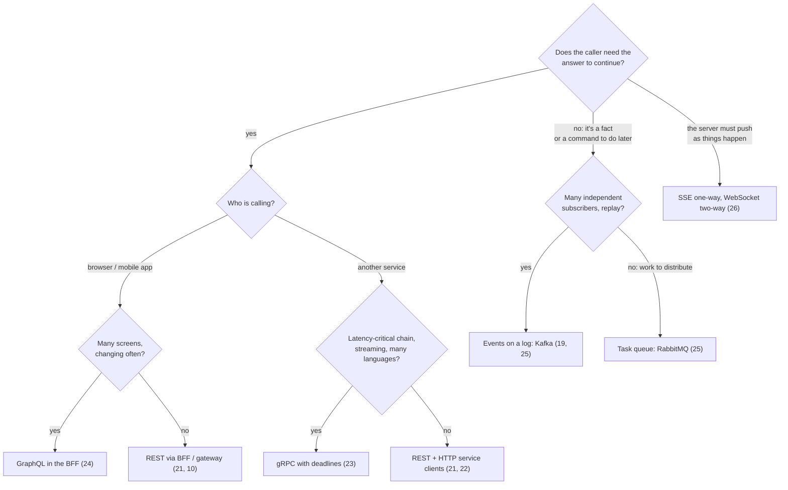

# Part 3 — Communication

<div class="badges" markdown><span class="badge badge-l1">L1 · Foundation</span><span class="badge badge-l2">L2 · Practitioner</span><span class="badge badge-l3">L3 · Senior/Lead</span><span class="badge badge-l4">L4 · Architect</span></div>

Part 2 decided how services are structured and how a business process spans them. Part 3 is about the wires between them: **which interaction style** to use for each conversation, how to make each one fast and safe, how to keep contracts evolvable, and how to survive the duplicates every network produces.

As in Part 2, every chapter measures its claims: real sockets, a real PostgreSQL, Google's protobuf runtime, Jackson 3 built from source, official JSON Schemas, or a simulation whose assumptions are stated, with the verified output in the text and the code to reproduce it.

## Sync or async? A decision guide



| Question | If yes | If no |
|---|---|---|
| Does the caller need the result now to continue? | Synchronous request/response | Asynchronous message or event |
| Must the operation complete even if the receiver is down right now? | Asynchronous (with an outbox, chapter 15) | Synchronous is acceptable |
| Is it a fact others may react to (now or later)? | Event on a log | Command or request to one owner |
| Does the server need to push updates as they happen? | SSE (one-way) or WebSocket (two-way) | Request/response |
| Will it be retried (it will)? | Idempotency key or natural idempotency (chapter 28) | — |

Two rules hold whichever style is chosen: **every remote interaction has a timeout or deadline** (chapters 18, 22, 23), and **every receiver tolerates duplicates and unknown fields** (chapters 25, 27, 28).

## What each chapter measured

| If your problem is… | Reach for | Chapter | What the chapter measured |
|---|---|---|---|
| Designing resource APIs that scale and evolve | REST: resources, keyset pagination, ETags, RFC 9457 | [21](ch21-rest-api-design.md) | Keyset pagination 9,664× faster than offset at the last of 2 M rows, without offset's duplicates and skips |
| Calling other services from Spring | RestClient, HTTP service clients | [22](ch22-http-clients.md) | A client per call cost 6–7× at p50 over TLS; virtual threads ran 1,000 slow calls 7× faster than a 50-thread pool |
| Fast internal calls, streaming, deadlines | gRPC | [23](ch23-grpc.md) | Protobuf 2.5× smaller than JSON, but gzipped JSON streams smaller still; propagated deadlines cut wasted work from 639 ms to 2 ms per request |
| Many app screens with different data needs | GraphQL in the BFF | [24](ch24-graphql.md) | 12 requests became 1 and bytes fell 8×; without batching, 19 backend calls and slower than REST |
| Reliable asynchronous processing | Queues, topics, retries, DLTs | [25](ch25-asynchronous-messaging.md) | Committing after + idempotency: 0 lost, 0 duplicated; Spring Kafka's default silently skipped 16 messages in an outage |
| Live updates to apps | SSE, WebSocket | [26](ch26-websockets-sse.md) | Polling saw 10 of 40 positions at ~1,190 bytes each; push saw all 40 at ~110 bytes; 10,000 streams in one JVM on virtual threads |
| Changing APIs without breaking consumers | Contracts, tolerant readers | [27](ch27-api-contracts.md) | 11 of 12 "small" changes broke a strict consumer; diff + contracts together caught 7 of 11; a change of meaning escaped both |
| Retries without double charges | Idempotency keys, dedup, correlation | [28](ch28-idempotency-correlation.md) | On PostgreSQL, only an atomic claim before the side effect gave one charge per key; constraints and SERIALIZABLE protected rows, not money |

## The chapters

<div class="grid cards" markdown>

-   **[21. Synchronous REST](ch21-rest-api-design.md)**

    ---

    Resources, status codes, keyset pagination, conditional requests, problem details. *PostgreSQL benchmark.*

-   **[22. HTTP Clients](ch22-http-clients.md)**

    ---

    RestClient, HTTP service clients, timeouts, reuse, virtual threads. *Measured on real sockets.*

-   **[23. gRPC & Protocol Buffers](ch23-grpc.md)**

    ---

    The wire format byte by byte, streaming, deadlines, load balancing. *Spring gRPC in Boot 4.1.*

-   **[24. GraphQL](ch24-graphql.md)**

    ---

    Schemas, N+1 and batching, query cost limits, federation. *Spring for GraphQL.*

-   **[25. Asynchronous Messaging](ch25-asynchronous-messaging.md)**

    ---

    Delivery semantics, ordering, retries, DLTs. *Spring for Apache Kafka, embedded broker.*

-   **[26. WebSockets & Server-Sent Events](ch26-websockets-sse.md)**

    ---

    Polling vs push, connection capacity, reconnect storms, fan-out. *SseEmitter and Spring WebSocket.*

-   **[27. API Contracts & Schema Evolution](ch27-api-contracts.md)**

    ---

    OpenAPI and AsyncAPI, tolerant readers, diffs vs consumer-driven contracts. *Spring Cloud Contract.*

-   **[28. Idempotency, Deduplication & Correlation](ch28-idempotency-correlation.md)**

    ---

    Idempotency keys, dedup windows, correlation and causation ids. *PostgreSQL concurrency experiment.*

</div>

## Reading order by experience

| You are | Read | Then |
|---|---|---|
| **New to service APIs** (🟢 L1) | 21 → 22 → 25 | [Part 4: Data](../data/index.md) |
| **Building services already** (🔵 L2) | 22 → 28 → 25 → 27 | [Part 6: Resilience](../resilience/index.md) |
| **Leading a team** (🟣 L3) | 27 → 28 → 25 → 23 → 26 | [Part 7: Observability](../observability/index.md) |
| **Designing the platform** (🔴 L4) | the decision guide above → 24 → 23 → 26 → 27 | [Part 8: Platform](../deployment/index.md) |
| **Preparing for interviews** | 21, 25, 27, 28 (each ends with 12 questions) | [Interview prep](../interview-prep/index.md) |

## How the FoodFleet story builds up

<ul class="mh-timeline">
<li><span class="when">ADR-021 · Chapter 21</span><span class="what">REST APIs use keyset pagination, conditional updates and RFC 9457 errors.</span></li>
<li><span class="when">ADR-022 · Chapter 22</span><span class="what">Service calls use HTTP service clients on RestClient, configured per group.</span></li>
<li><span class="when">ADR-023 · Chapter 23</span><span class="what">Internal latency-sensitive and streaming APIs use gRPC; the edge stays REST.</span></li>
<li><span class="when">ADR-024 · Chapter 24</span><span class="what">The customer apps use GraphQL in the mobile BFF; services keep their own protocols.</span></li>
<li><span class="when">ADR-025 · Chapter 25</span><span class="what">Consumers commit after processing, are idempotent, and dead-letter instead of skipping or looping.</span></li>
<li><span class="when">ADR-026 · Chapter 26</span><span class="what">Customers receive tracking over SSE, riders send positions over WebSocket.</span></li>
<li><span class="when">ADR-027 · Chapter 27</span><span class="what">Contracts are documents in the repo, checked by diff and consumer contracts; consumers are tolerant readers.</span></li>
<li><span class="when">ADR-028 · Chapter 28</span><span class="what">Keys for side effects, versions for state, and three ids on every message.</span></li>
</ul>

!!! tip "Running the code"
    ```bash
    cd code
    mvn -B -pl chapters/ch21-rest-api,chapters/ch22-http-clients,chapters/ch23-grpc,chapters/ch24-graphql,chapters/ch25-messaging,chapters/ch26-websockets-sse,chapters/ch27-api-contracts,chapters/ch28-idempotency-correlation -am verify
    ```
    JDK 25 and Maven 3.9+. Chapters 21 and 28 also include PostgreSQL scripts (`bench/`, `verify/`); chapter 28's container test needs Docker (skipped without it). Chapter 25's Kafka test starts an embedded broker.
