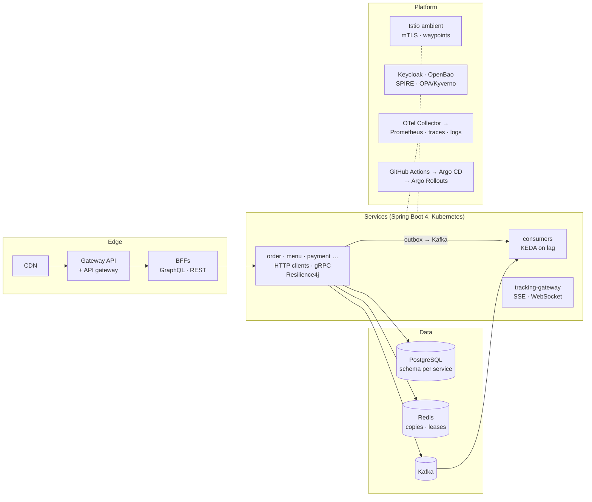

# Components & Tools Overview

L1 · FoundationL2 · PractitionerL3 · Senior/LeadL4 · Architect

The chapters decide; this part looks things up. Each page covers one component or tool: what it is, what FoodFleet uses and which ADR decided it, the chapter measurements that justify the choice, configuration taken from the handbook's code, and the pitfalls. Where FoodFleet compared a tool and chose something else, the page says so and explains when the other tool would be the right choice.

## The reference architecture

## The components

### Edge & Routing

| Component | FoodFleet uses | Decided in |
|---|---|---|
| [API Gateway](api-gateway.md) | Spring Cloud Gateway Server Web MVC as `edge-gateway` | ADR-010 |
| [Load Balancing](load-balancing.md) | kube-proxy, waypoints for per-request balancing, connection lifetime caps | ADR-054, ADR-057 |
| [Rate Limiting](rate-limiting.md) | GCRA in Redis per client and tenant at the gateway | ADR-040 |
| [Backend for Frontend](bff.md) | customer-bff (GraphQL), partner-bff, rider-bff | ADR-010, ADR-024 |

### Discovery & Configuration

| Component | FoodFleet uses | Decided in |
|---|---|---|
| [Service Discovery](service-discovery.md) | Kubernetes Services; headless Services for gRPC | ADR-011 |
| [Configuration Management](configuration-management.md) | Mounted ConfigMaps, watched directories for live values, validated properties | ADR-054 |
| [Feature Flags](feature-flags.md) | Flags in a watched ConfigMap, changed by pull request | ADR-054, ADR-058 |

### Communication

| Component | FoodFleet uses | Decided in |
|---|---|---|
| [REST Clients & HTTP Interfaces](http-service-clients.md) | HTTP service clients on `RestClient`, virtual threads | ADR-022 |
| [gRPC](grpc.md) | Spring gRPC for tracking, eta, dispatch and streaming | ADR-023 |
| [GraphQL](graphql.md) | Spring for GraphQL in the customer BFF, persisted queries only | ADR-024 |
| [WebSockets & SSE](websockets-sse.md) | `tracking-gateway`: SSE for customers, WebSocket for riders | ADR-026 |

### Messaging & Streaming

| Component | FoodFleet uses | Decided in |
|---|---|---|
| [Messaging Fundamentals](messaging-fundamentals.md) | Kafka for events, RabbitMQ for task queues, outbox and inbox | ADR-025 |
| [Apache Kafka](kafka.md) | Kafka 4 (KRaft) with Spring for Apache Kafka | ADR-025, ADR-069 |
| [RabbitMQ](rabbitmq.md) | Task queues: payouts, document generation | ADR-025 |
| [Spring Cloud Stream](spring-cloud-stream.md) | One menu replica; most services use Spring Kafka directly | ADR-025 |
| [Debezium CDC](debezium-cdc.md) | Outbox Event Router for high-volume services | ADR-015 |
| [Outbox Implementation](outbox-implementation.md) | Platform `Outbox.append`, polling relay, inbox in every consumer | ADR-015 |

### Resilience

| Component | FoodFleet uses | Decided in |
|---|---|---|
| [Resilience4j](resilience4j.md) | A breaker and a rejecting bulkhead per synchronous dependency | ADR-043 |
| [Spring Framework 7 Resilience](spring-framework-resilience.md) | `@Retryable` with jitter, `@ConcurrencyLimit` with REJECT | ADR-043 |

### Security

| Component | FoodFleet uses | Decided in |
|---|---|---|
| [Spring Security](spring-security.md) | Resource servers, deny by default, method security | ADR-037 |
| [Keycloak & Spring Authorization Server](keycloak-authorization-server.md) | Keycloak 26; the authorization server only locally | ADR-037 |
| [JWT & Token Relay](jwt-token-relay.md) | 15-minute `at+jwt`, token exchange, introspection for payments | ADR-036, ADR-038 |
| [mTLS & cert-manager](mtls-cert-manager.md) | SPIRE identities to SSL bundles; mesh mTLS | ADR-038, ADR-057 |
| [HashiCorp Vault](vault.md) | OpenBao: per-service policies, rotating dynamic credentials | ADR-039 |
| [Open Policy Agent](opa.md) | Compliance rules in CI and at admission | ADR-041 |

### Data

| Component | FoodFleet uses | Decided in |
|---|---|---|
| [PostgreSQL](postgresql.md) | PostgreSQL 16 for every service's data | ADR-012, ADR-029, ADR-033 |
| [MongoDB](mongodb.md) | **Not adopted**: JSONB menu cards instead | ADR-029 |
| [Redis / Valkey](redis-valkey.md) | Positions, caches, rate limits, counters; never the source of truth | ADR-029, ADR-032 |
| [Elasticsearch / OpenSearch](elasticsearch-opensearch.md) | **Not adopted yet**: full-text + trigram in PostgreSQL | ADR-029 |
| [Cassandra](cassandra.md) | **Not adopted**: partitioned PostgreSQL for history | ADR-029 |
| [Flyway & Liquibase](flyway-liquibase.md) | Flyway with `lock_timeout`, `CONCURRENTLY`, expand/contract | ADR-033 |
| [Connection Pooling](connection-pooling.md) | Small fixed HikariCP pools budgeted fleet-wide; PgBouncer for batch | ADR-033, ADR-039 |

### Caching

| Component | FoodFleet uses | Decided in |
|---|---|---|
| [Spring Cache Abstraction](spring-cache.md) | Transaction-aware `RedisCacheManager` for details | ADR-032 |
| [Caffeine (L1 Cache)](caffeine.md) | L1 where per-pod staleness is acceptable | ADR-032 |
| [Multi-Level Caching](multi-level-caching.md) | Per data type: HTTP, local, Redis, or none | ADR-032 |
| [CDN](cdn.md) | Static assets and cacheable menus | Chapters 10, 21 |

### Observability

| Component | FoodFleet uses | Decided in |
|---|---|---|
| [Monitoring: Prometheus, Grafana, Alertmanager](monitoring-prometheus-grafana.md) | Summed histograms, label budget, burn-rate alerts | ADR-048, ADR-051 |
| [Logging: Loki, ELK, EFK](logging-stack.md) | ECS JSON on stdout, masking encoder, no silent drops | ADR-050 |
| [Distributed Tracing](distributed-tracing.md) | Micrometer Tracing → OTel, W3C, parent-based sampling | ADR-049 |
| [OpenTelemetry Collector & Grafana LGTM](otel-collector-lgtm.md) | Gateway collector: RED from 100% of spans, tail sampling | ADR-047 |
| [Spring Boot Actuator](spring-boot-actuator.md) | Probe groups only, port 8081 behind a NetworkPolicy | ADR-052 |
| [APM: Datadog, New Relic, Dynatrace](apm-tools.md) | **Not the primary stack**: OTLP, so any backend fits behind the collector | ADR-047 |
| [Profiling: JFR & Pyroscope](profiling.md) | JFR on every JVM, profiles to a store | ADR-047 |

### Containers & Orchestration

| Component | FoodFleet uses | Decided in |
|---|---|---|
| [Docker](docker.md) | One Dockerfile template: jlink, layers, AOT cache, distroless | ADR-053 |
| [Docker Compose](docker-compose.md) | A generated local stack by journey profile | — |
| [Kubernetes](kubernetes.md) | No CPU limits, mounted config, PDBs | ADR-054 |
| [Helm](helm.md) | One shared chart, values per environment, digests | ADR-055 |
| [Kustomize](kustomize.md) | Overlays for platform components | ADR-055 |
| [KEDA](keda.md) | Consumers scaled on Kafka lag | ADR-056 |
| [Gateway API & Ingress](gateway-api-ingress.md) | `HTTPRoute`s; weights for canaries | ADR-054, ADR-058 |

### Service Mesh

| Component | FoodFleet uses | Decided in |
|---|---|---|
| [Istio (Sidecar & Ambient)](istio.md) | Ambient mode, strict mTLS, waypoints where L7 matters | ADR-057 |
| [Linkerd](linkerd.md) | **Not adopted** | ADR-057 |
| [Envoy](envoy.md) | Inside Istio's waypoints and the edge | ADR-057 |

### CI/CD & Quality

| Component | FoodFleet uses | Decided in |
|---|---|---|
| [GitHub Actions](github-actions.md) | Build once, sign by digest, PR to the environment repo; SHA-pinned | ADR-041, ADR-058 |
| [Jenkins & GitLab CI](jenkins-gitlab-ci.md) | **Replaced**: the Jenkins push-deploy job | ADR-058 |
| [Argo CD](argo-cd.md) | Per cluster, prune and self-heal | ADR-058 |
| [Argo Rollouts](argo-rollouts.md) | Canaries 10/25/50/100 with per-version analysis | ADR-058 |
| [SonarQube](sonarqube.md) | **Not adopted**: planted bugs, NullAway, ArchUnit instead | — |
| [Security Scanners](security-scanners.md) | SBOMs, a fixable-findings gate, daily rescans | ADR-041 |
| [Cosign & Syft](cosign-syft.md) | Keyless signing, provenance, Kyverno at admission | ADR-041 |

### Testing Tools

| Component | FoodFleet uses | Decided in |
|---|---|---|
| [Testcontainers](testcontainers.md) | PostgreSQL 16 once per run; no H2 | ADR-062 |
| [WireMock](wiremock.md) | The external payment provider stub | — |
| [Pact & Spring Cloud Contract](contract-testing-tools.md) | Pact with matchers and formats, `can-i-deploy` | ADR-063 |
| [Gatling & k6](load-testing-tools.md) | k6 open models in the release pipeline | ADR-065 |
| [Chaos Mesh & Litmus](chaos-tools.md) | Toxiproxy in CI, Chaos Mesh workflows in staging | ADR-045, ADR-065 |

### Developer Platform

| Component | FoodFleet uses | Decided in |
|---|---|---|
| [Backstage](backstage.md) | Scaffolder with versioned templates, checked catalog | ADR-071, ADR-072 |
| [OpenAPI & springdoc](openapi-springdoc.md) | OpenAPI-first, Spectral, oasdiff, drift test | ADR-027, ADR-071 |
| [AsyncAPI](asyncapi.md) | A document per topic; registry `FULL_TRANSITIVE` | ADR-027 |
| [Terraform](terraform.md) | Not chosen by an ADR; the infrastructure of ADR-059 | ADR-059 |

### Workflow, Scheduling, Locks & Others

| Component | FoodFleet uses | Decided in |
|---|---|---|
| [Temporal & Camunda](temporal-camunda.md) | An engine for refunds and onboarding; own orchestrator for place-order | ADR-014 |
| [Distributed Scheduling](distributed-scheduling.md) | CronJobs, ShedLock, one active outbox relay | ADR-015 |
| [Distributed Locks](distributed-locks.md) | Leases with fencing; the database's own locks first | ADR-032, ADR-046 |
| [Idempotency Store](idempotency-store.md) | Claimed keys with leases; dedup window plus entity versions | ADR-028 |
| [Notification Gateways](notification-gateways.md) | A platform service that sends; domains own templates | Chapters 5, 6, 28 |

## How these pages were written

- **Every number comes from a chapter or lab** in this handbook, measured as that chapter describes; pages give ranges across runs, as the chapters do.
- **Every code block is included from the handbook's code** (`--8<--`), so pages and code can't drift. Spring code that needed Maven Central was checked by import against the libraries' source, not compiled here ([Code Lab: how the code was checked](../code-lab/index.md#how-the-lab-code-was-checked)).
- **Tools FoodFleet didn't choose** get the same treatment: what the chapters measured on the alternative, and the signals that would change the decision.
- **Where no ADR decides something** (Terraform, SonarQube, CDN choice), the page says so rather than inventing a FoodFleet decision.
