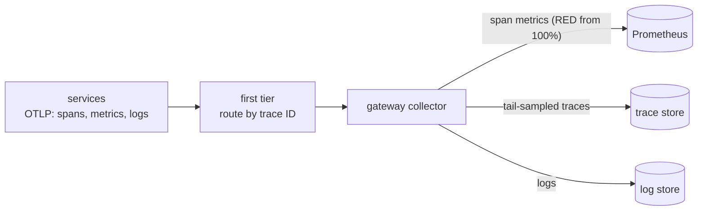

# OpenTelemetry Collector & Grafana LGTM

<div class="badges" markdown><span class="badge badge-l2">L2 · Practitioner</span><span class="badge badge-l3">L3 · Senior/Lead</span><span class="badge badge-l4">L4 · Architect</span></div>

| | |
|---|---|
| **What it is** | **OpenTelemetry Collector**: a vendor-neutral pipeline (receivers → processors → exporters, plus connectors between pipelines) for traces, metrics and logs; `otelcol-contrib` adds tail sampling, span metrics and most exporters. **LGTM**: Grafana's open-source backends, Loki (logs), Grafana, Tempo (traces), Mimir (metrics) |
| **FoodFleet uses** | A gateway collector tier receiving OTLP from every service; Prometheus for metrics, a trace store, a log store and a profile store behind it; `grafana/otel-lgtm` as the local stack |
| **Decided in** | [ADR-047](../observability/ch47-observability-fundamentals.md#8-enterprise-case-study) |
| **Learn it in** | [Chapter 47](../observability/ch47-observability-fundamentals.md), [lab 12](../code-lab/lab-12-observability.md), [local stack](../food-delivery-platform/docker-local-stack.md) |
| **Related** | [Distributed tracing](distributed-tracing.md), [Monitoring](monitoring-prometheus-grafana.md), [Logging stack](logging-stack.md), [Profiling](profiling.md) |

## The pipeline



```yaml title="collector.yaml, processors and connectors (chapter 47)"
--8<-- "code/chapters/ch47-observability-fundamentals/src/main/resources/otel/collector.yaml:21:54"
```

```yaml title="collector.yaml, pipelines (chapter 47)"
--8<-- "code/chapters/ch47-observability-fundamentals/src/main/resources/otel/collector.yaml:72:90"
```

- **`resource/trim`** deletes the JVM command line from every resource.
- **`span_metrics`** sees every span before sampling, so RED metrics are exact.
- **`tail_sampling`** waits 10 s for a trace to finish and keeps errors, traces over 300 ms and 1% of the rest. All spans of a trace must reach the same collector: with several replicas, a first tier routes by trace ID (the `loadbalancing` exporter).
- **`memory_limiter`** first in every pipeline: the tail sampler holds traces in memory.

## Why it's built this way

[Chapter 47](../observability/ch47-observability-fundamentals.md), a canary that added 600 ms to 5% of orders:

| Signal | What it showed |
|---|---|
| Metrics | The canary's p99 (720–732 ms) within one window, not why |
| Logs | 11,000 INFO lines; none mentioning slow, timeout or error |
| 1% head-sampled traces | **2–4 of 248–285** slow traces |
| **Tail-sampled traces** | **all of them, for 18–19% of the bytes** |
| Fields on spans / wide events | The cause exactly: UPI through one bank on the new version |

And the resource: payment-a's had 19 attributes, 983 characters of them the JVM command line, which carried `-Dpayments.gateway.token=…`. **The token appeared in exported spans**, and turning every resource attribute into Prometheus labels made a scrape of the collector **5.7× bigger** and copied it into every series. Hence `resource/trim`.

## LGTM

| Component | Role | FoodFleet |
|---|---|---|
| **Loki** | Logs, indexed by labels | Local stack; see [Logging stack](logging-stack.md) |
| **Grafana** | Dashboards, Explore, correlations (exemplar → trace, trace → logs) | Dashboards and alert views |
| **Tempo** | Traces in object storage, searched by TraceQL | Local stack; the production trace store isn't fixed by an ADR |
| **Mimir** | Horizontally scalable, Prometheus-compatible metrics | Prometheus today; Mimir (or Thanos) when long-term or global queries need it |
| Pyroscope | Continuous profiles | Where JFR profiles can go ([Profiling](profiling.md)) |

`grafana/otel-lgtm` packs an OTLP endpoint with Grafana, Prometheus, Tempo and Loki into one container: FoodFleet's [local stack](../food-delivery-platform/docker-local-stack.md) uses `0.35.0`. [Lab 12](../code-lab/lab-12-observability.md) uses a plain `otelcol-contrib` with file exporters so the output can be checked: 20 executor traces whole, 90 of 90 log lines with a trace ID, RED counts from the spans.

## Running the collector

- **Agent + gateway**: a DaemonSet or sidecar agent per node for batching and Kubernetes metadata (`k8sattributes`); a gateway tier for sampling and export.
- **Size for tail sampling**: `num_traces` ≈ decision wait × new traces per second × 2.
- **Collector metrics and health** scraped and alerted: it's critical infrastructure.
- **Version the config** and test it with `otelcol validate`.

## Pitfalls

- **Tail sampling behind a round-robin load balancer**: each replica sees part of each trace.
- **RED metrics from sampled spans**: undercounted by the sampling rate.
- **Every resource attribute as a label**.
- **No memory limiter**: the collector is OOM-killed under a burst, and with it all telemetry.
- **Vendor exporters in services**: export OTLP to the collector; change backends there.
