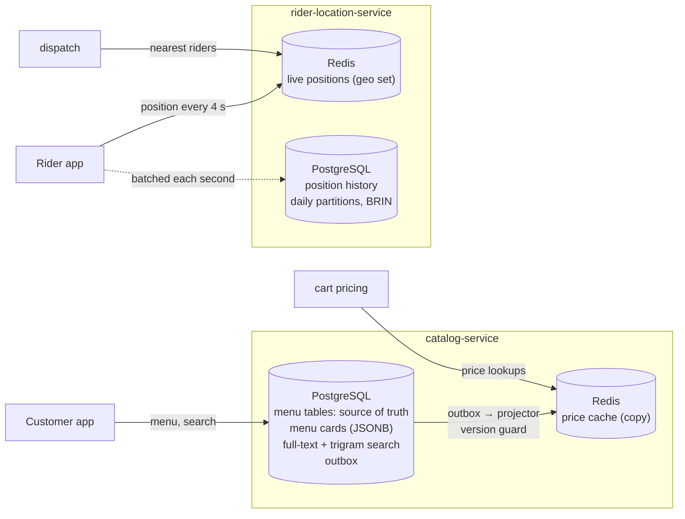

# 29. Polyglot Persistence

<div class="badges" markdown><span class="badge badge-l2">L2 · Practitioner</span><span class="badge badge-l3">L3 · Senior/Lead</span><span class="badge badge-meta">PostgreSQL 16 + Redis 7 · documents, search, geo, time series · keeping copies in sync</span></div>

<div class="grid two" markdown>

!!! info "Prerequisites"
    - [Chapter 12](../architecture-patterns/ch12-database-per-service.md): database per service
    - [Chapter 13](../architecture-patterns/ch13-cqrs-event-sourcing.md): CQRS and read models
    - [Chapter 15](../architecture-patterns/ch15-outbox-inbox-cdc.md): the transactional outbox

!!! abstract "What you'll learn"
    - Choose a store by **access pattern, durability need and consistency need**, not by fashion, and count the cost of every extra store
    - Measured on the same menus: a JSONB document read a whole menu **14× faster** than five joined tables, but price changes were **5× slower with 15× the WAL**, and a cross-restaurant query **180× slower**
    - Search inside PostgreSQL: full-text + prefix + trigram fallback found the dish for **29 of 29** queries, typos included; the trap of **stemming a half-typed word**
    - Rider positions: Redis took **3.8–5.6×** PostgreSQL's write rate at matched durability; a geo index cost PostgreSQL **over half its update rate**
    - Keeping two stores in sync: dual writes left **43–77 of 5,000** prices wrong; an outbox projector reading by offset **29–48**; claiming with `SKIP LOCKED` and a version guard **0**

</div>

---

## 1 · Introduction & Context

### One database, or one per need?

FoodFleet started with one PostgreSQL database. By the time it had 2,000 restaurants and 50,000 riders, three workloads were pulling it in different directions:

- **The menu page** reads a restaurant's whole menu (8 sections, 96 items, their options) on every app open, about 4,000 times a second at dinner time. Assembling it from five tables took 13 ms of database time per read.
- **Dish search** ("paneer butter masala", typed on a phone, often misspelt) ran `LIKE '%…%'` over 192,000 items: 90 ms, and nothing found for "panner".
- **Rider tracking** wrote 50,000 positions every 4–5 seconds, 10,000+ updates a second, into a table that also served dispatch queries.

The team's first instinct was a store per problem: MongoDB for menus, Elasticsearch for search, Redis for riders, a time-series database for history. Each choice was defensible on its own. Together they would mean five systems to run, back up, secure, upgrade and keep **consistent with each other**, by a team of eight.

**Polyglot persistence** is the idea that each service, or each workload, uses the storage technology that fits its data and access pattern. Database per service (chapter 12) makes it possible; it does not make it free. This chapter measures what each kind of store actually buys on FoodFleet's workloads, how far one PostgreSQL goes, and what keeping a second store in sync costs, because that cost, not the store's speed, usually decides.

### Where it comes from

<ul class="mh-timeline">
<li><span class="when">1970 · The relational model</span><span class="what">Codd's paper separates the logical model from storage; for 35 years "the database" means a relational one.</span></li>
<li><span class="when">2006–2007 · Bigtable and Dynamo</span><span class="what">Google and Amazon publish stores built for one access pattern at enormous scale, trading joins and transactions for availability and throughput.</span></li>
<li><span class="when">2008–2011 · "Polyglot persistence"</span><span class="what">Scott Leberknight coins the term (2008); Martin Fowler's 2011 bliki article makes it mainstream, as Redis (2009), MongoDB (2009) and Elasticsearch (2010) arrive.</span></li>
<li><span class="when">2014–2017 · PostgreSQL absorbs the use cases</span><span class="what">JSONB (9.4, 2014), BRIN indexes (9.5, 2016), declarative partitioning (10, 2017), alongside full-text search and pg_trgm.</span></li>
<li><span class="when">2016–2021 · Redis geo</span><span class="what"><code>GEOADD</code>/<code>GEORADIUS</code> (3.2), then <code>GEOSEARCH</code> (6.2).</span></li>
<li><span class="when">2020s · Fewer, broader stores</span><span class="what">Teams consolidate on general-purpose databases with extensions and add specialised stores only for measured needs, fed by outbox or CDC.</span></li>
</ul>

---

## 2 · Core Concepts & Terminology



Data model
:   How a store lets you shape data: **relational** (rows, joins, constraints), **document** (a nested value per key, e.g. JSON), **key-value** (opaque value per key), **wide-column** (rows of sparse column families, partitioned by key), **search index** (inverted index of terms to documents), **time-series** (append-mostly, ordered by time), **graph** (nodes and edges).

Access pattern
:   The concrete reads and writes a workload performs, with their rates and latency needs: "read one restaurant's whole menu, 4,000/s, p99 < 20 ms" is an access pattern; "store menus" is not.

Source of truth
:   The one store whose data is authoritative for a fact. Everything else holding that fact is a **derived store** (a copy, cache, read model or index) and can be rebuilt from the source.

Derived store / read model
:   A copy shaped for one kind of read: a search index, a cache, a denormalised document. It lags the source and must be kept in sync (chapter 13).

Dual write
:   Writing the same change to two stores from application code, one after the other. There is no transaction across them, so a crash, an outage or a race leaves them disagreeing.

Projector
:   A process that reads changes from the source of truth (an outbox table or the database's change log) and applies them to a derived store.

Durability level
:   What a write survives once acknowledged: process crash, machine crash, data-centre loss. PostgreSQL's `synchronous_commit` and Redis's `appendfsync` choose it; comparisons between stores are meaningless without it.

---

## 3 · How It Works Internally

### Documents: fast to read whole, expensive to change in part

PostgreSQL stores a large `jsonb` value **compressed and out of line** (TOAST). FoodFleet's menu is 43 kB of JSON, stored as 7.6 kB: reading it is one index lookup and one decompression. Changing one price inside it with `jsonb_set` produces a **new version of the whole value**: decompress, modify, recompress, write the whole thing again, and log it all to the WAL. The row is also the unit of locking, so two edits to different items of the same menu wait for each other.

In the tables, the same price change updates one small row. If no indexed column changes and the page has room, PostgreSQL makes it a **HOT update** (heap-only tuple): the new row version goes on the same page and no index is touched.

### Search: inverted indexes, stemming and trigrams

A `tsvector` is the list of normalised words (**lexemes**) in a text; the `english` configuration lower-cases, drops stop words and **stems** ("dosas" → "dosa", "fried" → "fri"). A GIN index maps each lexeme to the rows containing it, so `search @@ to_tsquery('english', 'chicken & biryani')` is a lookup and an intersection, in any word order. `:*` makes a term a prefix.

Stemming applies to the prefix too, and that breaks search-as-you-type: the half-typed "biry" stems to `biri`, which is not a prefix of the indexed `biryani`. The service matches the last, partial word both stemmed and as typed:

```java
--8<-- "code/chapters/ch29-polyglot-persistence/src/main/java/dev/foodfleet/ch29/catalog/DishSearch.java:22:40"
```

Typos ("panner", "chiken") defeat word matching altogether. **Trigrams** (pg_trgm) split text into three-letter sequences and compare how many two strings share; `<%` keeps names whose best-matching part is similar enough, and `<<->` orders by that distance, both served by a trigram index. Trigram matching is much slower than the word index, so it runs only when the words find nothing.

### Redis: memory, one thread, and a choice of fsync

Redis keeps everything in memory and executes commands one at a time on one thread, so a command never waits for a lock and a Lua script runs atomically. Durability is a setting: with the append-only file (AOF), `appendfsync always` syncs to disk before acknowledging writes (batching all clients' writes of one event-loop cycle into one fsync), `everysec` syncs once a second and can lose up to a second of writes, and no persistence loses everything on restart.

A **geo set** is a sorted set whose scores are 52-bit geohashes. `GEOADD` is a sorted-set insert; `GEOSEARCH … BYRADIUS` scans the geohash cells that cover the circle, computes each member's distance and, with `ASC`, **sorts every member inside the circle** before returning the first `COUNT`. In a dense city centre that is thousands of riders for every query.

### Time series: BRIN and partitions

A **BRIN** (block range) index stores, for each range of 128 table pages, the minimum and maximum of a column. When rows arrive in time order, the ranges don't overlap, and the index is tiny: it says which page ranges might contain a time window, and the scan reads those pages. A B-tree indexes every row. **Partitions** make retention cheap: dropping a day's partition removes its files, instead of deleting 1.4 M rows one by one, logging each, and leaving dead space for vacuum.

### Keeping a second store in sync

Every derived store needs a path from the source of truth. Writing to both from the request (**dual write**) has three failure modes no amount of care removes:

1. **Crash between the writes**: the first store has the change, the second never will.
2. **Outage of the second store**: the write fails; logging it doesn't put it back.
3. **Races**: two writers update the same item; their database writes commit in one order and their cache writes land in the other.

An **outbox** (chapter 15) puts the change in the source database, in the same transaction, and a **projector** applies it to the copy afterwards, as many times as needed. Two details make that correct. First, the projector must not track progress as "highest id seen": ids are assigned when rows are inserted but become visible when transactions commit, in a different order, so a reader that has seen id 1,001 can miss id 1,000 committing a moment later. It **claims** rows instead (`FOR UPDATE SKIP LOCKED`), applies them and deletes them in one transaction. Second, the copy only accepts a change **if its version is newer**, so retries, duplicates and reordering can't move it backwards:

```java
--8<-- "code/chapters/ch29-polyglot-persistence/src/main/java/dev/foodfleet/ch29/projection/PriceCache.java:20:24"
```

---

## 4 · Design Considerations & Trade-offs

All five experiments ran on PostgreSQL 16.13 and Redis 7.0.15 in a 2-vCPU container; scripts in `verify/`, verified output below. Two full runs of each; ranges show both.

### Measured: menus as documents vs tables

2,000 restaurants × 8 sections × 12 items (192,000 items, 288,000 option groups, 864,000 options), stored twice from the same rows: five normalised tables, and one JSONB document per restaurant. pgbench, 4 clients, 15 s per workload. "Read whole menu" returns the same JSON from both (the relational version builds it with `jsonb_agg`).

| Workload | Tables | JSONB document | |
|---|---:|---:|---|
| Storage | 151 MB | **16 MB** | 43 kB of JSON per menu, 7.6 kB compressed |
| Read a whole menu | 307–308 /s, 13 ms | **4,132–4,371 /s, 0.9–1.0 ms** | 13–14× |
| Read one item | **29,428–41,913 /s** | 15,692–16,085 /s | the whole document is decompressed for one item |
| Change one price | **5,711–5,986 /s, 0.7 ms, 598–618 B WAL** | 1,173–1,258 /s, 3.2–3.4 ms, **9.4–9.5 kB WAL** | 15–16× the WAL |
| Change prices on one busy menu | **5,596–5,854 /s** | 514–522 /s, 7.7–7.8 ms | one row = one lock |
| Cheapest 20 veg items under ₹150 in a city | **0.8–1.0 ms** | 168–169 ms | ~180×; every document is read |
| Table size after the updates | — | 16 MB → **181–226 MB** | whole old versions until vacuum |

- **Documents win for reading an aggregate whole** and lose for everything else: partial updates rewrite the whole value, concurrent edits to one aggregate serialise, and queries across aggregates read every document.
- The answer isn't one or the other: FoodFleet **writes to tables and reads a JSONB menu card** rebuilt in the same transaction (section 5). A document database would have given the same read speed and lost the cross-restaurant queries, the constraints and the transaction.

### Measured: dish search

The same 192,000 items, 29 queries a customer might type, each with the dishes they want (known from how the data was generated). Precision is the relevant share of the top 10; "found" counts queries with at least one relevant result.

| Strategy | Exact | Reordered | Plural | Typo | Half-typed | By ingredient | Found | p50 |
|---|---|---|---|---|---|---|---:|---:|
| `LIKE '%q%'`, no index | 6/6 | 0/5 | 1&#47;4 | 0/7 | 5/5 | 0/2 | 12/29 | 89–90 ms |
| `LIKE '%q%'`, trigram index | 6/6 | 0/5 | 1&#47;4 | 0/7 | 5/5 | 0/2 | 12/29 | 0.7–0.8 ms |
| Full-text, ranked | 6/6 | 5/5 | 4/4 | 0/7 | 0/5 | 2/2 | 17/29 | 5–6 ms |
| Full-text + prefix, stemmed | 6/6 | 5/5 | 4/4 | 0/7 | **4/5** | 2/2 | 21/29 | 8–9 ms |
| Full-text + prefix, stemmed or as typed | 6/6 | 5/5 | 4/4 | 0/7 | 5/5 | 2/2 | 22/29 | 9–10 ms |
| Trigram similarity | 6/6 | 5/5 | 4/4 | 7/7 | 5/5 | 0/2 | 27/29 | 55–61 ms |
| **The service: words, then similar names** | 6/6 | 5/5 | 4/4 | **7/7** | 5/5 | 2/2 | **29/29** | **14 ms** |

- **A trigram index fixes `LIKE`'s speed, not its answers**: still nothing for "biryani chicken", "panner" or "cottage cheese".
- **The stemmer breaks prefixes**: "chicken biry" found nothing with stemmed prefixes; matching the partial word as typed fixed it.
- Typo-tolerant trigram matching is ~6× slower than words (and up to 380–434 ms for some queries); used only as a fallback, the median stays at 14 ms and **a typo costs 43–57 ms at the median, up to ~88 ms** at this size. That, together with relevance tuning, synonyms ("paneer" for "cottage cheese" without it in the description), facets and many languages, is where a dedicated search engine starts to earn its operating cost.

### Measured: rider positions

50,000 riders in a 28 × 28 km area. `pgbench` and `redis-benchmark` (both C clients), 8 connections over TCP, no pipelining. Each pair at **matched durability**.

| Position updates | Rate | Latency | WAL per update |
|---|---:|---:|---:|
| PostgreSQL, `synchronous_commit=on` | 7,100–8,013 /s | 1.0–1.1 ms | 242–258 B |
| Redis, AOF `appendfsync always` | 30,590–32,007 /s | 0.23–0.24 ms | |
| PostgreSQL, `synchronous_commit=off` (may lose up to ~0.6 s) | 16,752–16,950 /s | 0.47–0.48 ms | 217 B |
| Redis, AOF `appendfsync everysec` (may lose ~1 s) | 90,033–95,039 /s | 0.06 ms | |
| Redis, no persistence | 85,324–105,330 /s | 0.05–0.07 ms | |
| PostgreSQL + GiST geo index, `synchronous_commit=off` | **7,526–7,632 /s** | 1.05–1.06 ms | **516–518 B** |

| Nearest 10 riders within 3 km | Rate | Latency |
|---|---:|---:|
| PostgreSQL, `earthdistance` + GiST, KNN order (random points) | 3,602–3,694 /s | 2.2 ms |
| Redis `GEOSEARCH … ASC COUNT 10` (city centre, ~1,900 riders in the circle) | 939–952 /s | 8.4–8.5 ms |
| Redis `GEOSEARCH … COUNT 10 ANY` (any 10 in the circle, unsorted) | 8,333–14,537 /s | 0.5–0.9 ms |

- At the same durability, Redis took **3.8–5.6× the write rate** at a quarter of the latency or less.
- **Indexes are a write cost**: 98% of PostgreSQL's position updates were HOT without the geo index, 0% with it; the rate fell by more than half and WAL per update more than doubled.
- **Redis is not faster at everything**: its sorted radius search computes and sorts every rider in the circle, PostgreSQL's KNN index stops after ten. `ANY` is fast but returns any ten riders, not the nearest. Dispatch asks a few hundred times a second; riders write 12,500 times a second. **The write path decides**, so live positions go to Redis, with a tight radius.

### Measured: position history

7 days × 1,000 riders × a ping a minute = **10.08 M rows**, written in time order.

| | Plain table, B-tree on time | Partitioned by day, BRIN on time |
|---|---:|---:|
| Ingest 10.08 M rows | 41.4–47.6 s | **34.1–39.0 s** |
| Time index size | 79 MB | **168 kB** |
| All riders in a 10-minute window | **1.9–2.0 ms** | 8.6–9.3 ms |
| One rider's last hour | 0.15–0.21 ms | 0.37–0.41 ms |
| Remove the oldest day (1.44 M rows) | `DELETE`: 1,061–1,152 ms, **171 MB WAL**, no space returned | `DROP` partition: **217–222 ms, 82–83 kB WAL** |

BRIN is 470× smaller and slower per query; for history that is written constantly and read occasionally, that's the right trade. Partitioning makes retention a metadata operation. No time-series database was needed at this volume; compression and downsampling (TimescaleDB, ClickHouse) become worth it at hundreds of millions of rows a day, and weren't measured here.

### Measured: keeping two stores in sync

PostgreSQL owns prices; Redis holds the copy cart pricing reads. 8 writers make **20,000 price changes to 5,000 items** under the same injected faults for every strategy: a 0–2 ms pause between the two writes, a process death between them on 0.5% of changes, a database failure after the cache write on 0.5% (cache-first only), and Redis unreachable for 1,000 changes. Every price is unique, so a wrong Redis value is either **stale** (an older committed price) or a **phantom** (never committed). Counted once everything has drained:

| Strategy | Stale | Phantom | Items wrong | Projector lag p50 / p99 |
|---|---:|---:|---:|---|
| Dual write: database, then Redis | 71–77 | 0 | **71–77** | |
| Dual write: database, then Redis, version-guarded | 74 | 0 | **74** | |
| Dual write: Redis, then database | 1–2 | 42–45 | **43–47** | |
| Outbox, projector reads `id > last seen` | 29–48 | 0 | **29–48** | 8 ms / 266–292 ms |
| **Outbox, projector claims rows (`SKIP LOCKED`) + version guard** | **0** | **0** | **0** | 3 ms / 228–238 ms |

The race alone (no crashes, no outage): two writers change the same item at the same moment, 1,000 times.

| Strategy | Rounds that left Redis wrong |
|---|---:|
| Dual write: database, then Redis | 391–396 |
| Dual write: database, then Redis, version-guarded | **0** |
| Dual write: Redis, then database | 475–484 |

- **A version guard fixes races and nothing else**: it brought the race from ~390 in 1,000 to 0 but left 74 items wrong after crashes and the outage, because those writes never reached Redis at all.
- **Cache-first writes invent prices**: 42–45 items showed prices the database never committed (a crash or failed transaction after Redis was updated).
- **The offset reader looks right and isn't**: rows committed out of id order were skipped for good (29–48 items).
- **Claim, apply, delete in one transaction, guarded by version: zero wrong**, with a median lag of 3 ms; the p99 of ~230 ms is the Redis outage, caught up automatically once Redis returned.
- Wrong items stay wrong until the next change to that item. Here, with about four changes per item, most lost writes were overwritten by later ones; in a real catalogue most items change rarely, so a lost write can show the wrong price for weeks.

### Choosing a store

| Access pattern | First choice | Add a specialised store when… |
|---|---|---|
| Transactions, constraints, ad-hoc queries across entities | Relational (PostgreSQL) | — (this is the default source of truth) |
| Read or replace a whole aggregate by key | JSONB column or table beside the relational model | Aggregates are huge, schema-free across tenants, and never queried across (document DB) |
| Text search, typeahead, typo tolerance | PostgreSQL full-text + pg_trgm | Relevance tuning, synonyms, facets, many languages, or typo queries over millions of documents need ms (Elasticsearch/OpenSearch) |
| Very high write rate of small, replaceable values; TTLs; counters | Redis | — (but it's a copy or ephemeral state, not the system of record) |
| Geo "nearest" with heavy writes | Redis geo set | Complex shapes and joins with other data (PostGIS) |
| Append-only events by time, retention | PostgreSQL partitions + BRIN | Hundreds of millions of rows a day, compression, downsampling (TimescaleDB, ClickHouse) |
| Huge key-partitioned data, multi-region writes | — | Cassandra, DynamoDB, with access patterns designed up front |
| Relationship traversal several hops deep | Recursive SQL | Graph-shaped queries dominate (Neo4j) |

Every additional store adds, permanently: provisioning, backups and **restore drills**, monitoring and alerting, upgrades and CVEs, access control and encryption, capacity planning, on-call knowledge, local and CI test setup, and **a sync path** from the source of truth with its own failure modes. Count these before the benchmark.

---

## 5 · Hands-on Implementation

```text
ch29-polyglot-persistence/
├── src/main/java/dev/foodfleet/ch29/
│   ├── catalog/     CatalogService, MenuCards (JSONB), DishSearch, SearchQuery, CatalogController
│   ├── projection/  PriceProjector (outbox → Redis), PriceCache (version-guarded)
│   └── riders/      RiderLocations (Redis geo), PositionHistory, PingBuffer, PartitionPlan, PartitionMaintenance
├── src/main/resources/db/migration/V1__catalog_and_riders.sql
└── verify/          the five experiments (psql, pgbench, redis-benchmark, python3 standard library)
```

Two services share the module for brevity; in production they're separate deployables with separate databases.

### 🟢 Level 1: start from access patterns

<div class="badges" markdown><span class="badge badge-l1">L1 · Foundation</span></div>

Before naming a database, write down each workload as an access pattern with numbers:

| Workload | Operation | Rate (peak) | Latency | Consistency | Loss tolerance |
|---|---|---:|---|---|---|
| Menu page | Read one restaurant's menu | 4,000 /s | p99 < 20 ms | Seconds stale is fine | None (source of truth) |
| Menu edits | Change price/availability | 50 /s | < 200 ms | Read-your-writes for the restaurant | None |
| Dish search | Typeahead over all items | 800 /s | p95 < 50 ms | Seconds stale is fine | Rebuildable |
| Cart pricing | Price of an item | 3,000 /s | p99 < 5 ms | Newest committed price | Rebuildable |
| Rider position | Replace one rider's position | 12,500 /s | < 10 ms | Latest wins | A second or two |
| Dispatch | 10 nearest available riders | 300 /s | < 50 ms | A few seconds stale | — |
| History | Append; read by rider or window | 12,500 /s in, rare reads | Minutes | — | Seconds |

Then group what can live together. Most rows here fit PostgreSQL; two (cart pricing latency, rider position write rate) justify Redis.

### 🔵 Level 2: one transaction for table, document and outbox

<div class="badges" markdown><span class="badge badge-l2">L2 · Practitioner</span></div>

The schema keeps the tables as the source of truth, with the menu card, search columns, outbox and partitioned history beside them:

```sql
--8<-- "code/chapters/ch29-polyglot-persistence/src/main/resources/db/migration/V1__catalog_and_riders.sql:20:39"
```

```sql
--8<-- "code/chapters/ch29-polyglot-persistence/src/main/resources/db/migration/V1__catalog_and_riders.sql:58:87"
```

A change updates the row, rebuilds the restaurant's card and records an outbox row, all in one transaction; nothing in the request path talks to Redis:

```java
--8<-- "code/chapters/ch29-polyglot-persistence/src/main/java/dev/foodfleet/ch29/catalog/CatalogService.java:11:67"
```

The menu endpoint serves the stored document as it is, with its version as the ETag, so an unchanged menu costs a `304`.

### 🟣 Level 3: the projector

<div class="badges" markdown><span class="badge badge-l3">L3 · Senior/Lead</span></div>

```java
--8<-- "code/chapters/ch29-polyglot-persistence/src/main/java/dev/foodfleet/ch29/projection/PriceProjector.java:11:67"
```

If Redis is down, the transaction rolls back and the rows wait; if the instance dies after applying a batch, the batch is applied again and the version guard turns it into a no-op. Several instances can run the projector: `SKIP LOCKED` hands each a different batch. Per item, the newest version always wins.

### 🟣 Level 3: live positions in Redis, history in PostgreSQL

<div class="badges" markdown><span class="badge badge-l3">L3 · Senior/Lead</span></div>

```java
--8<-- "code/chapters/ch29-polyglot-persistence/src/main/java/dev/foodfleet/ch29/riders/RiderLocations.java:16:75"
```

History goes through `PingBuffer`, which writes up to 5,000 pings per statement once a second, into daily partitions that `PartitionMaintenance` creates ahead and drops after 7 days:

```java
--8<-- "code/chapters/ch29-polyglot-persistence/src/main/java/dev/foodfleet/ch29/riders/PartitionPlan.java:45:73"
```

The container test runs both services against PostgreSQL and Redis: a price change reaching the card at once and Redis through the outbox, out-of-order replays that can't move the copy backwards, typo and half-typed searches, nearest riders and pruning, and history in partitions.

```java
--8<-- "code/chapters/ch29-polyglot-persistence/src/test/java/dev/foodfleet/ch29/PolyglotContainerTest.java:76:121"
```

### 🔴 Level 4: a paved road for data stores

<div class="badges" markdown><span class="badge badge-l4">L4 · Architect</span></div>

- **A short list of supported stores** (FoodFleet: PostgreSQL, Redis, Kafka; anything else needs an ADR with measurements and an owner for operations), each with a platform module: provisioning, backups with tested restores, monitoring, credentials, upgrade policy.
- **One rule for every derived store**: it is fed from the source of truth by an outbox or CDC with version-guarded writes, and it can be rebuilt from scratch by a documented job. No dual writes in request paths.
- **A data ownership map**: for each fact, the owning service and its source of truth; copies are listed with their sync path and acceptable lag.
- **Measure before adding**: a new store's proposal includes the access pattern, the measurement on the existing stores, and the full operating cost.

### Run and verify

```text
$ PGHOST=localhost PGPORT=5432 PGUSER=postgres REDIS_PORT=6379 verify/run.sh
== 1. menus: documents vs tables
storage, freshly loaded
  relational, 5 tables + indexes: 151 MB
  document, 1 table: 16 MB  (a menu: 43 kB of JSON, 7605 bytes stored compressed)

workload                          tps       avg ms     WAL bytes/tx
r_read_menu                       308       12.985                3
d_read_menu                      4371        0.915                0
r_update_price                   5986        0.668              598
d_update_price                   1173        3.410             9532
...
== 5. keeping two stores in sync
strategy                                      stale  phantom   wrong    chg/s   lag p50/p99/max ms
dual write: database, then Redis                 77        0      77     3321
outbox, projector reads 'id > offset'            48        0      48     3493        8 / 292 / 324
outbox, projector claims rows (SKIP LOCKED)       0        0       0     3218        3 / 238 / 292

$ python3 verify/check_service_sql.py
PASS Flyway migration V1 applies
PASS MenuCards.REBUILD creates the card at version 1
...
PASS PRUNE removes the silent rider from both sets

all checks passed
```

!!! question "Try it"
    1. In `verify/pgbench/d_update_price.sql`, make the menu twice as large. How do the document's update rate and WAL per change move, and why?
    2. Add "paneer" as a synonym for "cottage cheese" using a PostgreSQL thesaurus dictionary. What does it take to keep it maintained, compared with a search engine's synonym file?
    3. Run `e3_rider_locations.sh` with a 1 km radius in `GEOSEARCH`. How does Redis's search rate change, and what does that tell you about choosing the radius?
    4. In `e5_keeping_stores_in_sync.py`, set the projector to process rows in random order instead of by id. Does the version guard still give zero wrong items?

---

## 6 · Production Readiness

- [x] **Every fact has one source of truth**; every other store holding it is documented as a copy with its sync path and acceptable lag
- [x] **Stores chosen by access pattern with measurements**, including durability settings on both sides of any comparison
- [x] **No dual writes** in request paths: copies fed by outbox or CDC, applied with version guards
- [x] **Projectors claim work** (`SKIP LOCKED`) or use the change log position; never "id greater than last seen" on a sequence
- [x] **Every derived store can be rebuilt** from the source by a tested job, and its drift is monitored (sampled comparison)
- [x] **Write cost of indexes known**: HOT update ratio monitored on hot tables; no index added to a write-heavy table without measuring
- [x] **Retention by partition**, not by `DELETE`, for append-only data
- [x] **Ephemeral stores sized and bounded**: memory limits, eviction policy, TTLs or pruning for data that stops updating
- [x] **Each store has backups, restore drills, monitoring, upgrades and an owner**, or it isn't in production
- [x] **Local and CI environments run the same stores** (Testcontainers), so behaviour like stemming and fsync is tested, not assumed

---

## 7 · Anti-patterns & Pitfalls

!!! pitfall "Incident 1: the cart that charged yesterday's price"
    **Context.** catalog-service updated PostgreSQL, then Redis, in the request; cart pricing read Redis.
    **Symptoms.** A restaurant raised prices for a festival; for some items customers kept paying the old price for days, and some items showed a price the restaurant had never saved.
    **Root cause.** Dual writes: Redis timeouts during a failover were logged and dropped, and a code path that wrote Redis first left prices from failed transactions behind (measured: 43–77 of 5,000 items wrong after 20,000 changes under faults).
    **Fix.** Outbox in the price change's transaction; a projector that claims rows and applies them only if newer; a nightly sampled comparison of Redis against PostgreSQL.

!!! pitfall "Incident 2: biryani disappears from autocomplete"
    **Context.** Dish search used full-text search with a prefix on the last word.
    **Symptoms.** Typing "chicken b", "chicken bi" and "chicken bir" showed biryani; "chicken biry" showed nothing; "chicken biryani" showed it again.
    **Root cause.** The English stemmer turned the half-typed "biry" into `biri`, which isn't a prefix of the indexed `biryani` (measured: half-typed queries 4/5 found with stemmed prefixes, 5/5 with the partial word also matched as typed).
    **Fix.** The partial last word matched both stemmed and unstemmed; a regression suite of real typed queries.

!!! pitfall "Incident 3: the nightly delete that lagged the replicas"
    **Context.** Rider history was trimmed every night with `DELETE … WHERE recorded_at < now() - interval '7 days'`.
    **Symptoms.** Every night at 02:00, read replicas fell minutes behind; the table never got smaller; autovacuum ran for hours.
    **Root cause.** Deleting a day of rows writes WAL for every row (measured: 171 MB for 1.44 M rows), replicas must replay it, and the space is only reusable after vacuum.
    **Fix.** Daily partitions with retention by `DROP` (measured: 82–83 kB of WAL), created ahead by a scheduled job.

| Anti-pattern | Symptom | Fix |
|---|---|---|
| A new store for every workload | Many systems, thin expertise, sync bugs | Measure the existing store first; a short list of supported stores |
| Comparing stores at different durability | Wrong conclusions, surprise data loss | Match `synchronous_commit` / `appendfsync` before comparing |
| Dual writes from the request | Lost, stale and phantom values | Outbox or CDC + projector |
| Projector reading by "id > last seen" | Silently skipped changes | Claim rows with `SKIP LOCKED`, or follow the change log |
| Unguarded writes to the copy | Older values overwrite newer | Apply only if the version is newer |
| Whole aggregate in one document, edited in parts | Write amplification, lock contention | Tables for writes, a document for reads |
| Cross-aggregate queries on documents | Full scans | Relational model or a dedicated read model |
| `LIKE '%…%'` as search | Misses reordered words, plurals, typos | Full-text + trigram; a search engine when relevance needs it |
| Prefix search on stemmed terms only | Half-typed words find nothing | Match the partial word stemmed and as typed |
| Indexes added to write-heavy tables without measuring | Write rate halves | Check HOT ratio and WAL per write |
| `DELETE` for retention | WAL storms, replica lag, bloat | Partition by time, `DROP` old partitions |
| The cache as the only copy | Data lost on restart | A source of truth that can rebuild it |

---

## 8 · Enterprise Case Study

### FoodFleet: two stores, used deliberately

!!! decision "ADR-029: PostgreSQL by default; Redis for copies and ephemeral state; nothing else without measurements"
    **Status:** Accepted · **Date:** 2025-02-17

    **Context.** Menu reads, dish search, cart pricing, rider positions and history have very different access patterns. Proposals were on the table for MongoDB (menus), Elasticsearch (search), Redis (riders, prices) and a time-series database (history), for a platform team of eight.

    **Decision.** PostgreSQL is the source of truth for every service that owns business data. The catalog keeps menus in tables and rebuilds a JSONB menu card per restaurant in the same transaction; dish search uses full-text search with prefix matching (partial words stemmed and as typed) and a trigram fallback for typos. Redis holds only copies and ephemeral state: the price cache, fed from the catalog's outbox by a claiming projector with version-guarded writes, and live rider positions, with silent riders pruned after 30 s. Rider history is in PostgreSQL, partitioned by day with BRIN, kept 7 days and dropped by partition. A further store needs an ADR with the access pattern, measurements on PostgreSQL and Redis, and its operating cost; a dedicated search engine is expected when relevance tuning, synonyms or facets are needed.

    **Consequences.** ✅ Menu reads 14× cheaper than joins, with cross-restaurant queries still at 1 ms. ✅ Search finds misspelt dishes (29 of 29 test queries). ✅ Position writes at 3.8–5.6× PostgreSQL's rate at the same durability, history retention a metadata operation. ✅ Zero wrong prices in the sync experiment under crashes and outages. ⚠️ Typo searches cost ~50 ms at the median; a search engine is on the roadmap. ⚠️ The menu card rebuild serialises edits per restaurant (~500 edits/s per menu). ⚠️ Live positions can lose about a second on a Redis crash, by design.

### Fintech analogue: a payments platform 🔴

The ledger lives in a relational database with serialisable or carefully locked transactions, double-entry constraints and an append-only journal; nothing else is ever a source of truth for balances. Around it: Redis for rate limits, sessions and idempotency fast paths (backed by the database's own keys); a search engine over transactions for customer service and fraud analysts, fed by CDC and rebuildable; a columnar or time-series store for market data and risk analytics. Regulators ask "where is the authoritative record?", and the architecture has a one-word answer for each fact. Every derived store is reconciled against the ledger on a schedule, and differences raise alerts, not tickets.

### E-commerce analogue: product catalogue and cart

Product data (attributes, prices, stock) is owned by catalogue and inventory services in relational databases; product pages are served from denormalised documents or a CDN cache rebuilt on change. Discovery runs on a search engine (Elasticsearch, OpenSearch or Solr) because relevance, facets, synonyms and multi-language analysis are the product. Carts live in a key-value store with TTLs. Orders are relational. Every copy is fed from change events with versions, and the price shown at checkout is re-read from the source of truth, because a stale cached price is a legal problem, not a cosmetic one.

---

## 9 · Interview Q&A + Summary

#### Q1. What is polyglot persistence? · <span class="badge badge-l1">L1</span><span class="badge badge-l2">L2</span> · Cognizant · SAP

**Short answer:** Using different storage technologies for different data and access patterns within one system, typically per service: relational for transactions, a search engine for text search, a key-value store for caches and fast-changing ephemeral state. Database per service makes it possible; the cost is operating each store and keeping copies consistent.

#### Q2. How do you choose a database for a microservice? · <span class="badge badge-l2">L2</span><span class="badge badge-l3">L3</span> · Amazon · Flipkart

**Short answer:** From its access patterns with numbers (operations, rates, latency, consistency, loss tolerance), then the default store measured against them, then the operating cost of anything extra. The source of truth usually needs transactions and constraints (relational); specialised stores are justified by a measured gap, e.g. Redis for 12,500 position writes/s where PostgreSQL managed 7,100–8,000 with every commit synced (Redis: 30,000+).

#### Q3. Document store or relational for a restaurant menu? · <span class="badge badge-l2">L2</span><span class="badge badge-l3">L3</span> · Flipkart · Amazon

**Short answer:** It depends on the operations. Measured: a JSONB document read the whole menu 14× faster, but one price change was 5× slower with 15× the WAL, concurrent edits to one menu serialised (11× slower), and a cross-restaurant query was 180× slower. Best of both: write to tables, keep a document per menu rebuilt in the same transaction for reads.

#### Q4. Why are dual writes dangerous? · <span class="badge badge-l3">L3</span> · Goldman Sachs · JP Morgan · Amazon

**Short answer:** There is no transaction across two stores, so a crash between the writes, an outage of the second store or two concurrent writers leave them disagreeing, silently. Measured: 43–77 of 5,000 items wrong after 20,000 changes under faults; writing the cache first even produced prices that were never committed. Use an outbox or CDC with a projector.

#### Q5. How do you keep a cache or search index in sync with the database? · <span class="badge badge-l3">L3</span> · Flipkart · SAP

**Short answer:** Make the database the source of truth, record changes in the same transaction (outbox) or read the change log (CDC), and apply them with a projector that retries until it succeeds and writes only if the version is newer. Monitor lag and drift, and be able to rebuild the copy. Measured: zero wrong items, median lag 3 ms.

#### Q6. What's wrong with a projector that remembers the last outbox id it processed? · <span class="badge badge-l3">L3</span><span class="badge badge-l4">L4</span> · Goldman Sachs · Amazon

**Short answer:** Sequence values are assigned at insert but become visible at commit, in a different order. A transaction that took id 1,000 can commit after the projector has read 1,001, and is never read. Measured: 29–48 of 5,000 items left wrong. Claim rows with `FOR UPDATE SKIP LOCKED` and delete them when applied, or follow the log position (logical replication, Debezium).

#### Q7. Is Redis faster than PostgreSQL? · <span class="badge badge-l2">L2</span><span class="badge badge-l3">L3</span> · Flipkart · any

**Short answer:** For small writes, yes, and the honest comparison is at the same durability: about 31,000 vs 7,100–8,000 updates/s with every write synced, 90,000+ vs 16,800 with up to a second of possible loss. Not for everything: Redis's sorted radius search computes and sorts every member in the circle (~950/s with 1,900 riders inside) where PostgreSQL's KNN index stopped after ten (~3,650/s).

#### Q8. When do you need Elasticsearch instead of database full-text search? · <span class="badge badge-l2">L2</span><span class="badge badge-l3">L3</span> · Amazon · SAP

**Short answer:** When search is a product feature: relevance tuning, synonyms, facets and aggregations, many languages, typo-tolerant typeahead in milliseconds over millions of documents. Measured: PostgreSQL full-text + trigram fallback found 29 of 29 test queries at a 14 ms median over 192,000 items, but typos cost ~50 ms at the median. Then it's a derived store, fed from the source of truth.

#### Q9. Why can adding an index slow writes down so much? · <span class="badge badge-l3">L3</span> · JP Morgan · Goldman Sachs

**Short answer:** Every index must be updated on every write that changes its columns, and in PostgreSQL an indexed column change also prevents HOT updates, so all indexes get new entries. Measured: a GiST geo index took position updates from 98% HOT to 0%, cut the rate from about 16,800 to 7,600 per second and more than doubled WAL per update (217 → 517 B).

#### Q10. How do you store time-series data in a relational database? · <span class="badge badge-l2">L2</span><span class="badge badge-l3">L3</span> · SAP · Flipkart

**Short answer:** Append in time order into tables partitioned by time, with a BRIN index on the timestamp and B-trees only for the lookups you need (e.g. by device and time). Retention drops old partitions. Measured: the time index went from 79 MB to 168 kB, and removing a day took 83 kB of WAL instead of 171 MB. Move to a time-series or columnar store for compression and downsampling at much larger volumes.

#### Q11. What does every additional database cost? · <span class="badge badge-l3">L3</span><span class="badge badge-l4">L4</span> · any

**Short answer:** Provisioning, backups and restore drills, monitoring and alerting, upgrades and security patches, access control, capacity planning, on-call expertise, local and CI setup, and a sync path from the source of truth with its own failure modes and lag. These costs are permanent and usually exceed the licence or hosting bill.

#### Q12. Your team wants MongoDB, Elasticsearch, Redis and a time-series DB for one new service. How do you respond? · <span class="badge badge-l4">L4</span> · Amazon · Goldman Sachs

**Short answer:** Ask for the access patterns with numbers and measure them on the supported stores first. Then add only stores that close a measured gap, each as a derived store or ephemeral state fed from one source of truth, with an owner and the operating cost accepted. At FoodFleet that turned four proposed stores into PostgreSQL plus Redis.

### Key takeaways

- **Choose stores by access pattern, durability and consistency**, with measurements; compare at matched durability.
- **One source of truth per fact**; everything else is a rebuildable copy with a known sync path and lag.
- **Documents for whole-aggregate reads, tables for writes and cross-entity queries**: often both, in one transaction.
- **PostgreSQL covers more than expected** (JSONB, full-text, trigrams, partitions, BRIN); add a specialised store for a measured gap, not a category.
- **Never dual write**: outbox or CDC, claimed rows, version-guarded applies. Measured: 43–77 of 5,000 wrong vs 0.

### Further reading

- Martin Fowler, [PolyglotPersistence](https://martinfowler.com/bliki/PolyglotPersistence.html) (2011)
- Martin Kleppmann, *Designing Data-Intensive Applications* (2017): chapters 2–3 (data models, storage engines) and 11 (derived data)
- PostgreSQL documentation: [Full Text Search](https://www.postgresql.org/docs/16/textsearch.html), [pg_trgm](https://www.postgresql.org/docs/16/pgtrgm.html), [BRIN Indexes](https://www.postgresql.org/docs/16/brin.html), [Table Partitioning](https://www.postgresql.org/docs/16/ddl-partitioning.html)
- Redis documentation: [Persistence](https://redis.io/docs/latest/operate/oss_and_stack/management/persistence/), [GEOSEARCH](https://redis.io/docs/latest/commands/geosearch/)
- Spring Data Redis reference, [Redis Template and scripting](https://docs.spring.io/spring-data/redis/reference/redis/template.html)

---

**Previous:** [← 28. Idempotency, Deduplication & Correlation](../communication/ch28-idempotency-correlation.md) · **Next:** [30. Distributed Transactions →](ch30-distributed-transactions.md)
