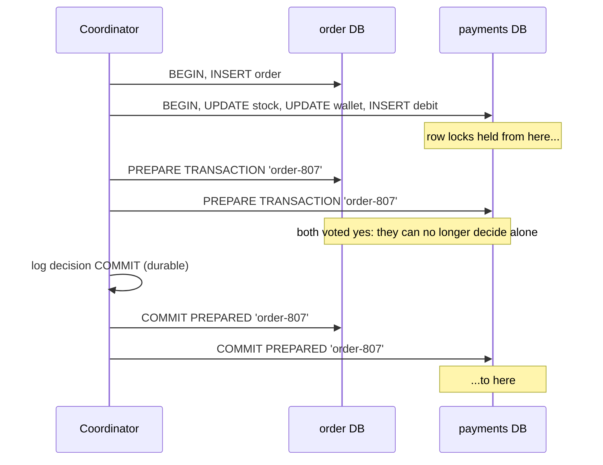

# 30. Distributed Transactions

<div class="badges" markdown><span class="badge badge-l3">L3 · Senior/Lead</span><span class="badge badge-l4">L4 · Architect</span><span class="badge badge-meta">2PC on PostgreSQL · in-doubt transactions · saga and outbox under the same failures</span></div>

<div class="grid two" markdown>

!!! info "Prerequisites"
    - [Chapter 14](../architecture-patterns/ch14-saga-pattern.md): sagas, compensation
    - [Chapter 15](../architecture-patterns/ch15-outbox-inbox-cdc.md): outbox and inbox
    - [Chapter 28](../communication/ch28-idempotency-correlation.md): idempotency

!!! abstract "What you'll learn"
    - How **two-phase commit** works, what "prepared" and "in doubt" mean, and why the protocol **blocks**
    - Measured on two PostgreSQL clusters, 1 ms round trips: 2PC took **2.4×** the latency of a local transaction and held row locks **2.8×** as long as a saga step; on two hot dishes it managed **161** orders/s against the saga's **~400**
    - **One in-doubt transaction** cut throughput on those dishes from ~160 to **2–6 orders/s** for 15 s, and **survived a database restart**
    - With the payments database down for 10 s, 2PC and a synchronous saga took **~0 orders**; the outbox design took **all of them** and confirmed each within **10.2 s**
    - Why XA is avoided between microservices, and where 2PC is still the right tool

</div>

---

## 1 · Introduction & Context

### One order, two databases

A FoodFleet order debits the customer's wallet and takes a portion of the dish from the kitchen's stock (payment-service's database), and records the order (order-service's database). Both must happen or neither: a debited wallet with no order is a support ticket; an order with no payment is lost revenue.

In a monolith this is one `@Transactional` method. Split across two services, a developer proposes the obvious fix: an XA transaction manager, so the two databases commit atomically and the code stays the same. The architecture review asks three questions: what happens to the hot rows while the transaction is being coordinated, what happens when the coordinator dies halfway, and what happens to ordering when the payments database is down for maintenance? This chapter answers them with measurements, on two real PostgreSQL clusters using PostgreSQL's own two-phase commit, against a saga and an outbox-driven design under the same failures.

### Where it comes from

<ul class="mh-timeline">
<li><span class="when">1978 · Two-phase commit</span><span class="what">Jim Gray's "Notes on Data Base Operating Systems" describes the protocol and its blocking problem.</span></li>
<li><span class="when">1987 · Sagas</span><span class="what">Garcia-Molina and Salem: long-lived transactions as a sequence of local transactions with compensations.</span></li>
<li><span class="when">1991–1999 · XA and JTA</span><span class="what">The X/Open XA specification standardises the interface between transaction managers and resources; Java's JTA (1999) brings it to application servers.</span></li>
<li><span class="when">2005 · PostgreSQL 8.1</span><span class="what"><code>PREPARE TRANSACTION</code> / <code>COMMIT PREPARED</code>: PostgreSQL can be a 2PC participant.</span></li>
<li><span class="when">2007 · "Life beyond Distributed Transactions"</span><span class="what">Pat Helland argues that scalable systems give up distributed transactions for entities, messages and idempotence.</span></li>
<li><span class="when">2012 · Spanner</span><span class="what">Google runs 2PC across Paxos groups: each participant is a replicated state machine, so the coordinator's failure doesn't block.</span></li>
</ul>

---

## 2 · Core Concepts & Terminology



Atomic commitment
:   Several participants either all commit or all abort. A local transaction gets it from one write-ahead log; across databases it needs a protocol.

Two-phase commit (2PC)
:   Phase 1: the coordinator asks every participant to **prepare** (make the work durable and promise to commit if told). Phase 2: if all voted yes, it logs the decision and tells all to commit; otherwise to abort.

Prepared / in doubt
:   A participant that voted yes and hasn't heard the decision. It may not commit or abort on its own, keeps its locks, and survives restarts in that state.

Blocking protocol
:   If the coordinator fails after the participants prepared, they wait (holding locks) until it recovers or someone resolves them. 2PC is blocking; three-phase commit avoids it only under assumptions (bounded delays) real networks don't give; consensus-replicated participants and coordinators (Spanner) make failure rare instead.

Presumed abort
:   A recovery rule: a prepared transaction with no logged decision is rolled back. The coordinator only needs to log COMMIT decisions.

Heuristic decision
:   An operator or a resource committing or rolling back an in-doubt transaction without the coordinator's decision. It unblocks the rows, and risks the participants disagreeing ("heuristic mixed").

XA / JTA
:   XA is the standard interface between a transaction manager and resources (databases, some message brokers); JTA is Java's API for it. Only resources that implement XA can take part: HTTP APIs, Kafka and most cloud services can't.

Saga
:   A sequence of local transactions, each committed on its own, with compensations for undo (chapter 14). No locks span services; intermediate states are visible.

---

## 3 · How It Works Internally

### PostgreSQL as a participant

`PREPARE TRANSACTION 'gid'` ends the session's transaction **without committing or aborting it**: PostgreSQL writes its state to the WAL (and, if it stays prepared across a checkpoint, to `pg_twophase/`), flushes it to disk, and detaches it from the session. The transaction keeps every lock it holds. Any session can later run `COMMIT PREPARED 'gid'` or `ROLLBACK PREPARED 'gid'`, also after a crash or restart; `pg_prepared_xacts` lists those waiting. The feature is off by default (`max_prepared_transactions = 0`), precisely because a forgotten prepared transaction blocks rows and stops vacuum from cleaning up behind it.

Compared with one local transaction, a two-database 2PC order costs more round trips (two prepares, a decision log write, two commit-prepareds) and more synchronous disk flushes (each prepare, the log, each commit), and the participants' locks are held across all of them.

### XA in Java and Spring Boot 4.1

A JTA transaction manager (an application server's, or an embedded one such as Narayana or Atomikos) enlists every XA resource touched inside a `@Transactional` method, runs both phases when the method returns, and keeps its own log to recover in-doubt transactions after a crash. Spring Boot 4.1 auto-configures `JtaTransactionManager` when it finds a transaction manager in JNDI (an application server), and offers `XADataSourceWrapper` and `XAConnectionFactoryWrapper` for wiring in an embedded one; it does not ship one itself. Whatever the manager, the participants are limited to XA-capable resources.

### Recovering in-doubt transactions

The coordinator's decision log is the authority. A recovery job compares `pg_prepared_xacts` with it: logged COMMIT → `COMMIT PREPARED`, logged ROLLBACK or nothing logged → `ROLLBACK PREPARED` (presumed abort), but only for transactions older than a grace period, because a live coordinator may be between its prepares and its log write. Recovering one too early overrules it.

```java
--8<-- "code/chapters/ch30-distributed-transactions/src/main/java/dev/foodfleet/ch30/indoubt/InDoubtPolicy.java:9:55"
```

### The alternative: local transactions joined by messages

The order-service transaction writes the order as `PENDING` and an outbox row; a relay delivers it to payment-service, which applies it in **its** local transaction, idempotently (a debit row keyed by the order id), and the relay records the decision on the order. No lock is ever held across services, and either side can be down without blocking the other. The cost: the order is visibly `PENDING` for a moment, and the code must handle "not yet" and "rejected" explicitly.

---

## 4 · Design Considerations & Trade-offs

Two PostgreSQL 16.13 clusters in one 2-vCPU container: A holds orders (and the 2PC decision log), B holds wallets, stock and debits. 8 clients place orders for 15 s; every statement is preceded by a **1 ms pause** standing in for a network round trip, so locks are held across "the network" as they would be. B transactions run with `lock_timeout = 2s`. The outbox relay batches up to 20 orders per payment transaction. `verify/experiment.py`, two full runs; ranges show both.

### Measured: cost and lock time

| Strategy | Dishes | Orders/s | p50 | p99 | Stock row lock held (p50) | Consistent afterwards |
|---|---|---:|---:|---:|---:|---|
| One database, one transaction (baseline) | 10,000 | 926–970 | 8.1–8.4 ms | 11–13 ms | 5.5–5.8 ms | yes |
| **2PC** across both databases | 10,000 | 389–398 | **19.7–20.2 ms** | 28–29 ms | **12.2–12.5 ms** | yes |
| Orchestrated saga (3 local transactions) | 10,000 | 696–731 | 10.7–11.1 ms | 16–17 ms | 4.4–4.5 ms | yes |
| Outbox (order accepted; payment applied after) | 10,000 | 1,267–1,308 accepted | 5.9–6.1 ms | 9.4–10 ms | 6.6–6.8 ms per batch | yes |
| One database | 2 hot | 306–313 | 19.2–19.7 ms | 94 ms | 5.8–5.9 ms | yes |
| **2PC** | 2 hot | **161** | 39.5–40.2 ms | 173–182 ms | 11.1–11.3 ms | yes |
| Saga | 2 hot | 396–406 | 17.2–17.4 ms | 56–59 ms | 4.3–4.4 ms | yes |
| Outbox | 2 hot | 1,269–1,321 accepted | 5.8–6.0 ms | 9.3–10.9 ms | 6.9–7.1 ms per batch | yes |

The outbox orders were confirmed a median of **20–21 ms** after being placed (p99 32–33 ms) with 10,000 dishes, 30–31 ms (p99 48–56 ms) with two hot dishes; confirmations kept pace with orders (1,265–1,318 confirmed/s).

- **2PC costs round trips and flushes**: 2.4× the local transaction's latency, and the participant's locks are held through both phases, 2.8× as long as the saga's payment step.
- **Hot rows turn lock time into throughput**: on two popular dishes 2PC managed 161 orders/s, about half of the local transaction and 40% of the saga.
- **The saga beat the single database on hot rows**: its payment transaction is short (4.4 ms), while the monolith's transaction also wrote the order while holding the stock lock.
- **The outbox decouples the request from the payment**: the request is one local transaction; the relay batches, so a hot dish's row is locked once per batch rather than once per order.

### Measured: the coordinator dies after PREPARE

Two hot dishes, 30 s. At 5 s the coordinator dies right after both participants prepared one order (for the saga: the orchestrator dies right after the payment step). At 12 s cluster B restarts. At 20 s the recovery job runs.

| Seconds | 2PC orders/s | 2PC lock timeouts | Saga orders/s |
|---|---:|---:|---:|
| 0–5 | 154–161 | 0 | 389–400 |
| 5–10 (one transaction in doubt) | **4–6** | 14 | 395–407 |
| 10–15 (B restarts at 12) | **2–5** | 14 | 378–391 |
| 15–20 | **3–4** | 14 | 392–413 |
| 20–25 (recovered) | 155–167 | 0 | 395–410 |

- **One prepared transaction held 6 locks, before and after the restart**: the restart didn't release it, by design. Orders for that dish waited the 2 s lock timeout and failed. Half of all orders were for that dish, so each client spent about 1 s per order waiting, and throughput on *both* dishes fell to 2–6/s: blocked requests tie up the threads that the healthy requests need.
- **The saga didn't notice its crash**: its payment step had committed; the order stayed `PENDING` until the recovery job confirmed it from the payment record. The restart left at most one more order with an unknown outcome (the connection broke at `COMMIT`), settled the same way.
- Recovery resolved the 2PC transaction by presumed abort (no decision logged: rolled back on both databases). Every run ended consistent: no order without a debit, no debit without an order.

### Measured: the payments database is down for 10 s

10,000 dishes, 30 s; cluster B is stopped at 10 s and started at 20 s.

| | Before (0–10 s) | During (10–20 s) | After (20–30 s) | Afterwards |
|---|---:|---:|---:|---|
| 2PC | 400–408 /s | **1 /s**, 350–1,225 refused | 405 /s | consistent; 1–6 orders waited up to 10.1 s to commit in B |
| Saga | 713–716 /s | **1–2 /s**, 1,393–1,395 refused | 696–704 /s | consistent |
| Outbox | 1,249–1,272 /s | **1,410–1,428 /s accepted** | 1,177–1,233 /s | consistent; the 14,102–14,287 orders from the outage confirmed within 10.2 s of being placed |

- **2PC and synchronous sagas couple availability**: ordering stopped for as long as payments was down. 2PC also left orders whose prepared transactions survived the shutdown, committed when B returned.
- **The outbox design kept taking orders** at full rate (more, since nothing waited on B), and confirmed them all once B was back.

### Choosing

| Situation | Use |
|---|---|
| Several services, each owning its data | **Saga**: local transactions plus outbox/inbox; compensations for undo |
| The caller doesn't need the outcome in the same request | **Outbox-driven saga**, `202 Accepted`, status by poll or push |
| The caller needs an immediate answer, the step is quick | Synchronous orchestrated saga with a persisted state, timeouts and recovery |
| Two databases owned by **one** service, low volume, both XA-capable, operations ready for in-doubt recovery | 2PC can be acceptable |
| Database and message broker in one service | **Outbox** (chapter 15), not XA |
| One logical database that must scale out with ACID | A distributed SQL database (Spanner, CockroachDB, YugabyteDB): 2PC inside, with replicated participants |
| External systems (payment providers, partners) | Never 2PC: idempotency keys and reconciliation (chapter 28) |

---

## 5 · Hands-on Implementation

```text
ch30-distributed-transactions/
├── src/main/java/dev/foodfleet/ch30/
│   ├── orders/    OrderController (202 Accepted), OrderService (order + outbox), OrderRelay
│   ├── payments/  PaymentLedger (idempotent, batched, falls back to one by one), Batches, PaymentsPort
│   └── indoubt/   InDoubtPolicy, InDoubtMonitor (for systems that do run 2PC)
├── src/main/resources/db/migration/V1__orders_and_payments.sql
└── verify/        experiment.py (two clusters: local vs 2PC vs saga vs outbox), check_service_sql.py
```

The `orders` and `payments` schemas stand in for the two services' databases: no transaction in the code spans both.

### 🟢 Level 1: model the states, not the transaction

<div class="badges" markdown><span class="badge badge-l1">L1 · Foundation</span></div>

Without a distributed transaction, "placed" and "paid" become states the order moves through, visible to the customer: `PENDING` → `CONFIRMED`, or `PENDING` → `REJECTED` with a reason (`INSUFFICIENT_FUNDS`, `SOLD_OUT`). The API says so: `POST /orders` returns **202 Accepted** with a `Location`, and the app follows the order's status (or receives it by push, chapter 26).

### 🔵 Level 2: one local transaction per service

<div class="badges" markdown><span class="badge badge-l2">L2 · Practitioner</span></div>

```java
--8<-- "code/chapters/ch30-distributed-transactions/src/main/java/dev/foodfleet/ch30/orders/OrderService.java:8:49"
```

### 🟣 Level 3: the relay and an idempotent ledger

<div class="badges" markdown><span class="badge badge-l3">L3 · Senior/Lead</span></div>

The relay claims outbox rows, asks payments for decisions and records them, all in one order-service transaction; if anything fails, the claim rolls back and the rows are retried.

```java
--8<-- "code/chapters/ch30-distributed-transactions/src/main/java/dev/foodfleet/ch30/orders/OrderRelay.java:15:75"
```

Payments applies a batch in one transaction and stores a decision per order, so a redelivered order gets the same answer and is never charged twice. Totals per dish and per customer are applied in key order (no deadlocks between batches); if a constraint refuses the batch, the orders are applied one by one so only those that can't be served are rejected.

```java
--8<-- "code/chapters/ch30-distributed-transactions/src/main/java/dev/foodfleet/ch30/payments/PaymentLedger.java:13:74"
```

The container test runs the flow and its failure cases against PostgreSQL with prepared transactions enabled:

```java
--8<-- "code/chapters/ch30-distributed-transactions/src/test/java/dev/foodfleet/ch30/OrdersAndPaymentsContainerTest.java:58:124"
```

### 🔴 Level 4: rules for the platform

<div class="badges" markdown><span class="badge badge-l4">L4 · Architect</span></div>

- **No distributed transactions across service boundaries.** Cross-service consistency is a saga with an outbox and idempotent participants; the API exposes the intermediate states.
- **`max_prepared_transactions = 0`** on service databases unless a service has an ADR for 2PC; where it is on, an in-doubt monitor and an alert on the age of the oldest prepared transaction are mandatory.
- **Recovery jobs have grace periods** (in-doubt transactions, `PENDING` sagas), so they never overrule a live coordinator.
- **Every "unknown" outcome is reconciled, not guessed**: a lost reply to `COMMIT` leaves the order `PENDING` for recovery to settle from the other side's records.

### Run and verify

```text
$ verify/run.sh                     # two PostgreSQL clusters; see the script for the variables
== 1. throughput and lock holding
8 clients, 15 s per run, simulated round trip 1.0 ms before every statement

strategy    dishes  orders/s   p50 ms   p99 ms  failed  B lock held p50      confirmed after p50/p99 ms   consistent
local       10,000       970      8.1     11.4       0           5.5 ms                                   yes
2pc         10,000       398     19.7     28.1       0          12.2 ms                                   yes
saga        10,000       731     10.7     15.7       0           4.4 ms                                   yes
outbox      10,000      1308      5.9      9.4       0           6.6 ms                20 / 32 (1306/s)   yes
local        2 hot       313     19.2     94.4       0           5.8 ms                                   yes
2pc          2 hot       161     40.2    172.7       0          11.1 ms                                   yes
saga         2 hot       406     17.2     56.1       0           4.3 ms                                   yes
outbox       2 hot      1321      5.8      9.3       0           6.9 ms                30 / 48 (1318/s)   yes

== 2. the coordinator dies after PREPARE
...
2pc: orders/s, lock timeouts, unreachable per 5 s
   0-5  s      154/s        0 lock timeouts      0 unreachable
   5-10 s        6/s       14 lock timeouts      1 unreachable
  10-15 s        2/s       14 lock timeouts     24 unreachable
  15-20 s        4/s       14 lock timeouts      0 unreachable
  20-25 s      155/s        0 lock timeouts      0 unreachable
  25-30 s      165/s        0 lock timeouts      0 unreachable
  before the restart: 1 prepared transaction(s) on B ['order-773'], holding 6 locks
  after the restart: 1 prepared transaction(s) on B ['order-773'], holding 6 locks
  recovery: in-doubt transactions resolved: 0 committed, 2 rolled back
...

$ python3 verify/check_service_sql.py
PASS Flyway migration V1 applies
PASS INSERT_ORDER returns the new id
PASS the outbox holds one row per order
...
PASS COMMIT / ROLLBACK PREPARED resolve them
PASS only the committed one took effect

all checks passed
```

!!! question "Try it"
    1. Set `RTT_MS=5` (another region) and rerun experiment 1. How do 2PC's latency and its hot-dish throughput change compared with the saga?
    2. In experiment 2, move the crash to just after the coordinator logged COMMIT. What does recovery do now, and what would a heuristic rollback by an operator have caused?
    3. Remove the grace period from `recover()` and rerun experiment 2. What happens to orders that were in flight when recovery ran?
    4. Make `PaymentLedger` reject a whole batch when one wallet is short (no fallback). How many good orders would one empty wallet reject at 20 orders per batch?

---

## 6 · Production Readiness

- [x] **No transaction spans services**; cross-service operations are sagas with an outbox and idempotent participants
- [x] **Intermediate states are part of the API** (`PENDING`, reasons for `REJECTED`), with 202 Accepted for asynchronous decisions
- [x] **Participants store a decision per request** so redeliveries get the same answer
- [x] **Batches lock rows in key order** and fall back to one-by-one on business failures
- [x] **Unknown outcomes are reconciled** from the other side's records, never assumed
- [x] **Recovery jobs** for stuck sagas and in-doubt transactions, with grace periods and alerts
- [x] **If 2PC is used**: an ADR, `max_prepared_transactions` sized, a decision log, an in-doubt monitor, an alert on the oldest `pg_prepared_xacts.prepared`, and a runbook for heuristic decisions
- [x] **Availability tested**: ordering keeps working with payments down (the outage experiment as a game day)

---

## 7 · Anti-patterns & Pitfalls

!!! pitfall "Incident 1: tonight's special froze"
    **Context.** Order placement used XA across the order and payment databases.
    **Symptoms.** At 20:10 on a Friday, orders for the two dinner specials started timing out; within seconds the whole order service was slow. Restarting the payments database didn't help.
    **Root cause.** An order-service instance was killed by the orchestrator (memory limit) between the prepares and the decision; one transaction stayed prepared, holding the stock row of a special. Measured: throughput on two hot dishes fell from ~160 to 2–6 orders/s, and the prepared transaction survived the restart.
    **Fix.** The transaction manager's recovery and an in-doubt alert in the short term; the outbox-driven saga in the next release.

!!! pitfall "Incident 2: maintenance closed the restaurant"
    **Context.** Payment-service's database was upgraded in a 10-minute maintenance window; order placement called payments synchronously.
    **Symptoms.** No orders could be placed for the whole window, at dinner time in one city.
    **Root cause.** Synchronous coupling: measured, 2PC and a synchronous saga both accepted ~0 orders while payments was down.
    **Fix.** Orders accepted as `PENDING` through the outbox; measured, all orders during a 10 s outage were accepted and confirmed within 10.2 s.

!!! pitfall "Incident 3: rejected orders, debited wallets"
    **Context.** The saga treated any error from payments as "payment failed" and rejected the order.
    **Symptoms.** After payments restarts, the odd order was rejected while the customer's wallet was debited.
    **Root cause.** The connection broke while `COMMIT` was in flight: the debit may have committed, the reply was lost. Measured: up to one order per restart had an unknown outcome at 8 concurrent clients; at production concurrency, more.
    **Fix.** Only errors before `COMMIT` reject; a lost reply leaves the order `PENDING`, and recovery settles it from the debit records (older than a grace period).

| Anti-pattern | Symptom | Fix |
|---|---|---|
| XA/2PC across microservices | Locks across services, coupled availability | Saga + outbox |
| 2PC with no in-doubt monitoring | Rows blocked indefinitely after a crash | Recovery job, alert on oldest prepared transaction |
| Recovery without a grace period | Overruling live coordinators | Only resolve what is older than the longest normal run |
| Heuristic decisions by hand | Participants disagree | Use the decision log; document and audit any heuristic action |
| Treating a lost reply as a failure | Money taken, order rejected | Leave `PENDING`, reconcile |
| Non-idempotent participants | Double charges on redelivery | Store a decision per request id |
| All-or-nothing batches for business checks | One bad order rejects many good ones | Fall back to one by one |
| Locking rows in arbitrary order in batches | Deadlocks | Sort keys; lock with `ORDER BY … FOR UPDATE` |
| Hiding intermediate states from the API | Clients guess, retry, duplicate | `PENDING` with a status resource |
| `max_prepared_transactions > 0` "just in case" | Forgotten prepared transactions block vacuum | Keep it 0 unless an ADR says otherwise |

---

## 8 · Enterprise Case Study

### FoodFleet: an order is a saga, not a transaction

!!! decision "ADR-030: No distributed transactions between services; outbox-driven sagas with idempotent participants"
    **Status:** Accepted · **Date:** 2025-03-03

    **Context.** Placing an order changes the order (order-service) and the wallet and stock (payment-service). An XA proposal promised atomicity without code changes. Measured on two PostgreSQL clusters: 2PC took 2.4× the latency, half the throughput on hot dishes, collapsed to 2–6 orders/s for as long as one transaction was in doubt (surviving a restart), and accepted no orders while payments was down.

    **Decision.** Services never share a transaction. Placing an order is one order-service transaction (order `PENDING` + outbox row) answered with `202 Accepted`; a relay delivers it to payment-service, which applies it in its own transaction, idempotently, storing a decision per order; the relay records `CONFIRMED` or `REJECTED` with a reason. Unknown outcomes stay `PENDING` and are reconciled by a recovery job with a 5 s grace period. `max_prepared_transactions` is 0 on all service databases; any future 2PC use needs an ADR, a decision log and an in-doubt monitor.

    **Consequences.** ✅ Orders are accepted while payments is down and confirmed when it returns (measured: within 10.2 s, after a 10 s outage). ✅ Hot dishes are locked per batch, not per order. ✅ No in-doubt transactions to recover. ⚠️ Customers see `PENDING` for ~20–30 ms normally, longer during incidents; the app shows "confirming". ⚠️ Every participant must be idempotent and store decisions. ⚠️ Rejections happen after acceptance, so the app and notifications handle them.

### Fintech analogue: funds transfer between banks 🔴

No bank shares a transaction with another. A transfer is a message (ISO 20022 `pacs.008`) with a unique end-to-end reference; each bank posts to its own ledger in local ACID transactions, the sending side first reserving or debiting, the receiving side crediting and acknowledging (`pacs.002` status reports), and returns or recalls act as compensations. Settlement between banks happens in a central system, and reconciliation of statements against ledgers catches anything that slipped through. Inside one bank, a core ledger often relies on one strongly consistent database, sometimes a distributed SQL database whose internal 2PC runs over replicated participants: atomicity where it's affordable, messages and reconciliation everywhere else.

### E-commerce analogue: checkout

Large shops confirm "order received" immediately and charge and allocate inventory asynchronously: the order service records the order, a payment authorisation is requested with an idempotency key, inventory is reserved with an expiry, and the customer gets "order confirmed" or "payment failed, please update your card" minutes later. Compensations (release the reservation, void the authorisation) handle failures, and the order page shows the state the order is in rather than pretending the checkout was one atomic act.

---

## 9 · Interview Q&A + Summary

#### Q1. What is two-phase commit? · <span class="badge badge-l2">L2</span><span class="badge badge-l3">L3</span> · Cognizant · SAP

**Short answer:** A protocol for atomic commit across several resources. Phase 1: the coordinator asks each participant to prepare (persist the work and promise to commit); phase 2: if all agreed, it logs COMMIT and tells everyone to commit, otherwise to abort. Between the phases the participants are in doubt and hold their locks.

#### Q2. Why is 2PC avoided between microservices? · <span class="badge badge-l3">L3</span> · Amazon · Flipkart · Goldman Sachs

**Short answer:** It holds locks across network round trips (measured: 2.8× as long as a saga step, half the throughput on hot rows), it couples availability (no orders while payments was down), it blocks if the coordinator fails (one in-doubt transaction cut a hot path to 2–6 orders/s), and it needs XA-capable resources, which brokers, HTTP APIs and external providers aren't. It also couples teams to a shared transaction manager.

#### Q3. What happens if the coordinator crashes after the participants prepared? · <span class="badge badge-l3">L3</span><span class="badge badge-l4">L4</span> · Goldman Sachs · JP Morgan

**Short answer:** The participants stay prepared, holding locks, across restarts, until the coordinator recovers and reads its log or someone resolves them. With presumed abort, no logged decision means roll back. Measured: the prepared transaction survived a database restart and kept its locks until recovery ran.

#### Q4. What is a heuristic decision and why is it dangerous? · <span class="badge badge-l4">L4</span> · JP Morgan · Goldman Sachs

**Short answer:** Committing or rolling back an in-doubt transaction without the coordinator's decision, usually by an operator to free blocked rows. If another participant got the opposite decision, the system is inconsistent ("heuristic mixed") and needs manual repair. Use the decision log; audit any heuristic action.

#### Q5. Does three-phase commit solve blocking? · <span class="badge badge-l4">L4</span> · Amazon · any

**Short answer:** Only if message delays are bounded and failures detectable, which networks don't guarantee; under partitions it can produce inconsistency. Practical systems instead replicate the coordinator and participants with consensus (Paxos/Raft), as Spanner does, so a single machine's failure doesn't block.

#### Q6. How does a saga differ from a distributed transaction? · <span class="badge badge-l2">L2</span><span class="badge badge-l3">L3</span> · Flipkart · SAP

**Short answer:** Each step commits locally and at once; failures are undone by compensating steps, not rollback. It gives up isolation (intermediate states are visible) in exchange for no cross-service locks and independent availability. Measured: the saga's payment step held its lock 4.3–4.5 ms vs 2PC's 11–12.5 ms.

#### Q7. Why should order placement return 202 Accepted? · <span class="badge badge-l3">L3</span> · Amazon · Flipkart

**Short answer:** Because the order exists but its payment isn't decided yet. Saying so lets the request be one local transaction, keeps ordering available when payments isn't (measured: all orders accepted during a 10 s outage, confirmed within 10.2 s), and the client follows a status resource or receives a push.

#### Q8. What do you do when you don't know whether a remote commit happened? · <span class="badge badge-l3">L3</span> · Goldman Sachs · Amazon

**Short answer:** Don't guess. Leave the operation pending and reconcile from the other side's records (or retry idempotently with the same key). Rejecting on any error charged customers for rejected orders in incident 3; measured, a database restart left up to one order (of 8 in flight) with an unknown outcome.

#### Q9. How do you make a saga participant safe to retry? · <span class="badge badge-l3">L3</span> · Amazon · JP Morgan

**Short answer:** Key the work by the request's id and store the decision in the same local transaction (an inbox or decision row); a repeat returns the stored decision. Lock rows in a consistent order, and for batches fall back to one by one so business rejections stay per request.

#### Q10. Is the transactional outbox a distributed transaction? · <span class="badge badge-l3">L3</span> · SAP · Flipkart

**Short answer:** No. It makes "change state and publish" atomic by writing both into one local database transaction; delivery happens afterwards, at least once, so consumers must be idempotent. It replaces XA between a database and a broker.

#### Q11. When is 2PC acceptable? · <span class="badge badge-l4">L4</span> · Goldman Sachs · SAP

**Short answer:** Inside one service or one database product: a service writing to two of its own databases at low volume with an operations team ready for in-doubt recovery; distributed SQL databases that run 2PC over consensus-replicated participants; legacy integration in an application server. Not across services, teams or external systems.

#### Q12. Design order placement for a food delivery app without distributed transactions. · <span class="badge badge-l4">L4</span> · Swiggy-/Zomato-style system design rounds

**Short answer:** `POST /orders` writes the order `PENDING` and an outbox row in one transaction and returns 202. A relay delivers the event to payment-service, which debits the wallet and takes stock in one local transaction keyed by order id (stored decision, idempotent). The relay records `CONFIRMED` or `REJECTED` with a reason and the app is notified. Recovery jobs with grace periods settle stuck and unknown cases; compensations (refund, restock) handle later cancellations.

### Key takeaways

- **2PC buys atomicity with locks held across the network, coupled availability and blocking on coordinator failure**, all measured here.
- **One in-doubt transaction can stall a hot path**, and survives restarts; anyone running 2PC needs recovery with a decision log and alerts.
- **Between services, use sagas**: local transactions, an outbox, idempotent participants that store decisions, explicit intermediate states.
- **Never guess an unknown outcome**: leave it pending and reconcile.
- **Recovery must not race the living**: grace periods for in-doubt transactions and stuck sagas.

### Further reading

- Jim Gray and Andreas Reuter, *Transaction Processing: Concepts and Techniques* (1992)
- Hector Garcia-Molina and Kenneth Salem, *Sagas* (SIGMOD 1987)
- Pat Helland, *Life beyond Distributed Transactions: an Apostate's Opinion* (CIDR 2007)
- PostgreSQL documentation: [PREPARE TRANSACTION](https://www.postgresql.org/docs/16/sql-prepare-transaction.html), [pg_prepared_xacts](https://www.postgresql.org/docs/16/view-pg-prepared-xacts.html)
- Spring Boot reference, [Distributed Transactions With JTA](https://docs.spring.io/spring-boot/reference/io/jta.html)
- James C. Corbett et al., *Spanner: Google's Globally-Distributed Database* (OSDI 2012)

---

**Previous:** [← 29. Polyglot Persistence](ch29-polyglot-persistence.md) · **Next:** [31. Data Consistency →](ch31-data-consistency.md)
