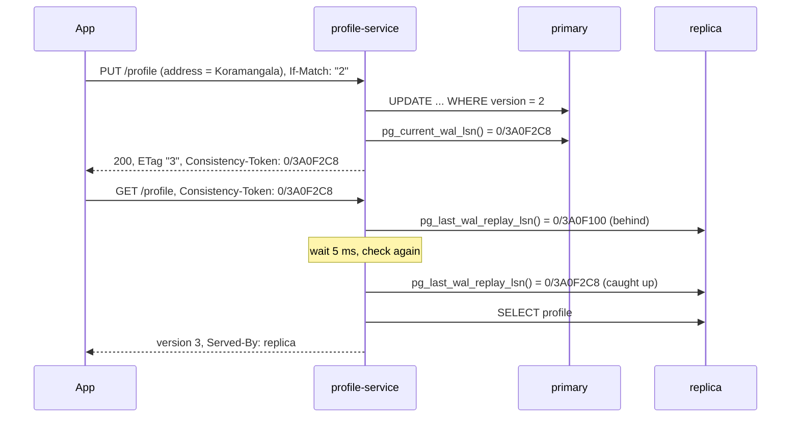

# 31. Data Consistency

<div class="badges" markdown><span class="badge badge-l3">L3 · Senior/Lead</span><span class="badge badge-l4">L4 · Architect</span><span class="badge badge-meta">primary + 2 streaming replicas · session guarantees · lost updates · CRDTs</span></div>

<div class="grid two" markdown>

!!! info "Prerequisites"
    - [Chapter 3](../foundations/ch03-distributed-systems-fundamentals.md): CAP and PACELC
    - [Chapter 13](../architecture-patterns/ch13-cqrs-event-sourcing.md): read models
    - [Chapter 30](ch30-distributed-transactions.md): sagas instead of distributed transactions

!!! abstract "What you'll learn"
    - What "eventually consistent" means for a user, in **session guarantees**: read-your-writes, monotonic reads, and the rest
    - Measured with real streaming replicas: reading from a lagging replica showed **stale data in 15% of reads** after the customer's own write; a **consistency token** brought that to **0** while keeping 97% of reads off the primary
    - A load balancer over two replicas made order status **go backwards 19% of the time**; a session token: **0**
    - Read-modify-write in the application **lost 15.5% of loyalty points** under concurrency; an atomic update lost none and was the fastest
    - Two regions writing one cart: last-writer-wins lost **562–578 added items**, an OR-Set **none**

</div>

---

## 1 · Introduction & Context

### "I changed my address and it still shows the old one"

To take load off its primary database, FoodFleet's customer service started reading from an asynchronous replica. Within a week, three kinds of complaint arrived:

- **"I changed my delivery address, the app showed the old one, so I changed it again."** The update went to the primary; the profile page reloaded from a replica that hadn't caught up.
- **"The tracking page went from *Out for delivery* back to *Preparing*."** The page polled through a load balancer over two replicas, one further behind than the other.
- **"My loyalty points disappeared."** Two services added points to the same customer at the same moment, each reading the balance, adding, and writing back.

None of these is a bug in PostgreSQL, and none is fixed by "making it strongly consistent" everywhere. Each is a specific, missing guarantee, and each has a specific, cheap fix. This chapter measures the anomalies on a real primary with two streaming replicas, and the fixes.

### Where it comes from

<ul class="mh-timeline">
<li><span class="when">1979–1990 · Sequential consistency and linearizability</span><span class="what">Lamport (1979) and Herlihy and Wing (1990) define what it means for a replicated object to behave like a single copy.</span></li>
<li><span class="when">1994 · Session guarantees</span><span class="what">Terry et al. (Bayou): read-your-writes, monotonic reads, writes-follow-reads and monotonic writes: what one user needs, without global agreement.</span></li>
<li><span class="when">2000–2012 · CAP and PACELC</span><span class="what">Brewer's conjecture (2000, proved 2002) and Abadi's PACELC (2012): during partitions choose availability or consistency; otherwise, latency or consistency.</span></li>
<li><span class="when">2007–2008 · Dynamo and "Eventually Consistent"</span><span class="what">Amazon's Dynamo paper and Werner Vogels' article bring eventual consistency, vector clocks and application-level conflict resolution to the mainstream.</span></li>
<li><span class="when">2011 · CRDTs</span><span class="what">Shapiro et al. formalise conflict-free replicated data types: data structures whose replicas converge without coordination.</span></li>
<li><span class="when">2014 · Hybrid logical clocks</span><span class="what">Kulkarni et al.: timestamps close to physical time that still respect causality, now used by CockroachDB, YugabyteDB and MongoDB.</span></li>
</ul>

---

## 2 · Core Concepts & Terminology



Strong consistency (linearizability)
:   Every read sees the latest completed write, as if there were one copy. Needs coordination on every operation: a single leader, or a quorum.

Eventual consistency
:   If writes stop, all replicas eventually agree. Says nothing about what a reader sees meanwhile, which is why it needs the guarantees below to be usable.

Session guarantees
:   Promises to one client (a session), not to everyone: **read-your-writes** (you see your own writes), **monotonic reads** (you never see older data after newer), **monotonic writes** (your writes apply in order), **writes-follow-reads** (your write is ordered after what you had read).

Replication lag
:   How far a replica is behind the primary: in bytes of WAL, or in time. Asynchronous replicas are always somewhat behind and can fall far behind (long queries, network, load).

Consistency token
:   Something the client carries that describes what it has seen (here, a WAL position). A server answers only from a replica that is at least that far along, or from the primary.

Lost update
:   Two read-modify-write cycles interleave and one overwrites the other's change. The classic race inside one database.

Conflict
:   Two writes to the same data accepted in different places without either seeing the other (two regions, offline clients). Something must decide the result: last-writer-wins, a merge function, or a human.

CRDT
:   A conflict-free replicated data type: replicas that have seen the same updates hold the same state, whatever order they saw them in. Counters, sets (OR-Set), registers, maps.

---

## 3 · How It Works Internally

### Streaming replication and WAL positions

The primary writes every change to its write-ahead log; replicas receive the WAL and **replay** it. `pg_current_wal_lsn()` on the primary is the log's current end; `pg_last_wal_replay_lsn()` on a replica is how far it has applied (NULL on a server that isn't replaying). Positions only grow, so "has the replica applied my write?" is a comparison: is its replay position at least the primary's position just after my write committed?

Two details decide whether that comparison is safe:

- **Check, then read, in separate statements.** A statement's snapshot is taken when it starts, before the functions in it run. `SELECT CASE WHEN pg_last_wal_replay_lsn() >= $token THEN (SELECT ...) END` can see a position that has passed the token while reading from a snapshot taken just before. A first version of the experiment did exactly that and served 1 stale read in 29,907.
- **Replica queries can be cancelled.** When replay needs to remove row versions a running query might still need, the replica cancels the query (`canceling statement due to conflict with recovery`, SQLSTATE 40001) after `max_standby_streaming_delay`. Readers must retry or fall back.

```java
--8<-- "code/chapters/ch31-data-consistency/src/main/java/dev/foodfleet/ch31/reads/ReplicaRouter.java:54:85"
```

### Lost updates inside one database

Under PostgreSQL's default READ COMMITTED isolation, `SELECT points` then `UPDATE ... SET points = <value computed in Java>` lets two transactions read the same balance and both write their own result: one change is lost. The fixes differ in where the work happens:

| Fix | How | Cost |
|---|---|---|
| Atomic update | `UPDATE ... SET points = points + 10` | none: the row lock serialises the increments |
| Pessimistic lock | `SELECT ... FOR UPDATE`, then write | the lock is held across the round trips |
| Optimistic version | `UPDATE ... WHERE version = :seen`, retry if no row | retries under contention |
| Repeatable read | the second writer gets a serialization failure (40001), retry | retries; the whole transaction repeats |

The same race happens through an API when two people edit the same record from stale screens: the version as ETag and `If-Match` (chapter 21) turns it into a `412 Precondition Failed` instead of a silent overwrite.

### Conflicts between writers that can't coordinate

When two regions (or a phone offline) accept writes to the same data, each applies its own write at once and learns about the other's later. Choices:

- **Last-writer-wins (LWW)** keeps the write with the greatest timestamp. Simple and convergent, but it discards the other write, and with wall clocks "greatest" can be the older write if a clock is behind.
- **Version vectors** detect that two writes were concurrent (neither had seen the other) and keep both as siblings for the application or user to resolve.
- **CRDTs** merge by construction. An **OR-Set** gives every add a unique tag; a remove deletes only the tags it had seen; merging unions both. A concurrent add therefore survives a remove that hadn't seen it, and replicas converge whatever the delivery order.
- **Hybrid logical clocks** stamp writes with "wall time, but never earlier than anything I have seen", so a write made after seeing another always orders after it, even with a slow clock.

```java
--8<-- "code/chapters/ch31-data-consistency/src/main/java/dev/foodfleet/ch31/merge/OrSet.java:10:56"
```

---

## 4 · Design Considerations & Trade-offs

A PostgreSQL 16.13 primary and two asynchronous streaming replicas (hot standby) in one 2-vCPU container. Every statement is preceded by a 1 ms pause standing in for a network round trip. "Lagging" replicas have `recovery_min_apply_delay` set, so each commit becomes visible on them that much later, as on a replica that is far away or busy. `verify/experiment.py`, two full runs; ranges show both.

### Measured: read-your-writes

32 customer sessions for 20 s. Each operation is a profile update (1%) or a read of the customer's own profile (99%), 10 ms apart; right after an update the profile is read at once (the page reloads). A read is stale if it shows an older version than the customer's own last write. Background writes keep replication busy.

| Replica | Reads go to | Stale reads | Reads on the primary | p50 | p99 | Replica queries cancelled |
|---|---|---:|---:|---:|---:|---:|
| healthy | always the replica | **36–40 (0.07–0.08%)** | 0% | 1.6 ms | 5.0–5.1 ms | 0 |
| healthy | always the primary | 0 | 100% | 1.6 ms | 4.8–5.3 ms | 0 |
| healthy | the primary for 1 s after an own write | 0 | 54.7% | 1.6 ms | 5.2 ms | 0 |
| healthy | the primary for 100 ms after an own write | 0 | 8.2% | 1.6 ms | 4.8–4.9 ms | 0 |
| healthy | **the replica once it has the write (token)** | **0** | **0%** | 3.1 ms | 9.3–9.7 ms | 0 |
| lagging, 200 ms | always the replica | **7,848–7,923 (14.9–15.0%)** | 0% | 1.5 ms | 5.0 ms | 0 |
| lagging, 200 ms | always the primary | 0 | 100% | 1.6 ms | 4.7–5.0 ms | 0 |
| lagging, 200 ms | the primary for 1 s after an own write | 0 | 54.7–55.0% | 1.6 ms | 5.1–5.4 ms | 0–4 |
| lagging, 200 ms | the primary for 100 ms after an own write | **3,489–3,545 (6.7–6.8%)** | 8.2% | 1.6 ms | 4.9–5.1 ms | 0–11 |
| lagging, 200 ms | **the replica once it has the write (token)** | **0** | **2.9%** | 3.0–3.2 ms | 56.7–57.0 ms | 0–19 |

- **A healthy replica is not enough**: even with sub-millisecond lag, an immediate re-read was stale 0.07–0.08% of the time; with a lagging replica, 15%.
- **"Read the primary for a while after a write" trades load for safety**, and fails when lag exceeds the window: 100 ms was 6.7–6.8% stale against a 200 ms lag; 1 s was safe but sent 55% of reads to the primary.
- **The token did both**: no stale reads, 2.9% of reads on the primary. The price is visible in the tail: with a lagging replica some reads waited up to the 50 ms limit (p99 57 ms).
- Replica reads were **cancelled** by replication conflicts (up to 19 in a run): any replica reader needs a retry or a fallback.

### Measured: monotonic reads

For 20 s the kitchen advances the status of 100 orders (~800 changes/s). 16 tracking pages each poll one of 10 orders every 10 ms through a load balancer over two replicas: replica 1 with no delay, replica 2 with a 300 ms apply delay.

| Routing | Reads | Went backwards | Steps behind (avg) | Reads on the primary |
|---|---:|---:|---:|---:|
| Random replica per request | 27,405–27,452 | **5,163–5,297 (18.8–19.3%)** | 1.5 | 0% |
| Sticky replica per session | 27,593–27,657 | 0 | — | 0% |
| **Random replica that has replayed at least the newest position seen** | 23,095 | **0** | — | 0% |

- **Two healthy-looking replicas with different lag make time run backwards**: random routing showed an earlier status than the page had already shown 19% of the time.
- **Sticky sessions fix it** while the session stays on one replica (and break when it fails over); a **token of the newest position seen** fixes it regardless of routing.

### Measured: lost updates

16 threads add 10 loyalty points at a time to 50 customers for 10 s, on the primary.

| Method | Adds/s | Points lost | Retries | p99 |
|---|---:|---:|---:|---:|
| Read, add in the application, write (READ COMMITTED) | 2,943–2,970 | **45,710–46,320 (15.5–15.6%)** | 0 | 10.6–11.1 ms |
| **Atomic `UPDATE points = points + 10`** | **4,416–4,945** | **0** | 0 | 7.0–8.8 ms |
| `SELECT … FOR UPDATE`, then write | 1,832–1,908 | 0 | 0 | 15.9–19.0 ms |
| Optimistic: `UPDATE … WHERE version = v`, retry | 2,438–2,450 | 0 | 4,791–4,812 | 21.1–21.6 ms |
| Read, add, write in REPEATABLE READ, retry | 1,630–1,689 | 0 | 3,013–3,154 | 28.8–30.5 ms |

- **Read-modify-write in the application lost 15.5% of all points**, silently: every request succeeded.
- **The atomic update was both correct and fastest.** Optimistic versions and REPEATABLE READ were correct but paid in retries (thousands at this contention) and tail latency.

### Measured: two regions writing one cart

Two regions accept writes to 2,000 shared family carts (20 operations each, a few hundred ms apart, by family members in either region) and replicate to each other with 50–500 ms lag. Simulation (`conflicts` in the script); counted once everything has arrived everywhere. A *lost add* is an item missing although nobody who had seen that add removed it; *resurrected* is an item back although every add of it had been seen by a remove; a *stale note* is a delivery note shown although a later writer had seen it and replaced it.

| Clock skew | Merge | Regions agree | Lost adds | Resurrected | Stale note |
|---:|---|---:|---:|---:|---:|
| 0 ms | Last writer wins on the whole cart (wall clock) | 2,000/2,000 | **562** | **259** | 0 |
| 0 ms | Last writer wins per item (wall clock) | 2,000/2,000 | 82 | 0 | 0 |
| 0 ms | **OR-Set per item, note by hybrid logical clock** | 2,000/2,000 | **0** | **0** | **0** |
| 250 ms | Last writer wins on the whole cart (wall clock) | 2,000/2,000 | **578** | **280** | 2 |
| 250 ms | Last writer wins per item (wall clock) | 2,000/2,000 | 78 | 3 | 2 |
| 250 ms | **OR-Set per item, note by hybrid logical clock** | 2,000/2,000 | **0** | **0** | **0** |

The simulation is deterministic (seeded): both runs gave identical numbers.

- **Every strategy converged**: both regions agreed in all 2,000 carts. Convergence is not correctness.
- **Last-writer-wins on the whole cart** lost hundreds of items (and brought back removed ones): each write carried the cart as its writer saw it, so it silently erased concurrent changes.
- **Per-item LWW** was much better but still dropped adds that raced a concurrent remove, and with a 250 ms clock skew began picking older notes.
- **OR-Set + hybrid logical clock: no anomalies** with or without skew.

### Choosing a guarantee per screen

| Data / screen | Needs | How |
|---|---|---|
| Wallet balance at checkout, payment status | Strong (latest) | Primary only |
| My profile, my addresses, my order after placing it | Read-your-writes | Consistency token (or primary for the session's writes) |
| Order tracking, chat, notifications list | Monotonic reads | Token of the newest position seen, or sticky replica |
| Restaurant listing, menus, ratings | Eventual (bounded staleness) | Any replica, a cache (chapter 32) |
| Counters (points, likes, stock) | No lost updates | Atomic or conditional update; CRDT counter across regions |
| Records edited by people | No lost updates through the API | Version + `If-Match` → 412 |
| Data written in two regions or offline | Convergence without losing intent | CRDTs; LWW only with HLC timestamps and for values where losing a concurrent write is acceptable |

---

## 5 · Hands-on Implementation

```text
ch31-data-consistency/
├── src/main/java/dev/foodfleet/ch31/
│   ├── reads/     DataSources (primary + replica), ConsistencyToken, Positions, ReplicaRouter
│   ├── profiles/  ProfileService (If-Match updates, token reads), ProfileController
│   ├── points/    LoyaltyPoints (atomic add, conditional redeem)
│   └── merge/     OrSet, HybridLogicalClock, LwwRegister
├── src/main/resources/db/migration/V1__profiles_and_points.sql
└── verify/        experiment.py (primary + 2 streaming replicas), check_service_sql.py
```

### 🟢 Level 1: name the guarantee each read needs

<div class="badges" markdown><span class="badge badge-l1">L1 · Foundation</span></div>

Go through the screens and API reads and write the guarantee next to each, using the table above. Most reads tolerate staleness; a few need the user's own writes; very few need the latest value from everyone. That list decides what may be read from replicas and caches.

### 🔵 Level 2: no lost updates

<div class="badges" markdown><span class="badge badge-l2">L2 · Practitioner</span></div>

Counters change in the database, in one statement; redeeming checks and changes in one statement:

```java
--8<-- "code/chapters/ch31-data-consistency/src/main/java/dev/foodfleet/ch31/points/LoyaltyPoints.java:6:47"
```

Records people edit carry their version as the ETag; an update must name the version it was based on:

```java
--8<-- "code/chapters/ch31-data-consistency/src/main/java/dev/foodfleet/ch31/profiles/ProfileService.java:21:50"
```

### 🟣 Level 3: replica reads with consistency tokens

<div class="badges" markdown><span class="badge badge-l3">L3 · Senior/Lead</span></div>

The replica gets its own pool; the primary stays `@Primary` for writes, transactions and Flyway:

```java
--8<-- "code/chapters/ch31-data-consistency/src/main/java/dev/foodfleet/ch31/reads/DataSources.java:12:40"
```

Responses carry the newest token the client has earned (`Consistency-Token` header, or a cookie for browsers); the client sends it back on every request. The router checks the replica's position, waits up to 50 ms, then asks the primary, and the response says which answered (`Served-By`), so dashboards show how often the fallback runs.

### 🟣 Level 3: data written in two places

<div class="badges" markdown><span class="badge badge-l3">L3 · Senior/Lead</span></div>

For a cart shared between devices or regions, an OR-Set keeps every add that a remove hadn't seen, and a hybrid logical clock orders single values like the delivery note:

```java
--8<-- "code/chapters/ch31-data-consistency/src/main/java/dev/foodfleet/ch31/merge/HybridLogicalClock.java:5:65"
```

The tests check the CRDT laws (merge is commutative, associative and idempotent) on 500 random histories, and that a note changed after seeing another wins even from a region whose clock is 250 ms slow.

### 🔴 Level 4: consistency as a platform contract

<div class="badges" markdown><span class="badge badge-l4">L4 · Architect</span></div>

- **Every read endpoint declares its guarantee** (strong, read-your-writes, monotonic, bounded-stale) in the API catalogue; the platform's data access library routes accordingly.
- **Consistency tokens are standard**: one header and cookie name, issued by any write, accepted by any read, propagated by the BFF (chapter 10) across services that share a database cluster.
- **Replica lag is an SLO** with an alert (e.g. p99 replay lag < 1 s), and the fallback rate to the primary is a capacity metric.
- **Multi-region writes require a merge design review**: which data is a CRDT, which is single-homed (written in one region only), and where LWW is acceptable.

### Run and verify

```text
$ PGHOST=... PRIMARY_PORT=... REPLICA1_PORT=... REPLICA2_PORT=... verify/run.sh
== ryw
32 customer sessions, 20 s per run: each operation is a profile update (1%) or a read of the own profile
(99%), 10 ms apart; right after an update the profile is read at once (the page reloads).
A read is stale if it shows an older version than the customer's own last write.

replica                       strategy                                 reads   stale  stale %  from primary  p50 ms  p99 ms  canceled
healthy (no delay)            always the replica                       52266      40    0.08%          0.0%     1.6     5.0         0
healthy (no delay)            always the primary                       52671       0    0.00%        100.0%     1.6     4.8         0
healthy (no delay)            primary for 1 s after own write          52236       0    0.00%         54.7%     1.6     5.2         0
healthy (no delay)            primary for 100 ms after own write       52609       0    0.00%          8.2%     1.6     4.8         0
healthy (no delay)            replica once it has the write (LSN)      45648       0    0.00%          0.0%     3.1     9.7         0
lagging (200 ms apply delay)  always the replica                       52674    7923   15.04%          0.0%     1.5     5.0         0
lagging (200 ms apply delay)  always the primary                       52303       0    0.00%        100.0%     1.6     5.0         0
lagging (200 ms apply delay)  primary for 1 s after own write          52413       0    0.00%         55.0%     1.6     5.1         0
lagging (200 ms apply delay)  primary for 100 ms after own write       52405    3545    6.76%          8.2%     1.6     4.9        11
lagging (200 ms apply delay)  replica once it has the write (LSN)      41828       0    0.00%          2.9%     3.0    56.7        19
...
== lost
16 threads add 10 loyalty points at a time to 50 customers for 10 s, on the primary.

method                                                  adds/s  points lost  retries  p99 ms
read, add in the app, write (READ COMMITTED)              2943        45710        0    11.1
atomic UPDATE points = points + 10                        4416            0        0     8.8
SELECT ... FOR UPDATE, then write                         1832            0        0    19.0
optimistic: UPDATE ... WHERE version = v, retry           2438            0     4791    21.1
read, add, write in REPEATABLE READ, retry                1689            0     3154    28.8

$ python3 verify/check_service_sql.py
PASS UPDATE against the current version returns the new version
PASS UPDATE against an old version changes nothing
PASS right after the write the replica is behind the token and still shows version 2
PASS once its replay position reaches the token (after ~275 ms) it shows version 3
...
all checks passed
```

!!! question "Try it"
    1. Raise the replica's apply delay to 2 s. What happens to the token strategy's tail latency and primary share, and what should the 50 ms wait limit become?
    2. Put the check and the read back into one statement and run 100,000 reads against a lagging replica. How many stale reads do you get?
    3. In the lost-update experiment, use 2 hot customers instead of 50. How do the retries of the optimistic and REPEATABLE READ methods change?
    4. Make the OR-Set's remove delete *all* tags of the item, including unseen ones. Which anomaly of last-writer-wins comes back?

---

## 6 · Production Readiness

- [x] **Each read declares its guarantee**; only bounded-stale reads go to replicas or caches unconditionally
- [x] **Read-your-writes via consistency tokens** (or primary reads for the session's own data), never via "sleep a bit"
- [x] **Monotonic reads** for pages that poll: tokens or sticky routing
- [x] **Check-then-read in separate statements** on replicas; retries for cancelled replica queries
- [x] **Replica lag monitored** (bytes and time), with an alert and a dashboard of primary fallbacks
- [x] **No read-modify-write in application code** for counters and balances: atomic or conditional updates
- [x] **Versions and If-Match** on records people edit; 412 with the current version
- [x] **Multi-writer data has a merge design**: CRDTs for sets and counters, HLC timestamps for registers, tombstone compaction
- [x] **Clock skew alerting** where timestamps decide anything

---

## 7 · Anti-patterns & Pitfalls

!!! pitfall "Incident 1: the address that changed back"
    **Context.** Profile reads were moved to a replica to relieve the primary.
    **Symptoms.** Customers updated their address, saw the old one, updated again; a few orders went to old addresses.
    **Root cause.** The page reloaded from a replica that hadn't replayed the update. Measured: 0.07–0.08% of immediate re-reads stale even with a healthy replica, 15% with a lagging one.
    **Fix.** Consistency tokens: the update returns the primary's WAL position, reads wait for the replica to reach it or go to the primary. Measured: 0 stale, 2.9% of reads on the primary.

!!! pitfall "Incident 2: delivery going backwards"
    **Context.** The tracking page polled every few seconds through a load balancer over two replicas.
    **Symptoms.** Customers saw *Out for delivery*, then *Preparing*, then *Out for delivery* again, and called support.
    **Root cause.** One replica lagged the other; each poll could land on either. Measured: 19% of polls went backwards with one replica 300 ms behind.
    **Fix.** The page sends the newest position it has seen; replicas behind it are skipped.

!!! pitfall "Incident 3: the vanishing loyalty points"
    **Context.** Order-service and promotions both added points by reading the balance, adding in Java and saving the entity.
    **Symptoms.** Customers' points didn't add up; audits found missing credits, mostly during campaigns.
    **Root cause.** Lost updates under READ COMMITTED. Measured: 15.5% of all points lost with 16 concurrent writers.
    **Fix.** `UPDATE loyalty SET points = points + :n`; redemption as a conditional update.

| Anti-pattern | Symptom | Fix |
|---|---|---|
| Replica reads everywhere | Users don't see their own changes | Guarantee per read; tokens |
| "Read from the primary for N seconds after a write" | Too short: stale; too long: primary overload | Tokens |
| Random routing over replicas for polling pages | Data goes backwards | Monotonic tokens or sticky sessions |
| Checking the replica position inside the reading statement | Rare stale reads | Check, then read |
| Ignoring replica query cancellations | Random 500s | Retry or fall back |
| Read-modify-write of counters in application code | Silent lost updates | Atomic or conditional updates |
| Updates without a version | Last save wins over a stale screen | ETag + If-Match, 412 |
| LWW with wall clocks across regions | Older writes win | HLC timestamps, or single-homed data |
| LWW on whole aggregates | Concurrent changes silently erased | Per-field merge, CRDTs |
| Treating convergence as correctness | All replicas agree on the wrong answer | Define and test the merge semantics |

---

## 8 · Enterprise Case Study

### FoodFleet: guarantees per read, not one setting for all

!!! decision "ADR-031: Session guarantees with consistency tokens; atomic updates; CRDTs for multi-writer data"
    **Status:** Accepted · **Date:** 2025-03-17

    **Context.** Moving reads to asynchronous replicas caused stale profiles, tracking pages that went backwards, and lost loyalty points. Measured: 15% stale re-reads from a lagging replica, 19% backwards polls over two replicas, 15.5% of points lost to read-modify-write.

    **Decision.** Every read endpoint declares its guarantee. Writes return a `Consistency-Token` (the primary's WAL position after the commit); reads that need read-your-writes or monotonic reads send the newest token they hold, and the data-access library serves them from a replica that has replayed that far (checked before the query, in a separate statement), waits up to 50 ms, else the primary. Counters and balances change only through atomic or conditional updates; records people edit require `If-Match`. The shared cart, which the mobile app also edits offline, is an OR-Set with HLC-stamped fields.

    **Consequences.** ✅ No stale own-data reads and no backwards tracking (measured: 0), with 2.9% of reads on the primary. ✅ No lost points. ✅ Offline cart edits merge without losing items. ⚠️ Clients must store and send tokens; the BFF does it for the apps. ⚠️ Reads may wait up to 50 ms when a replica lags; the fallback rate is monitored. ⚠️ OR-Set tombstones need compaction.

### Fintech analogue: balances and statements 🔴

A bank's ledger is strongly consistent: postings and balances are read and written on the primary, often with serializable transactions, because a stale balance can authorise an overdraft. Everything around it is weaker by design: statements and transaction history are served from replicas or a search index with "may take a few minutes" on the screen; the mobile app shows the balance with an "as of" time; card authorisations use a separately maintained available-balance with conservative holds. Read-your-writes matters for the customer's own transfers (the app shows the pending transfer immediately from the response, not from a replica). Clock-based ordering is avoided in favour of ledger sequence numbers.

### E-commerce analogue: the shopping cart

Amazon's Dynamo paper used the shopping cart as its example: add-to-cart must always succeed, even during failures, and concurrent versions are merged so that added items are never lost (deleted items occasionally resurface, a trade the paper accepts). Modern shops use the same idea with CRDT-style carts per device, while checkout re-reads prices and stock from the source of truth with strong consistency, since that is where a stale value costs money.

---

## 9 · Interview Q&A + Summary

#### Q1. What does eventual consistency guarantee? · <span class="badge badge-l2">L2</span> · Cognizant · SAP

**Short answer:** Only that replicas converge if writes stop. It says nothing about what a reader sees meanwhile: stale data, data going backwards, not seeing your own write. Real systems add session guarantees on top.

#### Q2. What is read-your-writes and how do you provide it with read replicas? · <span class="badge badge-l3">L3</span> · Amazon · Flipkart

**Short answer:** After a client writes, its reads reflect that write. Return a token with the write (in PostgreSQL, the WAL position after commit); route the client's reads to a replica whose replay position is at least the token, or wait briefly, or use the primary. Measured: 0 stale reads with 2.9% of reads on the primary, versus 15% stale from a lagging replica.

#### Q3. Why not just read from the primary for a few seconds after a write? · <span class="badge badge-l3">L3</span> · Flipkart · any

**Short answer:** The window is a guess. Shorter than the lag and reads are stale (100 ms against 200 ms of lag: 6.7–6.8% stale); long enough to be safe and many reads hit the primary (1 s: 55%). A token adapts to the actual lag.

#### Q4. What are monotonic reads? · <span class="badge badge-l3">L3</span> · Amazon · SAP

**Short answer:** A client never sees older data after it has seen newer. Load-balancing reads across replicas with different lag breaks it (measured: 19% of polls went backwards). Fix with sticky routing or a token of the newest position seen.

#### Q5. What is a lost update and how do you prevent it? · <span class="badge badge-l2">L2</span><span class="badge badge-l3">L3</span> · Goldman Sachs · JP Morgan · Amazon

**Short answer:** Two read-modify-write cycles interleave and one overwrites the other. Prevent with an atomic update (`SET x = x + 1`), a conditional update, `SELECT ... FOR UPDATE`, optimistic versions with retry, or REPEATABLE READ/SERIALIZABLE with retry. Measured: read-modify-write lost 15.5% of points; the atomic update lost none and was the fastest.

#### Q6. Optimistic or pessimistic locking? · <span class="badge badge-l3">L3</span> · JP Morgan · Flipkart

**Short answer:** Optimistic when conflicts are rare and the work between read and write is long (user edits: ETag + If-Match); pessimistic when conflicts are frequent and the critical section is short. Best of all, avoid both by making the change in the database in one statement. Under heavy contention optimistic retries dominate (thousands in the experiment).

#### Q7. How does PostgreSQL report replication lag, and what can go wrong reading from a replica? · <span class="badge badge-l3">L3</span><span class="badge badge-l4">L4</span> · Goldman Sachs · SAP

**Short answer:** `pg_stat_replication` on the primary (write/flush/replay lag), `pg_last_wal_replay_lsn()` and `pg_last_xact_replay_timestamp()` on the replica. Pitfalls: stale reads, queries cancelled by replay conflicts (SQLSTATE 40001), and a statement's snapshot preceding the functions in it, so check the position before reading, in a separate statement.

#### Q8. Last-writer-wins: when is it acceptable? · <span class="badge badge-l3">L3</span><span class="badge badge-l4">L4</span> · Amazon · any

**Short answer:** For single values where losing a concurrent write is acceptable (a display name, a note), with timestamps from a hybrid logical clock so causally later writes win. Not for collections or counters: measured, LWW on whole carts lost 562–578 added items across 2,000 carts.

#### Q9. What is a CRDT? Give an example. · <span class="badge badge-l4">L4</span> · Amazon · Goldman Sachs

**Short answer:** A data type whose replicas converge without coordination because merge is commutative, associative and idempotent. An OR-Set tags each add uniquely and removes only observed tags, so a concurrent add survives; a PN-counter keeps per-replica increments and decrements. Measured: no lost or resurrected items across 2,000 two-region carts.

#### Q10. What is a hybrid logical clock and why use one? · <span class="badge badge-l4">L4</span> · Goldman Sachs · SAP

**Short answer:** A timestamp of (physical time, counter) that never goes backwards and is always greater than any timestamp the node has seen. It stays close to wall time but respects causality, so ordering by it never puts an effect before what its writer had seen, even with skewed clocks. Used by CockroachDB and YugabyteDB.

#### Q11. Explain PACELC with an example from your system. · <span class="badge badge-l3">L3</span><span class="badge badge-l4">L4</span> · Amazon · Flipkart

**Short answer:** If partitioned, choose availability or consistency; else, latency or consistency. FoodFleet's restaurant listing chooses availability and latency (replicas, caches); the wallet chooses consistency (primary only) and accepts the latency; profiles use tokens to get read-your-writes at near-replica latency.

#### Q12. Design consistency for a food-delivery app's data. · <span class="badge badge-l4">L4</span> · Swiggy-/Zomato-style system design rounds

**Short answer:** Classify reads: wallet and payment status strong (primary); own profile, addresses and orders read-your-writes (tokens); tracking monotonic (tokens); menus, listings and ratings bounded-stale (replicas, caches). Counters by atomic updates; user-edited records with If-Match; cart as a CRDT if edited offline or in several regions; checkout re-reads prices and stock from the source of truth.

### Key takeaways

- **Eventual consistency needs session guarantees to be usable**: read-your-writes and monotonic reads are what users notice.
- **Consistency tokens give both cheaply**: check the replica's position, then read, else wait briefly or use the primary.
- **Lost updates are a write-path bug, not a replication one**: change values in the database, version what people edit.
- **Convergence is not correctness**: choose merge semantics (CRDTs, HLC) for data written in more than one place.
- **Decide per read**, measure lag, and monitor the fallback rate.

### Further reading

- Douglas Terry et al., *Session Guarantees for Weakly Consistent Replicated Data* (PDIS 1994)
- Werner Vogels, *Eventually Consistent* (ACM Queue, 2008)
- Giuseppe DeCandia et al., *Dynamo: Amazon's Highly Available Key-value Store* (SOSP 2007)
- Marc Shapiro et al., *Conflict-free Replicated Data Types* (SSS 2011)
- Sandeep Kulkarni et al., *Logical Physical Clocks* (OPODIS 2014)
- PostgreSQL documentation: [Hot Standby](https://www.postgresql.org/docs/16/hot-standby.html), [System Administration Functions](https://www.postgresql.org/docs/16/functions-admin.html)

---

**Previous:** [← 30. Distributed Transactions](ch30-distributed-transactions.md) · **Next:** [32. Caching Strategies →](ch32-caching-strategies.md)
