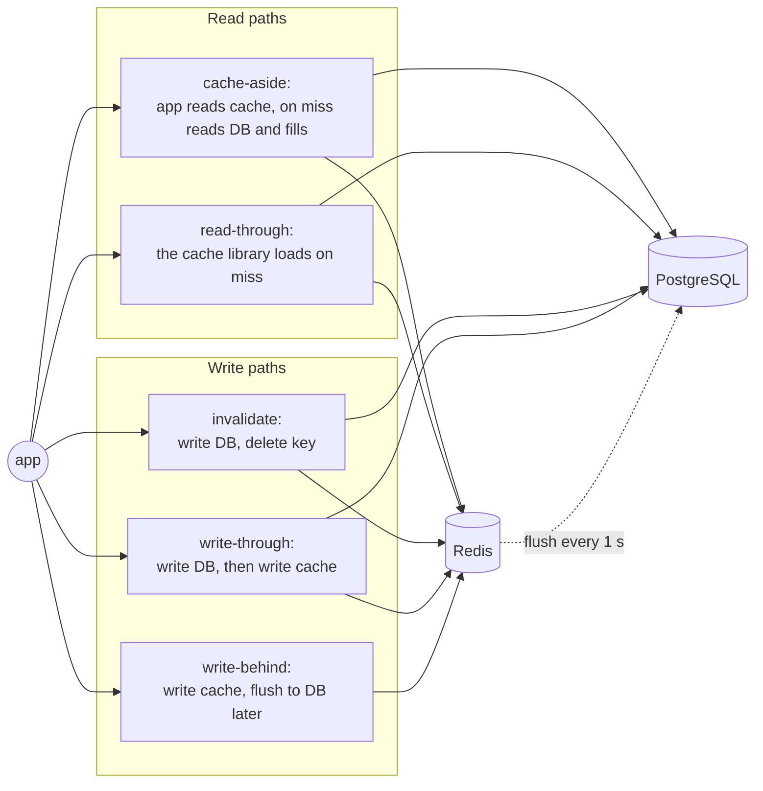

# 32. Caching Strategies

<div class="badges" markdown><span class="badge badge-l2">L2 · Practitioner</span><span class="badge badge-l3">L3 · Senior/Lead</span><span class="badge badge-meta">PostgreSQL + Redis · invalidation races · stampedes · write-behind</span></div>

<div class="grid two" markdown>

!!! info "Prerequisites"
    - [Chapter 29](ch29-polyglot-persistence.md): Redis as a derived store
    - [Chapter 31](ch31-data-consistency.md): staleness and versions
    - [Chapter 21](../communication/ch21-rest-api-design.md): HTTP caching and ETags

!!! abstract "What you'll learn"
    - **What is worth caching**: a Redis cache-aside **slowed** a primary-key read of a 43 kB menu card (p50 1.7–1.8 ms from PostgreSQL, 2.1–2.2 ms through Redis), while it turned a 130 ms aggregation into a 1.1 ms read
    - **Invalidation is a race**: with prices changing, TTL alone served stale prices in **97%** of reads; "update, then delete" left stale entries behind and 0.48–0.54% stale reads; **write-through with set-if-newer**, or **leases**, under **0.05%** and no stale entries left behind
    - **Stampedes**: 80 clients on an expiring key made **160 recomputations, 80 at once**; stale-while-revalidate made **9–10, one at a time, with no request over 100 ms**; XFetch on its own made it **worse**
    - **Write-behind** cut database writes from ~7,000 statements a second to **1**, and lost **9,991–10,651 views** when Redis restarted; a batch id kept a crashed flusher from counting **12,182–12,817 views twice**

</div>

---

## 1 · Introduction & Context

### The cache that made things slower

FoodFleet's menu API was slow at dinner time, so the team put Redis in front of everything: menu cards, prices, restaurant details, the "Top rated near you" widget. Three weeks later:

- **Menu pages were no faster.** Reading a 43 kB menu card from Redis took about as long as reading it from PostgreSQL by primary key, plus a second network hop on every miss.
- **Customers saw old prices** after restaurants changed them, sometimes for an hour, and checkout charged the new price.
- **Every 60 seconds the database spiked to 100% CPU** when the "Top rated" entry expired and every app instance recomputed it at once.

Caching is the most effective performance tool there is, and the easiest to get subtly wrong. This chapter measures, on PostgreSQL and Redis, what is worth caching, how each way of keeping a cache current fails under concurrency, how to stop stampedes, and what write-behind costs when something crashes.

### Where it comes from

<ul class="mh-timeline">
<li><span class="when">1960s–1980s · Hardware caches</span><span class="what">CPU caches establish the vocabulary: hit rate, write-through, write-back, invalidation.</span></li>
<li><span class="when">2003 · memcached</span><span class="what">LiveJournal's distributed in-memory cache; cache-aside in front of a database becomes the web's default architecture.</span></li>
<li><span class="when">2009 · Redis</span><span class="what">A cache with data structures, TTLs, atomic scripts and optional persistence.</span></li>
<li><span class="when">2010 · RFC 5861</span><span class="what"><code>stale-while-revalidate</code> and <code>stale-if-error</code> for HTTP caches.</span></li>
<li><span class="when">2013 · "Scaling Memcache at Facebook"</span><span class="what">Leases against stale sets and thundering herds, cache invalidation from the database's log.</span></li>
<li><span class="when">2015 · XFetch</span><span class="what">Vattani, Chierichetti and Lowenstein: optimal probabilistic early expiration to prevent stampedes.</span></li>
</ul>

---

## 2 · Core Concepts & Terminology



Cache-aside (lazy loading)
:   The application reads the cache; on a miss it reads the database and fills the cache. The most common pattern; Spring's `@Cacheable` is cache-aside.

Read-through / write-through
:   The cache sits in the path: it loads on a miss (read-through) or is updated synchronously with the database (write-through).

Write-behind (write-back)
:   Writes go to the cache and are flushed to the database later, in batches. Fewer database writes; a crash loses what wasn't flushed.

TTL and hit rate
:   Time-to-live bounds how long an entry lives; hit rate is the share of reads served by the cache. TTL bounds staleness only if nothing invalidates; it never prevents it.

Invalidation
:   Removing or replacing a cache entry when the source changes. "There are only two hard things in computer science": this is one.

Cache stampede (thundering herd, dog-piling)
:   Many requests miss the same key at once (expiry, eviction, deploy) and all recompute it, overloading the database exactly when it is busiest.

Single-flight / request coalescing
:   Concurrent misses for one key wait for one load. Per instance (a lock in memory, `@Cacheable(sync = true)`) or across instances (a lock in Redis).

Stale-while-revalidate
:   Serve the expired value while one caller refreshes it in the background.

Lease
:   A token handed out on a miss, invalidated by any write to the key; the reader's later fill is accepted only if its lease is still valid (Facebook's memcache).

---

## 3 · How It Works Internally

### The invalidation race

"Update the database, then delete the key" is the usual advice, and it has a well-known race:

1. Reader A misses, reads price version 1 from the database, and pauses (serialisation, a GC pause).
2. Writer B commits version 2 and deletes the key, which isn't there.
3. Reader A fills the cache with version 1, which now stays until its TTL.

Deleting first is worse (a reader can refill between the delete and the commit). Deleting twice narrows the window. Two techniques close it: making every cache write **conditional on the version** (an old value can never replace a newer one, whatever the order), or **leases** (a fill is accepted only if no write happened since the miss).

```java
--8<-- "code/chapters/ch32-caching-strategies/src/main/java/dev/foodfleet/ch32/menu/ItemPriceCache.java:10:52"
```

And in Spring: an eviction inside `@Transactional` runs **before** the commit unless the cache manager is transaction-aware, which lets a concurrent reader put the old row straight back. Spring Boot builds the `RedisCacheManager` from `spring.cache.redis.*`; a customizer makes it transaction-aware:

```java
--8<-- "code/chapters/ch32-caching-strategies/src/main/java/dev/foodfleet/ch32/info/CacheConfig.java:7:19"
```

### Stampedes

When a popular entry expires, every request that arrives before the first recomputation finishes is a miss. If the recomputation takes 130 ms and requests arrive every few microseconds, that is hundreds of concurrent recomputations, each slowing the others down. The defences:

- **Single-flight per instance**: one load per key per JVM (`@Cacheable(sync = true)`); N instances still make N loads.
- **A distributed lock**: one load in total; everyone else waits for it, so requests stall for a full recomputation at every expiry.
- **Probabilistic early expiration (XFetch)**: each request recomputes with a probability that rises as expiry approaches, scaled by how long recomputation takes, so one request usually refreshes early. Without a lock, at high request rates many requests "win", and under load the measured recomputation time grows, which makes winning even likelier.
- **Stale-while-revalidate**: an entry has a soft and a hard expiry; after the soft one, the old value is served at once and one caller (holding a short lock) refreshes in the background. Nobody waits, except on a truly cold key.

```java
--8<-- "code/chapters/ch32-caching-strategies/src/main/java/dev/foodfleet/ch32/top/SoftTtlCache.java:50:89"
```

### Write-behind

Counters that change constantly and are read rarely (views, impressions) can be incremented in Redis and moved to the database in batches. The flush must survive its own crash: the pending hash is **renamed** atomically (new increments go to a fresh hash), and a **batch id** stored with it and recorded in the database in the same statement as the counts makes finishing an already-committed batch a no-op. What it can't survive is Redis losing data: without persistence, a restart loses everything since the last flush.

---

## 4 · Design Considerations & Trade-offs

PostgreSQL 16.13 and Redis 7.0.15 in one 2-vCPU container; every database and Redis call is preceded by a 0.5 ms pause standing in for the network. `verify/experiment.py`, two full runs; ranges show both.

### Measured: what is worth caching

16 clients for 15 s, requests following a Zipf distribution over 2,000 restaurants (a few are very popular).

| What | Cache | Requests/s | p50 | p99 | Database reads/s | Hit rate |
|---|---|---:|---:|---:|---:|---:|
| Menu card | none | 7,240–7,768 | 1.7–1.8 ms | 6.3–7.1 ms | 7,239.5–7,768.3 | 0.0% |
| Menu card | Redis, cache-aside, TTL 60 s | 6,211–6,422 | 2.1–2.2 ms | 7.6–7.8 ms | 134.0–134.5 | 97.8–97.9% |
| Menu card | in-process (5 s) + Redis (60 s) | 13,760–14,152 | < 0.1 ms | 6.7–7.3 ms | 135.0–135.4 | 99.0% |
| Top restaurants | none | 8 | 1,960.2–2,077.3 ms | 3,050.4–3,352.0 ms | 8.1–8.5 | 0.0% |
| Top restaurants | Redis, cache-aside, TTL 60 s | 10,554–10,696 | 1.1 ms | 3.6–3.8 ms | 1.1 | 100.0% |

- **A primary-key read of a single row is already fast** in PostgreSQL: the Redis cache-aside served the menu card at 2.1–2.2 ms p50 against 1.7–1.8 ms than reading it from the database, with the same number of network hops. Its real benefit is offloading the database (DB reads fell to 134/s), not latency.
- **An in-process cache in front of Redis** removed the network hop for the hottest keys: 13,760–14,152 requests/s, p50 under 0.1 ms. Its price is staleness per instance (5 s here) and memory per instance.
- Even with the cache, "top restaurants" was computed 16 times at the start: all 16 clients missed the empty key at once (1.1 database reads/s over 15 s). A cold key is a stampede of its own.
- **Expensive computations are what caching is for**: "top restaurants" went from a 1,960–2,077 ms p50 (16 concurrent aggregations on 2 CPUs) to 1.1 ms.

### Measured: invalidation under concurrent changes

200 menu items, 16 clients for 15 s; 90% reads through the cache, 10% price changes, 2 ms apart. A reader that misses spends 0–5 ms between reading the database and filling the cache. A read is **stale** if it returns an older price than one committed before the read started; **stale entries** are keys still older than the database after the run (they stay wrong until their TTL).

| Strategy | Reads | Stale reads | Stale % | Hit rate | Stale entries left |
|---|---:|---:|---:|---:|---:|
| TTL only (60 s), no invalidation | 67,410–68,216 | 65,402–66,169 | 97.00–97.02% | 99.7% | 200 |
| Delete key, then update the database | 57,293–58,177 | 1,022–1,251 | 1.76–2.18% | 88.8–88.9% | 1–3 |
| Update the database, then delete key | 55,334–58,098 | 265–316 | 0.48–0.54% | 88.8–89.0% | 1–3 |
| Update, delete, delete again 500 ms later | 45,376–47,556 | 73–147 | 0.16–0.31% | 80.6% | 0 |
| **Update, then write through with set-if-newer** | 61,617–63,481 | 11–21 | 0.02–0.03% | 99.7% | 0 |
| **Update, delete; fills need a lease** | 54,615–55,140 | 6–13 | 0.01–0.02% | 89.5–89.6% | 0 |

- **TTL alone serves stale data almost always** for data that changes: 97% of reads.
- **Deleting before updating is the worst of the deletes**: readers refill the old value between the delete and the commit.
- **"Update, then delete" left stale entries behind** (1–3 in a run): the reader-fills-old-value race, real at this rate. Deleting again 500 ms later fixed the leftovers and cost hit rate.
- **Write-through with set-if-newer and leases** had the fewest stale reads (the unavoidable gap between commit and cache write) and left nothing stale behind. Write-through also kept the hit rate at 99.7%: the cache never goes cold for a changed item.

### Measured: stampedes

"Top restaurants" (an aggregation over 1 M reviews, ~120–190 ms alone) cached for 3 s; the value is in the cache when the run starts; 4 app instances × 20 clients ask for it every 5 ms for 20 s.

| Protection | Recomputations | Most at once | Requests/s | p50 | p99 | Requests > 100 ms |
|---|---:|---:|---:|---:|---:|---:|
| None (cache-aside) | 160 | 80 | 2,554–2,826 | 2.7–3.4 ms | 31.6–36.2 ms | 161 |
| Single-flight per instance | 20 | 4 | 6,939–7,196 | 2.5–2.9 ms | 12.9–13.1 ms | 400 |
| Distributed lock (SET NX), others wait | 7–8 | 1 | 7,408–7,541 | 2.8–3.0 ms | 13.0–13.4 ms | 400–401 |
| Probabilistic early refresh (XFetch) | 174–179 | 80 | 993–1,064 | 3.7–3.8 ms | 44.7–58.3 ms | 174–179 |
| XFetch + lock: one early refresher | 17–19 | 1 | 7,961–8,300 | 2.8–3.1 ms | 11.7–12.7 ms | 17–19 |
| **Stale-while-revalidate + refresh lock** | 9–10 | 1 | 7,509–7,522 | 3.3 ms | 15.1–15.2 ms | 0 |

- **Unprotected, every expiry recomputed once per client**: 80 at once, each slowed by the other 79.
- **Single-flight per instance** made one recomputation per instance (4 at once); a **distributed lock** made one in total, but both made hundreds of requests wait for it.
- **XFetch alone made things worse** at this request rate: with ~16,000 requests per second, "a small probability per request" is many recomputations per second. **XFetch with a lock** fixed that and left only the refreshing requests slow.
- **Stale-while-revalidate: one recomputation per expiry and no request over 100 ms.** The cost is serving a value up to one refresh old.

### Measured: write-behind

16 clients count item views (2,000 items) for 10 s.

| Write path | Views/s | DB statements/s | Views counted | In the database | Lost | Counted twice |
|---|---:|---:|---:|---:|---:|---:|
| Write-through: an UPDATE per view | 6,964–7,087 | 6,964.1–7,086.8 | 69,641–70,868 | 69,641–70,868 | 0 | 0 |
| Write-behind: HINCRBY, flush every 1 s | 12,212–12,271 | 1.0 | 122,119–122,710 | 122,119–122,710 | 0 | 0 |
| … Redis restarts (no persistence) at 7 s | 11,112–11,442 | 0.9 | 111,117–114,421 | 101,126–103,770 | 9,991–10,651 | 0 |
| … the flusher dies before its database commit | 12,278–12,729 | 1.0 | 122,777–127,293 | 122,777–127,293 | 0 | 0 |
| … the flusher dies after its commit, before cleanup | 12,221–12,479 | 1.0 | 122,209–124,794 | 122,209–124,794 | 0 | 0 |
| … the same, without the batch id | 11,948–12,954 | 1.0 | 119,476–129,544 | 131,658–142,361 | 0 | 12,182–12,817 |

- **Write-behind multiplied throughput and cut database writes** to one statement per second.
- **A Redis restart without persistence lost the unflushed views** (about one flush interval's worth). With AOF `everysec` the loss would be up to a second of increments; with no buffer, none.
- **The flusher's own crash cost nothing** with the rename and the batch id; without the batch id, finishing the batch after a crash counted it twice.

### Choosing

| Data | Strategy |
|---|---|
| Changes rarely, read constantly (restaurant details, config) | Cache-aside, TTL minutes to hours, evict after commit; `@Cacheable(sync = true)` |
| Changes and must not be served stale for long (prices, availability) | Write-through after commit with set-if-newer (or leases); short safety TTL |
| Expensive to compute, staleness of seconds OK (rankings, dashboards) | Stale-while-revalidate with a refresh lock |
| Cheap primary-key reads | Often no shared cache at all; maybe an in-process cache for the hottest keys |
| High-rate counters, approximate OK (views, impressions) | Write-behind with atomic claim and batch ids; persistence if loss matters |
| Money, stock, anything a decision depends on | **Read the source of truth**; cache only for display |

---

## 5 · Hands-on Implementation

```text
ch32-caching-strategies/
├── src/main/java/dev/foodfleet/ch32/
│   ├── info/   CacheConfig (transaction-aware RedisCacheManager), RestaurantInfoService (@Cacheable sync, @CacheEvict)
│   ├── menu/   ItemPriceCache (PUT_IF_NEWER), ItemPrices (cache-aside reads, write-through after commit)
│   ├── top/    SoftTtlCache (stale-while-revalidate + lock), CacheStore, TopRestaurants
│   └── views/  ViewCounter (HINCRBY), ViewFlusher (claim, apply with batch id, clean up)
├── src/main/resources/db/migration/V1__caching.sql
└── verify/     experiment.py, check_service_sql.py
```

### 🟢 Level 1: decide what to cache, and for how long

<div class="badges" markdown><span class="badge badge-l1">L1 · Foundation</span></div>

For each candidate, write down: how expensive it is to produce (measure it), how often it is read, how often it changes, and how stale it may be when shown. Cache what is expensive or very hot; don't cache what is cheap and changes often. The table above turns those answers into a strategy.

### 🔵 Level 2: Spring's cache abstraction, correctly configured

<div class="badges" markdown><span class="badge badge-l2">L2 · Practitioner</span></div>

```java
--8<-- "code/chapters/ch32-caching-strategies/src/main/java/dev/foodfleet/ch32/info/RestaurantInfoService.java:11:43"
```

```yaml
--8<-- "code/chapters/ch32-caching-strategies/src/main/resources/application.yml"
```

Spring Boot's default Redis cache serialises values with JDK serialization (hence `Serializable`); configure JSON serialization with a `RedisCacheConfiguration` bean for caches other services or languages read.

### 🟣 Level 3: prices that are never stale for long

<div class="badges" markdown><span class="badge badge-l3">L3 · Senior/Lead</span></div>

```java
--8<-- "code/chapters/ch32-caching-strategies/src/main/java/dev/foodfleet/ch32/menu/ItemPrices.java:12:71"
```

The cache is optional: if Redis is down, reads go to the database and writes still commit. The TTL is only a safety net for a missed write-through.

### 🟣 Level 3: counters written behind

<div class="badges" markdown><span class="badge badge-l3">L3 · Senior/Lead</span></div>

```java
--8<-- "code/chapters/ch32-caching-strategies/src/main/java/dev/foodfleet/ch32/views/ViewFlusher.java:14:81"
```

The container test covers each cache against PostgreSQL and Redis, including a batch left behind by a flusher that crashed after committing:

```java
--8<-- "code/chapters/ch32-caching-strategies/src/test/java/dev/foodfleet/ch32/CachingContainerTest.java:68:120"
```

### 🔴 Level 4: caching as a platform capability

<div class="badges" markdown><span class="badge badge-l4">L4 · Architect</span></div>

- **A caching library with the safe defaults built in**: transaction-aware eviction, set-if-newer writes, stale-while-revalidate for expensive keys, jittered TTLs, metrics (hit rate, load time, stale serves) per cache.
- **Caches are never the source of truth**: every cached value can be rebuilt; services must work (slower) with the cache down, and that is tested.
- **Invalidation from the database's change stream** (CDC, chapter 15) for caches shared across services, instead of every writer remembering every key.
- **Capacity and eviction policy** (`maxmemory`, `allkeys-lru` or `volatile-ttl`) set per Redis instance; separate instances for caches and for data that must not be evicted (write-behind buffers, locks).

### Run and verify

```text
$ PGHOST=... PGPORT=... PGUSER=postgres REDIS_PORT=... verify/run.sh
== stampede
'Top restaurants' (an aggregation over 1 M reviews, ~148 ms) cached for 3 s;
The value is in the cache when the run starts; 4 app instances x 20 clients ask for it every 5 ms for 20 s.

protection                                     recomputes max at once   req/s  p50 ms  p99 ms  >100 ms
none (cache-aside)                                    160          80    2554     3.4    31.6      161
single-flight per instance                             20           4    6939     2.9    12.9      400
distributed lock (SET NX), others wait                  8           1    7408     3.0    13.0      400
probabilistic early refresh (XFetch)                  179          80     993     3.7    58.3      179
XFetch + lock: one early refresher                     17           1    8300     2.8    11.7       17
stale-while-revalidate (soft TTL) + lock                9           1    7522     3.3    15.1        0

...

== writebehind
16 clients count item views (2,000 items) for 10 s.

write path                                              views/s  DB statements/s   counted    in DB   lost  doubled
write-through: UPDATE per view                             7087           7086.8     70868    70868      0        0
write-behind: HINCRBY, flush every 1 s                    12271              1.0    122710   122710      0        0
write-behind, Redis restarts (no persistence) at 7 s      11112              0.9    111117   101126   9991        0
write-behind, flusher dies before its DB commit           12729              1.0    127293   127293      0        0
write-behind, flusher dies after commit, before cleanup    12479              1.0    124794   124794      0        0
  ...without the batch id                                 12954              1.0    129544   142361      0    12817

$ python3 verify/check_service_sql.py
PASS Flyway migration V1 applies
PASS the price update returns the new version
PASS the writer's write-through after commit is stored
...
all checks passed
```

!!! question "Try it"
    1. Remove the 0–5 ms pause between reading the database and filling the cache. How many stale entries does "update, then delete" leave now, and why does that make the race more dangerous, not less?
    2. Give each instance's `@Cacheable` entries a TTL with ±10% jitter. What happens to the cold-start stampede after a deploy?
    3. Run the stampede experiment with the aggregation taking 2 s. Which protections still keep requests under 100 ms?
    4. Turn on AOF `appendfsync everysec` in Redis and repeat the write-behind restart. How many views are lost now?

---

## 6 · Production Readiness

- [x] **Each cache has a written purpose**: what it saves (measured), its staleness budget, its invalidation path
- [x] **Evictions and write-throughs happen after commit** (transaction-aware cache manager, or explicitly after the transaction)
- [x] **Cache writes are conditional on version** where values change, or protected by leases
- [x] **Expensive keys are protected from stampedes**: stale-while-revalidate or a lock; TTLs jittered
- [x] **The service works with the cache down**, with timeouts shorter than the database's latency
- [x] **Hit rate, load time, evictions and memory** are monitored per cache; alerts on hit-rate drops
- [x] **Write-behind only for data that may be approximate**, with atomic claims, batch ids, and the loss window documented
- [x] **Decisions (payment, stock, checkout price) read the source of truth**, never the cache
- [x] **Serialization chosen deliberately** (JSON for shared caches), and cache keys versioned when the format changes

---

## 7 · Anti-patterns & Pitfalls

!!! pitfall "Incident 1: the price that wouldn't update"
    **Context.** Menu prices were cached with cache-aside; updates deleted the key after committing.
    **Symptoms.** After a restaurant raised prices, a few items showed the old price on the menu for up to an hour (the TTL), while checkout charged the new one.
    **Root cause.** A reader that missed just before the update filled the cache with the old row just after the delete. Measured: "update, then delete" left 1–3 stale entries behind in a 15 s run.
    **Fix.** Write-through after commit with a set-if-newer script; readers' fills go through the same script. Measured: no stale entries left, under 0.05% stale reads.

!!! pitfall "Incident 2: the 60-second heartbeat of doom"
    **Context.** The home screen's "Top rated near you" was cached for 60 s with cache-aside.
    **Symptoms.** Database CPU hit 100% for a few seconds every minute; home-screen p99 latency spiked in step.
    **Root cause.** A cache stampede: every request in the gap recomputed the aggregation. Measured: 80 concurrent recomputations per expiry with 80 clients.
    **Fix.** Stale-while-revalidate with a refresh lock. Measured: one recomputation per expiry, no request over 100 ms.

!!! pitfall "Incident 3: views counted twice after a deploy"
    **Context.** View counts were buffered in Redis and flushed every second.
    **Symptoms.** After a deploy, popular items' view counts jumped; analytics flagged an impossible spike.
    **Root cause.** The flusher was killed after writing a batch to PostgreSQL but before deleting it from Redis; the new instance flushed it again. Measured: 12,182–12,817 views counted twice.
    **Fix.** A batch id stored with the claimed batch and recorded in the same statement as the counts. Measured: 0 doubled.

| Anti-pattern | Symptom | Fix |
|---|---|---|
| Caching cheap primary-key reads | No speedup, more moving parts | Measure first; cache what is expensive |
| TTL as the only invalidation for changing data | Stale reads most of the time | Write-through or invalidate on change |
| Delete before the database update | Old values refilled | Update, commit, then write through or delete |
| Eviction inside `@Transactional` without a transaction-aware cache | Old row cached again before commit | `transactionAware()`, or evict after commit |
| Unconditional cache fills | Old values overwrite new ones | Set-if-newer, leases |
| Same TTL for everything, no jitter | Synchronised expiries, stampedes | Jitter, stale-while-revalidate |
| XFetch without a lock at high request rates | More recomputations, not fewer | XFetch + lock, or stale-while-revalidate |
| Write-behind for money | Lost or doubled amounts | Write-through, or the database directly |
| Flushing without idempotency | Double counting after crashes | Atomic claim, batch ids |
| The service fails when the cache does | Cache outage = full outage | Fallback to the source, short timeouts |
| Caching decisions (stock, prices at checkout) | Overselling, wrong charges | Source of truth for decisions |

---

## 8 · Enterprise Case Study

### FoodFleet: four caches, four strategies

!!! decision "ADR-032: Cache by purpose: evict-after-commit for details, versioned write-through for prices, stale-while-revalidate for rankings, write-behind for counters"
    **Status:** Accepted · **Date:** 2025-03-31

    **Context.** One cache-aside pattern for everything gave no speedup on primary-key reads, stale prices after changes, and a database spike at every expiry of the home-screen ranking. Measured on PostgreSQL and Redis: Redis was at 2.1–2.2 ms p50 against 1.7–1.8 ms than the database for menu cards; "update, then delete" left stale entries; 80 recomputations per expiry for the ranking.

    **Decision.** Each cache states its purpose, staleness budget and strategy. Restaurant details: `@Cacheable(sync = true)` on a transaction-aware RedisCacheManager, evicted after commit. Item prices: cache-aside reads and write-through after commit, every cache write through a set-if-newer script, 30-minute safety TTL. Rankings and dashboards: stale-while-revalidate with a refresh lock. View counters: write-behind with an atomic claim and batch ids, on a Redis instance separate from the caches. Menu cards: no shared cache (primary-key reads), HTTP caching with ETags instead (chapter 21). Checkout and payments read the database. All caches are optional at runtime and monitored for hit rate and stale serves.

    **Consequences.** ✅ No stale prices left behind; under 0.05% of reads see a just-changed price late. ✅ The ranking costs one query per expiry, and no user waits for it. ✅ View counting costs the database one statement per second. ⚠️ Up to ~1 s of views can be lost if the counter Redis restarts. ⚠️ Rankings can be one refresh old. ⚠️ More than one caching pattern to learn; the platform library hides most of it.

### Fintech analogue: market data and account views 🔴

Trading and banking platforms cache aggressively where staleness is defined and bounded: market data snapshots with explicit timestamps, FX rates with validity windows, account summaries for the mobile app marked "as of". They never let a cache decide: limit checks, available balance for a payment and order validation read the system of record (or a strongly consistent in-memory store that *is* the record). Reference data (instruments, holidays, rules) is cached with versioned keys and pushed invalidation, because a stale rule is an incident, and every cached value carries the version or timestamp it was computed from, for audit.

### E-commerce analogue: product pages at peak

During sales, product pages are served from CDN and edge caches with stale-while-revalidate, product details from an application cache invalidated by catalogue change events, and prices and stock re-read (or reserved) at add-to-cart and checkout. Search-result and recommendation caches are keyed by query and segment with short TTLs and jitter to avoid synchronised expiries, and stampede protection keeps one recomputation per key per region when a promotion flushes them all.

---

## 9 · Interview Q&A + Summary

#### Q1. Cache-aside, read-through, write-through, write-behind: what's the difference? · <span class="badge badge-l2">L2</span> · Cognizant · SAP

**Short answer:** Cache-aside: the app reads the cache and loads from the database on a miss. Read-through: the cache does the loading. Write-through: writes update the database and the cache together. Write-behind: writes go to the cache and are flushed to the database later. They trade staleness, write latency and durability differently.

#### Q2. What should you cache? · <span class="badge badge-l2">L2</span><span class="badge badge-l3">L3</span> · Flipkart · Amazon

**Short answer:** What is expensive to produce or very hot, and may be slightly stale. Measured: Redis didn't speed up a primary-key read of a menu card (at 2.1–2.2 ms p50 against 1.7–1.8 ms), but turned a 130 ms aggregation into a 1.1 ms read. Never cache the inputs of decisions like payment or stock checks.

#### Q3. "Update the database, then delete the cache key": is that safe? · <span class="badge badge-l3">L3</span> · Amazon · Goldman Sachs

**Short answer:** Mostly, not always. A reader that missed just before the update can fill the old value just after the delete, and it stays until the TTL. Measured: 1–3 stale entries left in a 15 s run. Make cache writes conditional on version (set-if-newer), use leases, or delete again shortly after.

#### Q4. How do you prevent a cache stampede? · <span class="badge badge-l3">L3</span> · Flipkart · Amazon · JP Morgan

**Short answer:** Coalesce misses (single-flight per instance or a distributed lock), refresh before expiry (probabilistic early expiration, with a lock), or serve stale while one caller refreshes. Add TTL jitter. Measured: 160 recomputations unprotected; 9–10 with stale-while-revalidate, and no request over 100 ms.

#### Q5. What does @Cacheable(sync = true) do, and what doesn't it do? · <span class="badge badge-l2">L2</span><span class="badge badge-l3">L3</span> · SAP · Cognizant

**Short answer:** Concurrent misses for the same key on one instance wait for a single load. It does nothing across instances (N instances, N loads: measured 4 at once with 4 instances) and it doesn't serve stale values; combine with stale-while-revalidate for expensive keys.

#### Q6. Why might a cache eviction in a @Transactional method not work? · <span class="badge badge-l3">L3</span> · Goldman Sachs · any

**Short answer:** Unless the cache manager is transaction-aware, the eviction happens before the commit, and a concurrent reader can reload the old row and cache it. Make the RedisCacheManager transaction-aware (Spring Boot: a `RedisCacheManagerBuilderCustomizer` calling `transactionAware()`), or evict after commit.

#### Q7. When is write-behind appropriate? · <span class="badge badge-l3">L3</span> · Amazon · Flipkart

**Short answer:** For high-rate data that may be approximate: counters, impressions, last-seen times. It cuts database writes to batches (measured: ~7,000 statements/s to 1) but loses unflushed data if the cache loses it (measured: 9,991–10,651 views on a Redis restart). Flushes must be idempotent (atomic claim, batch ids). Never for money.

#### Q8. How do you keep a shared cache consistent across many services? · <span class="badge badge-l4">L4</span> · Goldman Sachs · SAP

**Short answer:** Let one service own the data and the cache, or drive invalidation from the owner's change stream (outbox or CDC) so no writer has to know every key. Version cached values so late or duplicate invalidations can't move a cache backwards.

#### Q9. What happens to your service when Redis is down? · <span class="badge badge-l3">L3</span> · Amazon · any

**Short answer:** It should fall back to the source of truth, slower but correct, with Redis timeouts shorter than the database's latency so a sick cache doesn't make things worse. Capacity planning must assume the database can take the cache's load for a while, or the cache becomes a hidden single point of failure.

#### Q10. Local (in-process) cache or distributed cache? · <span class="badge badge-l3">L3</span> · Flipkart · SAP

**Short answer:** Local caches are fastest (no network; measured p50 under 0.1 ms) but stale per instance and multiply memory; distributed caches are shared and consistent across instances but cost a network hop. Use local for small, hot, slowly-changing data with a short TTL, often in front of a distributed one.

#### Q11. How do you choose a TTL? · <span class="badge badge-l2">L2</span><span class="badge badge-l3">L3</span> · any

**Short answer:** From the staleness the business accepts and how the value is invalidated. With explicit invalidation, the TTL is a safety net and can be long; without it, the TTL is the staleness bound. Add jitter to avoid synchronised expiries; use soft and hard TTLs for stale-while-revalidate.

#### Q12. Design caching for a food-delivery home screen. · <span class="badge badge-l4">L4</span> · Swiggy-/Zomato-style system design rounds

**Short answer:** Rankings and recommendations: stale-while-revalidate per city or segment with refresh locks and jitter. Restaurant details: cache-aside, evicted after commit. Prices and availability: write-through with versions, re-read at checkout. Images and static content: CDN. View counters: write-behind. Every cache optional, monitored, and never the input to payment or stock decisions.

### Key takeaways

- **Cache what is expensive, not what is merely read often**: measure both paths first.
- **Invalidation is a concurrency problem**: write after commit, make cache writes conditional on version, or use leases.
- **Protect expensive keys from stampedes**: stale-while-revalidate with a lock beat locks, single-flight and XFetch here.
- **Write-behind trades durability for throughput**: idempotent flushes, documented loss window, never for money.
- **A cache is never the source of truth**: decisions read the database, and the service survives without the cache.

### Further reading

- Rajesh Nishtala et al., *Scaling Memcache at Facebook* (NSDI 2013)
- Andrea Vattani, Flavio Chierichetti, Keegan Lowenstein, *Optimal Probabilistic Cache Stampede Prevention* (VLDB 2015)
- Mark Nottingham, [RFC 5861: HTTP Cache-Control Extensions for Stale Content](https://www.rfc-editor.org/rfc/rfc5861) (2010)
- Spring Framework reference, [Cache Abstraction](https://docs.spring.io/spring-framework/reference/integration/cache.html)
- Spring Boot reference, [Caching](https://docs.spring.io/spring-boot/reference/io/caching.html)
- Redis documentation, [Key eviction](https://redis.io/docs/latest/develop/reference/eviction/)

---

**Previous:** [← 31. Data Consistency](ch31-data-consistency.md) · **Next:** [33. Database Scaling & Zero-Downtime Migrations →](ch33-database-scaling.md)
