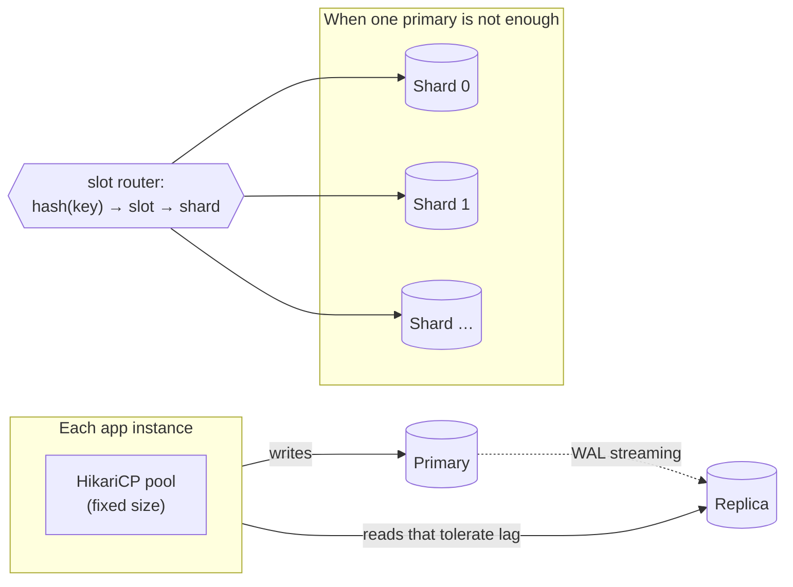
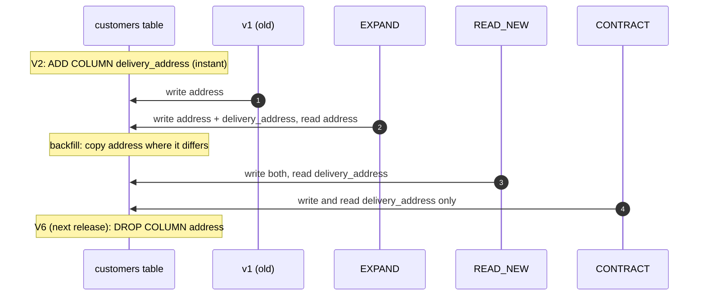

# 33. Database Scaling & Zero-Downtime Migrations

<div class="badges" markdown><span class="badge badge-l2">L2 · Practitioner</span><span class="badge badge-l3">L3 · Senior/Lead</span><span class="badge badge-l4">L4 · Architect</span><span class="badge badge-meta">PostgreSQL · HikariCP · Flyway · expand/contract · sharding</span></div>

<div class="grid two" markdown>

!!! info "Prerequisites"
    - [Chapter 29](ch29-polyglot-persistence.md): partitions and indexes
    - [Chapter 31](ch31-data-consistency.md): read replicas and replication lag
    - [Chapter 12](../architecture-patterns/ch12-database-per-service.md): a database per service

!!! abstract "What you'll learn"
    - **Pool size**: on 2 vCPUs, going from 16 to 256 connections added at most 10–19% throughput but raised the database's p99 **from 6 ms to 76–98 ms**; opening a connection per transaction cut throughput **from ~7,000 to 428–461 per second**
    - **Which DDL blocks writes**: adding a nullable column took **0.00 s**; a volatile default or a type change rewrote the table and blocked writes for **1.5–5.2 s**; a plain index blocked them for **0.8–1.2 s**, `CONCURRENTLY` for at most **53 ms**
    - **The lock queue**: an instant `ADD COLUMN` behind a 12 s report blocked **all** writes for **10 s**; with `lock_timeout` and retries the longest write waited **506 ms**
    - **Backfills and renames**: one `UPDATE` of 2 M rows made writes wait **up to 5.5–6.8 s**; batches of 1,000 **at most 60 ms**. Renaming a column in place failed **3,947–4,894 statements** during a rolling deploy; expand/contract failed **none**
    - **Shard keys**: sharding by city left one shard **5.96×** the average and half the shards empty; going from 16 to 20 shards moved **80%** of the data with `hash mod N` and **19.5%** with fixed slots

</div>

---

## 1 · Introduction & Context

### The migration that took the app down for a minute

FoodFleet's order service had grown to 40 instances and a 300 GB PostgreSQL database. Three things happened in one quarter:

- **The database ran out of connections during a deploy.** Each instance kept HikariCP's default 10 connections; with new instances starting before old ones stopped, the fleet asked for 500 against a `max_connections` of 400.
- **A one-line migration froze checkout for 64 seconds.** `ALTER TABLE orders ADD COLUMN note text` is instant, but it waited for an analyst's long query to finish, and every order write queued behind it.
- **A column rename broke half the fleet.** The migration renamed `address` to `delivery_address`; instances still running the old version failed every customer query until the rolling deploy finished.

None of these is about the database being too small. They are about **how many connections** it is asked to juggle, **which locks** a schema change takes and how long it waits for them, and **in what order** schema and code change when old and new versions run side by side. This chapter measures each on PostgreSQL 16 under write load, then looks at sharding: choosing a shard key and adding shards without moving everything.

### Where it comes from

<ul class="mh-timeline">
<li><span class="when">1970s · B-trees and the relational model</span><span class="what">Indexes and schemas that change rarely, by a DBA, in a maintenance window.</span></li>
<li><span class="when">1997 · Consistent hashing</span><span class="what">Karger et al.: keys on a ring, so adding a node moves only its share of keys.</span></li>
<li><span class="when">2005–2010 · Migrations as code</span><span class="what">Rails migrations (2005), Liquibase (2006), Flyway (2010): versioned schema changes shipped with the application.</span></li>
<li><span class="when">2006 · <em>Refactoring Databases</em> and CREATE INDEX CONCURRENTLY</span><span class="what">Ambler and Sadalage describe transition periods for schema changes (today's expand/contract); PostgreSQL 8.2 builds indexes without blocking writes.</span></li>
<li><span class="when">2010s · Sharding at web scale</span><span class="what">Vitess (YouTube), Redis Cluster's 16,384 slots (2015), Citus: fixed slots or ranges so shards can be added and moved.</span></li>
<li><span class="when">2013–2018 · Pools and cheap DDL</span><span class="what">HikariCP (2013) and its pool-sizing advice; PostgreSQL 11 (2018) adds columns with constant defaults without rewriting the table.</span></li>
</ul>

---

## 2 · Core Concepts & Terminology



Connection pool
:   A fixed set of open database connections shared by an instance's threads. Requests beyond the pool size wait in the application, which is cheap; connections beyond what the database can work on wait inside it, which is not.

Little's law
:   Requests in the system = throughput × time in the system. With 256 concurrent requests and 7,000 transactions per second, each request spends about 37 ms, however the waiting is split between pool and database.

Read replica
:   A copy of the primary fed by its write-ahead log; scales reads that tolerate lag (chapter 31). Writes still scale only with the primary.

Partitioning
:   Splitting one table into pieces inside one database (by range, list or hash) so queries and maintenance touch only some of them (chapter 29).

Sharding
:   Splitting data across several databases by a **shard key**. Each shard holds a subset of rows; queries that include the key go to one shard, others go to all.

Slot (virtual shard)
:   A fixed number of hash buckets (4,096 here; Redis Cluster uses 16,384) mapped to physical shards. Adding a shard reassigns whole slots; keys never change slots.

Expand/contract (parallel change)
:   Changing a schema in backwards-compatible steps: add the new structure, migrate data and code to it, then remove the old one, each step in its own deploy.

Lock queue
:   PostgreSQL grants table locks in order. A DDL statement waiting for a lock blocks every later request that conflicts with it, even those that don't conflict with the holder.

---

## 3 · How It Works Internally

### Why more connections stop helping

Each PostgreSQL connection is a process. With more connections than cores busy, they take turns on the CPU, contend for the same buffer and WAL locks, and each holds memory for sorts and hashes. Throughput flattens once the CPUs (or disks) are saturated, and per-request latency inside the database grows with every extra connection. The demand doesn't go away when the pool is smaller: requests wait for a connection in the application instead, in a fair queue, without holding database resources. The usual starting point is about **twice the database's cores** for the whole fleet, not per instance; then measure.

```java
--8<-- "code/chapters/ch33-database-scaling/src/main/java/dev/foodfleet/ch33/pool/PoolSizing.java:38:64"
```

### Which DDL takes which lock, and for how long

Most `ALTER TABLE` forms take an `ACCESS EXCLUSIVE` lock: nothing else may read or write the table while it is held. What matters is **how long** the statement holds it:

| Change | What PostgreSQL does | Lock held for |
|---|---|---|
| `ADD COLUMN` nullable, or with a constant default (11+) | Catalogue change only | Milliseconds |
| `ADD COLUMN ... DEFAULT gen_random_uuid()` (volatile) | Rewrites every row | The whole rewrite |
| `ALTER COLUMN ... TYPE` (most changes) | Rewrites the table and its indexes | The whole rewrite |
| `CREATE INDEX` | Reads the table; `SHARE` lock blocks writes, not reads | The whole build |
| `CREATE INDEX CONCURRENTLY` | Two passes, waits for older transactions; `SHARE UPDATE EXCLUSIVE` | Writes never blocked |
| `ADD CONSTRAINT ... CHECK` / `FOREIGN KEY` | Scans every row to validate | The whole scan |
| `... NOT VALID`, then `VALIDATE CONSTRAINT` | New rows checked at once; the scan runs later under a weaker lock | Milliseconds, then nothing |

### The lock queue

Even a millisecond DDL statement must first **get** its lock. If a long query holds a conflicting lock (any `SELECT` holds `ACCESS SHARE`), the DDL waits, and every statement after it that conflicts with the DDL's requested lock waits behind it: all reads and writes on the table. The fix is to never wait long: set `lock_timeout` for migrations so a DDL that can't get its lock in a moment gives up, then retry later. Flyway runs `spring.flyway.init-sqls` on its connection before migrating:

```yaml
--8<-- "code/chapters/ch33-database-scaling/src/main/resources/application.yml:13:15"
```

### CREATE INDEX CONCURRENTLY, and how it fails

A concurrent build can't run inside a transaction. Flyway's PostgreSQL parser recognises `CREATE INDEX CONCURRENTLY` and runs a script containing it without one, so it belongs in a migration of its own (mixing it with transactional statements needs `spring.flyway.mixed=true`). Flyway's own lock is a transaction-level advisory lock taken in `READ COMMITTED` by default, which does not hold a snapshot and so does not block the build (checked in `verify/`).

The build waits for every transaction that holds a snapshot older than its own, anywhere in the database: a long `REPEATABLE READ` report, a `pg_dump`, an analyst's session left open. Under `lock_timeout` that wait times out, and the failed build leaves an **INVALID** index behind: maintained on every write, never used for reads. Worse, `CREATE INDEX CONCURRENTLY IF NOT EXISTS` treats the invalid index as present, so rerunning the migration "succeeds" and the index stays useless. Measured:

```text
build while a REPEATABLE READ transaction is open: failed after 3.0 s (55P03 canceling statement due to lock timeout)
index left behind, valid: f
the same migration again (IF NOT EXISTS): succeeds; index valid: f; plan: Parallel Seq Scan on orders
after DROP INDEX CONCURRENTLY and a fresh build: valid: t; plan: Index Scan using orders_restaurant_created on orders
```

So the migration has no `IF NOT EXISTS`, and the service reports invalid indexes at start-up:

```sql
--8<-- "code/chapters/ch33-database-scaling/src/main/resources/db/migration/V3__orders_restaurant_created_index.sql"
```

### Expand/contract across a rolling deploy

During a rolling deploy, version N and version N+1 run against the same schema at the same time. A rename in one step breaks one of them whichever comes first: rename first and old instances fail; deploy first and new instances fail. Expand/contract splits it so that **every pair of neighbouring versions shares the column one of them reads**:



The backfill runs once every instance writes both columns, and it copies every row whose columns **differ**, not only empty ones: while old instances were still running, they may have updated `address` after a new instance had already filled `delivery_address`. It walks the primary key in small batches, each its own transaction, and stops at the highest id present when it starts:

```java
--8<-- "code/chapters/ch33-database-scaling/src/main/java/dev/foodfleet/ch33/address/KeysetBackfill.java:28:32"
```

### Sharding: the key and the map

A shard key decides two things: how evenly data and load spread, and which queries can go to one shard. A key with few values (city) or a skewed distribution (restaurant, where a few chains dominate) makes hot shards; a key nobody queries by (order id alone) makes every customer's "my orders" page ask every shard. A common answer is to shard by the entity most queries start from (customer) and **embed the shard in the other ids** (an order id that carries its customer's slot), so lookups by either key go to one shard.

How keys map to shards decides what moves when shards are added. `hash(key) mod N` moves almost everything when N changes. A consistent-hash ring moves about the new shards' share. **Fixed slots** do the same with a small, explicit map: keys hash to one of 4,096 slots forever; adding shards reassigns some slots, which are then copied one at a time.

```java
--8<-- "code/chapters/ch33-database-scaling/src/main/java/dev/foodfleet/ch33/sharding/SlotRouter.java:58:93"
```

---

## 4 · Design Considerations & Trade-offs

PostgreSQL 16.13 in a 2-vCPU container, `shared_buffers` 256 MB, `max_connections` 300; load from `pgbench` on the same machine. `verify/run.sh`, two full runs; ranges show both.

### Measured: pool size

`pgbench` simple updates (scale 20, 2 M accounts) for 15 s at each size. The demand is the same throughout, 256 concurrent requests; with fewer connections the rest wait in the application's pool, so their latency is 256 ÷ throughput (Little's law).

| Connections | Transactions/s | p99 in the database | Latency at 256 requests |
|---:|---:|---:|---:|
| 2 | 2,905–3,052 | 1.3–2.0 ms | 83.9–88.1 ms |
| 4 | 5,400–5,774 | 1.7–2.1 ms | 44.3–47.4 ms |
| 8 | 5,885–6,323 | 3.2–3.7 ms | 40.5–43.5 ms |
| 16 | 6,470–6,748 | 5.7–6.0 ms | 37.9–39.6 ms |
| 32 | 6,690–7,099 | 9.8–13.6 ms | 36.1–38.3 ms |
| 64 | 7,351–7,699 | 17.4–21.4 ms | 33.3–34.8 ms |
| 128 | 7,032–7,685 | 34.9–45.4 ms | 33.3–36.4 ms |
| 256 | 6,154–7,319 | 76.2–98.2 ms | 35.0–41.6 ms |
| 16, a new connection per transaction | 428–461 | — | 555–598 ms |

- **Most of the throughput was there by 16 connections** on 2 vCPUs; up to 64 added 10–19% more, and beyond that nothing (256 was 5–16% below the peak). `pgbench` ran on the same two CPUs, so part of the gain past 16 is the client overlapping its own work.
- **Latency inside the database grew with every doubling**: p99 5.7–6.0 ms at 16, 35–45 ms at 128, 76–98 ms at 256. The requests are the same; past the knee they just wait inside PostgreSQL instead of in the pool, holding a process and its memory while they do.
- **Two connections were too few**: the CPUs sat idle between round trips.
- **A new connection per transaction** (no pool, or a pool that keeps closing connections) cost more than 90% of throughput: each connection is a new process with authentication and catalogue cache warm-up.

### Measured: schema changes under load

2 M orders; `pgbench` updates and inserts on 8 connections for 25 s; the change runs at 8 s. *Longest write* and *writes > 1 s* count writes in flight while the change ran; *throughput* compares that window with the seconds before.

| Change | Took | Longest write | Writes > 1 s | Throughput vs before |
|---|---:|---:|---:|---:|
| `ADD COLUMN note text` | 0.00–0.01 s | 11–16 ms | 0 | 105–111% |
| `ADD COLUMN tip_paise int NOT NULL DEFAULT 0` | 0.00–0.01 s | 4–5 ms | 0 | 102–116% |
| `ADD COLUMN ref uuid DEFAULT gen_random_uuid()` | 3.39–5.19 s | 3,288–5,093 ms | 8 | 8–11% |
| `ALTER COLUMN amount_paise TYPE bigint` | 1.57–2.68 s | 1,475–2,569 ms | 8 | 17–26% |
| `CREATE INDEX` | 0.81–1.20 s | 820–1,195 ms | 0–8 | 29–36% |
| **`CREATE INDEX CONCURRENTLY`** | 1.17–2.19 s | **49–53 ms** | 0 | 57–63% |
| `ADD CONSTRAINT ... CHECK` | 0.12 s | 117–122 ms | 0 | 71–86% |
| **`... CHECK NOT VALID`, then `VALIDATE`** | 0.12–0.14 s | **10–14 ms** | 0 | 94–97% |
| `ADD COLUMN note text` behind a 12 s report query | 10.02 s | 10,017–10,022 ms | 8 (all writers) | 4–5% |
| **… with `lock_timeout` 500 ms and retries (8 attempts)** | 10.55–10.57 s | **504–506 ms** | 0 | 71–76% |

- **Catalogue-only changes are free**: a nullable column, a constant default, `NOT VALID` then `VALIDATE`.
- **Rewrites and plain index builds stop writes for as long as they run**, which grows with the table. 2 M rows took seconds here; 300 GB takes hours.
- **`CONCURRENTLY` took longer and kept writes flowing**: its cost is CPU and I/O shared with the traffic, not blocking.
- **The lock queue is the trap**: the instant `ADD COLUMN` waited 10 s behind a report and blocked every write for those 10 s. With `lock_timeout` 500 ms and retries, no write waited longer than the timeout, and the column was added once the report finished.

### Measured: backfilling a column

The same table and load; a new nullable column is filled for all 2 M rows, starting at 5 s.

| Backfill | Took | Batches | Longest write | Writes > 1 s | Throughput | WAL | Rows missed |
|---|---:|---:|---:|---:|---:|---:|---:|
| One `UPDATE` for all rows | 5.6–6.9 s | 1 | 5,529–6,782 ms | 8 | 1–2% | 602–603 MB | 0 |
| Batches of 10,000, no pause | 25.0–60.4 s | 203 | 158–240 ms | 0 | 56–60% | 650–713 MB | 0 |
| **Batches of 1,000, 20 ms pause** | 53.5–53.8 s | 2,028 | **58–60 ms** | 0 | **88%** | 797–812 MB | 0 |

- **One `UPDATE` was fastest and the worst for everyone else**: every row it touched stayed locked until it committed.
- **Small batches with a pause took 8–10× longer and were barely noticed** by the traffic. Each batch's locks last only for that batch, and autovacuum can reclaim dead rows as it goes.
- All of them write every row again (WAL and table growth); plan replica lag and disk for it.

### Measured: renaming a column during a rolling deploy

2,000 customers; 4 instances read and write addresses (50/50) every 2 ms; the deploy replaces one instance every 1.5 s. A *wrong read* returns an address older than one committed before the read started.

| Migration | Operations | Errors | Wrong reads | Wrong at end |
|---|---:|---:|---:|---:|
| Rename the column, then roll out the new version | 22,833–22,847 | 3,947–3,973 | 0 | 0 |
| Roll out the new version, then rename the column | 23,173–23,194 | 4,867–4,894 | 0 | 0 |
| Expand/contract, backfill only empty rows | 48,121–49,268 | 0 | 10–12 | 0 |
| **Expand/contract, backfill rows that differ** | 48,945–49,104 | 0 | **0** | 0 |

- **Renaming in place broke whichever version didn't match the schema**, for the length of the deploy.
- **Expand/contract had no errors**, but a backfill that filled only empty rows **served stale addresses**: rows an old instance updated after a new one had already filled the new column. Copying every row that differs fixed it.

### Measured: shard keys and resharding (simulation)

1 M orders from 200,000 customers and 20,000 restaurants (Zipf-distributed popularity) in 8 cities of unequal size, on 16 shards. Query mix: 40% by order id, 30% by customer, 25% by restaurant, 5% by city.

| Shard key | Largest shard vs average | Emptiest shard | Single-shard queries | Shards per query |
|---|---:|---:|---:|---:|
| Order id | 1.01× | 62,083 | 40% | 10.0 |
| Customer id | 1.19× | 57,456 | 30% | 11.5 |
| Restaurant id | 3.69× | 28,147 | 25% | 12.2 |
| City | 5.96× | 0 | 5% | 15.2 |
| **Customer id, shard embedded in order id** | 1.19× | 57,456 | **70%** | **5.5** |

Going from 16 to 20 shards, share of the orders that move:

| Mapping | Data moved | Largest shard afterwards |
|---|---:|---:|
| `hash(key) mod N` | 80.3% | — |
| Consistent-hash ring, 100 points per shard | 18.6% | 1.29× |
| **4,096 fixed slots, slots reassigned** | **19.5%** | **1.26×** |

- **Low-cardinality and skewed keys make hot shards**: by city, one shard held 6× the average and half the shards held nothing.
- **Embedding the customer's shard in the order id** made both of the most common lookups single-shard.
- **`mod N` resharding moves nearly everything**; a ring or fixed slots move about the new shards' share (the minimum is 4/20 = 20%). Slots make the move explicit: a list of slots to copy, each with a start and an end, which is what an operator needs.

### Choosing

| Pressure | First step | Then |
|---|---|---|
| Too many connections | Fixed, small pools; budget the fleet's total including deploys | A pooler (PgBouncer) between fleet and database |
| Read load | Indexes, caching (chapter 32) | Read replicas with lag-aware routing (chapter 31) |
| Large tables, slow maintenance | Partitioning by time (chapter 29) | Archiving cold partitions |
| Write load beyond one primary | Fewer writes: batching, write-behind for counters | Sharding by the key most queries start from |
| Schema changes | Catalogue-only DDL, `CONCURRENTLY`, `NOT VALID`, `lock_timeout` | Expand/contract for renames and type changes |

---

## 5 · Hands-on Implementation

```text
ch33-database-scaling/
├── src/main/java/dev/foodfleet/ch33/
│   ├── address/  AddressPhase (EXPAND → READ_NEW → CONTRACT), CustomerAddresses, KeysetBackfill, BackfillRunner
│   ├── pool/     PoolSizing (checks a fleet's pools against max_connections and the database's cores)
│   ├── schema/   InvalidIndexCheck (reports indexes left INVALID by a failed concurrent build)
│   └── sharding/ SlotRouter (CRC32C → 4,096 slots → shards; growth plans that move the fewest slots)
├── src/main/resources/db/migration/  V1 tables · V2 expand · V3 index CONCURRENTLY · V4 NOT VALID · V5 VALIDATE
├── src/main/resources/db/later/      V6 contract (ships in the release after CONTRACT)
└── verify/   e1–e5 experiments, check_service_sql.py, run.sh
```

### 🟢 Level 1: a pool sized for the database, not the instance

<div class="badges" markdown><span class="badge badge-l1">L1 · Foundation</span></div>

```yaml
--8<-- "code/chapters/ch33-database-scaling/src/main/resources/application.yml:1:12"
```

Add up the pools: instances × pool size, times the surge during a rolling deploy, plus connections for migrations, monitoring and replication, must stay below `max_connections`. If it doesn't fit, make pools smaller before making `max_connections` bigger.

### 🔵 Level 2: migrations that don't block

<div class="badges" markdown><span class="badge badge-l2">L2 · Practitioner</span></div>

One concern per file, each written to hold its lock only for a moment:

```sql
--8<-- "code/chapters/ch33-database-scaling/src/main/resources/db/migration/V2__expand_customer_delivery_address.sql"
```

```sql
--8<-- "code/chapters/ch33-database-scaling/src/main/resources/db/migration/V4__orders_amount_positive_not_valid.sql"
```

```sql
--8<-- "code/chapters/ch33-database-scaling/src/main/resources/db/migration/V5__orders_amount_positive_validate.sql"
```

V4 and V5 must be separate migrations: Flyway runs each in its own transaction, and together the `ADD CONSTRAINT`'s exclusive lock would be held for the whole validation scan.

### 🟣 Level 3: a rename in three deploys

<div class="badges" markdown><span class="badge badge-l3">L3 · Senior/Lead</span></div>

The phase is configuration, so each step is a deploy of the same code with a different `app.address-migration.phase`:

```java
--8<-- "code/chapters/ch33-database-scaling/src/main/java/dev/foodfleet/ch33/address/AddressPhase.java:10:49"
```

The unit test pins the property that makes rolling deploys safe:

```java
--8<-- "code/chapters/ch33-database-scaling/src/test/java/dev/foodfleet/ch33/address/AddressPhaseTest.java:37:45"
```

The release plan:

1. **Release A**: migration V2 (add `delivery_address`, drop `address`'s NOT NULL); phase `EXPAND`.
2. Once every instance runs A: enable the backfill on one instance (`app.backfill.enabled=true`); it is safe to re-run.
3. **Release B**: phase `READ_NEW`.
4. **Release C**: phase `CONTRACT`.
5. **Release D**: move V6 into `db/migration` (drop `address`).

The container test runs the migrations, including the concurrent index build, and the backfill repairing a row that an old instance overwrote:

```java
--8<-- "code/chapters/ch33-database-scaling/src/test/java/dev/foodfleet/ch33/ScalingContainerTest.java:51:66"
```

### 🔴 Level 4: shards that can grow

<div class="badges" markdown><span class="badge badge-l4">L4 · Architect</span></div>

```java
--8<-- "code/chapters/ch33-database-scaling/src/test/java/dev/foodfleet/ch33/sharding/SlotRouterTest.java:30:51"
```

Moving a slot is itself an expand/contract: copy the slot's rows to the new shard, keep copying changes (logical replication or the outbox, chapter 15), stop writes to the slot for a moment, switch its owner in the slot map (versioned, distributed to every router), then delete the old copy. Before sharding at all, exhaust the cheaper options in the table above: a single well-tuned PostgreSQL primary handles a great deal, and every cross-shard query, transaction and report afterwards is harder.

### Run and verify

```text
$ PGHOST=... PGPORT=... PGUSER=postgres verify/run.sh
== E2 DDL under load
2 M orders; pgbench writes on 8 connections for 25 s; the change runs at 8 s.

change                                               took   longest write  writes > 1 s  throughput
                                                                                          vs before
ADD COLUMN note text                               0.01 s           16 ms             0        105%
ADD COLUMN tip int NOT NULL DEFAULT 0              0.01 s            5 ms             0        102%
ADD COLUMN ref uuid DEFAULT gen_random_uuid()      3.39 s         3288 ms             8         11%
ALTER COLUMN amount_paise TYPE bigint              1.57 s         1475 ms             8         26%
CREATE INDEX                                       0.81 s          820 ms             0         36%
CREATE INDEX CONCURRENTLY                          1.17 s           53 ms             0         63%
ADD CONSTRAINT CHECK                               0.12 s          117 ms             0         86%
ADD CONSTRAINT CHECK NOT VALID, then VALIDATE      0.12 s           10 ms             0         94%
ADD COLUMN behind a 12 s report query             10.02 s        10017 ms             8          5%
  ...with lock_timeout 500 ms and retries         10.57 s          506 ms             0         71%   8 attempts

A concurrent build that cannot finish:
  build while a REPEATABLE READ transaction is open: failed after 3.0 s (55P03 canceling statement due to lock timeout)
  index left behind, valid: f
  the same migration again (IF NOT EXISTS): succeeds; index valid: f; plan: Parallel Seq Scan on orders
  after DROP INDEX CONCURRENTLY and a fresh build: valid: t; plan: Index Scan using orders_restaurant_created on orders

...

== E4 rename
2,000 customers; 4 instances read and write addresses (50/50) every 2 ms; deploys roll one instance every 1.5 s.

migration                                                ops   errors  wrong reads   wrong at end
rename the column, then roll out the new version       22847     3973            0              0
roll out the new version, then rename the column       23173     4867            0              0
expand/contract, backfill only empty rows              48121        0           12              0   backfilled 438 rows
expand/contract, backfill rows that differ             48945        0            0              0   backfilled 534 rows

$ python3 verify/check_service_sql.py
PASS V1__customers_and_orders.sql applies (in a transaction)
PASS V2__expand_customer_delivery_address.sql applies (in a transaction)
PASS V3__orders_restaurant_created_index.sql holds only the non-transactional statement
PASS V3__orders_restaurant_created_index.sql applies (outside a transaction)
...
PASS the backfill copies the empty row and the stale one
...
PASS a failed concurrent build is reported by InvalidIndexCheck

all checks passed
```

!!! question "Try it"
    1. Run E1 with `-j 1` and with the database limited to one CPU (`taskset`). Where does throughput peak now?
    2. Add `SET lock_timeout = '500ms'` to the E2 case "ADD COLUMN behind a 12 s report query" without retries. What does the migration tool see, and what should it do next?
    3. Change the backfill to batches of 50,000 with no pause. What happens to the longest write and to replica lag?
    4. In E5, shard by restaurant but split the ten largest chains across several shards by `restaurant_id, order_id`. How does the largest shard change, and which queries become multi-shard?

---

## 6 · Production Readiness

- [x] **Pool sizes are budgeted fleet-wide**: instances × pool × deploy surge + reserved < `max_connections`; checked in CI (`PoolSizing`)
- [x] **Fixed-size pools** (`minimum-idle` = `maximum-pool-size`), a short `connection-timeout`, `max-lifetime` below any network idle timeout
- [x] **Every migration sets `lock_timeout`**, and the deploy retries a migration that timed out
- [x] **Migrations are reviewed for locks**: no table rewrites, `CONCURRENTLY` for indexes, `NOT VALID` then `VALIDATE` in separate migrations
- [x] **No `IF NOT EXISTS` on concurrent index builds**; invalid indexes are reported and alerted on
- [x] **Every migration is compatible with the previous release's code** (expand/contract); destructive steps ship one release later
- [x] **Backfills are batched, resumable, bounded and throttled**, and copy rows that differ, not only empty ones
- [x] **Migrations are rehearsed on a production-sized copy under load** before they run in production
- [x] **Long transactions are limited** (`idle_in_transaction_session_timeout`, statement timeouts for reports); reports run on replicas
- [x] **Sharding, if any, uses a slot map**, keys embedded in ids, and a documented slot-move runbook

---

## 7 · Anti-patterns & Pitfalls

!!! pitfall "Incident 1: the deploy that exhausted the database"
    **Context.** 40 instances of the order service, HikariCP's default pool of 10 each; `max_connections` 400.
    **Symptoms.** During each rolling deploy, new instances failed to start with "too many clients already"; the deploy stalled with half the fleet replaced.
    **Root cause.** 400 connections in steady state and 500 during the deploy's surge, on a database with 16 cores that did its best work at a few dozen. Measured on 2 vCPUs: little throughput gained past 16 connections, and p99 inside the database 13–17× higher at 256.
    **Fix.** Pools of 4 per instance (160 total, 200 during deploys), checked by `PoolSizing` in CI; PgBouncer in transaction mode in front for the batch jobs.

!!! pitfall "Incident 2: the instant migration that froze checkout"
    **Context.** A release added a nullable column to `orders`, a catalogue-only change.
    **Symptoms.** Checkout timed out for about a minute, right as the migration ran; no errors in the migration log.
    **Root cause.** An analyst's query had been reading `orders` for minutes. The `ALTER TABLE` waited for its lock, and every order write queued behind the `ALTER TABLE`. Measured: an instant `ADD COLUMN` behind a 12 s report blocked writes for 10 s.
    **Fix.** `lock_timeout` for migrations with retries (measured: no write waited over 0.5 s), reports moved to a replica, and `idle_in_transaction_session_timeout` on the primary.

!!! pitfall "Incident 3: the index that was there and wasn't"
    **Context.** A migration created an index with `CREATE INDEX CONCURRENTLY IF NOT EXISTS` under a 2 s `lock_timeout`.
    **Symptoms.** The first deploy failed on the migration; the retry succeeded. Weeks later, a dashboard query was still doing sequential scans, and writes to the table had become slower.
    **Root cause.** The first build waited for a long `REPEATABLE READ` export, timed out, and left an INVALID index. The retry's `IF NOT EXISTS` saw it and did nothing. Measured: the rerun "succeeded", the index stayed invalid, the planner kept scanning.
    **Fix.** No `IF NOT EXISTS` on concurrent builds; a start-up check (`InvalidIndexCheck`) and an alert on `pg_index.indisvalid = false`; drop and rebuild.

| Anti-pattern | Symptom | Fix |
|---|---|---|
| Big pools "for safety" on every instance | Connection exhaustion in deploys; slower database | Small fixed pools, fleet-wide budget, pooler |
| A connection per request | Throughput collapses | A pool; never close pooled connections |
| DDL without `lock_timeout` | Instant DDL blocks all traffic behind a long query | `lock_timeout` + retries |
| Plain `CREATE INDEX` on a live table | Writes blocked for the build | `CONCURRENTLY`, in its own migration |
| `IF NOT EXISTS` on a concurrent build | Invalid index kept forever | Plain `CREATE`; check `indisvalid` |
| Adding a validated constraint in one step | Writes blocked for the scan | `NOT VALID`, then `VALIDATE` separately |
| Renaming or dropping a column in one release | Old instances fail during the deploy | Expand/contract over several releases |
| One huge backfill `UPDATE` | Long locks, replica lag, bloat | Keyset batches, throttled, resumable |
| Backfilling only `NULL`s while old code writes | Stale values after the switch | Copy rows that differ |
| Sharding by a low-cardinality or skewed key | Hot and empty shards | High-cardinality key; split hot tenants |
| `hash mod N` | Resharding moves almost all data | Fixed slots or a consistent-hash ring |

---

## 8 · Enterprise Case Study

### FoodFleet: scaling the order database without a maintenance window

!!! decision "ADR-033: Fleet-wide pool budgets, lock-safe migrations with expand/contract, and slot-based sharding only when one primary is not enough"
    **Status:** Accepted · **Date:** 2025-04-14

    **Context.** Deploys exhausted `max_connections`; an instant migration froze checkout behind a long query; a column rename failed every old instance during a rolling deploy. Measured on PostgreSQL 16 under write load: little throughput gained past ~16 connections on 2 vCPUs while latency inside the database grew 13–17× by 256; an `ADD COLUMN` behind a 12 s query blocked writes for 10 s; renaming in place failed thousands of statements during a deploy, expand/contract none.

    **Decision.** Each service's pool is fixed-size and budgeted fleet-wide, including the deploy surge; CI checks the budget against each database's `max_connections` and cores. Migrations run with `lock_timeout` 2 s and are retried by the deploy pipeline; table rewrites are forbidden in review; indexes are built `CONCURRENTLY` in their own migration, without `IF NOT EXISTS`; constraints are added `NOT VALID` and validated in a later migration; services report invalid indexes. Renames, type changes and drops use expand/contract across releases, with phases as configuration and throttled keyset backfills that copy rows that differ. Reports run on replicas. Sharding is deferred until write load requires it; when it does, orders are sharded by customer through a 4,096-slot map, with the slot embedded in order ids.

    **Consequences.** ✅ Deploys no longer touch the connection limit. ✅ Schema changes run during peak hours; a blocked migration fails fast instead of blocking traffic. ✅ No release depends on all instances switching at once. ⚠️ A rename takes four releases instead of one. ⚠️ Backfills on large tables take hours and must be watched for replica lag. ⚠️ The future slot map and cross-shard queries are new operational surface.

### Fintech analogue: schema changes on a ledger 🔴

A payments ledger can't take downtime or tolerate a migration that silently skips rows. Banks and payment processors run schema changes as change requests with a rehearsal on a production-sized copy, `lock_timeout` and statement timeouts on every DDL, and expand/contract for anything touching ledger tables. Backfills are reconciled: row counts and checksums per range before the switch, and both columns compared in production for a period (a "dark read") before the old one is dropped. Sharding follows the account (all of an account's entries on one shard, so a balance is a single-shard query), with cross-account transfers handled by sagas or a dedicated transfer service, and slot moves done with double-writes and reconciliation rather than a brief write freeze.

### E-commerce analogue: the order table at sale scale

Large retailers keep orders on sharded relational clusters keyed by customer or by order with the customer's shard embedded, so "my orders" and "this order" are single-shard, and route catalogue and search reads to replicas and caches. Schema changes go through online-migration tools (pt-online-schema-change, gh-ost for MySQL; `CONCURRENTLY`, `NOT VALID` and logical replication for PostgreSQL) and are frozen during peak sales. Connection counts are controlled with poolers in front of every database, because autoscaled application fleets would otherwise multiply connections exactly when the database is busiest.

---

## 9 · Interview Q&A + Summary

#### Q1. How big should a connection pool be? · <span class="badge badge-l2">L2</span><span class="badge badge-l3">L3</span> · Flipkart · Cognizant

**Short answer:** Small, and sized for the database, not the instance: a few times the database's cores across the whole fleet, then measured. Measured on 2 vCPUs: 16 to 256 connections added at most 10–19% throughput and raised p99 inside the database from 6 ms to 76–98 ms. Extra demand should wait in the pool, not in the database.

#### Q2. Why is opening a connection per request bad? · <span class="badge badge-l2">L2</span> · Cognizant · SAP

**Short answer:** A PostgreSQL connection is a process: forking, authentication and warming caches cost milliseconds. Measured: 6,470–6,748 transactions/s with a pool of 16 against 428–461 with a new connection per transaction.

#### Q3. Your migration only adds a nullable column, yet checkout froze. Why? · <span class="badge badge-l3">L3</span> · Amazon · Goldman Sachs

**Short answer:** The lock queue. The `ALTER TABLE` waited for a long query holding a lock on the table, and every later query waited behind the `ALTER TABLE`. Measured: 10 s of blocked writes behind a 12 s report. Use `lock_timeout` and retry, and keep long queries off the primary.

#### Q4. Which schema changes are safe on a large, busy PostgreSQL table? · <span class="badge badge-l3">L3</span> · Amazon · JP Morgan

**Short answer:** Catalogue-only ones: nullable columns, constant defaults (PostgreSQL 11+), `NOT VALID` constraints, dropping NOT NULL. Not: volatile defaults, most type changes (rewrites), plain index builds, validated constraints in one step. Use `CONCURRENTLY` and `NOT VALID` + `VALIDATE`.

#### Q5. What can go wrong with CREATE INDEX CONCURRENTLY? · <span class="badge badge-l3">L3</span> · Goldman Sachs · SAP

**Short answer:** It can't run in a transaction, it waits for every older snapshot in the database, and if it fails it leaves an INVALID index that is maintained but unused. With `IF NOT EXISTS`, a rerun keeps the invalid index (measured). Check `pg_index.indisvalid`, drop and rebuild.

#### Q6. How do you rename a column with zero downtime? · <span class="badge badge-l3">L3</span> · Flipkart · Amazon

**Short answer:** Expand/contract: add the new column; deploy code that writes both and reads the old; backfill; deploy code that reads the new; deploy code that writes only the new; drop the old in a later release. Measured: in-place renames failed thousands of statements during a rolling deploy; expand/contract none.

#### Q7. How do you backfill a column on a billion-row table? · <span class="badge badge-l3">L3</span> · Amazon · JP Morgan

**Short answer:** In keyset batches by primary key, each its own short transaction, throttled, resumable, bounded by the max id at start, watching replica lag and autovacuum. Measured on 2 M rows: one `UPDATE` made writes wait up to 5.5–6.8 s; batches of 1,000 kept them at or under 60 ms.

#### Q8. Read replicas or sharding? · <span class="badge badge-l3">L3</span><span class="badge badge-l4">L4</span> · Flipkart · Goldman Sachs

**Short answer:** Replicas scale reads that tolerate lag and are cheap to add; sharding scales writes and data size but makes cross-shard queries, transactions and operations hard. Exhaust indexing, caching, replicas, partitioning and write reduction first; shard when one primary can't take the writes.

#### Q9. How do you choose a shard key? · <span class="badge badge-l4">L4</span> · Amazon · Flipkart

**Short answer:** High cardinality, even distribution, and present in most queries. Measured: by city, one shard held 6× the average and half the shards held nothing; by customer with the shard embedded in order ids, 70% of queries hit one shard and the largest shard was 1.19× the average.

#### Q10. Why not hash(key) mod N? · <span class="badge badge-l3">L3</span><span class="badge badge-l4">L4</span> · Amazon · SAP

**Short answer:** Changing N remaps almost every key. Measured: 80% of orders moved going from 16 to 20 shards, against 19.5% with 4,096 fixed slots and 18.6% with a consistent-hash ring. Slots also give a small, explicit map and a unit of migration.

#### Q11. How do you move data between shards without downtime? · <span class="badge badge-l4">L4</span> · Goldman Sachs · JP Morgan

**Short answer:** Per slot: copy the rows, stream changes (logical replication, CDC or dual writes), verify counts and checksums, pause writes to that slot briefly, switch the slot map, resume, then delete the source copy. Routers read a versioned slot map; the old owner rejects writes for moved slots.

#### Q12. Design the order database for a food-delivery platform growing 10× a year. · <span class="badge badge-l4">L4</span> · Swiggy-/Zomato-style system design rounds

**Short answer:** Start with one PostgreSQL primary, replicas for reads and reports, time-partitioned orders and archiving, small fleet-wide pool budgets and a pooler. Lock-safe, expand/contract migrations from day one. When writes outgrow the primary, shard by customer through a slot map with the slot embedded in order ids, restaurant-side views built from events (chapter 15), and slot moves as a rehearsed runbook.

### Key takeaways

- **Pools are sized for the database**: small, fixed, budgeted across the fleet and its deploys.
- **A schema change's cost is its lock**: catalogue-only changes are free; rewrites and scans block writes; `lock_timeout` keeps a waiting DDL from blocking everyone.
- **`CONCURRENTLY` and `NOT VALID` keep writes flowing**, but a failed concurrent build leaves an invalid index; check for it.
- **Every release must work with the previous schema**: expand, migrate, contract; backfill in throttled batches that copy what differs.
- **Shard late, by the key queries start from, through slots**: the key decides hot shards and fan-out, the mapping decides how much moves.

### Further reading

- PostgreSQL documentation, [Explicit Locking](https://www.postgresql.org/docs/16/explicit-locking.html), [ALTER TABLE](https://www.postgresql.org/docs/16/sql-altertable.html) and [CREATE INDEX: Building Indexes Concurrently](https://www.postgresql.org/docs/16/sql-createindex.html#SQL-CREATEINDEX-CONCURRENTLY)
- HikariCP wiki, [About Pool Sizing](https://github.com/brettwooldridge/HikariCP/wiki/About-Pool-Sizing)
- Scott Ambler and Pramod Sadalage, *Refactoring Databases: Evolutionary Database Design* (2006)
- Danilo Sato, [ParallelChange](https://martinfowler.com/bliki/ParallelChange.html) (martinfowler.com, 2014)
- Flyway documentation, [PostgreSQL database](https://documentation.red-gate.com/flyway/flyway-concepts/database-support/postgresql) (non-transactional statements and the transactional lock)
- David Karger et al., *Consistent Hashing and Random Trees* (STOC 1997)
- Redis documentation, [Redis Cluster specification](https://redis.io/docs/latest/operate/oss_and_stack/reference/cluster-spec/) (hash slots)

---

**Previous:** [← 32. Caching Strategies](ch32-caching-strategies.md) · **Next:** [34. Reporting & Analytics →](ch34-reporting-analytics.md)
