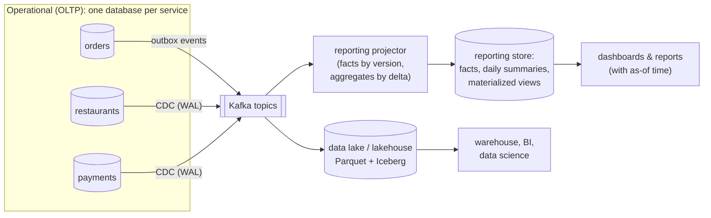

# 34. Reporting & Analytics Across Services

<div class="badges" markdown><span class="badge badge-l2">L2 · Practitioner</span><span class="badge badge-l3">L3 · Senior/Lead</span><span class="badge badge-l4">L4 · Architect</span><span class="badge badge-meta">CDC · logical replication · materialized views · incremental aggregates · data mesh</span></div>

<div class="grid two" markdown>

!!! info "Prerequisites"
    - [Chapter 12](../architecture-patterns/ch12-database-per-service.md): a database per service
    - [Chapter 13](../architecture-patterns/ch13-cqrs-event-sourcing.md): read models
    - [Chapter 15](../architecture-patterns/ch15-outbox-inbox-cdc.md): outbox and CDC

!!! abstract "What you'll learn"
    - **Where a cross-service report should run**: composing three services' APIs took **2.7–2.9 s** and made their databases read **12.7–13.4 million rows**; a federated query pulled **1.36 million rows** across; the same SQL on a replicated reporting copy took **0.72–0.76 s**, a pre-aggregated table **0.14 s**, with no load on the services
    - **What reports cost the primary**: two report loops on the order service's database cut its writes by **67–69%**; on a separate reporting copy, **no measurable change**. A report held open for 30 s left **94,000–97,000 dead rows** VACUUM couldn't remove
    - **CDC by logical replication**: changes reached the copy in **3–4 ms (p99)**; a stopped consumer made the order service keep **132–158 MB of WAL** in 60 s, and with a cap the slot was **invalidated** and the copy had to be rebuilt
    - **Keeping aggregates current**: a plain view refresh blocked readers for **3.0–3.4 s**; `CONCURRENTLY` blocked none but took **7× longer**; deltas per event kept the table current with no blocking. Counting events overstated revenue by **7.1%**, counting with deduplication by **1.9%**; state with versions was **exact**, and bucketing by the UTC day misplaced **4%** of orders

</div>

---

## 1 · Introduction & Context

### The finance report that took down checkout

Six months after FoodFleet split its monolith, finance asked for something that used to be one SQL query: *net revenue per restaurant last month, after refunds, with restaurant names.* The data now lived in three services: orders, restaurants and payments.

- **First attempt: a script calling the services' APIs.** It made hundreds of calls, pulled hundreds of thousands of rows through the APIs, took minutes for a month of data, and the payments team found it in their rate-limit alerts.
- **Second attempt: read-only access to the services' databases.** An analyst's query joined them through `postgres_fdw` on the order service's primary. Checkout slowed down every afternoon, and the orders table kept growing because VACUUM couldn't clean behind the analyst's open transaction. Worse, every schema change in any service now risked breaking finance.
- **Third attempt: a reporting store fed by change events.** Fast and harmless to the services, until finance noticed the numbers were **7% too high** (redelivered events counted twice, corrected amounts added twice) and that orders placed after midnight showed up on the previous day.

This chapter measures each approach on PostgreSQL, then builds a reporting store that stays correct under the realities of event delivery, says how fresh it is, and doesn't hurt the services it reads from. It ends with how the same ideas scale to data lakes and data mesh.

### Where it comes from

<ul class="mh-timeline">
<li><span class="when">1988–1996 · The data warehouse</span><span class="what">Devlin and Murphy (1988), Inmon (1992), Kimball's dimensional modelling (1996): copy operational data into a separate store shaped for analysis: facts and dimensions.</span></li>
<li><span class="when">2006–2010 · Hadoop and the data lake</span><span class="what">Cheap storage for raw data in any shape; "schema on read". James Dixon names the data lake in 2010.</span></li>
<li><span class="when">2011–2014 · Logs as the integration backbone</span><span class="what">Kafka at LinkedIn; Jay Kreps's "The Log" and the Kappa architecture: derive every view by replaying a stream of changes.</span></li>
<li><span class="when">2014–2016 · Logical decoding and Debezium</span><span class="what">PostgreSQL 9.4 decodes its WAL into row changes; Debezium turns databases' logs into Kafka topics. PostgreSQL 10 adds built-in logical replication (2017).</span></li>
<li><span class="when">2017–2020 · Table formats and the lakehouse</span><span class="what">Apache Iceberg (Netflix), Delta Lake, Hudi: transactional tables on object storage; warehouses and lakes converge.</span></li>
<li><span class="when">2019 · Data mesh</span><span class="what">Zhamak Dehghani: domain teams own their analytical data as products, with contracts and service levels, on a self-serve platform.</span></li>
</ul>

---

## 2 · Core Concepts & Terminology



OLTP and OLAP
:   Online transaction processing: many small reads and writes of current state (place an order). Online analytical processing: few large reads over history (revenue per city per month). They want different storage, indexes and isolation, and they hurt each other on the same database.

Reporting store (read model)
:   A database owned by a reporting service, built from other services' data and shaped for queries. No other service writes to it; it can always be rebuilt from the sources.

Change data capture (CDC)
:   Reading a database's committed changes from its log (PostgreSQL's WAL) and publishing them as a stream. Debezium does this for many databases; PostgreSQL's logical replication does it natively. It sees every change without the application's cooperation, but it exposes the source's table structure.

Outbox events
:   Changes the service publishes deliberately, in its own vocabulary and versioned like an API (chapter 15). The better default for data other teams depend on.

Replication slot
:   The source's bookmark for one CDC consumer: the source keeps every WAL segment the consumer hasn't confirmed. A consumer that stops makes the source's disk fill up.

Fact and dimension
:   A fact is an event or measurement (an order with an amount); a dimension describes it (the restaurant, the city, the day). Star schemas join facts to dimensions.

Materialized view
:   A query whose result is stored and refreshed on demand. In PostgreSQL a refresh recomputes everything; `CONCURRENTLY` lets reads continue during it.

Incremental aggregate
:   A summary kept current by applying each change's effect (a delta) instead of recomputing.

Freshness
:   How far behind its sources a report is. A reporting store is always behind; the question is by how much, and whether the report says so.

Data lake, lakehouse
:   Raw and refined data in open file formats (Parquet) on object storage; table formats (Iceberg, Delta) add transactions, schema evolution and time travel so engines can query it like a warehouse.

Data mesh and data products
:   Analytical data owned by the domain team that produces it and published as a product: a documented schema, an owner, a freshness and quality objective, and a stable interface, on a shared self-serve platform.

---

## 3 · How It Works Internally

### Why not query the services' databases?

Three costs, all measured below. **Load**: a report is a large scan and aggregation; on the primary it competes with order writes for CPU and I/O. **Garbage**: a long transaction holds a snapshot, and VACUUM can't remove row versions that snapshot might still see, so tables bloat while the report runs. **Coupling**: the report now depends on three teams' private schemas; any migration can break it, and those teams can no longer change their tables freely (chapter 12). A federated query (`postgres_fdw`, Trino, Presto) removes the copying but none of the three costs: it can't push a join across two servers down, so it pulls rows from each and joins them itself.

### CDC by logical replication

PostgreSQL writes every change to its WAL. With `wal_level = logical`, a **replication slot** decodes committed changes for one consumer, in commit order, and remembers the last position the consumer confirmed (`confirmed_flush_lsn`) and the oldest WAL it still needs (`restart_lsn`). The consumer (a PostgreSQL subscription here; Debezium in a Kafka pipeline) starts with a consistent snapshot of the tables (the initial copy) and then streams changes.

The slot is a promise: **the source keeps all WAL from `restart_lsn` on until the consumer confirms it.** A consumer that is down, slow or deleted without dropping its slot makes the source's disk fill up. Since PostgreSQL 13, `max_slot_wal_keep_size` caps what a slot may hold back; past it the slot is invalidated and the consumer must start over from a new snapshot. That is the right trade for the service (its disk is safe) and the reporting team must be able to rebuild.

### Incremental aggregates that stay correct

Events arrive at least once and not always in order (chapters 25 and 28). Counting events ("add the amount on DELIVERED, subtract on REFUNDED") is wrong as soon as an event is redelivered or an order's amount is corrected. Deduplicating by event id fixes the first problem but not the second: a correction is a new event about the same order.

The projector instead keeps **the latest state of each order**, replaced only by a newer version, and adjusts the daily totals by **the difference between the order's old contribution and its new one**, in one statement:

```java
--8<-- "code/chapters/ch34-reporting-analytics/src/main/java/dev/foodfleet/ch34/projection/OrderFactProjector.java:23:59"
```

A duplicate or an older version changes nothing (`up` is empty, so `delta` is empty). A correction subtracts the old amount and adds the new. A refund subtracts the order. An order whose restaurant or day changed moves from one row to another. An advisory lock per order serialises events for the same order, whichever consumer thread they arrive on.

### Whose day is it?

A "day" in a report is a business day in the city's time zone. India is UTC+5:30, so every order placed between midnight and 05:30 in Bengaluru has the previous date in UTC. Computing `placed_at::date` on a UTC server puts the late-night orders on the wrong day, and the error is concentrated where it is most visible: daily totals and day-over-day comparisons. The projector stores `business_day` computed once, with the configured zone.

### Materialized views

`REFRESH MATERIALIZED VIEW` recomputes the query and swaps the result in under an `ACCESS EXCLUSIVE` lock: readers wait for the whole refresh. `REFRESH ... CONCURRENTLY` computes the new result alongside, compares it with the old one by a unique index, and applies the differences with ordinary inserts, updates and deletes, so readers continue; it costs more work and needs that unique index. Both recompute everything, however little changed, and the view is as old as its last refresh. An incremental table costs a little work per change and is always current; a materialized view is simpler and fits summaries of summaries, refreshed rarely.

### Data lakes and data mesh

At larger scale the same flow continues past the reporting store: change events land in object storage as Parquet files in an Iceberg or Delta table (partitioned by day, compacted, with schema evolution and time travel), and warehouses or query engines read them. The design questions are the ones measured in this chapter: where the data comes from (outbox events or CDC), how late and duplicated changes are merged (by key and version, as here, using `MERGE`), what a business day is, and how fresh each table is. Data mesh adds **ownership**: the orders team publishes "orders" as a data product (schema, semantics, freshness objective, owner) as deliberately as it publishes its API, and a central platform provides the pipelines, storage and catalogue. This chapter's environment can't run a lake engine, so those parts are described, not measured.

---

## 4 · Design Considerations & Trade-offs

Two PostgreSQL 16.13 clusters in a 2-vCPU container: the services' cluster (`wal_level = logical`) pinned to one CPU, the reporting cluster to the other, standing in for separate machines. 20,000 restaurants in 8 cities, 2,000,000 orders over 90 days, payments with ~3% refunds; the reporting copy is built by logical replication (initial copy of the three tables: 8.2–10.2 s). `verify/run.sh`, two full runs (the data is regenerated for each); ranges show both.

### Measured: one report, four ways

Net revenue per restaurant in Bengaluru over 30 days, top 20 with names: data from the restaurants, orders and payments services. API calls pay a 0.5 ms round trip; the federated and reporting queries run over local sockets. *Rows read by services* counts rows the services' own databases read for the report.

| Approach | Time | Calls | Rows sent | Rows read by services |
|---|---:|---:|---:|---:|
| Compose the three services' APIs | 2,716–2,907 ms | 620–656 | 204,055–216,976 | 12.7–13.4 M |
| Federated query (`postgres_fdw`) | 2,192–2,278 ms | 1 | 1,355,001–1,355,124 | 8.0 M |
| **Same SQL on the reporting copy** | **720–764 ms** | 1 | 20 | **0** |
| **Pre-aggregated daily table** | **144 ms** | 1 | 20 | **0** |

- **API composition was the slowest and the heaviest on the services**: hundreds of calls, every BLR order of the month shipped through the APIs, and the services read millions of rows to serve them. It also puts the join logic in a script nobody owns.
- **The federated query was barely faster and pulled 1.36 M rows across**: `postgres_fdw` can't push a join between two servers down, so it fetched the rows and joined them locally.
- **The reporting copy answered the same SQL about 3× faster than the federated query, with no load on the services**; a pre-aggregated table took 144 ms. All four gave the same answer.

### Measured: what reports do to the primary

The order service's write path (pgbench, 8 clients, 30 s; insert an order, then update it) while two report loops (daily revenue over all orders) run on its database, on the reporting copy, or nowhere.

| Reports run on | Writes/s | p50 | p99 | Reports completed |
|---|---:|---:|---:|---:|
| Nowhere (baseline) | 3,084–3,144 | 2.4 ms | 5.2–5.5 ms | — |
| **The order service's primary** | **957–1,045** | 6.8–7.9 ms | **23.7–24.8 ms** | 14 |
| The reporting copy (separate CPU) | 3,178–3,291 | 2.2–2.4 ms | 5.2–5.9 ms | 14 |
| Nowhere (baseline, again) | 3,105–3,204 | 2.4 ms | 4.9–5.3 ms | — |

| A report transaction held open for 30 s of writes, on | Dead rows VACUUM couldn't remove | After the report ended |
|---|---:|---:|
| **The order service's primary** | **93,879–97,089** | 0 |
| The reporting copy | 0 | 0 |

- **Reports on the primary took 67–69% of its write throughput** here and multiplied p99 by four to five. On real hardware the share differs; the competition doesn't.
- **On a separate copy, the writes didn't notice.** Logically replicated copies also don't hold back VACUUM on the source; a physical replica with `hot_standby_feedback = on` does, so long reports on a hot standby can bloat the primary.
- **A long transaction on the primary pins every row version it might see**: ~94,000–97,000 dead rows in 30 s here, all removable once it ended. Hours-long reports make tables and indexes grow for good.

### Measured: CDC lag, a stopped consumer, and the slot cap

Logical replication from the order service's database to the reporting copy, with the same write load.

| Situation | Measured |
|---|---|
| Steady state, ~3,000 writes/s | Commit to copy: p50 2–3 ms, p99 3–4 ms, max 5–6 ms |
| Consumer stopped 10 s / 30 s / 60 s | WAL kept by the order service for the slot: 30–43 / 74–82 / 132–158 MB; the copy 10 / 30 / 60 s behind |
| Consumer restarted | Caught up in 6.1 s |
| Consumer stopped, `max_slot_wal_keep_size = 64MB` | Slot invalidated after 7 s (at most 57–62 MB kept); 15 s after restarting, the consumer was still failing and the copy 96 s behind |
| Rebuild from a fresh snapshot | 3.8–4.4 M orders copied in 27–31 s |

- **In steady state CDC is fast**: a few milliseconds from commit to the copy on one machine; across networks and through Kafka, expect seconds.
- **A stopped consumer costs the source disk** at the rate it writes WAL (here ~2.2–2.6 MB a second), indefinitely, unless capped. The copy falls behind second for second, **and nothing in its data says so**: hence an explicit freshness indicator.
- **With `max_slot_wal_keep_size`, the source was protected and the slot was invalidated**; the consumer failed with "can no longer get changes from replication slot" and the copy had to be rebuilt from a fresh snapshot. Rebuilding must be a routine, rehearsed operation.

### Measured: keeping a summary current

A per-restaurant, per-day summary of the orders (~0.9 M rows), read by 4 dashboard clients with point lookups, while 20,000 new delivered orders are folded in.

| Update | Took | Reads meanwhile | Longest read | Reads > 100 ms |
|---|---:|---:|---:|---:|
| `REFRESH MATERIALIZED VIEW` | 3.09–3.45 s | 861–978 | **3,024–3,381 ms** | 4 (every reader) |
| `REFRESH MATERIALIZED VIEW CONCURRENTLY` | 22.65–24.12 s | 311,073–322,032 | 26–28 ms | 0 |
| **Incremental table: a delta per new order** | 23.36–23.53 s (spread over time as orders arrive) | 311,563–327,356 | **17–20 ms** | 0 |

- **A plain refresh blocked every reader for the whole refresh.**
- **`CONCURRENTLY` blocked nobody but took ~7× longer** and still recomputed all ~0.9 M rows to fold in 20,000 orders.
- **Deltas per change** never blocked readers and kept the table current to the last event; afterwards it matched a full recomputation exactly. The cost is per-event work and the correctness rules above.

### Measured: incremental aggregates under real event delivery

20,000 orders over a week; each change publishes the order's state (PLACED, then DELIVERED or CANCELLED; 2% of delivered orders later corrected to a new amount, 3% refunded). The stream has 5% redeliveries and some newer events overtaking older ones. Each projection runs through SQL on the reporting cluster; totals are compared with the true ones from the orders' final states.

| Projection | Events/s | Restaurant-days wrong | Total revenue | Worst day |
|---|---:|---:|---:|---:|
| Counters | 3,964–4,820 | 839 of 3,271 | +7.14% | 8.2% |
| Counters + dedup by event id | 2,157–2,503 | 294 of 3,269 | +1.94% | 2.3% |
| **State + version + deltas (the projector)** | 945–1,008 | **0 of 3,268** | **+0.00%** | **0.0%** |
| … with the day taken in UTC | 919–959 | 969 of 3,383 | +0.00% | 4.1% |

Orders placed between 00:00 and 05:30 IST (a different UTC date): **4.0%**.

- **Counting events overstated revenue by 7.1%**, and every day was wrong by up to 8.2%.
- **Deduplicating by event id was not enough**: corrections are new events, so they were counted again (+1.9%).
- **State with versions and deltas was exact** at a fifth of the counting speed (one round trip per statement from one client here; batching and parallel partitions raise it).
- **The UTC day kept the total right and put 4% of orders on the wrong day**, so 969 restaurant-days and every daily total (up to 4.1%) were off.

### Choosing

| Need | Approach |
|---|---|
| A few numbers, one service's data, low volume | That service's API or its own read model |
| Cross-service operational reports (minutes fresh) | A reporting service: events or CDC into its own store, incremental aggregates |
| Dashboards over large history | Pre-aggregated tables; materialized views refreshed `CONCURRENTLY` for slow-moving summaries |
| Ad-hoc analysis, data science, years of history | A data lake or warehouse fed by the same change streams |
| Many teams producing and consuming analytical data | Data products with owners, contracts and freshness objectives (data mesh) on a shared platform |
| Never | Reports joining the services' production databases |

---

## 5 · Hands-on Implementation

```text
ch34-reporting-analytics/
├── src/main/java/dev/foodfleet/ch34/
│   ├── projection/ OrderEvent, OrderEventListener (Kafka), OrderFactProjector (state by version, deltas, IST days)
│   ├── report/     RevenueReports, ReportController, MonthlyViewRefresher (REFRESH ... CONCURRENTLY)
│   └── freshness/  Freshness (as-of time, lag, stale against an objective)
├── src/main/resources/db/migration/V1__reporting_store.sql
└── verify/  common.py (two clusters, three services' data), e1–e5, check_service_sql.py, run.sh
```

### 🟢 Level 1: an inventory of reports

<div class="badges" markdown><span class="badge badge-l1">L1 · Foundation</span></div>

For every report, write down: which services' data it needs, how fresh it must be, how far back it goes, who uses it for what decision, and the business definitions (what counts as revenue; whose day). Reports that need one service's data are that service's job. Reports that need several, or history, get a reporting store. "Real time" usually means "a few minutes old, and saying so".

### 🔵 Level 2: a reporting store and reports that say how fresh they are

<div class="badges" markdown><span class="badge badge-l2">L2 · Practitioner</span></div>

```sql
--8<-- "code/chapters/ch34-reporting-analytics/src/main/resources/db/migration/V1__reporting_store.sql"
```

```java
--8<-- "code/chapters/ch34-reporting-analytics/src/main/java/dev/foodfleet/ch34/freshness/Freshness.java:6:27"
```

Every report response carries `freshness`: the event time of the newest change included, the lag, and whether it exceeds the objective (`app.reporting.freshness-objective`). Dashboards show it; alerts fire on it.

### 🟣 Level 3: a projector that survives real event delivery

<div class="badges" markdown><span class="badge badge-l3">L3 · Senior/Lead</span></div>

```java
--8<-- "code/chapters/ch34-reporting-analytics/src/main/java/dev/foodfleet/ch34/projection/OrderFactProjector.java:76:87"
```

```yaml
--8<-- "code/chapters/ch34-reporting-analytics/src/main/resources/application.yml:28:32"
```

The container test applies duplicates, late events, refunds and a late-night order against real PostgreSQL:

```java
--8<-- "code/chapters/ch34-reporting-analytics/src/test/java/dev/foodfleet/ch34/ReportingContainerTest.java:52:81"
```

The projection is rebuildable: a new reporting database replays the topic from the beginning (`auto-offset-reset: earliest`, a compacted topic keyed by order id keeps the latest state of every order), or is seeded from a CDC snapshot.

### 🔴 Level 4: an analytical data platform

<div class="badges" markdown><span class="badge badge-l4">L4 · Architect</span></div>

- **One path for change data**: outbox events for data other teams depend on (versioned like APIs, chapter 27), CDC for the rest; both into Kafka, from which reporting stores, search indexes, caches and the lake are derived.
- **Slots as managed resources**: every CDC slot has an owner, a lag alert and a cap (`max_slot_wal_keep_size`); dropping a consumer drops its slot; rebuilding from a snapshot is automated.
- **The lake**: change streams merged into Iceberg/Delta tables by key and version (`MERGE`), partitioned by business day in the business's zone, compacted, with retention and access controls (personal data!) applied at the platform.
- **Data products**: each domain publishes its analytical datasets with an owner, schema and semantics, a freshness and completeness objective, and contract tests in CI; a catalogue makes them findable. The platform team runs the pipelines; the domains own the meaning.
- **Reconciliation**: daily checks that reporting totals match the systems of record (orders count, captured minus refunded) within tolerance, with alerts, before finance sees a number.

### Run and verify

```text
$ SRC_PGHOST=... SRC_PGPORT=... RPT_PGHOST=... RPT_PGPORT=... PGUSER=postgres verify/run.sh
== E5 incremental correctness
20,000 orders, 43,021 events delivered (2,081 redeliveries, some out of order).

projection              events/s   restaurant-days wrong  total revenue  worst day
counters                   3,964           839 of 3,271           +7.14%       8.2%
counters + dedup           2,503           294 of 3,269           +1.94%       2.3%
state + version            1,008             0 of 3,268           +0.00%       0.0%
... day in UTC               959           969 of 3,383           +0.00%       4.1%

orders placed between 00:00 and 05:30 IST (a different UTC date): 4.0%

...

== E3 CDC lag and slots
Steady state: pgbench writes for 30 s; a probe order every 250 ms, timed until it is in the copy.

  writes/s 3,105; probes 110; lag p50 3 ms, p99 4 ms, max 5 ms

The consumer stops for 60 s while writes continue:

   after   WAL retained for the slot   copy behind by
    10 s                      30 MB             10 s
    20 s                      51 MB             20 s
    30 s                      74 MB             30 s
    40 s                      94 MB             40 s
    50 s                     113 MB             50 s
    60 s                     132 MB             60 s
  re-enabled: caught up in 6.1 s; WAL retained afterwards 13 MB

With max_slot_wal_keep_size = 64MB, the consumer stops again:

  slot status: lost after 7 s, at most 57 MB retained (the order service's disk was protected)
  consumer re-enabled, 15 s later: caught up False, copy behind by 96 s (the consumer keeps failing: the slot can no longer return changes)
  rebuilt by a fresh initial copy: 4,396,270 orders in 31.1 s

$ PGHOST=... PGPORT=... python3 verify/check_service_sql.py
PASS Flyway migration V1 applies
PASS a new order is applied
...
PASS an order at 01:30 IST counts on the IST day, not the UTC one
PASS the monthly view refreshes CONCURRENTLY
PASS freshness is the newest event time applied

all checks passed
```

!!! question "Try it"
    1. In E2, run the reports on a physical streaming replica with `hot_standby_feedback = on`. What happens to the primary's dead rows?
    2. In E5, apply the stream with two concurrent consumers split by order id, then by restaurant id. Which split keeps the projector correct without the advisory lock?
    3. Change E4 to fold in 200 orders instead of 20,000. How long does `REFRESH ... CONCURRENTLY` take now, and why?
    4. Add a `restaurants` dimension to the reporting store from CDC. A restaurant moves from one city to another: which historical reports should change, and how would you model that (slowly changing dimension type 1 or 2)?

---

## 6 · Production Readiness

- [x] **No report reads a service's production database**; reports read a reporting store, a lake or the owning service's API
- [x] **Every report shows its as-of time**, and stale data is flagged against a freshness objective
- [x] **Projections are idempotent and order-tolerant**: state by key and version, aggregates by delta; tested with duplicates and late events
- [x] **Business days and periods are computed in the business's time zone**, once, and stored
- [x] **CDC slots are monitored** (retained WAL, lag) **and capped** (`max_slot_wal_keep_size`); unused slots are dropped
- [x] **The reporting store can be rebuilt** from a snapshot or by replaying events, and the rebuild is rehearsed
- [x] **Materialized views refresh `CONCURRENTLY`**, with a unique index, a lock timeout and a schedule matched to their freshness need
- [x] **Totals are reconciled** with the systems of record daily
- [x] **Analytical data has owners, schemas and contracts**; breaking changes go through the same process as API changes
- [x] **Personal data** in reporting stores and lakes is minimised, access-controlled and covered by retention and deletion

---

## 7 · Anti-patterns & Pitfalls

!!! pitfall "Incident 1: the afternoon checkout slowdown"
    **Context.** Analysts had read access to the order service's primary for "just a few queries".
    **Symptoms.** Checkout latency rose every afternoon; the orders table and its indexes grew week after week although VACUUM ran.
    **Root cause.** Large analytical queries competed with order writes, and long-open transactions kept VACUUM from removing dead rows. Measured: two report loops cut write throughput by 67–69%; a report held open for 30 s left 94,000–97,000 dead rows behind.
    **Fix.** Revoked access to production databases; reports moved to the reporting store fed by events. Measured on a separate copy: no change in write throughput, nothing pinned on the primary.

!!! pitfall "Incident 2: the slot that filled the disk"
    **Context.** A Debezium connector fed the analytics pipeline from the payments database. The connector was decommissioned when the pipeline moved; its replication slot was not dropped.
    **Symptoms.** Weeks later the payments database ran out of disk and stopped accepting writes.
    **Root cause.** The orphaned slot made PostgreSQL keep every WAL segment since the connector stopped. Measured: 132–158 MB in one minute at our write rate, without bound.
    **Fix.** `max_slot_wal_keep_size` on every database with slots, alerts on retained WAL per slot, and slot drop as part of decommissioning. Measured with a 64 MB cap: the slot was invalidated instead, and the consumer rebuilt its copy from a snapshot.

!!! pitfall "Incident 3: revenue 7% too high, and on the wrong day"
    **Context.** The first reporting projection added each DELIVERED event's amount to the day's total and subtracted refunds.
    **Symptoms.** Finance's reconciliation showed revenue several percent above captured payments; the "midnight" orders appeared on the previous day.
    **Root cause.** Redelivered events and amount corrections were counted again, and days were computed in UTC. Measured: +7.1% total revenue counting events, +1.9% with deduplication by event id, and 4% of orders on the wrong day with UTC days.
    **Fix.** Facts kept by order id and version, totals changed by deltas between old and new state, business day computed in the city's zone. Measured: exact.

| Anti-pattern | Symptom | Fix |
|---|---|---|
| Reports on services' production databases | Slow writes, bloat, schema lock-in | A reporting store fed by events or CDC |
| API composition for bulk reports | Slow, heavy on every service | Replicated data, pre-aggregated |
| Federated joins across services' databases | All rows pulled across, all costs kept | Copy the data, then join |
| Counting events into totals | Duplicates and corrections double-count | State by version, deltas |
| Dedup by event id as the only defence | Corrections still double-count | Key the state by entity and version |
| `date(timestamp)` on a UTC server | Late-night orders on the wrong day | Business day in the business's zone |
| Orphaned or uncapped replication slots | Source disk fills, database stops | Slot ownership, `max_slot_wal_keep_size`, alerts |
| Plain `REFRESH MATERIALIZED VIEW` during use | Readers blocked for the whole refresh | `CONCURRENTLY` with a unique index, or incremental tables |
| Reports without an as-of time | Decisions on silently stale numbers | Freshness in every report, objectives, alerts |
| CDC of private tables as a public contract | Every schema change breaks consumers | Outbox events for shared data; contracts |

---

## 8 · Enterprise Case Study

### FoodFleet: a reporting service and a path to the lake

!!! decision "ADR-034: Reports come from a reporting store built from change events, never from the services' databases"
    **Status:** Accepted · **Date:** 2025-04-28

    **Context.** Finance and operations need cross-service reports (orders, restaurants, payments). Composing APIs was slow and loaded every service; reading the services' databases slowed checkout and bloated tables; the first event-based projection overstated revenue and misdated late-night orders. Measured on PostgreSQL: API composition 2.7–2.9 s for one 30-day report with 620–656 calls; reports on the primary cut its writes by 67–69%; counting events +7.1%, UTC days 4% of orders misdated; state with versions exact.

    **Decision.** A reporting service owns a reporting store fed by order, payment and restaurant events from Kafka (outbox events where published; CDC for the rest, with capped and monitored slots). The projector keeps facts by key and version and adjusts aggregates by deltas; business days use the city's time zone. Every report returns its as-of time and a stale flag against a 5-minute objective. Monthly summaries are materialized views refreshed `CONCURRENTLY`. The store is rebuildable by replay and reconciled daily with payments. No report or person reads the services' production databases. Long-history analysis moves to a lake fed by the same topics when needed; datasets there have owners and contracts.

    **Consequences.** ✅ Cross-service reports in under a second, with no load on the services. ✅ Totals that reconcile, on the right day. ✅ Services keep their schemas private. ⚠️ Reports are minutes behind, and say so. ⚠️ One more service, pipeline and set of slots to run. ⚠️ Event contracts must carry everything reports need (amounts, versions, times), which shapes the producers' events.

### Fintech analogue: regulatory and finance reporting 🔴

Banks report positions, exposures and transactions to regulators with deadlines and penalties, so their reporting pipelines are built for **reconciliation and lineage** first: every reported number traces back to source records, totals are reconciled with the ledger before submission, and corrections are applied as new versions with full history (bitemporal data: when it happened and when we knew it). Business dates follow the booking calendar of each legal entity, not UTC. Data products such as "trades" and "positions" have named owners and contracts (the BCBS 239 principles demand accuracy, completeness and timeliness of risk data), and CDC slots on core banking databases are monitored as production-critical resources.

### E-commerce analogue: real-time dashboards at sale time

Large retailers stream orders, page views and inventory changes into Kafka; real-time dashboards (sales per minute, conversion, stock-outs) read incrementally maintained aggregates, while the lake (Iceberg or Delta on object storage) holds the full history for analysts and models. During sale events, operational databases are protected from analytical load entirely; dashboards show their freshness, and late events (mobile apps going offline) are merged by key and version, with the "day" defined in each market's time zone.

---

## 9 · Interview Q&A + Summary

#### Q1. How do you build a report that needs data from several microservices? · <span class="badge badge-l2">L2</span><span class="badge badge-l3">L3</span> · Flipkart · Cognizant

**Short answer:** Not by joining their databases. For small, rare queries, compose their APIs; for real reports, build a reporting store owned by a reporting service and fed by their events or CDC, shaped for the queries. Measured: API composition 2.7–2.9 s with hundreds of calls, a reporting copy under a second, a pre-aggregated table about 0.14 s.

#### Q2. Why not give analysts read access to the services' databases? · <span class="badge badge-l2">L2</span> · SAP · Cognizant

**Short answer:** Load, bloat and coupling. Measured: two report loops on the primary cut write throughput by 67–69%; a long report transaction left 94,000–97,000 dead rows VACUUM couldn't remove; and every service's schema becomes a public contract.

#### Q3. Outbox events or CDC for feeding analytics? · <span class="badge badge-l3">L3</span> · Amazon · Goldman Sachs

**Short answer:** Outbox events for data other teams depend on: deliberate, in the domain's language, versioned. CDC when you need everything without changing the source, or for internal pipelines, accepting that it exposes table structure. Many platforms use both into the same Kafka backbone.

#### Q4. What is a replication slot, and how can it take a database down? · <span class="badge badge-l3">L3</span> · Goldman Sachs · JP Morgan

**Short answer:** The source's bookmark for a logical (or physical) replication consumer; WAL is kept until the consumer confirms it. A stopped or orphaned consumer makes WAL accumulate until the disk is full. Measured: 132–158 MB a minute at our write rate. Cap it with `max_slot_wal_keep_size`, alert on retained WAL, drop slots with their consumers.

#### Q5. How do you keep aggregates correct when events are duplicated or out of order? · <span class="badge badge-l3">L3</span> · Amazon · Flipkart

**Short answer:** Keep the latest state per entity, replaced only by a higher version, and change aggregates by the delta between old and new state in the same transaction. Measured: counting events +7.1%, counting with dedup +1.9% (corrections), state with versions exact.

#### Q6. Materialized view or summary table? · <span class="badge badge-l3">L3</span> · SAP · Cognizant

**Short answer:** A materialized view is simple but recomputes everything on refresh; a plain refresh blocks readers (measured: all readers waited 3.0–3.4 s), `CONCURRENTLY` doesn't but took 7× longer. An incremental summary table is always current and never blocks, at the cost of per-change logic. Views for slow-moving summaries, incremental tables for live dashboards.

#### Q7. What's the most common bug in daily reports? · <span class="badge badge-l2">L2</span><span class="badge badge-l3">L3</span> · Flipkart · any

**Short answer:** Days in the wrong time zone. `date(placed_at)` on a UTC server put 4% of Bengaluru orders (00:00–05:30 IST) on the previous day in our data. Compute the business day in the business's zone once and store it.

#### Q8. How do you know a report is up to date? · <span class="badge badge-l3">L3</span> · JP Morgan · Amazon

**Short answer:** You don't, unless it tells you. Track the event time of the newest change applied, show it as "as of", compare it with a freshness objective, alert when exceeded. Measured: with the CDC consumer stopped, the copy fell 60 s behind in 60 s and nothing in the data showed it.

#### Q9. Data warehouse, data lake, lakehouse: what's the difference? · <span class="badge badge-l3">L3</span> · Amazon · SAP

**Short answer:** A warehouse stores modelled, cleaned data in a managed engine with schema on write. A lake stores raw and refined files cheaply in open formats, schema on read. A lakehouse adds table formats (Iceberg, Delta, Hudi) to the lake for transactions, schema evolution and time travel, so warehouse-style queries run on lake storage.

#### Q10. What is data mesh, and when is it worth it? · <span class="badge badge-l4">L4</span> · Goldman Sachs · SAP

**Short answer:** Domain teams own and publish their analytical data as products (owner, schema, semantics, freshness and quality objectives) on a self-serve platform, with federated governance. Worth it when a central data team has become the bottleneck for many domains; without a strong platform and clear ownership it becomes many inconsistent pipelines.

#### Q11. A reporting store disagrees with the payments system. What do you do? · <span class="badge badge-l3">L3</span><span class="badge badge-l4">L4</span> · JP Morgan · Goldman Sachs

**Short answer:** The system of record wins. Reconcile daily per day and entity, find the class of difference (missed events, duplicates, corrections, time zones, late data), fix the projection, and rebuild the affected range by replay. Reports carry their as-of time so known gaps are explainable.

#### Q12. Design analytics for a food-delivery platform. · <span class="badge badge-l4">L4</span> · Swiggy-/Zomato-style system design rounds

**Short answer:** Services publish outbox events (orders, payments, deliveries) to Kafka; CDC for the rest with capped slots. A reporting service maintains facts by version and incremental aggregates by city's business day for operations dashboards (minutes fresh, with as-of times). The same topics land in an Iceberg lake for history, finance reconciliation and data science. Datasets have owners and contracts; production databases are never queried for analytics.

### Key takeaways

- **Reports don't belong on the services' databases**: copy the data to a store built for reading, through events or CDC.
- **A copy is always behind**: measure it, show it, alert on it.
- **Make aggregates correct by construction**: state by version, deltas between states, business days in the business's zone.
- **CDC slots protect consistency and threaten disks**: cap, monitor and own them; make rebuilding routine.
- **At scale the same principles become a lake and data products**: owned, contracted, reconciled data.

### Further reading

- Ralph Kimball and Margy Ross, *The Data Warehouse Toolkit* (3rd ed., 2013)
- Jay Kreps, [The Log: What every software engineer should know about real-time data's unifying abstraction](https://engineering.linkedin.com/distributed-systems/log-what-every-software-engineer-should-know-about-real-time-datas-unifying) (2013)
- Martin Kleppmann, *Designing Data-Intensive Applications* (2017), chapters 10–11
- Zhamak Dehghani, *Data Mesh: Delivering Data-Driven Value at Scale* (2022)
- PostgreSQL documentation, [Logical Replication](https://www.postgresql.org/docs/16/logical-replication.html), [Replication Slots](https://www.postgresql.org/docs/16/warm-standby.html#STREAMING-REPLICATION-SLOTS) and [REFRESH MATERIALIZED VIEW](https://www.postgresql.org/docs/16/sql-refreshmaterializedview.html)
- Debezium documentation, [PostgreSQL connector](https://debezium.io/documentation/reference/stable/connectors/postgresql.html)
- Apache Iceberg, [Table spec](https://iceberg.apache.org/spec/)

---

**Previous:** [← 33. Database Scaling & Zero-Downtime Migrations](ch33-database-scaling.md) · **Next:** [Part 5 — Security →](../security/index.md)
